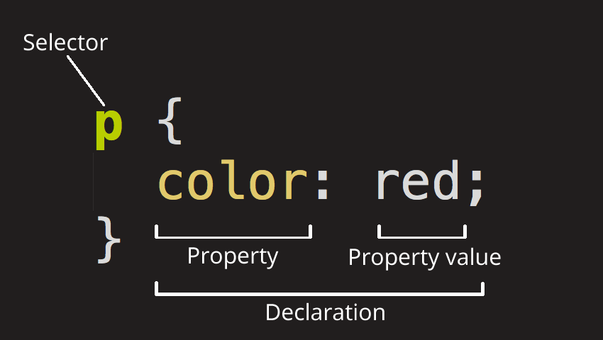
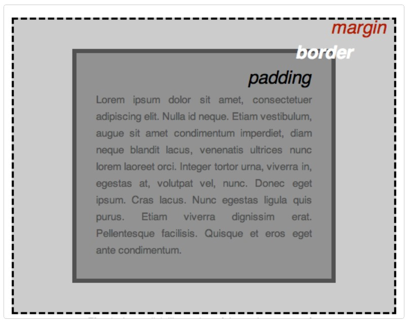

# CSS学习笔记

## CSS概述

CSS（Cascading Style Sheets，层叠样式表）是为Web内容添加样式的代码。CSS也不是真正的编程语言，甚至不是标记语言。CSS是一门样式表语言，也就是人们可以用它来选择性地为HTML元素添加样式。

如有如下的html文档：

```html
<!DOCTYPE html>
<html>
    <head lang="zh">
        <title>html页面基础实践</title>
        <meta charset="utf-8"/>
        <meta name="viewport" content="width=device-width"/>
    </head>
    <body>
        <p>
            学习HTML+CSS+JavaScript
        </p>
    </body>
</html>
```

我们想要让`<p>`元素包围的文本颜色为红色，就可以使用CSS去实现。

以内部样式表的方式使用CSS为例，在`<head>`元素内使用`<style>`元素，`<style>`内编写CSS规则：

```html
<!DOCTYPE html>
<html>
    <head lang="zh">
        <title>html页面基础实践</title>
        <meta charset="utf-8"/>
        <meta name="viewport" content="width=device-width"/>
        <style type="text/css">
            P{
                color: red;
            }
        </style>
    </head>
    <body>
        <p>
            学习HTML+CSS+JavaScript
        </p>
    </body>
</html>
```

html页面效果：


***备注：CSS 文档中所有位于 `/*` 和 `*/` 之间的内容都是 CSS 注释。浏览器在渲染代码时会忽略注释。CSS 注释是一种让你写下关于你的代码或逻辑的有用注解的方式。***

## CSS样式表引入到HTML文档

将一个样式表引入到HTML文档，有四种方法：

1. 内联样式表
2. 内部样式表
3. 外部样式表
4. `@Import`标记引入

### 内联样式表

将要表现的样式与内容混杂在一起，即把CSS规则混合到HTML元素中使用的方式。CSS规则作为HTML元素的`style`属性值。

如：`<p style="color: red;font-size: 14px;">这是段落内容</p>`。

**此方式会损失样式表的很多优势，不推荐使用。**

### 内部样式表

使用`<style>`元素（标签）在HTML文档头部定义内部样式表。

如：

```html
……
<head>
	<style type="text/css">
		<!--CSS规则-->
		p{
			color: red;
			font-size: 14px;
		}
	</style>
</head>
……
```

**注意：`<style>`元素（标签）其实可以不放在`<head>`元素内，而直接放在`<html>`元素内。**

如：

```html
<html>
    <head>...</head>
    <body>...</body>
    <style type="text/css">
    	CSS code...
    </style>
    <script language="JavaScript">
        JavaScript code...
    </script>
</html>
```


### 外部样式表

使用`<link>`元素（标签）链接到样式表文件（后缀为“`.css`”）。`<link>`元素在HTML文档头部进行指定，浏览器会从`href`属性的属性值所指定的文件中读取样式声明，并根据它来格式HTML文档。

如：

```html
<head>
	<link rel="stylesheet" type="text/css" href="filePath/fileName.css"/>
</head>
```

一些说明：

1. `<link>`属于XHTML元素（标签），除了可以链接CSS文件外，还可以链接其他外部资源
2. 当页面加载时，`<link>`链接的外部资源会同时被加载
3. `<link>`元素所有的IE都支持

### `@import`标记导入

在`<style>`元素（标签）中通过`@import`标记导入。

如：

```html
<style type="text/css">
	@import url("filePath/fileName.css");
</style>
```

一些说明：

1. `@import`属于CSS标记，只能导入CSS文件
2. `@import`标记导入的CSS文件会等到HTML页面下载完成后再加载
3. `@import`标记只有IE5以上的才支持

## CSS继承

CSS的继承指的是当HTML元素（标签）具有嵌套关系时，内部元素（标签）自动拥有外部元素（标签）的不冲突的样式的性质。它允许样式不仅可以应用于某个特定的元素，还可以应用于它的子元素。但是当子元素与父元素的属性样式出现冲突时，子元素的样式具有较高的优先级。

**在CSS中并不是所有属性都允许继承。**

## “CSS规则集”详解

### CSS规则集编写基础（语法）

以如下代码为例。

```css
P{
  	color: red;
  }
```

整个结果称为**规则集**（通常简称*规则*），注意各个部分的名称：



+ 选择器（Selector）

  HTML元素的名称位于规则集开始。它选择了一个或多个需要添加样式的元素（在这个例子中就是`<p>`元素）。要给不同的元素添加样式，只需要更改选择器。

+ 声明（Declaration）

  一个单独的规则，如`color: red`用来指定添加样式元素的属性。

+ 属性（Properties）

  改变HTML元素样式的途径（本例中`color`就是`<p>`元素的属性）。CSS中，由编写人员决定修改哪个属性以改变规则。

+ 属性的值（Property value）

  在属性的右边，冒号后面即属性的值，它从指定属性的众多外观中选择一个值（我们除了`red`之外还有很多属性值可以用于`color`）。

注意其他重要的语法：

+ 除了选择器部分，每个规则集都应该包含在成对的大括号里（`{}`）。
+ 在每个声明里要用冒号（`:`）将属性与属性值分隔开。
+ 在每个规则集里要用分号（`;`）将各个声明分隔开。

如果要同时修改多个属性，只需要将它们用分号隔开，就像这样：

```css
p {
  color: red;
  width: 500px;
  border: 1px solid black;
}
```

也可以选择多个类型的元素并为它们添加一组相同的样式。将不同的选择器用逗号分开。如：

```css
p,
li,
h1 {
  color: red;
}
```

### 不同类型的选择器

#### HTML选择器（元素选择器、标签或类型选择器）

选择符为**HTML元素名**（标签名），此时样式定义将替换HTML元素（标签）的默认显示。任何HTML元素（标签）都可以作为CSS选择符。

选择的内容：所有指定类型的HTML元素。

如`p`选择`<p>`。

#### ID选择器

为标有特定ID的HTML元素指定特定的样式。HTML元素以id为属性来设置id选择器，CSS中ID选择器以”`#`“来定义。ID选择符是唯一的，不同的元素的id值是不能重复的。

选择的内容：具有特定ID的元素。单一HTML页面中，每个ID只对应一个元素，一个元素只对应一个ID。

如`#my-id`选择`<p id="my-id">`或`<a id="my-id>"`。

语法形式：

```
[HTML元素]#<ID选择符>{
	属性: 属性值;
	[属性: 属性值;……]
}
```


#### 类选择器

用于描述一组元素的样式，类选择器有别于ID选择器，class可以在多个元素中使用。class选择器在HTML中以属性表示，在CSSS中以“`.`”来定义。

选择的内容具有特定类的元素。单一页面中，一个类可以有多个实例。

如`.my-class`选择`<p class="my-class>"`和`<a class="my-class>"`。

语法形式：

```
[HTML元素].<类选择符>{
	属性: 属性值;
	[属性: 属性值;……]
}
```

#### 分组选择器

将多个选择符共用一个样式表定义，避免样式表定义重复。这就是分组选择符。定义分组选择符，单个选择符之间用“`,`”分隔开。

如：

```css
p,
li,
h1 {
  color: red;
}
```

语法形式：

```
<选择符器>
[,<选择器>,……]{
	属性: 属性值;
	[属性: 属性值;……]
}
```


#### 关系选择器

关系选择符说明了两个选择器之间的关系。CSS关系选择符包括各种简单选择符的组合方式。

##### 包含选择器（后代选择器）

用于选取某个元素的后代。**元素之间用空格分隔开。**

有如下HTML片段代码：

```html
<div class="a">
	<p>第一段</p>
</div>
<p clas="a">第二段</p>
```

如`.a p{ color: red; }`选择的内容是`<div class="a"><p>第一段</p></div>`，即“第一段”这三个字变红。

如`p .a{ color:red; }` 选择的内容是`<p clas="a">第二段</p>`，即”第二段“这三个字变红。

##### 子元素选择器

与后代选择器相比，子元素选择器只能选择作为某元素子元素的元素，**元素之间用“`>`”分隔开**。

有如下HTML片段代码：

```html
<div>
	<p>第一段</p>
	<span>
		<p>第二段</p>
	</span>
</div>
<p>第三段</p>

```

如`div>p{ color: red; }`选择的内容是`<P>第一段</P>`，即“第一段”三个字变红，选取的是`<div>`元素的直接子元素`<p>`。

***后代选择器和子元素选择器的区别：后代选择器选择的是元素后代（子子孙孙），子元素选择器选择的是直接孩子。如`div p{ color: red; }`选择的内容是`<p>第一段</p>`和`<p>第二段</p>`。***

##### 相邻兄弟选择器

可选择紧接在另一个元素后的元素，且二者有相同的父元素，**元素之间用“`+`”分隔开**。

有如下HTML片段代码：

```html
<body>
	<div>
		<p>第一段</p>
	</div>
	<p>第二段</p>
	<p>第三段</p>
</body>
```

如`div+p{ color: red; }`选择的是`<p>第二段</p>`，即“第二段”三个字变红，选取的是`<div>`后的与`<div>`有共同父元素`<body>`的第一个`<p>`元素。

##### 后续兄弟选择器

用于选择后续兄弟选择器，选取所有指定元素之后的相邻元素，**元素之间用`~`分隔开**。

有如下HTML片段代码：

```html
<body>
	<div>
		<p>第一段</p>
	</div>
	<p>第二段</p>
	<p>第三段</p>
</body>
```

如`div~p{ color: red; }`选择的是`<p>第二段</p>`和`<p>第三段</p>`。

#### 属性选择器

根据元素属性的取值来选取对象，即选取拥有特定属性的元素。

如`img[src]`选择``但不是``。

语法形式：

````html
[HTML元素]<属性选择符>{
	属性: 属性值;
	[属性: 属性值;……]
}
````

属性选择符（取值）：

1. `[attribute]`：用于选取带有指定属性的元素。
2. `[attribute=value]`：用于选取带有指定属性和值的元素。
3. `[attribute~=value]`：用于选取属性值中包含指定词汇的元素。
4. `[attribute|=value]`：用于选取带有以指定值开头的属性值的元素，该值必须是整个单词。
5. `[attribute^=value]`：匹配属性值以指定值开头的每个元素。
6. `[attribute$=value]`：匹配属性值以指定值结尾的每个元素。
7. `[attribute*=value]`：匹配属性值中包含指定值的每个元素。

如：

```html
<div>
	<input type="text"/>
	<input type="button"/>
</div>
```

选取第一个输入框：`input[type="text"]{……}`。

选取第二个输入框：`input[type="button"]{……}`。

#### 伪类选择器

伪类是一种特殊的类选择符，能被支持CSS的浏览器自动识别的特殊选择符。伪类存在的意义是为了通过选择器找到那些不存在于DOM树中的信息，特定状态下的特定元素（比如鼠标指针悬停于链接上）。伪类由“`:`”开头，然后是伪类的名称。

如`a:hover`选择仅在鼠标指针悬停在链接上时的`<a>`元素。

语法形式：

```
selector:pseudo-class{property:value;……}
```

*伪类是在CSS中已经定义好的，不能像类选择符一样使用别的名字，可以解释为对象在某个特殊状态下的样式。*常用的伪类：

1. `:active`：将样式添加到被激活的元素。
2. `:focus`：将样式添加到被选中的元素。
3. `:hover`：当鼠标悬停在元素上时，向元素添加样式。
4. `:link`：将特殊的样式添加到未被访问过的链接。
5. `:visited`：将特殊的样式添加到被访问过的链接。
6. `:first-child`：将特殊的样式添加到元素的第一个子元素。
7. `:lang`：允许创作者来定义指定的元素中使用的语言。

***伪类本质上是为了弥补常规CSS选择器的不足，以便获取到更多信息。CSS中伪类用一个`:`开头，可以同时使用多个伪类。***

#### 伪元素选择器

伪元素在DOM树中创建了一些抽象元素，这些抽象元素不在于文档中（比如伪元素可以使开发者获取不存在于源文档中的内容，如`::before`、`::after`）。伪元素由`::`开头，然后就是伪元素的名称。

语法形式：

```
selector::pseudo-element{……}
```

伪元素通过对插入到文档中的虚构元素进行触发从而实现特定的样式。

一些常用伪元素：

1. `::first-letter`：将特殊的样式添加到文本的首字母。
2. `::first-line`：将特殊的样式添加到文本的首行。
3. `::before`：在某元素之前插入某些内容。
4. `::after`：在某元素之后插入某些内容。

***伪元素本质上是创建了一个有内容的虚拟容器。CSS中伪元素用一个`::`开头，只能同时使用一个伪元素。***

## CSS：一切皆盒子（盒子模型）

编写 CSS 时你会发现，你的工作好像是围绕着一个一个盒子展开的——设置尺寸、颜色、位置，等等。页面里大部分 HTML 元素都可以被看作若干层叠的盒子。

CSS布局主要是基于盒子模型。在HTML页面上占用空间的每个盒子都有类似的属性：

+ `padding`（内边距）：是指内容周围的空间。
+ `border`（边框）：是紧接着内边距的线。
+ `margin`（外边距）：是围绕元素边界外侧的空间。

如下图所示：


