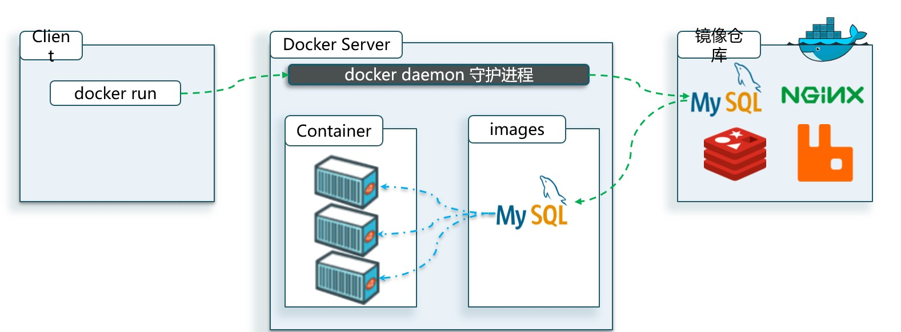
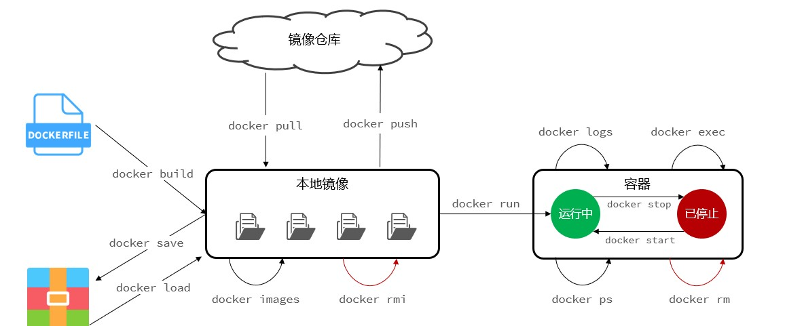
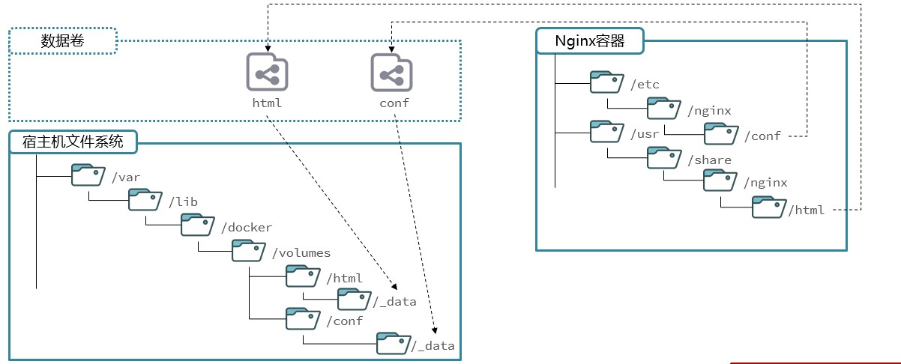
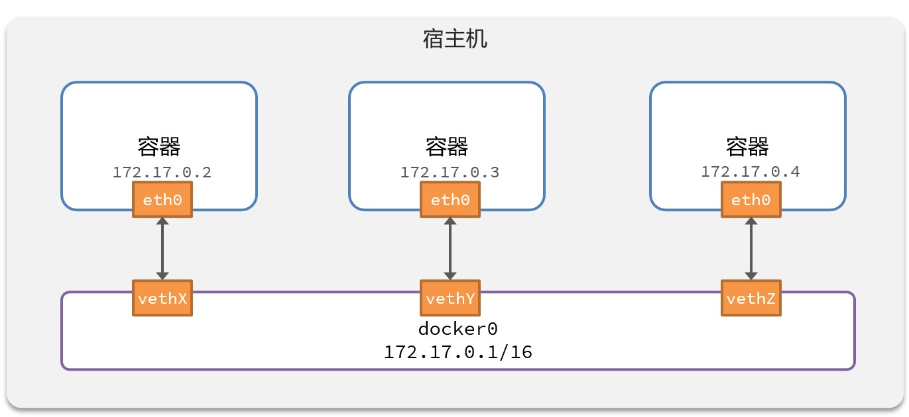

# Docker

## Docker概述

Docker 是一个开源的应用容器引擎，基于 [Go 语言](https://www.runoob.com/go/go-tutorial.html) 并遵从 Apache2.0 协议开源。

Docker 可以让开发者打包他们的应用以及依赖包到一个轻量级、可移植的容器中，然后发布到任何流行的 Linux 机器上，也可以实现虚拟化。

容器是完全使用沙箱机制，相互之间不会有任何接口（类似 iPhone 的 app）,更重要的是容器性能开销极低。

Docker是一个快速构建、运行、管理应用的工具。

### Docker的应用场景

+ Web 应用的自动化打包和发布。
+ 自动化测试和持续集成、发布。
+ 在服务型环境中部署和调整数据库或其他的后台应用。
+ 从头编译或者扩展现有的 OpenShift 或 Cloud Foundry 平台来搭建自己的 PaaS 环境。

### Docker的优点

Docker 是一个用于开发，交付和运行应用程序的开放平台。Docker 使您能够将应用程序与基础架构分开，从而可以快速交付软件。借助 Docker，您可以与管理应用程序相同的方式来管理基础架构。通过利用 Docker 的方法来快速交付，测试和部署代码，您可以大大减少编写代码和在生产环境中运行代码之间的延迟。

1. 快速，一致地交付应用程序

   Docker 允许开发人员使用您提供的应用程序或服务的本地容器在标准化环境中工作，从而简化了开发的生命周期。

   容器非常适合持续集成和持续交付（CI / CD）工作流程，请考虑以下示例方案：

   + 您的开发人员在本地编写代码，并使用 Docker 容器与同事共享他们的工作。
   + 他们使用 Docker 将其应用程序推送到测试环境中，并执行自动或手动测试。
   + 当开发人员发现错误时，他们可以在开发环境中对其进行修复，然后将其重新部署到测试环境中，以进行测试和验证。
   + 测试完成后，将修补程序推送给生产环境，就像将更新的镜像推送到生产环境一样简单。

2. 响应式部署和扩展

   Docker 是基于容器的平台，允许高度可移植的工作负载。Docker 容器可以在开发人员的本机上，数据中心的物理或虚拟机上，云服务上或混合环境中运行。

   Docker 的可移植性和轻量级的特性，还可以使您轻松地完成动态管理的工作负担，并根据业务需求指示，实时扩展或拆除应用程序和服务。

3. 在同一硬件上运行更多负载

   Docker 轻巧快速。它为基于虚拟机管理程序的虚拟机提供了可行、经济、高效的替代方案，因此您可以利用更多的计算能力来实现业务目标。Docker 非常适合于高密度环境以及中小型部署，而您可以用更少的资源做更多的事情。

### Docker架构

Docker包括三个基本概念：

+ 镜像（Image）：Docker镜像（Image），就相当于是一个root文件系统。比如官方镜像ubuntu:16.04就包含了完整的一套Ubuntu:16.04最小系统的root文件系统。
+ 容器（Container）：镜像（Image）和容器（Container）的关系，就像是面向对象程序设计中的类和实例一样，镜像是静态的定义，容器是镜像运行时的实体容器可以被创建、启动、停止、删除、暂停等。
+ 仓库（Repository）：仓库可以看成一个代码控制中心，用来保存镜像。
+ 镜像仓库：存储和管理镜像的平台，Docker官方维护了一个公共仓库——[Docker Hub Container Image Library | App Containerization](https://hub.docker.com/)

Docker 使用客户端-服务器 (C/S) 架构模式，使用远程API来管理和创建Docker容器。

Docker 容器通过 Docker 镜像来创建。

当我们利用Docker安装应用时，Docker会自动搜索下载应用镜像（Image）。**镜像不仅包含应用本身，还包含应用运行所需要的环境、配置、系统函数库。**Docker会在运行镜像时创建一个隔离环境，称为容器（Container）。



| 概念                    | 说明                                                         |
| ----------------------- | ------------------------------------------------------------ |
| Docker镜像（Images）    | Docker镜像是用于创建Docker容器的模板，比如Ubuntu系统         |
| Docker容器（Container） | 容器是独立运行的一个或一组应用，是镜像运行时的实体           |
| Docker客户端（Client）  | Docker客户端通过命令行或者其他工具使用Docker SDK<https://docs.docker.com/engine/api/sdk/>与Docker的守护进程通信 |
| Docker主机（Host）      | 一个物理或者虚拟的机器用于执行Docker守护进程和容器           |
| Docker Registry         | Docker仓库用来保存镜像，可以理解为代码控制中的代码仓库。Docker Hub<https://hub.docker.com>提供了庞大的镜像集合供使用。一个Docker Registry中可以包含多个仓库（Repository）；每个仓库可以包含多个标签（Tag）；每个标签对应一个镜像。通常，一个仓库会包含同一个软件不同版本的镜像，而标签就常用于对应该软件的各个版本。我们可以通过`<仓库号>:<标签>`的格式来指定具体是这个软件哪个版本的镜像。如果不给出标签，将以latest作为默认标签 |
| Docker Machine          | Docker Machine是一个简化Docker安装的命令行工具，通过一个简单的命令行即可在相应的平台上安装Docker，比如VirtualBox、Digital Ocean、Microsoft Azure |

## Docke Engine安装——Centos

官网文档：[Install Docker Engine on CentOS | Docker Docs](https://docs.docker.com/engine/install/centos/)

### 卸载旧版本的Docker

```shell
yum remove docker \
    docker-client \
    docker-client-latest \
    docker-common \
    docker-latest \
    docker-latest-logrotate \
    docker-logrotate \
    docker-engine
```

### 推荐安装方法——设置 Docker 的存储库并从中安装

官方文档：[Install Docker Engine on CentOS | Docker Docs](https://docs.docker.com/engine/install/centos/#install-using-the-repository)

#### 设置存储库

+ 安装 `yum-utils` 软件包（提供 `yum-config-manager` 实用程序）并设置存储库。

  ```shell
  yum install -y yum-utils
  yum-config-manager --add-repo https://download.docker.com/linux/centos/docker-ce.repo
  ```

#### 安装docker engine

1. 安装 Docker Engine、containerd 和 Docker Compose

   + 最新版

     ```shell
     yum install docker-ce docker-ce-cli containerd.io docker-buildx-plugin docker-compose-plugin
     ```

   + 特定版本

     + 要安装特定版本，请首先列出存储库中的可用版本

       ```shell
       yum list docker-ce --showduplicates | sort -r
       ```

     + 替换 `<VERSION_STRING>` 为所需版本，然后运行以下命令进行安装

       ```shell
       yum install docker-ce-<VERSION_STRING> docker-ce-cli-<VERSION_STRING> containerd.io docker-buildx-plugin docker-compose-plugin
       ```

2. 启动Docker

   ```shell
   systemctl start docker
   ```

3. 通过运行 `hello-world` 映像来验证 Docker 引擎安装是否成功

   ```shell
   docker run hello-world
   ```

   此命令下载测试映像并在容器中运行它。当容器运行时，它会打印确认消息并退出。

+ 一些有关命令

  ```bash
  # 启动Docker
  systemctl start docker
  
  # 停止Docker
  systemctl stop docker
  
  # 重启
  systemctl restart docker
  
  # 设置开机自启
  systemctl enable docker
  
  # 执行docker ps命令，如果不报错，说明安装启动成功
  docker ps
  ```

### 配置镜像加速

国内从 DockerHub 拉取镜像有时会遇到困难，此时可以配置镜像加速器。Docker 官方和国内很多云服务商都提供了国内加速器服务。

以阿里云镜像加速为例。

+ 注册/登录阿里云账号

+ 点击`产品->容器->容器镜像服务ACR->管理控制台->镜像工具->镜像加速器`，可以看到属于自己的加速器地址

+ 参考网页上的操作（这里是centos）：

  ```shell
  sudo mkdir -p /etc/docker
  sudo tee /etc/docker/daemon.json <<-'EOF'
  {
    "registry-mirrors": ["https://<自己的地址>.mirror.aliyuncs.com"]
  }
  EOF
  sudo systemctl daemon-reload
  sudo systemctl restart docker
  ```

## 快速入门

### 部署MySQL

先停止操作系统中正在运行的MySQL，确保本机已安装Docker，且在网络开通的情况下，执行以下命令（centos为例）即可安装MySQL:

```shell
docker run -d --name mysql \
-p 3306:3306 -e TZ=Asia/Shanghai \
-e MYSQL_ROOT_PASSWORD=123 mysql
```

### 命令解读

以上述部署MySQL的命令为例。

+ docker run：创建并运行一个容器
  + -d（参数）：是让容器在后台运行
+ --name：给容器起名字，必须唯一
+ -p：设置端口映射，`3306:3306`是将物理机（宿主机）的端口号和容器（虚拟机）内的进程端口号进行映射，即其他的计算机访问该容器中的应用或进程是通过物理机的3306端口去访问
+ -e ：设置环境变量，格式：`KEY=VALUE`，具体的值由镜像的创建者规定
+ mysql：指定运行的镜像（Images）的名字

### 镜像命名规范

+ 镜像名称一般由两部分组成：[repository]:[tag]
  + 其中repository就是镜像名
  + tag是镜像的版本
+ 在没有指定tag时，默认是latest，代表最新版本的镜像

## Docker基础

### 常见命令

Docker最常见的命令就是操作镜像、容器的命令，详见官方文档：<https://docs.docker.com/>、<https://docs.docker.com/engine/reference/commandline/cli/>

下图为Docker常见命令的示意图



+ docker pull：从远端仓库下载（拉取）镜像到本地仓库中，其中的远端仓库不仅限于docker的中心仓库，也可以是各组织自建的仓库。
+ docker images：查看所有的本地镜像
+ docker rmi：删除本地镜像
+ docker build：自己构建（自定义）本地镜像（前提：存在DOCKERFILE文件）
+ docker save：将镜像保存为一个压缩文件，可供移动、拷贝等
+ docker load：将某个镜像压缩包加载到本地镜像中
+ docker push：将本地镜像推到远端仓库（可以是官方的，也可以是自建的）
+ docker run：创建并运行容器。若镜像不存在，会进行镜像拉取，再创建容器并运行。*注意：此命令会创建容器，所以当某个镜像已经存在时，再使用此命令，创建的是该镜像所属的新容器，而不是原来的容器*
+ docker stop：停止容器运行（具体是指容器内部的某个进程），此时容器依然存在
+ docker start：启动容器运行（具体是启动容器内部的某个进程）
+ docker ps：查看容器的运行状态（默认是运行中——Up），加上`-a`参数查看所有（包含停止——Exited）
+ docker rm：删除容器
+ docker logs：查看容器的日志信息
+ docker exec：执行一些命令进入容器的内部，进行某些处理、设置

#### 命令使用

案例：查看DockerHub，拉取Nginx镜像，创建并运行Nginx容器

需求：

+ 在DockerHub中搜索Nginx镜像，查看镜像的名称

+ 拉取Ngnix镜像

  ```shell
  docker pull nginx
  ```

+ 查看本地镜像列表

  ```shell
  docker images
  ```

+ 创建并运行Nginx容器

  ```shell
  docker run -d --name nginx -p 80:80 nginx
  ```

+ 查看容器

  ```shell
  docker ps
  ```

+ 停止容器

  ```
  docker stop nginx
  ```

+ 再次启动容器

  ```shell
  docker start nginx
  ```

+ 进入Nginx容器

  ``` shell
  docker exec -it nginx bash
  ```

  *含义：进入nginx容器以bash交互*

+ 删除容器

  ```shell
  docker rm nginx
  ```

### 数据卷挂载

**数据卷（volume）是一个虚拟目录，是容器内目录与宿主机目录之间映射的桥梁。**

官网原文：`Volumes are the preferred mechanism for persisting data generated by and used by Docker containers. While [bind mounts](https://docs.docker.com/storage/bind-mounts/) are dependent on the directory structure and OS of the host machine, volumes are completely managed by Docker. `

以nginx容器为例：



有关数据卷的命令以`docker volume`开头，官网：<https://docs.docker.com/reference/cli/docker/volume/create/>

*注意：在执行docker run命令时，使用`-v 数据卷:容器内目录`可以完成数据卷挂载。在创建容器时，如果挂载了数据卷且数据卷不存在，会自动创建数据卷。*

常见命令：

+ docker volume create：创建数据卷
+ docker volume ls：查看所有数据卷
+ docker colume rm：删除指定数据卷
+ docker volume inspect：查看某个数据卷详情
+ docker volume prune：清除数据卷

### 本地目录挂载

命令`docker inspect 容器名`——查看容器详情。

在执行docker run命令时，使用`-v 本地目录:容器内目录`可以完成本地目录挂载

+ 本地目录必须以“./”或“/”开头，如果直接以名称开头，会被识别为数据卷而非本地目录
+ 以mysql为例
  + `-v mysql:/var/lib/mysql`会被识别为一个数据卷叫mysql
  + `-v ./mysql:/var/lib/mysql`会被识别为当前目录下的mysql目录

### 自定义镜像

镜像就是包含了应用程序、程序运行的系统函数库、运行配置等文件的文件包。构建镜像的过程其实就是把上述文件打包的过程。

+ 常规部署一个Java应用的步骤：

  1. 准备一个Linux服务器
  2. 安装JRE并配置环境变量
  3. 拷贝jar包
  4. 运行jar包

+ 构建一个Java镜像的步骤：

  1. 准备一个linux运行环境
  2. 安装JRE并配置环境变量
  3. 拷贝jar包
  4. 编写运行脚本

  镜像结构：

  + 以上的每一步称为“层”（layer）：添加安装包、依赖、配置等，每次操作都形成新的一层。每层形成一个压缩包，所有的压缩包共同组成镜像。

  + 基础镜像（BaseImage）：应用依赖的系统函数库、环境配置、文件等。

  + 入口（Entrypoint）：镜像运行入口，一般是程序启动的脚本和参数。

#### Dockerfile语法

Dockerfile就是一个文本文件，其中包含一个个的指令（Instruction），用指令来说明要执行什么操作来构建镜像。将来Docker可以根据Dockerfile帮我们构建镜像。常见指令如下：

+ FROM：指定基础镜像
+ ENV：设置环境变量，可在后面指令使用
+ COPY：拷贝本地文件到镜像的指定目录
+ RUN：执行linux的shell命令，是给镜像使用者看的
+ ENTRYPOINT：镜像中应用的启动命令，容器运行时调用

关于Dockerfile更详尽的说明，参见官网：[Dockerfile reference | Docker Docs](https://docs.docker.com/reference/dockerfile/)

实例1：基于Ubuntu基础镜像，利用Dockerfile描述镜像结构

```
# 指定基础镜像
FROM Ubuntu:16.04
#配置环境变量，JDK的安装目录、容器内时区
ENV JAVA_DIR=/usr/local
# 拷贝jdk和java项目的包
COPY ./jdk8.tar.gz $JAVA_DIR/
COPY ./docker-demo.jar /tmp/app.jar
# 安装JDK
RUN cd $JAVA_DIR \ && tar -xf ./jdk8.tar.gz \ && mv ./jdk1.8.0_144 ./java8
# 配置环境变量
ENV JAVA_HOME=$JAVA_DIR/java8
ENV PATH=$PATH:$JAVA_HOME/bin
# 入口，java项目的启动命令
ENTRYPOINT ["java","-jar","/app.jar"]
```

实例2：可以直接基于JDK为基础镜像（已包含了操作系统环境、JDK安装等），省略实例1中的部分步骤

```
# 基础镜像
FROM openjdk:11.0-jre-buster
# java项目的包
COPY docker-demo.jar /app.jar
# 入口，java项目的启动命令
ENTRYPOINT ["java","-jar","/app.jar"]
```

当编写好了Dockerfile，可以利用下面的命令来构建镜像：

```shell
docker build -t myImage:1.0 .
```

+ `-t`：是给镜像起名，格式依然为repository:tag的格式，不指定tag时，默认为latest。
+ `.`：是指定Dockerfile所在目录，如果就在当期目录，则指定为“.”。

即`docker build -t 镜像名 Dockerfile文件目录`

## 自定义网络

默认情况下，所有容器都是以bridge方式连接到Docker的一个虚拟网桥上。



加入自定义网络的容器可以通过**容器名**互相访问，Docker的网络操作命令如下：

+ docker network create：创建一个网络
+ docker network ls：查看所有网络
+ docker network rm：删除指定网络
+ docker network prune：清楚未使用的网络
+ docker networ connect：使指定容器连接加入某网络
+ docker network disconnect：使指定容器连接离开某网络
+ docker network inspect：查看网络详细信息

更详细的有关Docker 网络的操作参考官网：[docker network | Docker Docs](https://docs.docker.com/reference/cli/docker/network/)

## DockerCompose

Docker Compose通过一个单独的docker-compose.yml模板文件（YAML格式）来定义一组相关联的应用容器，帮助我们实现多个相互关联的Docker容器的快速部署。

一个docker-compose.yml例子：

```YAML
version: "3.8"

services:
  containerA:
    image: A
    container_name: A
    ports: 
      - "11:11"
  containerB:
    image: B
    container_name: B
    ports: 
      - "22:22"
  containerC:
    image: C
    container_name: C
    ports: 
      - "33:33"
```

有关Docker Compose的有关信息：[Docker Compose overview | Docker Docs](https://docs.docker.com/compose/)，有关命令：[Overview of docker compose CLI | Docker Docs](https://docs.docker.com/compose/reference/)
