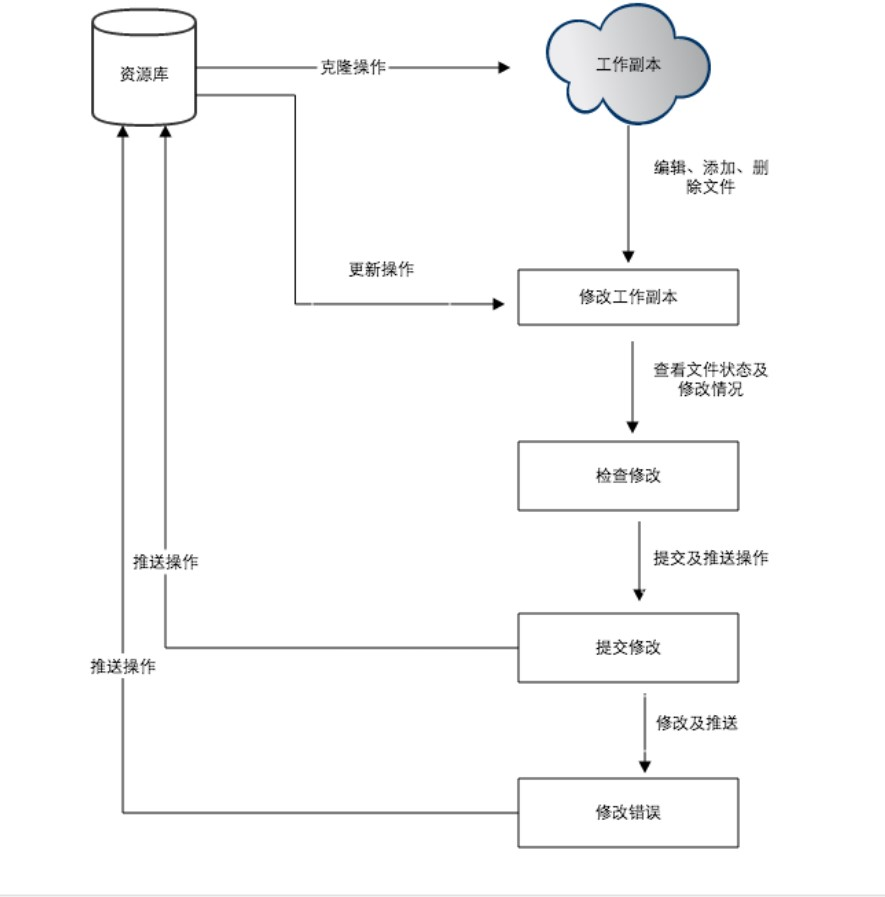
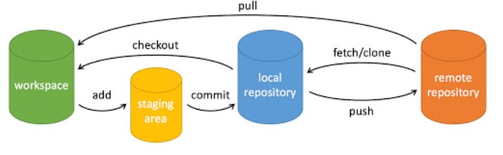

# Git学习笔记

Git是一个分布式版本控制工具，主要用于管理开发过程中的源代码文件，在软件开发过程中被广泛使用。

Git可以帮助我们：

+ 代码回溯
+ 版本切换
+ 多人协作
+ 远程备份

## Git概述

通过Git仓库来存储和管理软件开发过程中的源代码文件。通过Git仓库来存储和管理这些文件，Git仓库分为两种：

+ 本地仓库：开发人员自己电脑上的Git仓库
+ 远程仓库：远程服务器上的Git仓库

Git的基础操作：

+ commit：提交，将本地文件和版本信息保存到本地仓库
+ push：推送，将本地仓库文件和版本信息上传到远程仓库
+ pull：拉取，将远程仓库文件和版本信息下载到本地仓库

## Git下载和安装

Git官方网站：<https://git-scm.com/>

菜鸟教程地址：<https://www.runoob.com/git/git-tutorial.html>

### Git全局配置

安装Git后首先要做的事情是设置用户名和email地址。

在Git命令行中执行命令：

```shell
git config --global user.name "zhagnsan"
git config --global user.email 张三@computer.com
```

*注：此处的用户名和邮箱不一定要求真实，仅仅是commit和push时的一种身份标识。*

如果要在某个特定的项目中使用其他名字或者邮箱，只要去掉`--global`选项重新配置即可，新的设定会保存在当前项目的`.git/config`文件里。

查看配置信息：

```shell
git config --list
```

也可以直接查阅某个环境变量的设定，只要把特定的名字跟在后面即可，如：

```shell
git config user.name
```


Git提供了一个叫做`git config`的工具，专门用来配置或读取相应的工作环境变量。这些环境变量，决定了Git在各个环节的具体工作方式和行为。这些变量可以存放在以下三个不同的地方（Linux系统）：

+ `/etc/gitconfig`文件：系统中所有用户都普遍适用的配置。若使用`git config`时用`--system`选项，读写的就是这个文件。
+ `~/.gitconfig`文件：用户目录下的配置文件只适用于该用户。若使用`git config`时使用`--global`选项，读写的就是该文件。
+ 当前项目的Git目录中的配置文件（也就是工作目录中的`.git/config`文件）：这里的配置仅仅针对当前项目有效。每一级别的配置都会覆盖上层相同的配置，所以`.git/config`里的配置会覆盖`etc/gitconfig`中的同名变量。

在windows系统上，Git会找寻用户主目录下的`.gitconfig`文件。如：`C:\Users\xxxx\.gitconfig`文件。

## Git代码托管服务

我们可以借助互联网上提供的一些代码托管服务来实现，其中比较常用的有GitHub、码云（Gitee）、GitLab、BitBucket。

### Git的工作（使用）流程

一般的工作（使用）流程：

1. 克隆Git资源作为工作目录
2. 在克隆的资源上添加或修改文件
3. 如果别人修改了，你可以更新资源
4. 在提交前查看修改
5. 提交修改
6. 在修改完成后，如果发现错误，可以撤回提交并再次修改并提交

示意图：




## Git基本概念

+ 工作区：包含`.git`文件夹的目录就是工作区，也称为工作目录，主要用于存放开发的代码，是可以在自己电脑上看到的目录

+ 暂存区：`.git`文件夹（目录）中有很多文件，其中的`index`文件夹（`.git/index`）就是暂存区，也可以叫做stage。暂存区是一个临时保存修改文件的地方

+ 版本库：工作区的隐藏文件（夹）`.git`就是版本库，版本库中存储量很多配置信息、日志信息和文件版本信息等

  工作区->暂存区：添加选择的改变，`git add [文件名]` 

  暂存区->版本库：提交改变，`git commit -m '修改信息' [文件名]`

  工作区中的文件存在两种状态：

  + untracked 未跟踪（未被纳入版本控制）

  + tracked已跟踪（被纳入版本控制）

    1. Unmodified 未修改状态
    2. Modified 已修改状态
    3. Staged 已暂存状态

    这些文件的状态会随着执行Git命令发生变化。

    `git status`可以查看文件夹中的文件状态

## Git常用命令

 Git命令官方文档：[Git - Reference (git-scm.com)](https://git-scm.com/docs)

Git基本命令的作用示意图：


+ workspace：工作区
+ staging area：暂存区/缓存区
+ local repository：版本库或本地仓库
+ remote repository：远程仓库

### 获取仓库

要使用Git对我们的代码进行版本控制，首先需要获得Git仓库。获取Git仓库的方式：

+ 在本地初始化一个Git仓库

  在某个文件目录下，执行命令：`git init`，该命令执行完成后会在当前目录下生成一个`.git`目录。注意：一个文件夹下只能有一个“.git“文件。

  指定目录作为Giit仓库，执行命令：`git init [指定目录]`，会在指定目录下生成一个`.git`目录。

+ 从远程仓库克隆

  执行命令：`git clone [远程Git仓库地址]`，将远程仓库克隆到本地。
  
  如果需要克隆到指定的目录，执行命令：`git clone [远程Git仓库地址] [指定目录]`。

### 本地仓库操作

本地仓库常用命令如下：

+ git status：查看文件状态

  + 查看在你上次提交之后是否有对文件进行再次修改

    ```
    git status
    ```

  + 简短输出结果

    ```
    git status -s
    ```

    

+ git add：将文件的修改加入暂存区

  + 添加一个或多个文件到暂存区

    ```
    git add [file1] [file2] ...
    ```

  + 添加指定目录到暂存区，包括子目录

    ```
    git add [dir]
    ```

  + 添加当前目录下的所有文件到暂存区

    ```
    git add .
    ```

    

+ git reset：将暂存区的文件取消暂存或者是切换（回退）到指定版本

  + 命令语法

    ```
    git reset [--soft | --mixed | --hard] [HEAD]
    ```

    参数：

    + **--mixed** 为默认，可以不用带该参数，用于重置暂存区的文件与上一次的提交(commit)保持一致，工作区文件内容保持不变
    + **--soft** 参数用于回退到某个版本
    + **--hard** 参数撤销工作区中所有未提交的修改内容，将暂存区与工作区都回到上一次版本，并删除之前的所有信息提交
    + **HEAD**说明：
      + `HEAD` 表示当前版本（也可用`HEAD~0`表示）
      + `HEAD^ `上一个版本（也可用`HEAD~1`表示）
      + `HEAD^^` 上上一个版本（也可用`HEAD~2`表示）
      + `HEAD^^^` 上上上一个版本（也可用`HEAD~3`表示）
      + 以此类推...

+ git commit：将暂存区的文件修改提交到版本库（本地仓库）

  + 提交暂存区到本地仓库中

    ```
    git commit -m [message]
    ```

    [message] 可以是一些备注信息。

  + 提交暂存区的指定文件到本地仓库

    ```
    git commit [file1] [file2] ... -m [message]
    ```

  + **-a** 参数设置修改文件后不需要执行 git add 命令，直接来提交

    ```
    git commit -a
    ```

    

+ git log：查看日志（历史提交记录）

  + 命令基本语法

    ```
    git log [选项] [分支名/提交哈希]
    ```

    常用选项：

    - `-p`：显示提交的补丁（具体更改内容）。
    - `--oneline`：以简洁的一行格式显示提交信息。
    - `--graph`：以图形化方式显示分支和合并历史。
    - `--decorate`：显示分支和标签指向的提交。
    - `--author=<作者>`：只显示特定作者的提交。
    - `--since=<时间>`：只显示指定时间之后的提交。
    - `--until=<时间>`：只显示指定时间之前的提交。
    - `--grep=<模式>`：只显示包含指定模式的提交消息。
    - `--no-merges`：不显示合并提交。
    - `--stat`：显示简略统计信息，包括修改的文件和行数。
    - `--abbrev-commit`：使用短提交哈希值。
    - `--pretty=<格式>`：使用自定义的提交信息显示格式。

### 远程仓库操作

远程仓库常用命令如下：

+ git remote：查看远程仓库
+ git remote add：添加远程仓库
+ git clone：从远程仓库克隆
+ git pull：从远程仓库拉取——从远程仓库获取最新版本并合并到本地仓库，命令格式`git pull [远程仓库名] [branch-name]`
+ git push：推送到远程仓库

### 分支操作

分支是Git使用过程中非常重要的概念。使用分支意味着可以把自己的工作从开发主线上分离开，以免影响开发主线。同一个仓库可以有多个分支，各个分支相互独立，互不干扰。

通过`git init`命令创建本地仓库时默认会创建一个master分支。

分支操作常用命令如下：

+ git branch：查看分支。`git branch -r`：列出所有远程分支。`git branch -a`：列出所有本地分支和远程分支
+ git branch [name]：创建分支
+ git checkout [name]：切换（捡出）分支
+ git push [远程仓库名] [name]：将分支推送到远程仓库
+ git merge [name]：合并分支（将name分支合并到当前分支）
+ git branch -d [name]：删除分支

### 标签操作

Git中的标签，指的是某个分支某个特定时间点的状态。通过标签，可以很方便的切换到标记时的状态。比较有代表性的是人们会使用这个功能来标记分布结点（如v1.0、v1.2等）

标签操作常见的命令如下：

+ git tag：列出已有标签
+ git tag [name]：创建标签
+ git push [远程仓库名] [name]：将标签推送至远程仓库
+ git checkout -b [branch] [name]： 切换（捡出）标签放置到某个分支下

