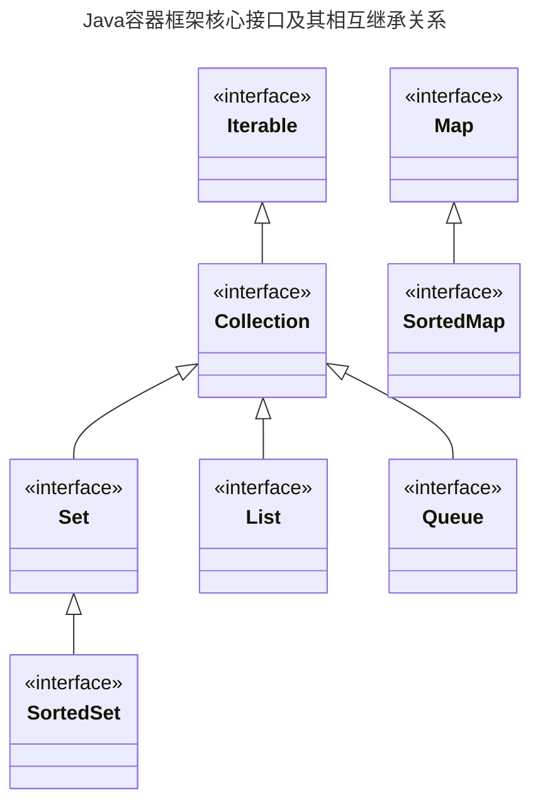

# JAVA编程语言学习——Java 8版本

*内容参考书籍：胡平，刘涛.  Java编程从入门到精通. 北京: 人民邮电出版社, 2020.*

## 第1章 认识Java

Java是一种计算机编程高级语言,在上世纪90年代末由**Sun**公司(后被**Oracle**公司收购)开发公布。

### 1.1 Java语言的特点

（1）简单
Java语言与C语言很接近,使得大多数开发者能够快速学习和使用Java语言.另一方面,Java舍弃了C++中很少使用的、晦涩且容易出错的特性，如运算符重载、多重继承等。特别地，Java还从语法层面取消了指针，同时提供了自动内存回收机制，使开发者不用频繁地编写代码显式地释放内存。

（2）完全面向对象
与C++不同，Java对面向对象的要求十分严格，任何变量和方法都只能包含于某个类的内部；Java提供了封装、继承和多态等基本的面向对象的特性，并且只支持单继承；为了能够表达多继承的语义，同时避免引入C++的多继承所带来的复杂性，Java使用了接口的概念——类可以继承另一个类，同时也能实现若干个接口；同时Java提供了全面的动态绑定机制，而不像C++只能对虚函数使用动态绑定。

（3）分布式
Java提供的RMI（Remote Method Invocation，远程方法调用）机制甚至允许执行网络中另一台机器上的代码，这使得一个Java程序可以被分布到网络中若干个不同的物理机器上，并形成一个逻辑上的整体。

（4）安全
Java程序经常需要被部署在开放的网络环境中，为此，Java从诞生之初就非常重视安全性。例如，在编译阶段进行语法、语义和类型安全检查，类被装载到Java虚拟机时进行字节码校验等。对于通过网络下载的类，Java也提供了多层安全机制以防止程序被恶意代码侵害，这些机制包括代码行为检查、分配不同的命名空间以防止本体同名类被替换等。此外，Java还允许用户自定义安全管理器，以便灵活地控制访问权限。

（5）健壮
Java的设计目标之一是要协助开发人员编写出各方面可靠的程序。Java既有的强类型检查、异常捕获及处理、资源自动释放以及垃圾自动回收等机制，为程序的健壮性提供了重要保证。

（6）平台中立与可移植
为使Java程序能够运行在网络中的任何平台，Java源程序被编译为平台中立（即无关）的字节码文件，后者可以在所有实现了相应规范的Java平台上运行。

（7）半编译、半解释型
Java源代码（.java文件）被Java编译器（javac）先编译为字节码文件（.class文件），此时字节码还不能CPU直接执行，还需要由Java虚拟机（JVM）将这些字节码“解释”成CPU能够理解的指令（机器码）并交由CPU执行。

（8）高性能
由于存在解释的过程，从理论上，Java程序的执行性能是低于传统的编译型语言（如C、C++）的。但与纯解释型的脚本语言（如JavaScript、Python等）相比，Java的性能却要高得多。随着近年来JIT（Just In Time，即时的）编译以及HotSpot（一种新的Java虚拟机规范）等字节码优化技术的出现，Java程序的性能已经非常接近于C++，对于绝大多数应用，这种性能差距是完全可以接受的。

（9）动态特性
除了接口和自动类型推断所提供的动态特性外，Java语言的动态特性更多体现在反射机制上。反射机制允许程序在运行而非编译阶段动态地访问类和对象的元数据（用来描述数据的数据），这使得Java语言比那些直接被编译成本地代码的语言更具有动态性。

（10）开源
Java从诞生之初便坚持开源（开放源代码）策略。任何个人和组织都可以免费下载JDK核心类库的源代码。也正因如此，任何Java开发者都能拓展官方代码，从而创建出适合自己需求的类库。

### 1.2 Java的技术领域

Java适合开发分布式环境下的企业级应用以及Android智能移动终端应用，而不适合（或不支持）开发GUI桌面、嵌入式、系统或驱动级应用————而这些恰恰是C和C++语言所擅长的领域，反之亦然。

### 1.3 Java下载，JDK、JRE、JVM

由于**Sun**公司被**Oracle**公司收购，当下关于Java的下载官方网站为：[https://www.oracle.com/java/technologies/downloads/](https://www.oracle.com/java/technologies/downloads/)

JDK（Java Development Kit），它是功能齐全的 Java SDK，是提供给开发者使用的，能够创建和编译 Java 程序。他包含了 JRE，同时还包含了编译 java 源码的编译器 javac 以及一些其他工具比如 javadoc（文档注释工具）、jdb（调试器）、jconsole（基于 JMX 的可视化监控⼯具）、javap（反编译工具）等等。

JRE（Java Runtime Environment） 是 Java 运行时环境。它是运行已编译 Java 程序所需的所有内容的集合，主要包括 Java 虚拟机（JVM）、Java 基础类库（Class Library）。也就是说，JRE 是 Java 运行时环境，仅包含 Java 应用程序的运行时环境和必要的类库。而 JDK 则包含了 JRE，同时还包括了 javac、javadoc、jdb、jconsole、javap 等工具，可以用于 Java 应用程序的开发和调试。

Java 虚拟机（JVM）是运行 Java 字节码的虚拟机。JVM 并不是只有一种！只要满足 JVM 规范，每个公司、组织或者个人都可以开发自己的专属 JVM。

有这样一个关系：JDK包含JRE，而JRE包 含JVM。
JDK = JRE + 开发工具集（例如Javac编译工具等）
JRE = JVM + Java SE 标准类库

## 第2章 标识符、基本数据类型、运算符、表达式

### 2.1 标识符

标识符直观地表述就是编写程序时所输入的一个个“单词”。标识符可以分为关键字、保留字和用户标识符。

#### 2.1.1 关键字和保留字

关键字是一类具有特殊含义的和用途的标识符，而保留字则是预留的关键字，只是当前尚不可用，但可能以后会成为正式的关键字（故关键字和保留字通常统称为关键字）。关键字通常用于表示数据类型、程序结构或修饰变量等，他们对编译器有特殊的含义。
**类型相关**
基本类型名：boolean、byte、short、int、long、char、float、double
类型值：false、true、null
类型定义：class、interface、enum
与其他类型的关系：extends、implements
对象引用：this、super
对象创建：new
返回类型：void
**修饰符**
访问控制：private、protected、public
属性控制：final、abstract、static
浮点精度控制：strictfp
本地方法：native
序列化：trasient
多线程：synchronized、volatile
**流程控制**
分支：if、else、switch、case、default
循环：for、do、while、break、continue
异常处理：try、catch、finally、throw、throws
其他：instanceof、assert、return
**包相关**
import、package
**留待扩展（保留字）**
const、goto

#### 2.1.2 用户标识符

用户标识符是除关键字之外的任何合法标识符，它们由用户命名，其命名规则如下：
**（1）能包含数字（0~9）、字母（a~z、A~Z、汉字等）、下划线（_）、美元符号（$）。**
**（2）不能以数字开头。**
**（3）不能与关键字相同。**
*注：由于Java采用了Unicode字符集，故Java中的标识符可以包含所有非西文字符（如汉字），但为了保证代码的可读性和避免潜在错误的发生，一般不推荐使用非西文字符命名标识符。*

---

除必须满足的规则外，标识符的命名还应遵循一些惯例和约定，使得标识符的命名有利于代码的编写、阅读和维护。

**包名**

+ 采用“从大到下”的方式——与网络域名的顺序相反
+ 每级包名都用小写字母
+ 若由多个单词组成，则直接连在一起
  如：java.lang、com.mycompany.mysoft

**类名**

+ 使用“大驼峰”（UpperCamelCase）表示法——每个单词的首字母大写，其余小写
+ 尽量使用名词结尾
  如：MobilePhone、Account

**接口名**

+ 使用“大驼峰”表示法
+ 通常以able结尾，有时也以大写字母I（interface）开头
  如：Drawable、IShape

**方法名**

+ 使用“小驼峰”（lowerCamelCase）表示法——从第2个单词开始，每个单词的首字母大写，其余小写
+ 第一个单词一般是动词
+ 若是取值型（读）方法，一般以get开头
+ 若是设值型（写）方法，一般以set开头
+ 若取的值是boolean型，一般以is开头
  如：deleteStudent、getUserInfo、isFemale

**字段和局部变量名**

+ 使用“小驼峰”表示法
+ 命名应能体现变量值的意义
+ 短名称一般只用于局部变量且是基本类型，如循环结构中的整型计数器可命名为i、j、k1、k2等
+ 若变量是数组或容器，则应使用单词的复数形式
+ GUI组件型变量也可以使用“匈牙利”表示法——类型缩写前缀+变量描述，如btnLogin、dlgDeletion等
  如：studentWithMaxAge、loginDialog、allMaleEmployees

**常量名**

+ 全部大写，多个单词用下划线隔开
  如：PI、WINDOWS_HEIGHT

---

#### 2.1.3 常量与变量

**变量**是指在程序运行期间其值能被修改的量。Java是静态类型的编程语言——**所有的变量必须先声明，即指定类型后才能使用**。

---

**常量**是指在程序运行期间其值不能被修改的量，具体可分为——字面常量和final常量。
**字面常量**无须声明，可**在代码中直接书写出来**，如：\'张\'、123、0.618、true、\"张三\"。
**final常量**是指以**final**关键字修饰的变量，它只能被赋值一次，且以后不允许再被赋值。
如：

```java
final int COUNT=100;
final String USER_NAME="匿名";
```

---

对final常量的一些说明：

+ 建议final常量名全部使用大写字母，若有多个单词，则用下划线连接
+ 可以在声明final常量时赋值，也可以在后面某处赋值
+ 一经赋值，以后使用即使将同样的值赋给final常量也是不允许的

### 2.2 基本数据类型

**数据类型的意义**

+ 任何数据在任何时刻都有其所属类型
+ 不同的数据类型能够存放不同性质和意义的数据
+ 不同的数据类型在内存中被分配的字节数可能不相同，从而它们各自能表示的数值范围也不同
+ 数据类型决定了能够对数据进行的操作

---

Java的数据类型可以分为两大类——**基本类型和对象类型**。基本类型又称为原始类型，用以表示具有原子性的数据，如整数、小数、字符等；而对象类型则是复合的数据类型，它是由基本类型或对象类型组合而成的——类似C语言的结构体。
Java的基本类型可以分为4类——整型、浮点型 、字符型和布尔型。其中，整型和浮点型用来表示整数和实数；字符型用来表示单个字符；布尔型用来表示逻辑值（又称真假值）。

**基本数据类型**

|  分类  | 类型名 |      占据的字节数      |                表示范围                |       默认值       |
| :----: | :-----: | :--------------------: | :------------------------------------: | :----------------: |
|  整型  |  byte  |           1           |           -2$^7$~2$^7$-1           |         0         |
|  整型  |  short  |           2           |        -2$^{15}$~2$^{15}$-1        |         0         |
|  整型  |   int   |           4           |        -2$^{31}$~2$^{31}$-1        |         0         |
|  整型  |  long  |           8           |        -2$^{63}$~2$^{63}$-1        |         0         |
| 浮点型 |  float  |           4           |    -3.4E+38\~3.4E+38(6\~7位有效数字)    |         0.0         |
| 浮点型 | double |           8           | -1.7E+308\~1.7E+308(15\~16位有效数字） |         0.0         |
| 字符型 |  char  |           2           |             0~2$^{16}$-1             | '\u0000'（空字符） |
| 布尔型 | boolean | 具体与虚拟机的实现有关 |        true（真）和false（假）        |       false       |

*注：在Oracle官方文档中boolean型“呈现”为1位信息，即1bit，但其具体占据的字节数未明确，由于计算机存取信息的最小单位是字节，因此简单认为boolean型占据1字节（高7位为0），即1byte。*

---

#### 2.2.1 整型

##### 2.2.1.1 整型常量

Java用前缀来标识整型常量的进制，用后缀来标识整型常量的类型。

（1）前缀

+ 0（数字零）：八进制整数。如0123、-010，分别表示十进制数83、-8。
+ 0x或0X（数字零）：十六进制整数。如0x123表示十进制数291。
+ 0b或0B（数字零）：二进制整数。如0b101表示十进制数5。
+ 无前缀：默认为十进制数。如123、-80。

（2）后缀

+ l或L：long型，占8个字节。如：123l、-80L。
+ 无后缀：默认为int型，占4字节。如：123。
  *注：Java并未提供用于byte和short型整数的后缀。*

---

##### 2.2.1.2 整型变量

```java
int i=100;//正确
int j=-0x100;//正确
int k=100L;//错误
int m=100000000000;//错误
byte b1=10;//正确
byte b2=200;//错误
short s1=400;//正确
short s2=40000;//错误
long p=50000;//正确
long q=50000L;//正确
```

为整型变量赋值时需注意：

+ 不要将long型常量赋值给非long型变量（*注意long型变量也不要赋给非long型变量，除非使用强制类型转换*），即使常量值在变量范围内，如第3行。
+ 字面常量不要超过其所属类型的表示范围，如第4行。
+ 因Java中没有byte和short型的字面常量，故可将int型常量赋给byte型和short型变量，但要注意不要超过相应的范围，如第6行和第8行。
+ 总是可以将int型常量赋给long型常量——前者总在后者范围之内，如第9行。

***一般来说，long型已满足大多数应用对整数的需求。若不能满足，则可以考虑使用java.math包下的BigInteger类，该类可以表示无限大小的整数。***
*注：在实际开发时可以根据数值可能的大小和实际应用场景选择合适的整型。*

#### 2.2.2 浮点型

##### 2.2.2.1 浮点型常量

Java使用**后缀来表示浮点型常量的类型**。

+ f或F后缀：float型，占4个字节。如-123f、3.14F。
+ d或D后缀：double型，占8个字节。如-123d、3.14D。
+ 无后缀：默认为double型。如-123.4、3.14。

**与整型常量不同，不能用前缀来表示常规形式的浮点型常量的进制。** 如：

```java
double d1=0x10.2;//错误
float f1=0x10.2f;//错误
float f2=010.2;//错误
float f3=010.2f;//正确
```

***注：第1行、第2行都是错误的，因为不允许在浮点型常量左边加0x前缀。第3行、第4行的前缀0并非表示八进制，而是作为填充位数用的前导零。第3行错误是因为010.2是double类型，不允许赋值给float型。***

---

Java允许使用**指数形式**来书写浮点型常量，这特别适合表示较大的实数，具体格式为：`[+|-][0x|0]尾数E|P[+|-]指数[f|d]`
其中：

+ 第1个+、-表示浮点数的符号，若未指定则为正。
+ 竖线|表示“或”，即只能指定|分隔开的若干项的某一项。
+ 尾数可以是整数或小数，均可带前缀，这与常规形式的浮点型常量不同。
+ 前缀0x表示尾数是十六进制数，而前缀0只是前导零而并非八进制数。
+ E表示以10为底，P表示以2为底，大小写均可。
+ 当尾数是十进制时，只能使用E。
+ 当尾数是十六进制时，只能使用P，因为E是十六进制数的其中一个的基数。
+ 第2个+、-表示指数的符号，若未指定则为正。
+ 指数必须是十进制整数，可以带前导零。

如：

+ 2E3F表示float型常量：2*10$^3$，F是float型后缀
+ 2.4E+3表示double型常量：2.4*10${^3}$,不带后缀默认为double型
+ 0x2E3F表示int型常量：2\*16$^3$+14\*16$^2$+3\*16$^1$+15\*16$^0$=11839。*注：这是一个十六进制整数，不能看作浮点数，因为尾数为十六进制时，只能用P而不是E。*
+ 0x20P-6f表示float型常量：\[2\*16$^1$+0\*16$^0$\]\*2$^{-6}$=0.5

**在实际应用中，应使用最为常规的指数形式，如-1.23E5，其他形式仅作一般了解。**

---

##### 2.2.2.2 浮点型变量

```java
float f1=-12.3E+5;//错误，不能将double型常量赋给float型变量
float f2=-12.3E+5f;//正确
double d1=2018.7;//正确
double d2=2018.7d;//正确
double d3=2018.7f;//正确，float型的范围在double型内
float f3=0x1234;//正确，int型的范围在float型内
float f4=01234L;//正确，long型的范围在float型内
double d4=1234L;//正确，long型的范围在double型内
```

**我们可以看到，总是可以将“小”（表示范围小）类型常量或变量赋给“大”（表示范围大）类型变量，因为前者能表示的数的范围在后者之内，反之，却不行，如第1行。**

***一般来说，double型已经能满足绝大多数应用对实数的需求。若对精度要求较高或涉及到货币计算，则应优先考虑使用java.math包下的BigDecimal类，该类可以表示任意精度的有符号十进制数。***

---

#### 2.2.3 字符型

##### 2.2.3.1 Unicode介绍

ASCII（American Standard Code for Information Interchange，美国信息交换标准码）码是单字节的，故最多只能表示256个字符，显然，对于非拉丁语言中的字符，ASCII码是无能为力的。

Unicode旨在为世界上所有的语言和文字中的每一个字符都确定一个唯一的编码，以满足跨语言、跨平台进行文字的转换和处理需求。目前，实际使用较为广泛的Unicode编码采用16位的编码空间，即每个字符占用2个字节，理论上共能表示65536个字符，基本满足各种语言的需要。不同的系统和平台设计的Unicode编码的实现方式（称为UTF，Unicode Transformation Format，Unicode转换格式）不同，如UTF-8、UTF-16等，这些实现往往与每个国家和地区自己定义的编码标准不兼容。
*Unicode编码是兼容ASCII码的，也就是说，ASCII码中每个字符的编码值在Unicode编码中并无变化，只是由原来的8位扩展到了16位。*

Java在设计之初就考虑了语言的不兼容问题，因此**采用了Unicode编码**。具体来说，Java源文件（.java文件）被编译为class文件后，不管源文件采用何种编码存储，在class文件中均被转换成Unicode编码。当class文件被执行时，Java虚拟机会自动探测所在操作系统的默认语言，并将class文件中以Unicode编码表示的字符和字符串转换成该语言使用的编码。*若操作系统（或用于显示运行结果的软件环境）所设置语言的编码与源文件的编码一致（或兼容），就能正确显示源文件中的字符和字符串，否则将出现乱码*。

***若采用纯文本编辑器编写代码，则编码格式选择ANSI；若采用IDE，则选择UTF-8。***

##### 2.2.3.2 字符型常量

字符是指自然语言中的单个文字。Java中的**字符型常量用一对西文单引号括起来**，有3种表示形式。
（1）常规表示
适用于常规字符，在单引号中直接书写即可，如'A'、'风'。
（2）转义表示
对于特殊字符，若以常规表示的形式直接输入到代码中，会破坏程序的语法，因此对这些字符进行转义。**转义字符以反斜杠“\”开头**。

|   字符   | 转义字符 | 说明                        |
| :-------: | :------: | :-------------------------- |
|     '     |    \'    | 西文单引号                  |
|     "     |    \"    | 西文双引号                  |
|     \     |    \\    | 反斜杠                      |
|   回车   |    \r    | return，光标跳到本行开头    |
|   换行   |    \n    | newline，光标跳到下一行开头 |
|   退格   |    \b    | backspace，光标左移一列     |
| 跳格/制表 |    \t    | table，光标跳到下一个制表列 |

（3）编码表示
即以每个字符对应的编码进行表示，但需要使用反斜杠“\”做转义。

|  格式  |                                                   说明                                                   |            举例            |
| :----: | :-------------------------------------------------------------------------------------------------------: | :------------------------: |
|  \ddd  |                           用于表示拉丁字符。ddd是1~3位的八进制数，可以加前导零                           |   '\101':'A'  '\63':'3'   |
| \uxxxx | 能表示所有的Unicode字符。u必须小写，xxxx是4位的十六进制数，若不够4位，必须加前导零补足4位，且不能加0x前缀 | '\u0041':'A' '\u98CE':'风' |

##### 2.2.3.3 字符型变量

字符型变量以关键字char声明，如 `char ch='A';`。
注意：（1）在Java语言中，字符是基本类型，而**字符串却是对象类型**（字符串常量用双引号括起来）。不能将字符串常量赋值给字符型变量，即使前者仅包含一个字符。（2）在C语言中，允许一对单引号紧挨在一起，此时表示的是ASCII码为0的空字符，而Java不允许这样，即**一对单引号中必须有且仅有一个字符常量**。

##### 2.2.3.4  字符串常量

多个字符常量可以放在一对西文双引号中组成字符序列，称为字符串（String）常量。***字符串不是基本类型，而是对象类型。***
如 ``"张三"``

#### 2.2.4 布尔型

在C语言中没有专门用于表示真假值的类型（一般是通过宏定义实现），或者说C语言中任何数值都能表示真假——只有0表示假，其他值均表示真。C语言这种以数值表示真假值的方式为程序带来了潜在的逻辑错误。

Java摒弃了C语言的不安全的做法，专门以布尔型表示真/假、成立/不成立的概念。

##### 2.2.4.1 布尔型常量

布尔型专门用来表示真假，故只有2个常来那个——**true**（真）和**false**（假），它们实际上是Java中的关键字。

##### 2.2.4.2 布尔型变量

布尔型变量以关键字boolean声明，取值只能是true或false，**默认为false**。

***注意：布尔型和整型有着本质区别，true和false并不对应着某两个具体的整数，因此不要试图在布尔型和整型之间做类型转换的操作。***

#### 2.2.5 类型转换

某些运算对参与运算的数据的类型有所要求，可能需要先将某种类型的数据“强行”转换成符合要求的类型。为此，Java提供了两种类型转换——自动类型转换和强制类型转换。

##### 2.2.5.1 自动转换

自动类型转换又称为隐式转换或类型提升，**由Java编辑器和运行时环境自动完成**。

```java
int a=100;
long b=200;
long c=a+b;
```

不同的基本类型相遇时，自动类型转换总是将“小”（表示范围小的）类型提升为“大”（表示范围大的）类型，这样做的目的很明显——保证值和精度不会丢失。
自动转换规则：``byte,short,char -> int -> long -> float -> double``。**对于byte，short，char型，它们相遇时不会发生自动类型转换，如确需转换，可以使用强制转换**。

##### 2.2.5.2 强制转换

强制转换又称为显示转换或造型，这种转换由**代码显式告知Java编译器和运行时环境将某种类型的数据转换成其他类型**，语法格式：``（目标类型）式子``或 ``(目标类型)(式子)``，如 ``(int)a``与 ``(int)(a)``等价。*若式子仅含单个常量或变量，则可以省略其外的一对圆括号，否则不能省略*，如 ``(long)(a+b)``不等价于 ``(long)a+b``——前者是将a+b的和强制转换为long型，而后者却是先将a的值强制转换为long型，再与b相加。

对于基本类型，强制类型转换有以下几种情况：

+ 小整型 -> 大整型：值不会丢失。
+ 大整型 -> 小整型：只保留低若干字节，值可能丢失。
+ 整型 -> 字符型：保留整型数据的低16位（有符号数，若不足16位则符号扩展至16位），并作为字符的Unicode编码（无符号数）。
+ 浮点型 -> 整型：直接丢弃浮点型的小数部位（并非四舍五入）。
+ 整型 -> 浮点型：整数部分的值不会丢失，小数部分为0。
+ double <-->float：值和精度（小数位较多时）都有可能丢失。

在实际应用中，强制类型转换更多的应用在彼此间具有继承关系的对象类型，譬如将父类对象强制转换成子类对象。

相较于自动类型转换，强制类型转换更为灵活、更能满足不同的需求，但需要注意：

+ 不能在boolean型与其他基本类型之间做强制类型转换。
+ 无论是自动转换还是强制转换，转换的过程中只是得到了一个临时的变量，而被转换变量的类型并没有发生变化，仍然是声明变量时所指定的类型。

#### 2.2.6 基本类型的包装类

Java以类的形式为8种基本数据类型提供了相应的包装。通过包装类，可以将基本类型的常量或变量包装为对应包装类的对象，并通过包装类提供的方法，方便地获取相关信息或执行某些常用操作。

##### 2.2.6.1 包装类

| 基本类型 |  包装类  | 直接父类 |
| :------: | :-------: | :------: |
|   byte   |   Byte   |  Number  |
|  short  |   Short   |  Number  |
|   int   |  Integer  |  Number  |
|   long   |   Long   |  Number  |
|  float  |   Float   |  Number  |
|  double  |  Double  |  Number  |
|   char   | Character |  Object  |
| boolean |  Boolean  |  Object  |

8种基本数据类型的包装类均位于java.lang包下。**因前6种基本类型都属于数值型，故对它们对应的包装类都继承自Number类，而Character和Boolean类则继承自Object类。**

##### 2.2.6.2 包装类的主要方法

每个包装类都提供了大量的方法，可以通过这些方法完成常用的与基本类型相关的操作。

+ 创建包装类的对象
  该类方法主要用于从基本类型（或字符串）创建对应的包装类对象，即“包装”基本类型，格式为：``包装类名 对象名 = new 包装类名(基本类型或字符串)``
+ 将字符串解析为基本类型
  该类方法是**静态方法（无须通过对象而直接以类名调用）**，主要用于将一个字符串解析（parse）为对应的基本类型的值，格式为：``包装类名.parseXxx(字符串[,进制])``，其中第2个参数时可选的，用以指定解析整型数据时采用的进制，用数字2、16等分别表示二进制、十六进制等。
  *注：若指定字符串不能被解析为对应类型，则在运行时（而非编译时）会出错。*
+ 从包装类对象获得值
  该类方法主要用于从包装类的对象中获得其对应基本类型的值，格式为：``对象名.xxxValue()``。
+ 将基本类型转换为字符串
  该类方法主要用于将基本类型的值转换为字符串，格式为：``包装名.toString(基本类型[,进制])``。此方法为**静态方法**。

除了这些方法外，包装类还提供了一些静态常量，如对应基本类型的最大值和最小值等，可查阅JDK的API文档了解。

##### 2.2.6.3 自动装箱和拆箱

```java
int i;
Integer a = 10; //相当于Integer a = new Integer(10)
i=a; //相当于i = a.intValue();
```

+ 自动装箱（Auto Boxing）
  将基本类型（包括常量和变量）自动包装成其对应的包装类对象，如第2行。
+ 自动拆箱（Auto Unboxing）
  从包装类的对象中自动提取出其对应的基本类型的数据，如第3行。

**程序被编译时，编译器会自动判断是否需要进行自动装箱或拆箱的操作，使得在那些本应使用包装类对象的地方可以直接使用其对应的基本类型的数据，反之亦然。**

### 2.3 运算符

Java中的运算法也具有优先级，若多个运算符出现同一式子中，则优先级高的先运算，对于优先级相同的运算符，则视运算符的结合性。

| 优先级 |                         运算符                         |       结合性       |
| :----: | :----------------------------------------------------: | :----------------: |
|   1   |   ()（显式先运算、方法调用）  []  .  ::（方法引用）   | 从左向右（左结合） |
|   2   |     !  +（正）  -（负）  ~  ++  --  ()（强制转换）     | 从右向左（右结合） |
|   3   |                        *  /  %                        |       左结合       |
|   4   |                    +（加）  -（减）                    |       左结合       |
|   5   |                      <<  >>  >>>                      |       左结合       |
|   6   |                <  <=  >  >=  instanceof                |       左结合       |
|   7   |                         ==  !=                         |       左结合       |
|   8   |                           &                           |       左结合       |
|   9   |                           ^                           |       左结合       |
|   10   |                           \|                           |       左结合       |
|   11   |                           &&                           |       左结合       |
|   12   |                          \|\|                          |       左结合       |
|   13   |                           ?:                           |       右结合       |
|   14   | =  +=  -=  *=   /=   %=  &=    ^=\|=   <<=   >>=  >>>= |       右结合       |

+ 优先级为2的运算符是一元的——只对一个常量、变量或式子进行元素，优先级为13的运算符是Java中唯一的三元运算符，**其余都是二元运算符**。
+ 尽管C语言中作为运算符的逗号可以出现在Java代码的某些位置（如一次声明多个变量），但其（“,”）并不是Java的运算符。

*注：在开发中为了提高代码的可理解性，应当尽量使用圆括号（优先级最高）显式标识出式子中的哪部分先运算。*

#### 2.3.1 赋值运算符

赋值运算符是使用频率最高的运算符之一，其功能是将某个常量、变量或式子的值赋给某个变量。赋值运算符具体包含两种：简单赋值运算符和复合赋值运算符。

+ 简单赋值运算符——“=”
  它将“=”右边的常量、变量或式子的值赋给左边的变量。
  *左边只能是变量，右边通常是常量或变量，也可以是其他任何式子。*
+ 复合赋值运算符——“+=”、“-=”、“*=”、“/=” 、“%=”、“&=”、“^=”、“|=”、“<<=”、“>>=”、“>>>=”
  复合赋值运算符是12个运算符分别与“=”运算符的组合——在完成某种运算的同时进行赋值运算，如 ``a+=2``等价于 ``a=a+2``。

#### 2.3.2 算术运算符

+ 四则运算符——+、-、*、/、%
  它们都是二元运算符，但+和-也可以作为一元运算符，分别表示某个数的正、负。**“%”——模除运算符（或称模运算符），其计算某个整数对另一个整数的余数，因此也称为取余运算符。**
  **对于“/”，若参与运算的均为整数则做整除（如5/2=2），否则做精确除（如5/2.0=2.5）。**若整除时2个数的符号相反，则余数符号与被除数相同，并向零靠近。
  **对于“%”，若参与运算的2个数（假设a和b）均为整数，则结果为整除所得的余数（如5%2=1），否则结果为a-(b*q)，其中q=(int)(a/b)，如5.1%2.0=1.1。**在C语言中%运算符要求操作数必须是整数，注意区分。
  不同类型相遇时，小类型被自动提升为大类型，运算结果为大类型。
  当“+”两侧都是数值（包括字符）型时，完成的是相加而非拼接。
  当“+”两侧都是字符串时，直接拼接。若仅有某一侧是字符串，系统会自动将另一侧的值转换为对应的字符串形式，并拼接二者。
  **以“+”拼接字符串的方式存在一定的性能损失**，不要过多使用（特别是在循环结构中）。此时可采用StringBuilder或StringBuffer类。
+ 自增与自减——++、--
  均是一元运算符，分别称为自增和自减运算符，它们的作用是将某个变量的值加1或减1后存回该变量。
  若运算符位于变量前，如 ``++a``或 ``--a``，将a自增1或自减1，然后用增1或减1后的值参与式子的运算。
  若运算符位于变量后，如 ``a++``或 ``a--``，将a的原值参与式子的运算，然后将a自增1或自减1。
  **只能对变量而不能对常量和式子进行自增或自减。**

#### 2.3.3 关系运算符

关系运算符——“==”（等于）、“!=”（不等于）、“>”（大于）、“>=”（大于等于）、“<”（小于）、“<=”（小于等于），其中“==”和“!=”的优先级低于其他4个。
因boolean类不能被转换为数值型，故其不能与其他基本类型进行关系运算。此外两个boolean型数据间只能进行相等或不相等的比较。
由于精度限制，尽量不要使用关系运算符在整型与浮点型、浮点型与浮点型之间做直接的大小比较，否则可能出现非预期的结果。
**尽量不要用“==”运算符判断两个字符串是否相等，而应使用String类的equals方法。**

#### 2.3.4 条件运算符

条件运算符是指“?:”，其使用“?”和“:”隔开3个式子，是Java中唯一的三元运算符。使用格式：``式子1 ? 式子2 : 式子3``条件运算符的逻辑是：若式子1成立，则取式子2的值作为整个式子的值，否则取式子3的值作为整个式子的值。
因整个式子的取值取决于式子1是否成立，故式子1也被称为条件，其值必须是boolean型。
**条件运算符的优先级几乎是最低的——只比赋值运算符高。**

#### 2.3.5 逻辑运算符

逻辑运算符包括3个：!、&&、||，它们均**要求参与运算的式子的值为boolean型，并且整个式子的值是boolean型**。

|     运算符     | 使用格式 |                          运算规则                          |
| :------------: | :------: | :--------------------------------------------------------: |
|  !（逻辑非）  |    !A    |           若A为true，整个式子为false，否则为true           |
|  &&（逻辑与）  |   A&&B   | 只有当A、B同为true时，整个式子才为true，其他情况均为false |
| \|\|（逻辑或） |  A\|\|B  | 只有当A、B同为false时，整个式子才为false，其他情况均为true |

与C语言不同，不能对非boolean型数据进行逻辑运算。
**对于式子A&&B，若A为false，则不管B是否成立，整个式子的值便能确定为false，故此时B不会被执行。类似地，对于式子A||B，若A为true，则式子B不会被执行。**以上称为逻辑运算符的短路规则。

#### 2.3.6 位运算符

位运算符的操作对象是二进制位，并要求操作数必须是整数（或字符）型，具体可以分为两类——按位运算符和移位运算符。

+ 按位运算符
  + 按位非：~，位运算符中唯一的一元运算符
  + 按位与：&
  + 按位或：|
  + 按位异或：^
+ 移位运算符
  + 有符号数左移：<<，每移动1位，二进制数的最高位被舍弃，最低位补0。
  + 有符号数右移：>>，每移动1位，二进制数的最低位被舍弃，最高位补原来的最高为（即符号扩展），以保持树的符号不变。
  + 无符号数右移：>>>，每移动1位，二进制数的最低位被舍弃，最高位补0。

移位操作并不改变被移位的操作数，除非将结果存回了。
若对byte、short、char型数据移位，数据会自动转换成int型。

### 2.4 表达式

表达式相当于自然语言中的短语，通常由常量、变量以及运算符组成。表达式是由类型的，一般来说，一个表达式中最后被运算的部分决定了整个表达式的类型。除了由常量、变量以及运算符组成的表达式外，表达式可能还包含方法调用、对象创建等。

---

## 第3章 程序流程控制

流程控制允许程序有选择性地跳过或重复执行某些特定的代码，从而改变程序的执行流程。

### 3.1 语句与语句块

语句分为4种：

+ 表达式语句：表达式后跟一个分号
  + 赋值表达式
  + 自增或自减表达式
  + 方法调用
  + 创建对象
+ 声明性语句：变量声明后跟一个分号
+ 流程控制语句：用以控制程序执行流程的雨具
+ 空语句：只有一个分号的语句

---

语句块：将连续的多条语句当作一个整体——以一对花括号括起来，这些语句连同花括号一起被称为语句块，有时也称为复合语句。

+ 语句块可以不包含任何语句，此时称为空语句块
+ **可以在语句块内声明变量，但该变量只在语句块内部有效**
+ 语句块声明的变量不能与之前外部声明的变量重名
+ 在语句块内部可以访问之前在外部声明的变量
+ 语句块可以嵌套，并列的多个语句块内部可以声明重名的变量

---

### 3.2 分支结构

分支结构也称为选择结构，其特点：根据某个表达式的成立与否（或不同取值），让程序执行不同的分值。

#### 3.2.1 if语句

当条件成立时，执行某个语句或语句块，否则跳过它们，什么都不执行。
语法格式：

```
if(条件)
  语句或语句块
```

+ 条件表达式的值必须是boolean型，不能时数值。
+ 关键字if与条件组成的行并不是语句，它们连同其后的语句或语句块一起才构成了一个完整的语句，即if语句。

#### 3.2.2 if-else语句

当条件成立时，执行语句或语句块A，否则执行B。
语法格式：

```
if(条件)
  语句或语句块A
else
  语句或语句块B
```

+ 语句或语句块A与B二者是互斥的——必有且仅有一个被执行。
+ else之前必须有与其匹配的if，else不能单独出行。

#### 3.2.3 if及if-else的嵌套

+ if和if-else语句都能嵌套自身或相互嵌套，即它们控制的语句包含了if或if-else语句。
+ Java中else与if的匹配规则与C语言一样——**else总是与之前最近的、未被匹配的if相匹配**。

#### 3.2.4 switch语句

switch语句又称开关语句，是一种多分支语句。switch语句将某个表达式的值依次与值1，值2，……，值n进行比较，若某次相等，则执行对应的语句或语句块。每个语句或语句块都可以跟一个break语句——break关键字加一个分号，已结束整个switch语句。若表达式的值与给定的n个值均不相等，则执行默认（default）语句或语句块（若存在），整个switch语句也执行结束。
语法格式：

```
switch(表达式){
  case 值1:语句或语句块1
      [break;]
  case 值2:语句或语句块2
      [break;]
  ……
  case 值n:语句或语句块n
      [break;]
  [default: 默认语句或语句块
      [break;]]
}
```

+ 表达式的值以及各case关键字后的值必须是int、字符串或枚举类型，若是byte、short和char型，则自动提升为char型
+ 各case关键字后的值必须是直接常量、final常量或常量表达式，且不能重复出现。
+ **switch语句可以有零至多个case子句，但至多有一个default子句**
+ case和default子句可以不含任何语句或语句块，但冒号不能省略
+ 当表达式的值与某个case子句中的值相等，执行完相应语句或语句块后，若没有遇到break语句，则此后不在比较，而直接执行后面的case和default子句，直至遇到break。
+ 若每个case和default子句最后都有break语句，则它们的顺序可以任意交换，而不影响执行结果。

---

### 3.3 循环结构

循环结构的特点是：当条件成立时，重复执行某段代码。

#### 3.3.1 while语句

当条件成立时，重复执行某个语句或语句块，否则结束while语句。
语法格式：

```
while(条件)
  循环体
```

+ 条件决定着是否执行循环体，因此也称为循环条件，其对应的表达式的值必须是boolean型
+ 因先判断条件是否成立，再决定是否执行循环体，故**while语句的循环体可能一次都不执行**
+ 为防止陷入死循环，循环体中应包含使循环条件趋于不成立的语句

#### 3.3.2 do-while语句

当条件成立时，重复执行循环体，否则结束do-while语句。
语法格式：

```
do
  循环体
while(条件);
```

+ do-while语句先执行循环体再判断循环条件，因此，do-while语句的循环体至少要执行一次
+ while语句右圆括号后的分号不能省略，以构成do-while语句

#### 3.3.3 for语句

语法格式：

```
for([表达式1];[表达式2];[表达式3])
  循环体
```

执行流程：（1）执行表达式1。（2）判断表达式2是否成立，若成立，执行循环体，否则执行for语句。（3）执行完循环体后执行表达式3，然后转（2）。

+ 表达式1执行且只执行一次，通常用于循环条件的初始化
+ 循环体是否继续执行取决于表达式2是否成立，因此**for语句的循环体可能一次都不执行**。
+ 表达式2的值必须是boolean型
+ 可以在表达式1中声明变量，该变量只在for语句内有效
+ 表达式2和表达式3中可以用逗号分隔多个表达式，以方便初始化和修改多个用以控制循环的变量
+ **for语句的3个表达式均可以省略，但分号不能省略**

#### 3.3.4 break与continue语句

当满足一定条件时，可能需要提前结束循环，此时可以使用break或continue语句

+ break语句
  break语句在循环语句中的作用：结束break语句所在的那一层循环（循环可以嵌套），并继续执行该层循环之后的代码
+ continue语句
  continue语句**只能出现在循环体语句中**，其作用是结束**本次**循环，并继续执行下一次循环。

*注：若某个算法无法被优化为不超过3层的循环，则可将嵌套最深的一或多层循环抽取出来作为单独的方法。*

#### 3.3.5 带标号的break与continue语句

有时候，我们可能需要结束或继续指定的某层循环，此时可以使用带标号的break和continue语句。
首先使用标号标记循环语句，然后在循环中的break或continue后跟上标号。如：

```
标号1:for(int i=0;i<100;i++){
  ……
  标号2:while(i<50){
    if(i%3==0){
      continue 标号2;
    }
    ……
  }
  if(i-6>=j){
    break 标号1；
  }
}
```

+ 标号是指用以标记循环语句起始行的合法标识符，其后跟一个冒号。
+ 带标号的break语句用以结束标号所标记那层循环。
+ 带标号的continue语句用以结束标号所标记的那一层循环的本次循环，并继续执行该层的下一次循环。

---

## 第4章 数组

数组（Array）是由若干具有相同类型的元素构成的有序集，实际上它是一种用于存放固定个数的数据的容器。数组中的元素可以是基本类型，也可以是对象类型，但同一数组中的所有元素必须具有相同的类型。数组中元素的个数称为数组的长度（Length），每个元素在数组中所处的位置称为该元素的下标（index），通过下标来定位数组中的某个元素。

### 4.1 一维数组

若只能以一个下标定位到数组中的元素，此时的数组称为一维数组。

#### 4.1.1 声明一维数组

一维数组的声明有两种等价形式：

```
类型[] 数组名;
类型 数组名[];
```

如：``int[] a;``等价 ``int a[];``
**不管数组中的元素是何种类型，数组本身是一种对象类型。**
声明数组时不能在方括号中指定数组长度，而要**在创建数组时指定数组长度**。

#### 4.1.2 创建一维数组

**仅仅声明数组，数组元素并未被分配内存单元**，因此，声明数组后要进行**创建的操作——为数组元素分配内存单元，否则不能访问该数组**。
创建一位数组的语法格式：

```
数组名 = new 类型[数组长度];
```

+ 关键字new右侧的类型必须与声明时指定的类型一致，对于对象类型则要兼容。
+ 数组长度不能省略，其可以是任何**值为int型的表达式**，但不能为负数。若长度是byte、short或char型，则自动提升为int型。
+ 可以在声明数组的同时创建数组，如：``int[10] a= new int[10];``
+ 创建数组后，各元素的值均为默认值（对象类型为null）

---

也可以在声明数组的同时为各个元素指定初值，语法格式：

```
类型[] 数组名={初值1,初值2,……};
```

+ 多个初值用逗号隔开，初值的个数决定了数组的长度
+ 各初值的类型要与声明的类型一致。若不一致，则系统会试图将初值类型自动转换为声明的类型，若不能转换，则视为语法错误

***从内存的角度看，数组名实际上代表着数组对象的引用，被分配在栈中，而数组元素则被分配在堆中。***

#### 4.1.3 访问一维数组

1. 取得数组长度
   Java中的任何数组都有一个标识数组长度的**属性**——length，可通过“数组名.length”的形式动态取得数组长度。如：``int length=a.length;``。***注意：length是final常量，由系统自动赋值一次，开发者不能修改改属性***
2. 访问数组元素
   Java通过数组下标来访问数组中的元素。对于一维数组，通过一个下标即能定位数组中的任一元素，如：``int value=a[2];``。**下标从0开始**，第i个元素的下标是i-1，即下标与自然计数之间相差1。下标可以是任何值为int型的表达式。
   ***注意：在程序运行时，JRE会检查指定的下标是否“越界”，即超出数组长度。若越界则会抛出名为ArrayIndexOutOfBoundsException的错误。而C语言并不检查下标——当越界发生时，不会提示任何错误，得到的值是不确定的。***
3. 访问整体数组
   Java允许通过数组名将数组作为整体进行访问，如：

   ```java
   int[] a=new int[5];
   a=new int[10]; //重新创建数组
   int[] b=new int[20];
   a=b; //数组作为整体相互赋值
   ```

   上述代码的第2行、第4行其实是修改数组对象的引用a，使其指向新的数组对象。

#### 4.1.4 遍历数组

1. 采用一般的for循环，如：

   ```java
   for(int i=0;i<a.length;i++){
    System.out.println(a[i]);
   }
   ```
2. 采用for-each循环（也称增强型for循环）
   语法格式：

   ```
   for(类型 e:数组名){
    循环体  //访问数组元素e
   }
   ```

  如：

```java
  for(int e:a){
    System.out.println(e);
  }
```

---

### 4.2 二维数组

#### 4.2.1 声明和创建二维数组

1. 声明二维数组
   声明格式：``类型[][] 数组名; //或  类型 数组名[][];``
2. 创建二维数组

   + 创建二维数组常规语法格式：

   ```
   数组名 = new 类型[行数][列数];
   类型[][] 数组名 = new 类型[行数][列数]; //在声明的同时创建
   ```

   + 也可以在声明数组的同时为各元素指定初值，语法格式：

   ```
   类型[][] 数组名 = {{第1行初值},{第2行初值},……};
   ```

#### 4.2.2 二维数组的存储结构

计算机的内存空间总是一维结构——有若干字节单元线性排列而成，因此，**不管声明的数组是几维的，在内存中它们都会被映射成一维结构**。
对于二维数组，可以将其每一行视为一个元素，只不过这些元素又各自是一个包含若干元素的一维数组。
二维数组的各行是相对独立的，故创建二维数组时，可以省略列数（但行数不能省略），然后单独创建每一行。如：

```java
int[][] a=new int[3][];
a[0]=new int[2];//创建第1行（共2列）
a[1]=new int[4];//创建第2行（共4列）
a[2]=new int[3];//创建第3行（共3列）
```

#### 4.2.3  访问二维数组

1. 取得数组长度
   可以对二维数组及其每一行取长度，如：

   ```java
   int[][] a=new int[3][];
   a[0]=new int[2];
   a[1]=new int[4];
   System.out.println(a.length);//打印3
   System.out.println(a[0].length);//打印2
   System.out.println(a[1].length);//打印4
   System.out.println(a[2].length);//运行时将出错，因为未创建第3行
   ```
2. 访问数组元素
   访问二维数组的元素需要给出2个下标——行标和列标，格式：``数组名[行标][列标]``，如：``int value=a[1][2];``

---

## 第5章 类与对象

### 5.1 面向对象概述

Java语言是完全意义上的面向对象编程语言——在Java世界中，一切皆是对象。

#### 5.1.1 相关概念

##### 5.1.1.1 面向对象

从方法学的角度来看，面向对象（Object Oriented）强调直接以问题域中客观存在的事务为中心来观察和分析问题，并根据这些事务的本质特点，将它们抽象为对象，作为软件系统的基本组成单元。
从编程的角度来看，面向对象首先根据用户需求（业务逻辑）抽象出业务对象，然后利用封装、继承和多态等编程手段逐一实现各业务逻辑，最后通过整合，使得软件系统达到“高内聚，低耦合”的设计目标。*内聚是指一个软件模块中各要素批次的相关程度。高内聚是指一个软件模块中只包含相关性很强的代码，也被描述为单一责任原则。耦合是指同一软件的不同模块之间的关联程度，关联越紧密，则这些模块的独立性也就越差——修改某个模块，可能会影响到其他模块。*
面向对象设计软件开发的众多方面，除了面向对象编程（OOP）外，其思想更多的体现在面向对象分析（OOA）和面向对象设计（OOD）上。

##### 5.1.1.2 对象

对象（Object）是人们要研究的具体事务（即前述的客体），它不仅能表示现实世界中有形的实体，也能表示无形的（即人脑抽象出来的）规则、计划或时间等。可以从不同的角度来理解对象。
（1）从设计者的角度，对象是具有明确责任并能够为其他对象提供服务的实体。
（2）从开发者的角度，对象是由数据（描述了事物的属性）和作用于数据的操作（描述了事物的行为）构成的整体。
（3）从使用者的角度，对象是他们所熟知的现实世界中的具体个人。

##### 5.1.1.3 类

类（Class）是人脑对若干具有相同（或相似）属性的行为的对象的抽象，如从麻雀、燕子等抽象出鸟类。类与对象的关系是密不可分的，有：
（1）类是对象的抽象，其实际上是一种概念，强调的是对象间的共性，而对象则是类的具体实例（Instance）。对象和类的关系如同张三和人类的关系。
（2）从编程的角度看，类是属性和行为的集合，必须先编写类，然后才能创建该类的对象，创建对象也称为实例化（Instantiate）对象。
（3）可以创建出一个类的多个不同对象，任何对象都至少有一个所属的类。

此外不同的类之间可能存在着一定的关系，通常，它们之间的关系有以下两种：
（1）特殊与一般的关系。其表达的逻辑是：类A是一种（is-a）类B——前者比后者更为具体，特性更为丰富。如：汽车（类）是一种交通工具（类）。
（2）整体与部分的关系。其表达的逻辑是：类A有一个（has-a）类B——前者包含了后者、后者是前者的一部分。如：汽车（类）有一个发动机（类）

##### 5.1.1.4 消息

对象之间通过消息（Message）进行通信与交互。若对象需要履行自身所支持的某个行为（即完成某个操作），则需要向该对象发送一个消息。消息包含了使对象完成特定操作的全部信息——接受消息的对象（谁来完成操作）、消息的名称（完成哪个操作）以及消息的相关信息（操作所需要的附加信息）。
从代码的角度看，发送消息实际上相当于调用了某个对象的某个方法并传入相应的参数。

#### 5.1.2 基本特性（特征）

面向对象的**三大特性（特征）——封装、继承、多态**。

##### 5.1.2.1 封装

封装（Encapsulation）本质上是一种信息隐藏的手段，即将对象的属性和行为封装为一个整体，并使得用户（即使用该对象的其他对象）只能看到该对象的外部接口（即对象暴露给外部的行为说明），而对象的内部实现（属性及行为的具体实现细节）对用户则是不可见的。
面向对象中的类是封装良好的模块。封装所带来的最大好处是降低了软件系统的耦合程度，，当外部接口涉及的行为的实现细节发生变化时，只要接口不变，则使用该接口的那些对象也不需要做任何修改。例如，即便将自然吸气发动机更换为涡轮增压发动机（行为的实现细节发生了变化），但驾驶员仍按原来的方式驾驶汽车。

##### 5.1.2.2 继承

有些类之间存在着特殊与一般的关系，面向对象就是通过继承（Inheritance）来表达这种关系。其中一般类称为父类，特殊类称为子类。即使未给子类指定任何属性和行为，它仍具有父类的全部属性和行为。此外，子类还能对继承自父类的属性和行为进行修改和扩充。
**继承具有传递性**——若类A继承了类B，类B继承了类C，则可以称类A也继承了类C，前二者称为直接继承，后者称为间接继承。
继承极大地提升了软件代码的可重用性和软件系统的可扩展性。

##### 5.1.2.3 多态

简单来说，多态（Polymiorphism）是指类的某个行为具有不同的表现形态，具体可以分为两种级别：
（1）一个类中：一个类的多个行为具有相同的名称，但各自要处理的数据不同。
（2）多个类中：父类的某个行为在其各个子类中具有不同的实现方式。

***

### 5.2 类

类是对具体事物的抽象，必须先定义类，才能创建该类的对象。**类包含属性和行为**，从代码的角度看，属性通常被称为*成员变量*（Member Variable）或*字段*（Field），而行为则通常被称为*成员方法*（Member Method，通常简称为方法），字段和方法统称为类的成员。

#### 5.2.1 类的定义格式

类的常规定义格式：

```
[修饰符] class 类名 [extends 父类] [implements 接口1,接口2,……]{
  [修饰符] 类型 字段名1;
  [修饰符] 类型 字段名2;

  [修饰符] 类型 方法名1([形参表]){
    方法体
  }

  [修饰符] 类型 字段名3;

  [修饰符] 类型 方法名2([形参表]){
    方法体
  }

  [修饰符] 类型 字段名4;
}
```
+ 关键字class用以定义类，其后用一对花括号括起来的内容称为类体，其中包含了零至多个字段和方法。
+ 关键字extends用于指定类所继承的父类（**至多一个**），关键字implements则用于指定类所实现的接口（可以有多个）。
+ 字段可以出现在类内部的任何位置，但必须位于方法之外，且彼此不能重名。
  

**注意**：一个源文件通常只包含一个类，且源文件名（不含.java）必须与类名严格一致，编译得到的class文件与源文件名相同。一个源文件也可以包含多个类，通常这些之间是平行的关系（即彼此不互相包含），此时的*源文件名必须与被public修饰的那个类名严格一致*，编译得到多个class文件，class文件名分别与每个类名相同。

#### 5.2.2 变量的作用域

作用域（Scope）是指一个变量其作用的范围，即允许在类的哪些位置访问该变量。根据变量在类中的出现的位置不同，Java中的变量可分为局部变量和字段。

+ 局部变量的作用域
  局部变量（Local Variable，也称为本地变量）声明在方法的内部。具体分为以下3种：
  + 方法体中声明的变量：其作用域从声明处至方法结束。
  + 语句块中声明的变量：其作用域从声明处至语句块结束。
  + 方法的形象：其作用域是整个方法体。
  
  ***局部变量只允许以final修饰或不带任何修饰符。***
+ 字段的作用域
  字段的作用域是整个类体而并非从声明处开始（字段间的访问除外）。因此，字段可以被类中的任何方法访问，无论该字段是声明在这些方法之前还是之后。

***

### 5.3方法

#### 5.3.1 方法的定义

方法描述了对象所具有的行为，方法必须先定义再调用。其常规定义格式：

```
[修饰符] 返回类型 方法名([类型 形参1[,类型 形参2,……]])[throws 异常列表]{
  方法体
}
```

+ 方法可以没有形参（此时称为无参方法），也可以有多个形参。无论参数个数多少，方法名后的圆括号必不可少。
+ 方法体描述了行为的细节，由局部变量的声明、语句及语句块组成。方法体可以为空（即方法不执行任何操作），但其外的一对花括号必不可少。
+ 一个类的各个方法彼此间是平行的，**不能在方法内部定义另一个方法**（即方法定义不能嵌套）。
+ 方法在类中的先后位置对程序的执行结果没有影响。
+ **方法执行完毕后，可能需要带回一个结果**。该结果的类型以方法名左边的返回类型指定。若方法不带回任何结果，则返回类型必须以void关键字代替，不能省略。

***任何一个Java独立应用程序对应的多个类中，有且仅有一个名为main的方法（返回类型必须为void，形参是一个字符串数组），该方法所在的类称为主类。main方法是程序的启动入口，即程序总是从main方法开始执行，无论该方法位于类的什么位置。***

#### 5.3.2 return语句

return语句的作用：方法在执行过程中，满足一定条件后，立即结束方法的执行：还有方法需要在方法结束的同时带回一个结果。语法格式：

```
return [表达式];   //或 return[(表达式)];
```

+ 关键字的意义是结束其所在方法的执行，return语句会改变程序的执行流程，属于流程控制语句。
+ 返回类型为void的方法可以不含return语句（方法体执行完毕，方法便结束了），若含，则return后不能跟任何表达式而直接以分号结尾。
+ 表达式可以用圆括号括起来，否则，它与return之间至少要有一个空格。
+ 表达式值的类型应该与方法的返回类型一致。若不一致，系统会试图将前者转换为后者，若不能转换则视为语法错误。
+ 方法体可以含有多条return语句，但它们彼此互斥，即一旦执行力其中一条，方法立即结束。

#### 5.3.3 方法调用

方法调用的常规格式：

```
方法名([实参1[,实参2，……]])
```

方法调用所在的方法称为主调方法，被调用的方法则称为被调方法。

+ 实参必须具有确切的值，通常是常量或变量，也可以是表达式或具有返回值的方法调用代码等。
+ 方法调用处的实参个数及类型应与方法定义的形参一致。若个数不一致，则视为语法错误。若类型不一致，系统会试图将实参转换为对应的形参类型；若不能转换，则视为语法错误。
+ 对于返回类型不是void的方法，可以将方法调用代码直接作为其他表达式的操作数，或作为其他方法调用的实参。

#### 5.3.4 方法重载

Java允许类具有多个同名的方法。但这些方法的形参个数或类型不尽相同，这称为方法的重载（Overload）。*方法重载实际上多态特性在同一个类中的体现。*

方法名相同的方法才是重载方法，**但形参的个数和类型不能完全相同**。同一个类中不允许定义多个名称及形参完全相同，但返回类型不同的方法，即，**仅返回类型不同的多个方法并非互为重载方法**，而是语法错误——定义了重复的方法，编译器这样规定是为了防止方法调用时出现“歧义”。

方法调用时，系统会根据实参的个数和类型来决定调用哪个重载方法。

#### 5.3.5 构造方法

Java以特殊的方法来创建类的对象。这种方法称为构造方法（Constructor，也称构造器）。**构造方法专门用来创建对象**，其并不像常规方法那样代表着类的行为。

如：

```java
public class Person{
  String name;
  int age;

  Person(String name){
    this.name=name;
  }

  Person(String name,int age){
    this.name=name;
    this.age=age;
  }

  public void setName(String name){
    this.name=name;
  }

  public String getName(){
    return this.name;
  }
}
```

与常规方法相比，构造方法的特点：

+ 构造方法的名称必须与类名严格一致，且没有返回类型——连void关键字都没有。
+ 构造方法也可以有多个重载版本，其中，包含全部字段的构造方法称为完全构造方法。*不带任何参数的构造方法称为默认构造方法或无参构造方法*。上例中没有开发者编写的默认构造方法（无参构造方法）。
+ **若类中不含任何构造方法，则系统自动为该类提供一个默认构造方法。**反过来说，只要编写了任何一个构造方法，系统就不会提供默认的构造方法，如上例。
+ **构造方法不允许使用除访问权限修饰符之外的其他任何修饰符**。
+ **使用new关键字调用构造方法**。
+ 创建了对象之后，一般要将其赋给相应类型的变量，后者称为对象名，如``Person p1=new Person("John");``，p1即为对象名。此后通过“对象名.方法名(实参表)”或“对象名.字段名”的形式访问对象的字段名和方法，其中“.”是成员访问运算符。
+ **没有对象名的对象称为匿名（Anonymous）对象，其只能被使用一次**，如方法writeName（Person person）需要一个Person对象作为参数，``writeName(new Person("张三"));``。

#### 5.3.6 this关键字  

**this关键字只能用于方法内部，其表示当前对象**，即调用this所在方法的那个对象。this关键字通常用于以下3种场合：

1. 访问字段和方法
   + 当字段与局部变量未重名时，在方法内部通过变量名就可以区分访问的是字段还是局部变量。但此时加上this关键字可以强调字段，增加代码的可读性。
   + **若字段与局部变量重名，则必须通过this关键字访问字段**。
   + 调用同一个类的方法时，可以直接调用，也可以加上this关键字以增加代码可读性。
2. 在构造方法中调用本类的其他构造方法
   + ***以this关键字调用本类构造方法的语句只能出现在构造方法中，且必须作为构造方法的第一条语句。***
3. 返回当前对象
   + 有时为了简化代码，需要连续多次调用对象的方法，此时可以将this关键字放在return之后——返回当前对象。

#### 5.3.7 变长参数方法

变长参数方法——可以定义形参个数不固定的方法。格式：

```
[修饰符] 返回类型 方法名([类型 形参1,][类型... 变长形参名])[throws 异常列表]{
  方法体
}
```

如求取若干整数中的最大者（整数个数不定）的方法：

```java
int getMax(int first,int... varArgs){
  int max=first;
  for(int i:varArgs){ //变长参数的本质是数组
    max=i>max?i:max;
  }
  return max;
}
```

+ 变长参数只能出现在方法的形参中，不能将其定义为变量或字段。
+ **一个方法只能有一个变长参数，且变长参数必须是方法的最后一个形参。**
+ 变长参数实际上会被编译器转换为数组。
+ 若重载的方法中，有些含有变长参数，有些没有，并且它们都能匹配某个方法调用中的实参，则**优先调用没有变长参数的方法**。
+ 若重载的方法中均含有变长参数，并且它们都能匹配某个方法调用中的实参，则调用存在语法错误——编译器不知道调用的是哪个方法。

#### 5.3.8 native方法

Java提供Java本地接口(Java Native Interface,JNI)规范用来解决以下场景的需求：

1. 需要访问操作系统的某些底层特性。
2. 需要调用其他语言编写的库。
3. 用其他语言实现某些时间敏感型的操作。

其核心是：允许Java代码调用C、C++及汇编等被编译为平台本地代码的编程语言所编写的程序或库（或反向调用，但极少这样做），从而是实现多语言的互操作。

**若Java代码调用的某个方法是以其他语言实现的，则该方法称为本地方法。**声明本地方法时需加上native关键字，并且不带方法体——形参表所在的圆括号后直接以分号结尾，具体语法格式为：

```
native 返回类型 方法名(形参表);
```

与操作系统一样，绝大多数的本地方法是以C/C++语言编写的。编写并调用本地方法的基本步骤如下：
（1）在Java源文件中声明本地方法。
（2）编译Java源文件，产生class文件以及包含了本地方法对应的C/C++函数原型声明的头文件。命令格式为：

```
javac -h . 源文件名.java // 选项“-h”表示生产头文件，“.”表示在当前路径下生成
```

（3）编写C/C++源文件以实现本地方法。
（4）将C/C++源文件编译为DLL文件（Dynamic Link Library，动态链接库）。
（5）在需要调用本地方法的Java类中加载上一步的DLL文件并调用本地方法。

### 5.4 包

与管理计算机上的文件类似，可以根据职责和功能，将多个类组织到不同的目录下，这些目录被称为包（Package）。与目录下可以含有文件和子目录类似，包下可以含有类和子包，它们成了一个层级结构。包的意义有：

+ 位于同一个包下的多个类之间具有一定的联系，方便项目的管理。
+ 每个类都隶属于一个包，不同的包可以含有同名的类，利于类的多版本维护。
+ 便于开发者快速找到一个类。
+ 包提供某种级别的访问权限控制。

为避免二义性，一个Java项目用以存放所有源文件的根目录通常是固定的，该目录对应着默认包（Default Package）。

#### 5.4.1 package语句

将某个类组织到某个包下是通过编写特定的代码做到的，这样的代码称为package（打包）语句。
如：``package mypackage.package1;``。

+ 关键字package后的包名可以是多级包名，父包与子包间通过“.”分隔，各级包名应是合法标识符，并尽量遵循相应的命名习惯。
+ 类可以不含package语句，此时的类属于默认包。
+ 一个源文件**最多只有一条package语句**，且必须位于第一行，以分号结尾。

#### 5.4.2 import语句

import语句用于引入某些包下的**类**，以便程序使用这些类，如：``import java.sql.Date;``。被引入的类有以下几种：

+ 由JDK内建的jar包中的类
+ 当前项目中自己定义的类
+ 当前项目依赖的其他任何jar包中的类

关于import语句的一些说明：

+ import语句紧跟在package语句之后，可以有**零至多条**。
+ 不能引入位于默认包下的类。
+ 若要引入一个包下的所有类（不包含该包下的子包中的类），可使用通配符“*”，但这种引入方式在某些情形下会降低编译性能，甚至引发命名冲突，不推荐。
+ 与正在编写的类处在同一包的那些类不需要被引入，可以直接使用它们。
+ 为避免冲突，不同包下的同名类只能引入一个，其余类必须通过完全限定名（Fully Qualified Name，带完整包名的类）的形式来访问。
+ 可以使用带static关键字的import语句引入类的静态字段，如：
  ```java
  import static java.lang.System.out;
  import static java.lang.Math.PI;
  ……
  //后面代码可直接使用out、PI
  out.println("hello!");//等价于System.out.println("hello!");
  s=PI*r*r;//等价于s=Math.PI*r*r;
  ```
+ java.lang包是java的核心包（lang即language）。Java虚拟机规范规定——任何类都可以不显式引入该包而直接使用其下的类。

***

### 5.5 修饰符

修饰符（Modifier）实际上是一些可选关键字，主要用于修饰类、字段和方法，以便为它们增加某些特性或限制。Java共11个修饰符，根据功能可分为两类——访问权限修饰符和非访问权限修饰符。

#### 5.5.1 访问权限修饰符

在定以类时，可能需要指定类的某些字段或方法只能被指定位置的代码访问，同时还需要控制访问的级别（如只能获得而不能修改某个字段），这就是访问权限控制。Java提供了若干用以控制访问权限的关键字，称为访问权限修饰符，具体包括3个：public、protected、private，具体如下：

| 修饰符 | 中文称法 | 可修饰 | 可见性/可访问性 |
| :-: | :-: | -: | -: |
| public | 公有的 | 类、字段、方法 | 包外、子类、包内、类内 |
| protected | 受保护的 | 字段、方法 | 子类、包内、类内 |
| 未指定（缺省） | 包权限 | 类、字段、方法 | 包内、类内 |
| private | 私有的 | 字段、方法 | 类内 |

+ 权限访问修饰符修饰的是类、字段和方法的可“被”访问性，即谁能看到它们，因此也被称为可见性（Visibility）。
+ **protected和private不能修饰类**（仅指外部类，对嵌套类（内部类）则不同）。
+ 处于安全考虑，在满足需求的前提下，尽量使用权限更小的修饰符。
+ *字段尽量使用private修饰，然后编写对字段进行读/写的方法，并采用合适修饰符有选择地公开这些方法*。

在同一个Java源文件中可以定义多个类，但其中只能有一个类是以public修饰的，且源文件名要与该类严格一致。若源文件中所有类都不是public的，则文件名可以是任意的（但不推荐这样做）。

#### 5.5.2 final和static

非访问权限修饰符具体包括8个：native、final、static、abstract、transient、synchronized、volatile和strictfp，其中native在5.3.8中已经介绍，strictfp（Strict Float Point）则使用较少（可用于修饰类、接口和方法。在默认情况下，Java虚拟机在处理浮点运算时，得到的结果往往不够精确，且不同平台不一致。该关键字可强制Java虚拟机严格按照IEEE-754规范来执行浮点数相关的运算。）。其余修饰符会在后续介绍。

| 修饰符 | 可修饰 | 意义 |
| :-: | :-: | :- |
| final | 类 | 最终类，即类不能被继承。final类中的所有方法均是final方法。 |
| final | 方法 | 最终方法，即方法不能被子类重写。 |
| final | 字段、局部变量 | 即final常量或变量。以final修饰的字段和局部变量，一经赋值便不能再次赋值。 |
| static | 类 | static只能修饰嵌套类（内部类） |
| static | 方法、字段 | 静态方法（静态字段），可直接通过类名访问，而无须先创建对象，因此也被称为类方法（类字段）。换句话说，静态方法和字段独立于类的任何对象，它们在类被加载后（创建对象前）就已经初始化了。无论创建了多少个对象（包括0个），静态方法和静态字段只有一份，并被该类的所有对象共享。 |
| static | 语句块 | 静态语句块，位于方法外部。当类被加载时，虚拟机会执行语句块中的代码。这对于想在类加载阶段做一些复杂初始化操作的场合非常有用。 |

+ 静态方法是属于类的，只有1份，其总能被该类的任何对象“看到”，因此，在非静态方法（设为a）中可以直接访问静态方法（设为b）。若a和b来自同一个类，则可以省略b所属的类名。
+ 在非静态方法（设为a）中可以直接访问本类的其他非静态方法（设为b），因为a和b都来自于同一个对象——调用a的那个对象，也就是当前对象。
+ 在静态方法中可以直接访问其他静态方法，也可以通过对象来访问静态方法（但不推荐）。
+ 在静态方法中不能直接访问非静态方法——因为前者独立于任何对象，而后者与某个具体对象相关联，因此必须通过对象来访问。

### 5.6 对象

对象是类的具体实例，Java中的一切都是对象。

#### 5.6.1 对象的初始化

对象的初始化（Initialization）是指为对象的字段赋以初值，一般通过以下4种方式。

1. 直接赋值
	直接赋值是指在声明字段的同时显式赋以初值，若在创建对象时未修改该字段，则每个对象的该字段都具有相同的初值。
2. 使用默认值
	由于类中的任何方法都可以修改字段，且同一个字段在多个对象中往往需要不同的值，因此，声明字段的同时赋以初值并没有太大的意义，但让字段具有不确定的值则会带来潜在的安全问题。因此，**Java允许只声明字段而不赋初值（以final修饰的字段除外），但会为每一个字段提供一个默认值**。对于基本类型的默认值在第2章介绍了。**对于对象类型，默认值为关键字null——空对象。**
	*注意：对于方法内部的局部变量（除形参外），由于它们不可能被其他方法修改，即使系统为它们赋以初值也没有意义。因此，使用局部变量前，它们必须被显式地赋以初值，否则视为语法错误。与此类似的还包括final修饰的字段。*
3. 通过构造方法
	可以在构造方法中为字段赋值，这种初始化方式具有更大的灵活性，是最为常用的对象初始化方法。
	*注意：若同时使用直接赋值与构造方法赋值，则直接赋值方式的初始化会被覆盖——因为构造方法后执行。*
4. 通过静态语句
	也可以在**静态语句块**中对**静态字段**赋以初值。因**静态语句块是在类的加载阶段（创建对象前）执行的**，因此，此种实际方式实际上是初始化类而非对象。

#### 5.6.2 对象的引用

在Java中，通过对象的引用来操作对象，如：

```java
Person p=new Person("Tom");// 将创建的对象赋给引用p
p.sleep(60);//通过引用操作对象
new Person("Andy").sleep(60);// 匿名对象也有引用，只是该引用由系统生成，对开发者不可见
```
引用可以单独存在而不与任何对象关联，此时的应用称为空引用——被赋以初值null，空引用不指向任何对象。**操作空引用将发生运行时错误**。不同的引用可以指向同一个对象，但一个引用不能同时指向多个对象。

#### 5.6.3 栈和堆

栈（Stack）和堆（Heap）是程序对内存的逻辑划分，分别用于存放不同的数据。与C++不同，Java自动管理栈和堆，开发者不能通过代码显式地设置栈和堆。

栈是一种具有后进先出（Last In First Out）性质的数据结构。栈是一段连续的存储区，其优势是访问性能较高，只需要移动栈顶指针就能完成内存的分配和释放，但其缺点也很明显——栈中所有数据所占的字节数与生存周期必须是确定的，缺乏灵活性。***Java将基本类型的数据以及对象的引用存放在栈中。***

为了提高灵活性，***Java将对象存放于堆——内存的动态存储区中***。堆的优势是允许在运行时刻动态地为对象分配内存，这些对象的生存期不必事先告诉编译器，**Java的垃圾回收器会在合适的时机自动回收那些不被任何引用指向的对象所占的内存空间，因此比栈更灵活。**

由于堆不是连续的存储区，对象的定位、动态分配以及自动回收等涉及的内存操作均需要耗费一定时间，故访问性能较栈低。

#### 5.6.4 参数传递

方法调用时，实参要向形参传递数据，不同种类的参数具有不同的传递方式。

+ 对于基本类型的参数，传递的是值，形参得到**值的拷贝**。
+ 对于对象类型，传递的则是引用，形参得到**引用而非其指向的对象的一份拷贝**。

之所以将参数传递分为传值和传引用，是因为二者有着明显不同的效果。

+ 对于**值传递**，由于形参与实参各自占据着不同的内存单元，因此，**若在被调方法内修改形参，则调用结束后回到主调函数，原先传入的实参值并不会发生变化**。
+ 对于**引用传递**，尽管形参与实参本身也占据不同的内存单元，但它们指向的是同一个对象，换句话说，此时的实参和形参只是同一对象的不同别名。因此，**若在被调方法内修改形参指向的对象（注意不是修改形参），实际上修改的就是实参指向的对象（注意不是实参）**。

#### 5.6.5 垃圾回收

Java中的对象也要经历创建、使用和回收等阶段，这些阶段称为对象的生命周期（Lifecycle）。对象被使用完后，应当释放其所占的内存单元，以使这些内存可被分配给将来创建的对象，这一过程在Java中被称为垃圾回收（Garbage Collection，GC），由垃圾回收器负责完成。

垃圾回收器是Java虚拟机的一个重要组成部分，其作用是查找和回收不再被使用的对象，以便更有效地使用内存资源。垃圾回收器的特点：

+ 自动性
	Java程序启动后，虚拟机会启动一个系统级线程，并由该线程自动监视程序中对象的状态，一旦对象变为无用的，垃圾回收器便会在合适的时机回收这些对象占据的内存。Java语言的优势之一——开发者能将更多的精力投入到对软件业务的关注上，而无须像C/C++那样编写大量代码显式地释放内存。另一方面，垃圾自动回收也有效降低了因开发者的疏忽可能导致的内存泄漏等风险。
+ 不可预知性
	负责垃圾回收的线程受到各种运行环境的影响，如CPU的调度时机、可用内存的容量等，因此，虚拟机执行垃圾回收的准确时间点是无法预知的。换句话说，对象一旦称为垃圾，其所占内存不一定被立刻回收，极端情况下，甚至可能根本不会被回收（程序结束时，由操作系统回收）。一般情况下，当堆内存的可用内存容量较小时，虚拟机便会执行垃圾回收的工作。
	开发者能够参与垃圾回收的唯一方式是显式调用System类的静态方法gc——请求虚拟机执行垃圾回收，即便如此，虚拟机是否响应请求以及相应的准确时机仍是无法预知的。``System.gc();``

尽管开发者无法直接控制垃圾回收，但可以通过某些良好的编程习惯使对象尽量满足垃圾回收的条件，具体包括以下：

+ 将使用完的对象显式赋为null。
+ 复用之前的对象。

*说明：垃圾回收器在回收垃圾对象时，会调用对象所属类的finalize方法（相当于C++的析构函数）。因此，可以为类编写finalize方法以控制对象被回收时的善后操作细节。然而，前面已经提到，垃圾对象可能根本不会被回收。也就是说，即使编写了finalize方法，也不能保证该方法一定会被执行，因此，以纯Java语言编写的程序通常不需要为类编写finalize方法。*

### 5.7 类的继承

继承是面向对象的重要特性之一，其提供了在已有类的基础上定义新类的机制，是提高代码复用性地重要保证。继承意味着子类自动拥有父类的属性与行为。此外，子类还可以增加父类所没有的属性与行为。

#### 5.7.1 继承的语法

必须先有父类，而后才有子类，继承的语法格式为：

```
[修饰符] class 子类名 extends 父类名 {
	//类体
}
```

+ 继承实际上描述了类之间的“is-a”的关系，即子类一定“是一种”父类。也就是说，***子类对象可以赋给父类引用***，而不会有语法错误，反之则不然——***父类对象不一定“是一种”子类对象***。
+ **Java只支持单继承，即一个类只能有一个父类**。若未显式指定父类，则类继承自java.lang包下的Object类。也就是说，Java中的所有类都是Object类的直接或间接子类，因此，Object类被称为根类。
+ **子类不会拥有父类中以private修饰的字段和方法。对于以public或protected修饰的字段和方法，无论子类是否与父类同属一个包，子类都拥有它们。对于默认权限的字段和方法，只有当子类与父类同属一个包时，子类才拥有它们。**
+ ***以final修饰的类不能被继承***。
+ 子类不会自动拥有父类的构造方法。例如，Person类具有Person(String name)构造方法，不意味着子类Student类也拥有Student(String name)构造方法。

#### 5.7.2 super关键字

super关键字实际上代表着父类对象的引用，其使用形式一般如下。

1. 访问父类的字段或方法
	例如：super.m++、super.methodA()。尽管子类可以直接继承自父类的字段和方法，但此时*加上super关键字可以增加代码的可读性——访问的字段和方法是来自父类的*。
	**注意：若子类重写了父类定义的字段和方法，则必须通过super关键字才能访问父类定义的字段和方法。**
2. 调用父类的构造方法
	例如：super()、super(实参表)。**通过super关键字调用父类构造方法的意义在于初始化父类的各个字段以供子类使用**，由于父类可能具有多个重载的构造方法，系统会根据圆括号内的实参个数及类型决定调用父类的那个构造方法。
	super关键字与this关键字的相似之处：
	+ 以super调用父类构造方法的语句必须作为构造方法的第一条语句。
	+ 关键字super不能出现在静态方法或静态语句块中。

#### 5.7.3 构造方法的调用顺序

使用new关键字调用功能构造方法来创建对象是，看起来只执行了构造方法内的代码，实际上远非如此——**当调用子类的构造方法时，若子类的构造方法未通过super（或this）语句显式调用父类（或本类）的构造方法（即第1条语句不是super语句或this语句），则系统会自动先调用父类的无参构造方法，如父类不具有无参构造方法则报错。**

#### 5.7.4 方法重写与运行时多态

有时，从父类继承而来的方法或许不能满足子类的需要，此时**子类可以重新定义父类的方法，这称为方法重写（Override，或称覆盖）**。若子类重写了父类的方法，则此后通过子类对象调用该方法时，访问的是子类而非父类的方法——相当于父类的方法被隐藏了。

+ 子类重写父类方法时，方法名、形参表以及返回类型必须与父类严格一致，否则就不是重写，而是子类定义新的与父类无关的方法。
+ 子类方法的可见性必须等于或高于父类被重写方法的可见性。
+ **子类不能重写父类中以final或static修饰的方法**。
+ 子类若想调用父类被重写的方法，必须通过super关键字。

Java允许将子类对象赋给父类引用，若此时调用父类的某个方法，由于该方法可能被子类重写了——显然无法再编译时确定到底调用的是父类还是子类的方法，于是**具体调用哪个必须等到程序运行时才能确定，因此这种级别的多态称为运行时多态**。

**无论引用是指向本类对象还是子类对象，当通过该引用调用某个方法时，系统首先从引用指向的对象所属的类中寻找被调用的方法，若找到则执行该方法，否则到父类中寻找，直至到达根类Object类。**若根类Object中都未找到该方法，则视为语法错误。

#### 5.7.5 对象造型与instanceof

基本类型的强制转换（即造型）也适用于对象类型，目的是将某种类型的对象显式转换为另一种类型，其语法格式为：

```
(目标类型)对象   // 或 (目标类型)(对象)
```

+ **对象造型只适用于那些兼容（即具有继承关系）的类型，否则视为语法错误。**
+ 将父类引用造型为子类对象时，语法上总是合法的，但运行时可能会出现名为ClassCastException（类造型异常）的错误，具体视父类引用指向的是父类对象还是子类对象。
+ 因子类对象总是能赋给父类引用，故无须显式将子类对象造型为父类对象。
+ 与基本类型一样，被造型的对象（实际上是对象的引用）的类型没有发生变化，但不一样的是，对象造型并不会得到一个临时对象。

**有时程序需要判断某个对象的所属类型，以决定如何进行下一步操作，此时可以使用关键字instanceof**，其语法格式为：``对象 instanceof 类型``。此语法实际上一个返回boolean值的表达式，**其逻辑是判断对象是否“是一种”给定类型（并非判断对象所属的真实类型）**。如：Person类是Student类的父类

```java
Student s= new Student("Tom");
System.out.println(s instanceof Student);//true
System.out.println(s instanceof Person);//true
System.out.println(s instanceof Object);//true
System.out.println(s instanceof Teacher);//false
```

#### 5.7.6 根类Object

在Java中，一切皆是对象——所有的类都直接或间接继承自java.lang.Object类，该类是任何Java类库所形成的继承树的根。Object类定义了以下几种常见方法

1. native int hashCode()
	该方法得到用以标识对象的哈希码。它**默认将对象在内存中的地址转换为一个int型整数，以作为该对象的哈希码**（因涉及内存地址的访问，被设计为native方法）。因此，**若未重写hashCode方法，则任何对象的哈希码都是唯一的。在判断子类对象的等价性时，通常需要重写该方法。**
2. final native Class getClass()
	该方法得到对象所属的类型。java.lang.Class是类类型，它包含了一个类的所有信息（如类名、包名、字段和方法等）。任何对象所属的类均是确定的，故该方法不能被子类重写。**通过Class类，程序可以在运行时动态访问类的信息。**
3. String toString()
	该方法得到对象的字符串描述。该方法的源代码如：

```java
public String toString(){
	return getClass().getName()+"@"+Integer.toHexString(hashCode());
}
```
可见，Object类将对象的类名通过@字符与对象哈希码的十六进制形式连接，以作为该对象的字符串描述——这通常不能满足子类的要求。因此，**若子类对象需要自定义其文字描述，通常要重写该方法**。

#### 5.7.7 对象的等价性

***当以“==”运算符比较两个基本类型的变量时，其比较的是值，若用于对象，则比较的是对象的引用。***很多情况下，开发者并不关心两个对象的引用是否相等，而关心对象的“内容”是否相同。
Object类提供了equals方法用于比较两个对象，其完整代码如下：

```java
public boolean equals(Object obj){
	return (this==obj);
}
```

**容易看出，equals方法与“==”运算符的实质是一样的，因此，若子类对象需要自定义其判等逻辑，通常要重写该方法。**

Object类的equals方法与前述的hashCode方法有着紧密的联系。尽管从语法上来说，使equals方法返回true的两个对象的哈希码可能不相同，但这违反了官方文档中对hashCode方法的约定，极端情况下可能导致程序出现难以察觉的错误。因此，**若子类重写了equals方法，通常有必要重写hashCode方法，使后者的计算逻辑与前者的判等逻辑相同——确保equals方法true的两个对象的哈希码相同**。

### 5.8 枚举

枚举（Enumeration）类型用于解决——将变量的取值限定在由若干常量构成的范围之内。

#### 5.8.1 定义枚举类型

枚举类型实际上是由若干常量构成的集合，这些常量称为枚举常量，声明为枚举类型的变量的取值只能是这些枚举常量中的某一个。枚举类型的定义格式为：

```
[修饰符] enum 枚举类型名 [implements 接口名1,接口名2,……]{
	枚举常量1,枚举常量2,……[;]
}
```

+ 从语法上看，虽然枚举类型使用了enum而非class关键字，但**枚举类型实质上就是一个类——可以包含字段、构造方法或其他方法（甚至是main方法）**。
+ 当枚举类型包含字段和方法时，最后一个枚举常量后的分号不能省略。
+ **每个枚举常量都会被分配一个int类型的值——序数，从0开始，并以1递增**。
+ 枚举常量可以出现在switch语句中的case关键字后，但此时不能使用完全限定名，即枚举常量前不能跟“枚举类型名.”——编译器会根据switch后括号内的枚举对象知道各case后的枚举常量是在哪个枚举类型中定义的。
+ **所有的枚举类型实际上都隐含继承自java.lang.Enum类，故不能再继承其他的类，但可以实现多个接口**。

Enum类的常用方法：

| 方法原型 | 方法的功能及参数说明 |
| :-: | :-: |
| final Class getDeclaringClass() | 得到枚举对象对应的类类型 |
| final String name() | 得到枚举对象取值的名称，即枚举常量对应的字符串 |
| final int ordinal() | 得到枚举对象取值对应的序数 |

除上述方法外，编译器还会为枚举类型生产一个无参的静态方法values，该方法返回所有枚举常量构成的数组。

*注意：每个枚举常量都是其所属的枚举类型，而并不是其序数所属的int型，因此不能像操作int型数据那样操作枚举常量。此外，与C/C++不同，不允许显式改变枚举常量的序数，也不允许将与序数对应的int型造型为枚举常量。*

枚举使用例子：

```java
enum ShapeType{ //枚举类型
	UNKNOWN,SQUARE,TRIANGLE,CIRCLE //若干枚举常量
}

public class EnumDemo{
	public static void main(String[] args){
		ShapeType[] types= ShapeTypes.values();//得到所有的枚举常量
		for(ShapeType t: types){
		System.out.println(t.ordinal()+":"+t.name());//打印枚举常量序数和名称
		}
		
		ShapeType type=ShapeType.TRIANGLE;//声明和初始化枚举对象
		System.out.println(type.getDeclaringClass().getName());
		
		switch(type){
			case UNKNOWN:
				System.out.println("未知形状");
				break;
			case SQUARE:
				System.out.println("正方形");
				break;
			case TRIANGLE:
				System.out.println("三角形");
				break;
			case CIRCLE:
				System.out.println("圆形");
				break;
		}
	}
}
```

***

#### 5.8.2 带构造方法的枚举

有时，仅有枚举常量的名称和序数并不能满足程序的需求，枚举常量可能还需要附带一些自定义的信息，此时可以为枚举类型编写带若干参数的构造方法，并以“枚举常量(实参表)”的形式来定义各个枚举类型。如：

```java
enum WeekDay{
	MON("Monday","星期一"),//定义枚举常量时调用构造方法
	TUE("Tuesday","星期二"),
	WED("Wednesday","星期三"),
	THU("Thursday","星期四"),
	FRI("Friday","星期五"),
	SAT("Saturday","星期六"),
	SUN("Sunday","星期天");//结束的分号不能省略
	
	private String enName,cnName;//字段（存放枚举常量的英、中文描述）
	
	//构造方法（不允许在枚举类型外部通过构造方法创建枚举对象，故是私有的）
	private WeekDay(String enName,String cnName){
		this.enName=enName;
		this.cnName=cnName;
	}
	
	public String getEnName(){
		return enName;
	}
	
	public String getCnName(){
		return cnName;
	}
}

public class EnumDemo{
	public static void main(String[] args){
		System.out.println("%-6s %-10s %-12s %s\n","序数","枚举常量","英文描述","中文描述");
		System.out.println("------------------------------");
		for(WeekDay d: WeekDay.values()){
			System.out.println("%-8s %-14s %-16s %s\n",d.ordinal(),d.name(),d.getEnName(),d.getCnName());
		}
	}
}
```

***

## 第6章 抽象类、接口、嵌套类（内部类）与Lambda表达式

### 6.1 抽象类

#### 6.1.1 抽象方法

通过abstract关键字将父类的方法修饰为抽象的，此时的方法称为抽象方法。其格式为：

```
[访问权限修饰符] abstract 返回类型 方法名([形参表]);
```

+ **抽象方法不带方法体**，它是对方法的基本说明，类似于C语言的函数原型声明。
+ 即使方法形参表所在圆括号的后面的一对花括号内没有任何代码，此时的方法也是带方法的普通方法。也就是说，**抽象方法连一对花括号都不带，而直接以分号结尾**。
+ **可选的访问权限修饰符不能是private，因为抽象方法要被子类重写。**
+ **关键字abstract不能与final或static一起修饰方法，因为抽象方法要被子类重写。**
+ **构造方法不能是抽象的。**

#### 6.1.2 抽象类

方法位于类中，**若类含有抽象方法，则该类必须以abstract关键字声明为抽象类**。抽象类具有一下特点：

+ **抽象类可以含零至多个普通方法，也可以含零至多个抽象方法。**
+ **无论抽象类是否含抽象方法，它都不允许被实例化**，即不能创建抽象类的对象，因为它描述的是抽象的概念。
+ 抽象类可以含构造方法，以便创建其子类对象时由虚拟机调用，但**不能通过代码显式调用抽象类的构造方法**。
+ **抽象类不能以final修饰**，因为抽象类存在的意义就是被子类继承。
+ **若父类是抽象类，且子类不想成为抽象类，则子类必须将父类中的所有抽象方法重写为带方法体的普通方法，否则子类仍必须以abstract关键字声明为抽象类。**

***

### 6.2 接口

#### 6.2.1 声明接口

接口是对抽象类的进一步延伸，提供了更高级别的抽象，其常规声明格式为：

```
[public] interface 接口名{
	[public static final] 字段类型 字段名 = 初始值;
	[public abstract] 返回类型 方法名([形参表]);
}
```

+ **接口不允许使用除public之外的访问权限修饰符，故可以省略interface左侧的public。**
+ **接口中只能包含公共抽象方法，故可以省略方法声明中的public和abstract关键字。**
+ 与类一样，**接口也可以包含字段，当它们只能是公共静态常量**，故可以省略字段声明中的public、static和final关键字。
+ 可以将接口理解为以interface关键字修饰的特殊类，与普通类一样，**接口也可以作为引用类型**。
+ 与抽象类一样，**不允许实例化接口，即不能创建接口的对象**。

#### 6.2.2 接口继承接口

与类的继承类似，接口之间也可以继承，其语法格式为：

```
[public] interface 接口名 extends 父接口1,父接口2,……{
	//字段和抽象方法
}
```

+ **接口只能继承接口，而不能继承类。**
+ 与类的继承类似，接口的继承也表达了“is-a”的逻辑。
+ **与类只能继承一个父类不同，接口可以继承多个接口**，彼此以逗号隔开（各父接口的顺序可任意），表达的逻辑是子接口即是一种父接口1，也是一种父接口2，……
+ **若子接口继承的多个父接口定义了同名的字段，则在子接口中必须通过“父接口.字段名”的方式显式指定访问的是哪个父接口的字段，否则会出现语法错误。**

#### 6.2.3 类实现接口

Java不支持多重继承，即一个类只能有直接父类，但Java通过接口变相实现多重继承。为了区别于类继承类、接口继承接口，Java将类“继承”接口描述为类“实现”接口——以implements（实现）关键字表示，其语法格式为：

```
[修饰符] class 类名 [extends 父类名] [implements 接口名1,接口名2,……]{
	//类体
}
```

+ 类可以实现零至多个接口，接口名彼此间可以逗号隔开，且顺序无关。
+ 若类A实现了接口B，则称A为B的实现类。
+ **类必须重写其实现的所有接口的所有抽象方法，否则该类必须被声明为抽象类。**
+ 与继承类有所不同，实现接口真正表示的是“like-a”的逻辑。
+ 接口实现类的类名经常采用“接口名+Impl”的命名风格。

***

面向对象思想的核心就是对现实世界的模拟和抽象，从面向对象的角度看，接口实际上是其实现类所必须拥有的一组行为的集合。一个接口可以有多个不同的实现类，接口充当了这些实现类的公共协议或契约。接口清晰分离了软件系统的功能说明（即接口）和功能实现细节（即实现类），降低了二者的耦合程度——当功能的实现细节发生变化时，只要接口不变，则调用该接口的代码也不需要做任何修改，使得软件系统符合OCP原则，从而提升系统的可扩展性。

***

#### 6.2.4 含默认方法的接口

**为了能够在不影响已有实现类的前提下为接口增加新的行为，接口允许包含带方法体的普通方法——默认方法**，其语法格式：

```
default [public] 返回类型 方法名([形参表]){
	//方法体
}
```

+ 是否带有public关键字的效果是一样的，故通常省略。
+ **接口I的子接口及实现类将自动拥有I的默认方法m，子接口及实现类也可以将m重写声明为不带方法体的抽象方法。**
+ 可以将default关键字替换为static，以便直接通过接口名调用该默认方法。
+ **接口可以同时含有任意个数的抽象方法和默认方法。**

*注意：若类C实现了多个接口，且这些接口中定义了相同的、以default修饰的默认方法m，则类C必须重写方法m（可通过“接口名.super.m”的形式调用指定接口的m方法），否则调用类C对象的m方法时，无法区分调用的是哪个接口的默认方法m。对于同时继承了这些接口的子接口也是如此。*

### 6.3 抽象类与接口的比较

根据面向对象理论，所有的对象都是通过类来描述的，但反过来却不然——并非所有的类都是用来描述对象的，若类不能包含足够的信息用以描述具体的对象，则这样的类就应该被设计为抽象类或接口。抽象类和接口的本质是用来表征对问题进行分析和设计所得出的抽象概念，这些抽象概念各自描述了一系列看上去不同、但本质相同的具体概念的抽象。

下面分别从语法和设计层面来比较抽象类和接口的区别。

#### 6.3.1 从语法层面

| 比较点 | 抽象类 | 接口 |
| :-: | :-: | :-:|
| 关键字 | abstract class | interface |
| 字段 | 无限制 | 必须是public、static和final的 |
| 方法 | 普通方法、抽象方法 | 抽象方法、默认方法、且必须是public的 |
| 继承/实现 | 只能被类或抽象类继承 | 即可以被接口继承，又能被类或抽象类实现 |
| 多重继承 | 不支持 | 可以继承多个父接口 |

简而言之，抽象类是一种功能不全的类，而接口只是方法原型声明、默认方法和公共静态常量的集合，二者都不能被实例化。

#### 6.3.2 从设计层面

父类和子类之间存在着“is-a”关系，即父类和子类在概念本质上应该是相同的，这一点同样适用于抽象类，但对于接口来说则不然。若类A实现接口B，并不表示“A is-a B”的逻辑，而仅仅表示A实现了B定义的契约（或A支持B定义的行为），从这一点看，实现接口所表示的逻辑可以称为“like-a”。

面向对象设计的另一个重要原则——ISP（Interface Segregation Principe，接口隔离原则），该原则强调：使用多个专门的小接口比使用单一的大接口更好。换句话说，站在接口调用者的角度，一个类对另一个类的依赖性应建立在最小接口上，即不应强迫调用者依赖他们不会使用到的行为，过于臃肿的接口是对接口的污染。

***

### 6.4 嵌套类

若在同一Java源文件中包含多个类，通常情况下，这些类的定义彼此之间是平行的。Java支持将一个类定义在另一个类中，前者称为嵌套类（Nested Class），后者称为外部类（Outer Class）。站在**类是否以static关键字修饰的角度看，可以将嵌套类分为静态嵌套类和非静态嵌套类，其中非静态嵌套类又称为内部类（Inner Class）**。嵌套类的定义格式为：

```
class OuterClass{
	……
	static class StaticNestedClass{ //静态嵌套类
		……
	}
	
	class InnerClass{ //非静态嵌套类（内部类）
		……
	}
}
```

+ 可以将嵌套类当做其外部类的成员。
+ 与外部类不同的是，嵌套类可以使用4种访问权限修饰符中的一种。
+ *编译时只需要编译外部类，但会为每个嵌套类都生成一个class文件，文件名形如“外部类名$嵌套类名”。若嵌套类内又定义了类，则继续以$分隔。*


#### 6.4.1 静态嵌套类

**静态嵌套类是指以static修饰的嵌套类**，它与所属的外部类（而非外部类的对象）相关联。**在静态嵌套类的内部不能直接访问外部类的非静态成员——这些成员必须通过外部类的对象来访问**。**静态嵌套类通过其外部类的类名访问**。

#### 6.4.2 内部类

与静态嵌套类不同，内部类（非静态嵌套类）是与其所属外部类的对象相关联的，换句话说，内部类的对象仅存在于其外部类的对象之中。因此，**必须现有外部类的对象，才能创建内部类对象。**

*注意：若要在外部类之外（即另一个类中）创建内部类对象，则要采用如下的特殊语法（注意new关键字的位置）：```OuterClass.InnerClass innerObj = outerObj.new InnerClass();```*

+ **不能在内部类中定义静态字段，除非该静态字段是final的。**
+ 在内部类中可以直接访问外部类的成员（包括私有的）。
+ **当在内部类中使用this关键字时，其指的是内部类的当前对象。**
+ 在内部类外可以访问内部类的私有成员。

*与静态嵌套类不同，内部类不仅可以定义在外部类的类体中（方法体外），也能定义在方法体中，具体有两种形式——局部内部类和匿名内部类。*

#### 6.4.3 局部内部类

局部内部类（Local Inner Class）定义在方法体中，故其可见性较常规内部类更小——局部内部类仅在其所在的方法内部可见，而在其他位置不可见。

*注意：在局部内部类中可以访问但不能修改其所在方法声明的局部变量，编译器规定——这些局部变量对于局部内部类来说是final的，尽管前者在声明时未加final关键字。*

#### 6.4.4 匿名内部类

匿名内部类（Anonymous Inner Class）是指没有名称的内部类。若程序只需要创建类的的一个对象，且该类需要继承父类（或实现接口）时，可以考虑使用匿名内部类。**定义匿名内部类时，其类体作为new语句的一部分。**具体格式为：

```
new 继承的父类或实现的接口名([构造方法实参表]){   //此行的一对圆括号不能少
	类体    //通常是重写的父类（或接口）所定义的方法的代码
}
```

以上语法其实创建了一个匿名内部类的对象，该匿名内部类继承了指定的父类或实现了指定接口。**因匿名内部类没有类名，也就不存在构造方法，故要显式调用父类的某个构造方法（通常为无参构造方法）。**从这个角度看，可以将匿名内部类理解为同时定义和调用构造方法以创建对象的语法结构。

+ **不能为匿名内部类定义构造方法，但可以定义非静态字段。**
+ 匿名内部类可以包含内部类，但很少这样做。
+ 可以将匿名内部类当做无名的局部内部类，因此局部内部类的所有特性对匿名内部类同样有效。
+ **在可能的情况下，建议优先使用Lambda表达式而不是匿名内部类。**

*若匿名内部类继承了父类，则在类体中可以访问父类的成员、重写父类的方法等；若匿名内部类实现了接口，则在类体中必须重写该接口的所有抽象方法。*

### 6.5 函数式接口与Lambda表达式

函数式接口、Lambda表达式即方法引用是JDK8引入的重要特性，它们源于今年来重新开始流行的函数式编程（Functional Programming，FP）思想。**函数式编程具备一个基本特性——允许将函数整体（注意不是指函数调用的返回值）当作一种类型，并能作为其他函数的输入（参数）和输出（返回值）。**

#### 6.5.1 函数式接口 

**函数式接口（Functional Interface）是指仅包含一个抽象方法的接口**，较常规接口，函数式接口的特殊之处在于**支持Lambda表达式**。

+ 接口中的**默认方法并不影响该接口成为函数式接口**。
+ 可以为接口增加@FunctionalInterface注解，以便编译器强制检查该接口是否满足函数式接口的限制——仅包含一个抽象方法。
+ 带@FunctionalInterface注解的接口若不满足函数式接口的限制，将出现语法错误。
+ **子接口若将父接口中的抽象方法重写为默认方法，则子接口的抽象方法个数将减少1个。**
+ **子接口若将父接口中的默认方法重新声明为了抽象方法，则子接口的抽象方法个数将增加1个。**
+ 接口若将父类（**因接口只能继承接口而不能继承类，故是指接口隐式继承了根类Object**）中的方法重新声明为了抽象方法，并不影响该接口的抽象方法个数。

#### 6.5.2 Lambda表达式

Lambda表达式源自美国数学家及逻辑学家Alonzo Church于1936年提出的λ演算（Lambda Calculus）的思想——若某个问题能通过组合若干函数的算法来描述，则说明该问题是可计算的，也就是可以**通过编程语言的函数组合来实现这样的计算过程**。

**Lambda表达式的主要作用是作为方法调用中类型为函数式接口的实参**，以简化常规编程方式的代码。Lambda表达式的基本语法格式为：

```
(形参表P) -> {
	//方法体B
}
```

从本质上看，**Lambda表达式实际上是以一种简化的语法重写了对应函数式接口中的唯一抽象方法，其中形参表P对应于被重写的抽象方法的形参表，方法体B对应于重写抽象方法时的方法体。执行Lambda表达式相当于隐式调用该重写的抽象方法。**

+ 在大多数情况下，编译器能根据Lambda表达式中形参所处的上下文，自动推断出它们的类型，故此时可省略形参的类型（在某些特殊情况下，编译器不能推断出形象类型，此时省略会导致语法错误）。
+ **若Lambda表达式的方法体仅包含一条语句，则可去掉该语句末尾的分号——将语句改为表达式，并省略方法体外的花括号。若该唯一语句是return语句，则在省略花括号的同时还必须省略return关键字。**
+ **若Lambda表达式的参数仅有一个，则可以省略该唯一形参外的圆括号。**

Lambda表达式的设计初衷之一就是用来替代匿名内部类，这也注定了二者有很多的相似之处。例如，**在Lambda表达式中同样可以访问但不能修改其所在方法声明的局部变量，这些局部变量对于Lambda表达式来说是final的。**另外，二者也有明显的区别。

+ 编译器将Lambda表达式编译为类的私有方法而非单独的class文件。
+ 因不会被编译为对应的类，故在Lambda表达式中出现的this关键字指向表达式所在的那个类的当前对象。

除了用于替代匿名内部类外，**Lambda表达式还能赋给相应函数式接口的引用，并通过后者显式调用接口中的抽象方法**。

在实际开发中，特别是在处理容器框架中的数据时，可借助Lambda表达式进行流式编程，从而显著降低代码量，同时使得代码看起来更贴近业务流程。

#### 6.5.3 方法引用

很多时候，**Lambda表达式的方法体仅包含一条调用语句，此时可以通过双冒号“::”来引用该方法**，从而提升代码可读性。方法引用可分为4种情形：

| 方法| 语法 | 示例 | 等价的Lambda表达式 |
| :- | :- | :- | :- |
| 静态方法 | 类名::静态方法名 | Integer::valueOf | (s,r) -> Integer.valueOf(s,r) |
| 实例方法 | 对象名::实例方法名 | sa::compareTo | sb -> sa.compareTo(sb) |
| 实例方法 | 类名::实例方法名 | String::compareTo | (sa,sb) -> sa.compareTo(sb) |
| 构造方法 | 类名::new | Student::new | age -> new Student(age)|

+ 通过类名引用实例方法时，Lambda表达式的第一个参数会成为调用该实例方法的对象。为避免理解上的障碍，应优先使用对象名来引用实例方法
+ **引用构造方法时，函数式接口的抽象方法必须返回相应的类型。**
+ 除通过类名引用实例方法外，其余方式所引用方法的参数个数及类型应与函数式接口中抽象方法的参数个数及类型一致——当被引用方法所属的类具有多个同名的重载方法时，以便编译器知道引用的是哪个方法。

## 第7章 异常与处理

发现错误的理想时机是在编译阶段，即程序运行之前，而这往往是不现实的——编译器只能发现代码中的语法错误。在运行阶段，因输入数据、对象当前状态以及所处的运行环境等方面的差异，程序可能会出现各种各样的运行时错误，如除数为0、要读写的文件不存在、数组下标越界等。

Java的异常与错误处理机制提供了一种在不增加控制流程代码的前提下检查和处理错误的能力，使得编写错误处理的代码变得可控。

### 7.1 异常的概念和分类

#### 7.1.1 异常的概念

Java中的异常是指Java程序在运行时可能出现的错误或非正常情况，至于是否出现，通常取决于程序的输入、程序中对象的当前状态以及程序所处的运行环境。

#### 7.1.2 异常的分类

JDK类库中提供了数十个类用以表示各种各样具体的异常，其中列出了java.lang包下的几个重要的类，下面分别介绍它们的含义和作用。

1. **Throwable**：Java中的异常被描述为“可抛出“的事物，**它是所有异常类中的父类**。**Throwable有两个子类——Error（错误）和Exception（异常）**。
2. **Error**：描述了JRE的内部错误、资源耗尽等情形，**一般由Java虚拟机抛出**。Error异常出现时，程序是没有能力处理的，因此不应编写代码处理Error及其子类异常。
3. **Exception**：是开发者能够通过代码直接处理和控制的异常。若无特别说明，异常一般是指Exception及其子类所代表的异常。程序若出现了Exception及其子类所代表的异常。**程序出现了Exception及其子类异常（不包括RuntimeException及其子类），则必须编写代码处理，否则视为语法错误。**相对于Error，开发者更应该关注此种异常。
4. **RuntimeException**：继承自Exception，代表“运行时”异常。**此种异常出现的频率一般比较高（或者认为严重程度较Exception低），所以程序处不处理RuntimeException及其子类异常均可。**

根据是否需要显式编写处理异常的代码，Java中的异常可以分为Checked和Unchecked型。其中，前者适用于Exception及其子类，后者适用于Error和RuntimeException及它们的子类。这两类异常的划分及主要区别如下。

| 分类 | 异常类 | 是否需要代码显式处理 | 现实中开车的例子 |
| :-: | :- | :- | :- |
| Checked | Exception及其子类 | 必须处理，否则视为语法错误 | 没油了 |
| Unchecked |Error及其子类 |不必处理，因为无法处理 | 前方塌方了 |
| Unchecked | RuntimeException及其子类 | 处不处理均可 | 路上有个小石子 |

### 7.2 异常处理及语法

#### 7.2.1 异常的产生及处理

一般情况下，当程序在运行中发生了异常，JRE会自动生成一个对应异常类的对象，该异常对象含有异常的描述信息、产生位置等，这一过程称为异常的抛出（throw）。异常对象产生后，谁来负责接收和处理呢？具体可以分为两种情况。

1. 当程序未编写用以处理异常的代码时，由JRE负责接收和处理异常对象，其处理方式通常是直接输出异常的产生位置、所属类型以及描述信息等。
2. 当程序编写了用以处理异常的代码时，由该代码负责接收和处理异常对象。

上述过程称为异常的捕获（catch）。

由JRE默认处理异常的方式不仅缺乏灵活性，而且输出的信息对软件的大多数用户来说是晦涩、无用的，这可能会导致用户的反感，甚至流失一部分潜在的客户。相比之下，由代码来处理异常的方式则显得更加灵活——可以控制更多处理细节。

#### 7.2.2 throw语句及throws子句

1. throw语句
	除了JRE能抛出异常对象之外，也可以**通过throw语句以编程的方式显式抛出异常对象。**throw语句的语法较为简单——*在throw关键字后跟上要抛出的异常对象即可*，格式如下：
	
	```
	throw 异常对象；
	```
	
	+ **一条throw语句只能抛出一个异常对象**。
	+ **一般来说，执行完throw语句后，会结束其所在方法的执行。**
	+ 在同一语法结构中，若throw语句之后还有语句S，则编译器将提示语法错误——S为“不可达的代码”。因此，*throw语句必须是某个语法结构的最后一条语句*。

2. throws子句
	**若方法体中含有throw语句，并且抛出的是Checked型异常，则该方法的声明部分必须加上throws子句——告知JRE该方法可能会抛出某些异常**，格式如下：
	
	```
	public void doSomething() throws IOException,ArithmeticException{
		//方法体
	}
	```
	
	+ 关键字throws后可以跟多个异常，彼此用逗号分隔，其没有先后顺序之分。
	+ **关键字throws后可以跟方法体中并未抛出的异常。**
	+ 关键字throws后可以同时出现Unchecked和Checked型异常。
	+ 若方法体中会抛出Unchecked型异常，则这些异常出不出现在throws子句中均可。
	+ **若方法体中会抛出Checked型异常，并且未编写代码处理这些异常，则该方法的throws子句中必须含有这些异常。**
	+ **若父类的某个方法带throws子句（设抛出的异常为E），则子类在重写该方法时，要么声明抛出E或E的子类，要么不含throws子句，否则会有语法错误。**

	一般来说，带throws子句的方法只是抛出异常而不负责具体的处理——因为该方法不能决定如何处理这些异常。***当异常发生时，异常对象会被抛给上层代码（即调用该方法的方法），若上层代码没有处理，则继续向上抛。若最上层代码仍未处理，则抛给JRE做默认处理。***因此，在设计良好的软件中，总有一层代码要负责处理下层代码抛出的异常对象。
	
	*说明：从JDK1.4开始提供了断言机制——assert关键字后面跟一个布尔表达式。若表达式为false，则抛出java.lang.AssertionError（属于Unchecked型）。尽管断言对排查程序的逻辑错误有一定帮助，但由于某些原因，在实际开发中极少使用。*

#### 7.2.3 try-catch

try-catch结构用于捕获和处理异常——将那些可能抛出的代码放在try结构中，并在catch结构中捕获和处理相应的异常，格式如下：

```
try{
	// 可能抛出异常的代码
}catch(SomeException e){
	// 处理SomeException异常的代码
}[catch(AnotherException e){
	// 处理AnotherException异常的代码
}]
```

try和catch是关键字，其后的一对花括号必不可少，花括号及其内代码分别称为try块和catch块。一般来说，**一个try块后有一个或多个与之对应的catch块。catch关键字后的圆括号内包含了异常的类名和对象名**（如SomeException和e）。

+ 异常对象名只要满足标识符命名规则即可。
+ **在try块中声明的变量（设为a）仅在该try块内有效。**因此，若要在try块中访问a，必须在try块之前声明a。
+ 尽管**catch后圆括号内的内容**看起来与方法形参类似，当二者有着本质上的区别——后者由方法调用语句中的实参赋值，而前者**由JRE自动赋值**。
+ 异常对象名只在其所属的catch块内有效——在该catch块以外是无法访问的。因此，同一try块对应的多个catch块中的异常对象可以重名，彼此没有影响。
+ **同一try块对应的多个catch块中的异常类不能相同，即一种异常只能捕获一次。**
+ 在try块中可能抛出Checked型异常必须有对应的catch块。
+ 不能捕获try中根本不可能抛出的异常
+ 同一try块对应的多个catch块之间是互斥的，即发生异常时，只会执行对应或最贴切的异常类的那个catch块。

**执行try块中的语句时，若发生了异常，则程序流程马上转到对应的catch块中。catch块中执行完毕后，发生异常的语句所在的try-catch结构便执行结束。若无发生异常，则执行完try块中的语句后，该try-catch结构也执行结束。**

*注意：多个catch块中的异常类彼此间具有继承关系，则应该先捕获子类异常，否则，多个catch块的先后顺序可以任意放置。*之所以这样规定，原因很明显——子类异常一定是父类异常，若先捕获父类异常，则后面的catch块将无效。可以将每个catch块想象成“拦截错误的网”，若上网眼比下层小，则下层的网将失去作用。

除上述常规的catch子句外，从JDK7开始，可以在一个catch子句中同时捕获多个异常类——以按位或运算符“|”分隔多个异常类，格式如下：

```
catch(SomeException | AnotherException | …… e){
	//处理异常对象e的代码
}
```

+ 捕获的多个异常之间不能具有继承关系——既然已经捕获了父类异常，再捕获子类异常就没有意义了。
+ **系统将自动以fina修饰上述语法中的异常对象e，故不能在catch块中修饰e。**

#### 7.2.4 finally

前述的try-catch结构可以带一个可选的finally块，由后者来执行某些扫尾或善后的工作。

*注意：不管try块中的代码是否发生了异常，都要执行对应的finally块中的语句。*

finally块是try-catch-finally或try-finally结构中的一部分，其只能出现在try-catch或try结构之后，而不能单独出现，格式如下：

```
try{
	...//可能抛出异常的代码
}catch(SomeException e){
	...//处理SomeException异常的代码
}[catch(AnotherException e){
	...//处理AnotherException异常的代码
}][finally{//若try块至少有一个对应的catch块，则finally块是可选的
	...//在这里做扫尾或善后的工作
}]
```

或

```
try{
	...//可能抛出异常的代码
}finally{//因为没有任何catch块，故不能省略finally块
	...//在这里做扫尾或善后的工作
}
```

*注意：尽量不要在try块和finally块中同时编写return语句，否则程序的实际执行结果可能与之前介绍的知识点相违背，从而严重降低了代码的可理解性。类似地，也不要在finally块和try块中修改相同的变量。*

#### 7.2.5 try-catch-finally的嵌套

与分支和循环结构一样，try-catch-finally结构也可以相互嵌套。一般来说，内层的try-catch结构只出现在外层的catch块或finally块中。

+ 内层catch块中的异常代码对象名不能与外层catch块重名。
+ 当内层try块中的代码抛出异常时，程序流程将转到内层try块对应的catch块。
+ 内层的try-catch结构执行完毕后，会继续执行其后属于外层的try-catch结构的代码。

#### 7.2.6 try-with-resources

从JDK7开始，**在编写涉及I/O流等资源的代码时，可以使用try-with-resources（带资源的try）结构来替代常规的try-catch-finally结构，从而使得代码更简洁、可读性更高。**try-with-resources的语法格式如下：

```
try(资源声明语句){
	...//可能抛出异常的代码
}[catch (SomeException e){
	...//处理SomeException异常的代码
}][finally{ //finally块是可选的
	...//在这里做扫尾或善后的工作
}]
```

+ 资源声明语句形如“FileReader reader = new FileReader("D:/TestFile.txt")”。若有多个资源，则各语句间以分号隔开。
+ **资源所属的类必须实现java.lang.AutoCloseable接口，后者定义了一个close抽象方法。**
+ **无论try块中的代码是否抛出了异常，当try块执行完毕时，系统都会自动调用各资源的close方法以释放这些资源。**
+ 与前述常规的try块不同，**带资源的try块对应的catch块和finally块都是可选的，若带了catch块或finally块，则执行它们的代码前，系统会先调用各资源的close方法。**
+ **若try块和资源的close方法均抛出了异常（设分别为e1、e2），并且未编写对应的catch块处理这些异常，则所在方法仅会抛出e1——因为e2被抑制了（Suppressed）了。**
+ 可以通过异常根类Throwable提供的getSuppressed()方法得到之前所有被抑制的异常对象。
+ 系统按照与资源声明相反的顺序调用各资源的close方法。

鉴于try-with-resources结构所具有的优点，在实际开发中，在可能得情况下，应优先使用try-with-resources结构，而非常规的try-catch-finally结构。

### 7.3 异常类的主要方法

#### 7.3.1 Throwable类的方法

作为所有异常类的根类，Throwable类提供了几个重要的方法。

1. String getMessage()
通过调用异常对象的getMessage方法可以得到异常的简单描述信息。
2. void printStackTrace()
大多数情况下，真正发生异常的代码（下层代码）是位于某个其他类的某个方法中的，其与程序的入口（如main方法）之间形成了一条路径，路径上可能还有其他的方法调用（上层代码）。当下层代码发生异常时，会导致各个上层代码均发生异常。为了还原异常的产生顺序，需要对路径上的所有调用点进行遍历，这一过程被称为追踪（Trace）。由于方法的调用顺序与异常的产生顺序是相反的，故而形成了栈追踪（Stack Trace）。

**若未编写异常处理代码，则当异常发生时，JRE会自动调用printStackTrace方法，将异常的站追踪信息输出到标准输出流——命令行窗口或IDE的控制台。**

#### 7.3.2 Exception类的构造方法

Exception类提供以下几个构造方法用以构造异常对象，其中常用的有两个。

1. Exception()
该默认构造方阿创建一个不带异常描述文字的异常对象。
2. Exception(String message)
该构造方法创建一个描述文字为message的异常对象。需要注意，Exception类并不包有用以存放异常描述文字的成员变量。打开Exception类的源文件，会发现下面的代码：

```java
public Exception(String message){
	super(message);
}
```

可见，其调用的是父类Throwable的构造方法。在打开Throwable类的源文件，找到下面的代码：

```java
public Throwable(String message){
	fillInStackTrace();
	detailMessage = message;
}
```

接下来，找到前述7.3.1介绍的getMessage方法的代码：

```java
public String getMessage(){
	return detailMessage;
}
```

容易看出，真正存放异常描述文字的是Throwable类的detailMessage成员，而改成员被声明为私有的，必须通过getMessage方法获得。

### 7.4 自定义异常类

很多时候，程序在运行时出现的错误是与程序的功能呢或业务相关的，如输入的用户名和密码不正确。为了能以一种可控的、容易维护的方式编写程序，可以通过自定义的异常类去封装和描述程序中的这些错误。可以通过自定义异常类对登录时出现的每一种错误进行封装，这不仅使得代码结构更加清晰，而且更贴近业务。定义和使用异常类通常包括以下几个步骤。

1. **自定义异常类**：因无法处理Error及其子类所代表的异常，故一般**让自定义异常类继承Exception或RuntimeException，然后在构造方法中调用父类的构造方法并传入用以描述业务信息的字符串。**
2. **抛出异常对象**：在业务方法的声明部分加上throws子句，当满足一定条件时，**构造相应的异常对象并用throw语句抛出**。
3. **捕获和处理异常**：将那些调用业务方法的代码放在try块中，并在catch块中捕获和处理相应的异常。

**编写自定义异常类时，若该异常发生后可能会对程序的继续正常运行造成影响，或想强制业务方法的调用者“意识到”该种异常，则一般让自定义异常类继承Exception。**

***

## 第8章 多线程与并发

### 8.1 概述

#### 8.1.1 程序、进程与线程

程序、进程与线程是彼此相关但又有着明显区别的概念。

1. 程序
	程序（Program）是指令与数据的集合，通常以文件的形式存放在外存中，也就是说，程序是静态的代码。
2. 进程（Process）就是运行中的程序，有时也称为任务（Task）。操作系统运行程序的过程即是进程从创建、存活到消亡的过程。进程与程序的区别主要体现在以下几个方面。
	+ 处于存活状态（即运行中）的进程会占用某些系统资源。
	+ 进程是动态的代码，若不运行程序，则操作系统不会创建相应的进程。此外，，可以创建同为一个程序的多个进程。
	+ 进程消亡时就不存在了，而对应的程序仍然存在。
3. 线程
	线程（Thread）是进程中能够独立执行的实体（即控制流程），是CPU调度和分派的基本单位。进程是线程的组成部分——进程允许包含多个同时执行的线程，这些线程共享进程占据的内存空间和其他系统资源。在多个线程间切换所导致的系统资源开销要比在多个进程间切换的开销小得多。

#### 8.1.2 多任务与多线程

多任务是指操作系统中同时运行着多个进程，因此有时也称为多进程。多线程是指同一进程中的某些控制流程被多个线程同时执行。

通常情况下，多个进程间不能（也不应）相互访问，除非通过操作系统或某些特定的通信管道（如系统剪切板、文件、网络连接等）。相比之下，同属于一个进程号的多个线程却可以共享该进程的内存空间，这也是多任务与多线程最大的区别。

#### 8.1.3 线程状态及调度

1. 线程的状态
线程在其生命周期中经历的状态包括5种——新建、可运行、阻塞和终结。

+ 新建：线程被创建后所处的状态。
+ 可运行：此时的线程有资格运行，但线程调度尚未将其选定以进入运行状态。所有处于可运行状态的线程组成了一个集合——可运行线程池。
+ 运行：线程调度程序从可运行池中选定一个线程并运行，该线程即进入运行状态。运行中的线程可以回到可运行的状态，也可以进入阻塞状态。
+ 阻塞：处于阻塞状态的线程并未终结，只是由于某些限制而暂停了。当特定事件发生时，处于阻塞状态的线程可以重新回到可运行状态。
+ 终结：线程运行完毕后便处于终结状态。线程一旦结束，不能再回到可运行状态。

2. 线程的调度
线程调度一般由操作系统中的线程调度程序负责，对于Java程序，则由Java虚拟机负责。Java虚拟机采用了抢占式线程调度模型。

*注意：Java虚拟机调度线程的准确时机是无法预期的。因此，编程时不要对多个线程的执行顺序做任何假设——特别是对那些优先级相近的多个线程。*

#### 8.1.4 Thread类与Runnable接口

Java语言提供了完善的线程支持机制以及丰富的线程API，其中最常用的是Thread类和Runnable接口，它们均位于java.lang包下。

1. Thread类
	**Thread类实现了Runnable接口，是多线程的核心类**，其常用API：
	| 方法原型 | 方法的功能及参数说明 |
	| :-: | :-: |
	| Thread() | 创建线程对象，名称默认为Thread-n，其中n为整数 |
	| Thread(String name) | 创建具有指定名称的线程对象 |
	| Thread(Runnable target) |创建具有指定运行目标的线程对象，参数为实现了Runnable接口的类的对象 |
	| void run() | Runnable接口定义的run方法的重写版本，启动线程时将自动调用此方法。Thread类重写此方法时并未做任何有意义的实现，通常交由子类重写 |
	| final void setPriority(int p) | 设置进程对象的优先级，参数取值为1~10。Thread类定义了3个用以描述进程优先级的静态常量：·MIN_PRIORITY：最低优先级，值为1。·NORM_PRIORITY：普通优先级，值为5（默认值）。·MAX_PRIORITY：最高优先级，值为10。操作系统不一定支持上述10个优先级。此外，优先级并非定量描述线程享受的CPU服务时间，二者并不存在正比关系。 |
	| final void setDaemon(boolean b) | 设置线程对象是否为守护（Deamon）线程。Java中的线程分为用户线程（默认）和守护线程。虚拟机中负责垃圾回收、内存管理等工作的线程都是守护线程，程序一般很少创建守护线程。守护线程与用户线程的最大区别在于——当所有的用户线程执行完毕时，虚拟机便退出，而不管守护是否执行完毕。 |
	| static Thread currentThread() | 得到当前线程对象——即执行此方法的那个线程 |
	| boolean isInterrupted() | 判断线程对象的中断标志。 |
	| final boolean isAlive() | 判断线程对象是否处于存活状态，即不处于新建或终结状态。 |

2. Runnable接口
	**Runnable是一个函数式接口，它只定义了一个无参的run方法。实现了Runnable接口的类（设为R）的对象可作为构造线程对象（设为t）时的参数——启动t时，将自动执行R的run方法。**

***

***编写多线程程序，首先要创建线程对象，具体有以下两种方式：***

+ **继承Thread类并重写其run方法**，使用1中表格的第1个构造方法或第2个构造方法来创建线程对象。
+ **编写类R实现Runnable接口并重写其run方法**，然后构造R的对象r，并将r作为1中表格的第3个构造方法的参数来创建线程对象。

若某个类已继承了别的类，则无法再继承Thread类。因此，通过实现了Runnable接口来编写线程类的方式更为灵活。**但无论哪种方式，均要重写run方法。**

### 8.2 线程状态控制

Java中线程的状态在Thread类的内部枚举State中定义，但没有运行状态，阻塞状态则细分为等待、定时等待和阻塞状态。Thread类包含了几个用以控制线程状态的API，绝大部分多线程程序都会用到它们，具体包括start、sleep、yield、join和interrupt方法等。

#### 8.2.1 start方法

**start方法没有参数，其用于启动线程对象——使线程进入可运行状态。**

+ ***调用线程对象的start方法后，线程不一定立即执行，Java虚拟机会在合适时机调用线程对象的run方法。***
+ Java虚拟机调度线程的准确时机是无法预期的。
+ **不要直接调用线程对象的run方法——该方法专门由Java虚拟机调用。**

#### 8.2.2 sleep方法

**sleep方法是静态的**，具有两个重载版本，其中接受long型参数的版本最为常用。**sleep方法使当前线程休眠参数指定的一段时间（单位为毫秒），其他线程并不受影响。**当时间到达后，线程将回到可运行状态。**若线程在休眠过程中被其他线程中断，则抛出InterruptedException异常（Checked型），因此，通常将调用sleep方法的代码置于try块中。**

#### 8.2.3 join方法

join方法具有3个重载版本，其中没有参数的版本最为常用。**join方法将调用该方法的线程对象合并到当前线程，并等前者执行完毕后，后者才继续执行。若调用join方法的线程被其他线程中断，则抛出InterruptedException异常。**join方法实际上将多个并行的线程合并成了一个串行的线程。

#### 8.2.4 yield方法

**yield方法是无参的静态方法，其使当前线程主动让出CPU的使用权，以使其他线程有机会执行。调用此方法后，当前线程将回到可运行状态。**

*注意：即使是主动让出CPU的线程也有可能立刻重新获得CPU而继续运行，就好像该线程之前并未让出CPU一样。*

#### 8.2.5 interrupt方法

**interrupt方法没有参数，它经常用来中断线程。当线程A处于休眠状态时，另一个正在运行的线程B可以调用A的interrupt方法以唤醒A——使A抛出InterruptedException异常，从而结束休眠，并重新回到可运行线程池等待CPU资源。**

### 8.3 并发控制

#### 8.3.1 同步与异步

多个并发的线程可能会共享一些数据，此时需要考虑这些线程彼此的状态。例如，某个线程需要修改共享数据，在其未完成相关操作前，其他线程不应该打断它，否则将会破坏数据的完整性或一致性。

**同步（Synchronization）是指一个方法或一段代码在同一时刻至多只能被一个线程执行，在该线程未执行完该方法或该段代码之前，其他并发的线程必须等待。若没有此限制，则称为异步（Asynchronization）。**

*注意：在现实生活中，特别是在汉语语境下提到同步，表达的语义往往是指多个活动同时进行，而这恰好与多线程中的同步概念相反——多线程中的异步才对应着人们在日常生活中所说的同步。*

**同步是保障线程安全（Thread Safety）的手段之一。**线程安全是指——当多个线程同时执行类C的方法时，不管代码指定的调用顺序如何，也不管Java虚拟机具体如何调度这多个线程，在不添加任何同步相关代码的前提下，若能保证类C中这些方法的执行结果总是与预期一致，则称类C是线程安全的。

#### 8.3.2 synchronized关键字

**在Java虚拟机中，每个对象都有一个相关联的锁，利用对象锁可以实现多个进程间的互斥操作——当线程A访问某个对象时，可以获得该对象的锁，以强制其他线程必须等到线程A完成所需的操作并释放锁后，才能访问该对象。**

Java通过关键字synchronized来为指定对象或方法加锁，**具体逻辑是：首先判断对象锁是否存在，若是则获得锁，并在执行完紧随其后的代码段后释放对象锁；若否——锁已被其他线程拿走，则线程进入等待状态，直至获得锁。**具体地，synchronized有以下两种用法。

1. 同步代码块
	**同步代码块指定了需要同步的对象和代码——在拥有对象锁的前提下，才能执行这些代码。**同步代码块地语法格式如下：
	
	```
	synchronized(同步对象){
		//需要同步的代码
	}
	```

2. 同步方法
	也可以使用synchronized关键字将某个方法声明为**同步方法——在任何时刻，至多只有一个线程能执行该方法。**同步方法的语法格式为：
	
	```
	synchronized 返回类型 方法名(形参表){
		//方法体
	}
	```
	

容易看出，**synchronized关键字的本质是将同一段代码执行方式由原来的多个线程同时执行变为了依次执行，因此在性能上会有一定损失。**

*注意：除synchronized关键字外，Java还提供了用以修饰字段的volatile（易变的）关键字。被volatile修饰的字段具有如下两个特性。*

	+ 字段作为共享数据被某个线程修改后的新值对其他线程的立即可见性。
	+ 禁止编译器和虚拟机在优化字节码时对相关指令进行重排序，以保证语句执行顺序的始终一致性。

尽管可以利用上述特性解决某些场景下的多线程同步问题，且性能要优于前述的同步代码块和同步方法，但volatile仍无法保证与被修饰字段相关的表达式和语句的原子性。另外，volatile还涉及Java虚拟机的某些复杂底层机制（如内存模型等），在未准确理解这些机制前，滥用volatile关键字可能会使程序出现非预期的、不确定的、难以理解的结果。

#### 8.3.3 wait、notify和notifyAll方法

根类Object提供了几个用于线程间通信的API，具体如下：

1. public final void wait()
	若正在执行同步代码的线程A在对象x上调用了wait方法，则A将暂停执行而进入对象x的等待池，同时释放对象x的锁。直至其他线程在对象x上调用notify或notifyAll方法时，A才能重新获得对象x的锁并继续执行。注意，此API可能抛出InterruptedException异常。
2. public final native void notify()
	唤醒正在等待调用此方法的那个对象的锁的某个线程。若等待同一对象锁的线程有多个，具体唤醒哪个线程则取决于Java虚拟机的底层实现。
3. public final native void notifyAll()
	唤醒正在等待调用此方法的那个对象的锁的所有线程。

***

## 第9章 容器框架与泛型

Java中的容器能够将若干元素按照某种方式组织为一个整体，以方便对这些元素进行添加、删除、修改和查找等操作。

容器框架是用于描述和操作各种容器的同一架构，其意义主要体现在以下方面：

1. 简化编程
	容器框架提供了丰富的数据结构和功能，使得开发者能将更多的精力放在软件的业务，而不是这些功能的实现细节上。
2. 保证代码质量和运行效率
	容器框架中的各种数据结构和算法已经被广泛测试，相对于开发者自己实现这些数据结构和算法来说，直接使用容器框架所编写的代码具有更高的质量和更好的性能。
3. 支持跨API的互操作
	编程语言的很多API在设计时就考虑了对容器框架的支持。

### 9.1 核心接口

容器框架包含了一组重要的接口，它们描述了各种具体容器类共同遵守的协议。



#### 9.1.1 容器根接口：Collection

**Collection是Java容器框架的根接口**，它定义了各种具体容器的最大共性，其他绝大多数容器接口均直接或间接继承自该接口。

*说明：Iterable（可迭代的，位于java.lang包下）作为Collection的父接口，是从JDK5开始提供的，其目的是使容器支持JDK5的新语法——增强型for循环。*

Collection接口的常用API。

| 方法原型 | 功能及参数说明 |
| :- | :- |
| int size() | 得到容器中的元素个数 |
| boolean isEmpty() | 判断容器是否不包含任何元素 |
| boolean contains(Object o) | 判断容器是否包含元素o |
| Iterator iterator() | 得到容器的迭代器 |
| Object[] toArray() | 将容器转换为数组。返回的数组包含容器中的所有元素 |
| boolean add(Object o) | 向容器中添加元素o。添加成功，则返回true。若容器已包含o，且不允许有重复元素，则返回false。 |
| boolean remove(Object o) | 从容器中删除元素o。删除成功，则返回true。若容器不包含o，则返回false。 |
| boolean containsAll(Collection c) | 判断当前容器是否包含容器c中所有的元素 |
| boolean addAll(Collection c) | 将c中所有元素添加到当前容器中。若当前容器在此方法结束后发生了变化，则返回true。 |
| boolean removeAll(Collection c) | 将当前容器中也被c包含的所有元素删除。返回值同addAll() 。|
| boolean retainAll(Collection c) | 仅保留当前容器中也被容器c包含的哪些元素。即删除当前容器中未被包含在c中的所有元素。返回值同addAll()。 |
| void clear() | 删除容器中所有元素。 |

#### 9.1.2 集合接口：Set

Ser接口继承自Collection，**用以描述不能包含重复元素的集合型容器**。**该接口中定义的方法与Collection完全一样，只是加上了“不允许出现重复元素”的限制。**

**Set有一个常用的子接口SortedSet（有序集合），有序集合中的所有元素按照某种顺序呈升序排列**，这种顺序既可以是元素的自然顺序，也可以是根据创建集合时指定的比较器所定制的比较规则而得到的顺序。***SortedSet接口的常用API如下。***

| 序号 | 方法原型 | 功能及参数说明 |
| :-: |:- | :- |
| 1 | Comparator comparator() | 得到用于排序的比较器。若使用自然顺序排序，则返回null。 |
| 2 | SortedSet subSet(Object from,Object to) | 得到有序集合中从from（含）开始到to(不含)结束的子集。 |
| 3 | Object first() | 得到有序集合的第一个元素。|

#### 9.1.3 列表接口：List

List列表接口继承自Collection，**用以描述列表型容器**。与集合接口不同，**列表接口可以包含重复的元素，并允许根据元素所在的索引来访问元素**，因此列表接口有时也被称为序列接口。List接口的常用API如下。

| 序号 | 方法原型 | 功能及参数说明 |
| :-: | :- | :- |
| 1 | void add(int i,Object o) | 在列表的索引i处插入指定元素o |
| 2 |Object get(int i) | 得到列表中索引i处的元素 |
| 3 | Object set(int i,Object o) | 将列表中索引i处的元素替换为o |
| 4 | Object remove(int i) | 删除并返回列表中索引i处的元素 |
| 5 | int indexOf(Object o) | 返回列表中首个与o相等的元素的索引。若没有这样的元素，则返回-1 |
| 6 | List subList(int from,int to) | 得到列表中从索引from（含）开始到索引to（不含）结束的子列表 |
| 7 | ListIterator listIterator() |得到含列表所有元素的迭代器。ListIterator是Iterator的子接口 |

#### 9.1.4 队列接口：Queue

Queue接口继承自Collection，**用以描述队列型容器**。队列其实是一种操作受限的列表。通常只允许在队列的两端分别做添加和删除元素的操作。其中，允许删除元素（即出队）的一端称为队头，允许添加元素（即入队）的一端称为队尾，故队列具有先进先出特性。Queue接口的常用API如下。

| 序号 | 方法原型 | 功能及参数说明 |
| :-: | :- | :- |
| 1 | boolean add(Object o) | 将元素o添加至队尾。成功则返回true。若队列可用空间不足（一般不会出现这种情况），则抛出IllegalStateException异常（UnChecked型） |
| 2 | boolean offer(Object o) | 与方法1类似。当队列可用空间不足时返回false而不抛出异常 |
| 3 | Object remove() | 删除并返回队头元素。若队列为空，则抛出NoSuchElementException异常（UnChecked型） |
| 4 | Object poll() | 与方法3类似。当队列为空时返回null而不抛出异常 |
| 5 | Object element() | 得到队头元素。队列为空时抛出NoSuchElementException异常 |
| 6 | Object peek() | 与方法5类似。当队列为空时返回null而不抛出异常 |

#### 9.1.5 映射接口：Map

**Map中的每一个元素都是有键到值的映射，从而形成了多个键值对（Key-Value Pairs）。**因元素形式较为特殊，故**Map未继承Collection接口**。**Map不允许包含重复的键——因为键是用来唯一标识键值对的。**Map接口的常用API。

| 序号 | 方法原型 | 功能及参数说明 |
| :-: | :- | :- |
| 1 | int size() | 得到映射中的键值对个数 |
| 2 | boolean containsKey(Object k) | 判断映射是否包含键k |
| 3 | boolean containsValue(Object v) | 判断映射是否包含值v |
| 4 | Object get(Object k) | 得到映射中键k对应的值 |
| 5 | Object put(Object k,Object v) | 若存在键k，则用v替换其对应的值并返回被替换的旧值。否则返回null |
| 6 | Object remove(Object k) | 若存在键k，则删除该键值对并返回键k对应的值。否则返回null |
| 7 | void clear() | 删除映射中所有的键值对 |
| 8 | Set keySet() | 得到映射中所有的键构成的集合 |
| 9 | Collection values() | 得到映射中所有的值构成的集合 |
| 10 | Set entrySet() |得到映射中所有的键值对构成的集合 |

Map有一个子接口SortedMap（有序映射），它包含的所有键值对按照键进行排序。该接口具有的方法与SortedSet在形式上非常类似。

#### 9.1.6 遍历容器

需要按照某种次序将容器中的每个元素访问且访问一次，这就是遍历（也称为迭代）。遍历容器常用的5种方式。

1. 将容器转换为数组
	Collection接口定义了toArray方法将容器对象转换为数组，此后可以利用循环接口依次取出数组中的元素并访问。

2. 使用迭代器接口Iterator
	**迭代器是一种允许对容器中元素进行遍历并有选择地删除元素的对象，其本身并不是容器。**迭代器以java.util.Iterator接口描述，一般通过Collection接口的iterator方法得到。Iterator接口常用的API。
	
	| 序号 | 方法原型 | 功能及参数说明 |
	| :- : | :- | :- |
	| 1 | boolean hasNext() | 若仍有未被迭代的元素，则返回true |
	| 2 | Object next() | 得到下一个未被迭代的元素 |
	| 3 | void remove() | 删除迭代器当前指向的（即最后被迭代的）元素 |
	
	使用迭代器遍历容器的代码如下例。
	
	```java
	Iterator it = c.iterator(); //c为重写了iterator方法的容器实现类的对象
	while(it.hasNext()){
		Object o = it.next(); //得到下一个元素
		... //对元素o进行操作
	}
	```

3. 使用size和get方法
	这种方法与方式1类似，先获得容器内元素的总个数，然后依次取出每个位置上的元素并访问，如下例。
	```java
	for(int i=0;i<c.size();i++){ //c为重写了iterator方法的容器实现类的对象
		Object o = c.get(i); //并且c具有按位置取元素的get方法
		... //对元素o进行操作
	}
	```

4. 使用增强型for循环
	
	```
	for(Object o:容器对象){
		循环体 //对元素o进行操作
	}
	```

5. 使用Iterable接口的forEach默认方法
	从JDK8开始，Iterable接口增加了名为forEach的默认方法。该方法以方式4的形式封装了迭代逻辑，以支持近年来重新开始流行的函数式编程风格。**forEach方法接受一个Consumer类型的参数，而后者是函数式接口，因而可以直接使用Lambda表达式作为forEach方法的参数**，如下例。
	
	```
	容器对象.forEach(o ->{
	... //对元素o进行操作
	})
	```
	
***

以上5种方式，方式4、5明显由于其他3种，主要原因如下。

+ 绝大部分的容器实现类都支持方式4、5的遍历（Collection接口作为除Map外的所有容器的根接口，继承了Iterable接口），因而无须事先知道容器对象所对应的类重写了Collection接口的哪些方法。
+ 无须额外编写代码以控制循环的结束。
+ 屏蔽了从容器对象中取得元素的具体细节。

*注意：由于Map未继承Collection接口，因此Map接口的实现类的对象不支持增强型for循环（但仍支持forEach方法——与Iterable接口一样，Map接口也定义了名为forEach的默认方法）。*

***

### 9.2 常用集合类

**集合不允许包含重复元素，但可以最多包含1个空对象。**有3个常用的Set接口实现类——HashSet、LinkedHashSet和TreeSet。

#### 9.2.1 哈希集合：HashSet和LinkedHashSet

哈希集合根据哈希码来存取集合中的元素。集合中不允许出现重复的元素，当向哈希集合中添加一个元素x时，如何判断x是否已经存在呢？具体逻辑如下。

+ 首先，虚拟机会调用x的hashCode方法（若x所属类未重写该方法，则调用其父类直至根类Object的hashCode方法）计算出该元素的哈希码h。
+ 若h与集合中所有元素的哈希码均不相同，则说明x不存在。
+ 若h与集合中某个元素e的哈希码相同，则继续调用x.equals(e)进一步判断——若equals()方法返回true，则说明x存在，否则x不存在。

可见，**哈希集合判断两个元素相等要满足两个条件——对这两个元素分别调用hashCode方法的返回值相等、两个元素通过equals方法进行比较的结果为true。**之所以在比较了哈希码之后，又要通过equals方法进行比较，是因为哈希码的计算规则可能会出现冲突——对不同元素计算出的哈希码却相同。因此，若重写了对应类的equals或hashCode方法中的某一个，则必须重写另一个，并且要保证二者具有相同的判等逻辑——两个使equals方法返回true的对象的哈希码总是相同的。

***

**HashSet**实现了Set接口，并且不保证元素的迭代顺序，对其进行查找、添加、删除元素等操作的时间复杂度是常量级。**在构造HashSet对象时，可以通过构造方法指定其初始容量（即最多能存放多少个元素，默认为16）。当容量不够时，系统会自动追加空间。**

*注意：对HashSet进行迭代的时间跟集合中的元素个数与其维护的HashSet对象的最大容量之和成正比。若初始容量过大，则浪费了不必要的内存空间，可能会导致虚拟机可用内存不足，而一定程度上增加迭代时间。若初始容量过小，则每次因容量不够而追加空间时，都会频繁引起数据结构的复制，从而耗费较多的时间。*

***

**LinkedHashSet（链式哈希集合）**继承自HashSet，其也是根据元素的哈希码来决定元素的存储位置。也HashSet不同的是，**LinkedHashSet使用指针（即链）来维护元素的次序，以保证其迭代顺序与添加元素的顺序一致。**LinkedHashSet的添加、删除等操作的性能与HashSet非常接近，其迭代性能则与初始容量无关。

***

#### 9.2.2 树形集合：TreeSet

TreeSet也HashSet的特性类似，不同的是前者**采用了树形结构来存储集合元素**，还实现了NavigableSet（可导航的集合）接口（继承自SortedSet）。**TreeSet允许对集合元素进行排序，具体包括自然排序和自定义排序，其中自然排序是默认的排序方式。**

1. 自然排序
	java.lang.Comparable接口定义了int ComparaTo(Object o)方法，实现该接口的类的对象可以相互比较大小，具体逻辑为：
	
	+ 若该方法返回0，则表示当前对象与对象o相等。一般应使该方法返回0的逻辑与equals方法返回true的逻辑一致。
	+ 若返回正数，则表示当前对象大于对象o。
	+ 若返回负数，则表示当前对象小于对象o。

	若要使用自然排序，集合中元素对应的类必须实现Comparable接口。TreeSet会采取某种排序算法，并根据重写的compareTo方法的返回值，将集合中所有元素按大小关系的升序进行排序。

2. 自定义排序
	自定义排序方式则通过构造方法指定一个比较器——实现了java.util.Comparator接口的类的对象，以确定集合中全部元素的大小关系。Comparator接口所定义的int compare(Object o1,Object o2)方法的返回值意义与上述compareTo方法是一致的。

由于采用了树形结构存储元素，TreeSet的大部分操作的时间复杂度与元素总个数呈对数级关系。

***

### 9.3 常用列表类

**列表允许包含重复元素（包括空对象）**，有两个常用的List接口实现类——ArrayList和LinkedList，它们分别对应着列表的顺序存储方式和链式存储方式。

#### 9.3.1 顺序列表类：ArrayList

ArrayList实现了List接口，其实质是**基于可变长度数组的列表实现**，简称为顺序表。逻辑上具有相邻关系的元素在物理上（即内存中）也相邻。**ArrayList具有和数组一样的随机存取特性**。与HashSet类似，ArrayList也有一个用于性能调优的参数——初始容量。该容量是指列表所能包含元素的最大个数，可以通过构造方法指定。当不断向ArrayList中插入元素且容量不足时，系统会自动为其追加容量。**ArrayList类的大多数API都重写了父接口List中的对应API。**

#### 9.3.2 链式列表：LinkedList

LinkedList也实现了List接口，其实质是**基于指针（即链）的列表实现**，简称为链表。对于链表，各元素所占内存单元的相对位置可以是任意的。为了还原元素间的逻辑关系，每个元素除存放自身信息外，还要存放逻辑上位于该元素下一位置的那个元素的指针。**由于链表无须预先分配内存空间，因此LinkedList没有如ArrayList的初始容量那样的性能调优参数。**

*LinkedList还实现了Deque（Double Ended Queue，双端队列）接口*，而后者继承自Queue接口，这是为了让LinkedList支持在链表的两端均能进行入队和出队等操作。**LinkedList类的部分API重写了父接口List和Queue中的对应API**，关于**Dueue接口中定义并被LinkedList类重写**的常用API如下。

| 序号 | 方法原型 | 功能及参数 |
| :-: |:- |:- |
| 1 | Object getFirst() | 得到链表的第一个元素。若链表为空，则排除NoSuchElementException异常 |
| 2 | void addLast(Object o) | 将元素o添加到链表的末尾，以作为最后一个元素 |
| 3 | Object removeFirst() | 得到并删除链表的第一个元素。链表为空时同方法1 |
| 4 | boolean offerLast(Object o) | 将元素o添加到链表的末尾。当空间不足时返回false而不抛出异常 |
| 5 | Object peekFirst() | 得到链表的第一个元素。链表为空时返回null |
| 6 | void push(Object o) | 将元素o要入栈。此时把链表作为栈来使用 |
| 7 | Object pop() | 将元素o弹出栈。此时把链表作为栈使用 |
| 8 | Iterator descendingIterator() | 得到逆序迭代器，链表元素按照从最后一个到第一个的顺序排列 |

### 9.4 常用映射类

**映射不允许包含重复的键，但键和值均可以是空对象**。映射中的每个键值对作为整体也被称为条目——以Map接口中的内部接口Entry表示。有3个常用Map接口实现类——HashMap、LinkedHashMap和TreeMap。

#### 9.4.1 哈希映射：HashMap和LinkedHashMap

**哈希映射根据哈希码来存取映射中的元素。**

**HashMap**实现了Map接口，并且**不保证元素的迭代顺序**，其也有一个优化迭代性能的参数——初始容量。**对HashMap进行查找、添加、删除元素等操作的时间复杂度是常量级的。**

**LinkedHashMap**继承自HashMap并实现了Map接口，其也是根据元素的哈希码来确定元素的存储位置。与HashMap不同的是，**LinkedHashMap使用指针（即链）来维护元素的次序以保证迭代顺序**。LinkedHashMap的查找、添加、删除等操作的性能与HashMap非常接近，**且迭代性能则与初始容量无关**。

**LinkedHashMap还提供了两个LinkedHashSet所不具有的特性**。

+ LinkedHashMap支持以键被访问的先后顺序排序（默认以键被添加的先后顺序排序）。在此种排序方式下，当通过某个键访问链式哈希映射后，该键会被放置到映射的末尾，即认为该键是“近期被访问最多”的键。
+ LinkedHashMap提供了“boolean removeEldEntry(Map.Entry eldest)”方法，子类可以重写该方法以自定义最旧（即最早被访问）条目的自动删除策略——这使得构建基于LRU（Least Recently Used，最近最少使用到的）算法的缓存系统变得非常容易。

#### 9.4.2 树形映射：TreeMap

**TreeMap**与HashMap的操作特性类似，不同的是前者**采用了红黑树结构来存取映射中的元素，因此其查找、插入、删除等操作的时间复杂度与树中元素总个数呈对数关系**，并且实现了NavigableMap（可导航的映射）接口（继承自SortedLMap）。因此，**TreeMap允许对映射中的元素按照键来排序**。

TreeMap也支持以键的自然顺序或自定义顺序对元素进行排序，具体则取决于创建TreeMap对象所使用的构造方法。TreeMap类的部分API重写了父接口Map和SortedMap中的对应API，对在NavigableMap接口中定义并被TreeMap类重写的常用API如下。

| 序号 | 方法原型 | 功能及参数说明 |
| :-: | :- | :- |
| 1 | Object lowerKey(Object k) | 得到小于键k的最大键。若不存在则返回null，下同 |
| 2 | Map.Entry lowerEntry(Object k) | 得到小于键k的最大键对应的条目 |
| 3 | Object floorKey(Object k) | 得到小于或等于键k的最大键 |
| 4 | Map.Entry floorKey(Object k) | 得到小于或等于键k的最大键对应的条目 |
| 5 |Map.Entry firstEntry() | 得到最小键对应的条目 |
| 6 | Map.Entry pollFirstEntry() | 删除并返回最小键对应的条目 |
| 7 | NavigableMap descendingMap() | 得到当前映射的逆序映射 |
| 8 | NavigableMap subMap(Object from,boolean fromInclusive,Object to,boolean toInclusive) | 得到当前映射的子映射。4个参数的意义分别是：起始键、是否包含起始键、结束键、是否包含结束键 |

****

***注意：到目前介绍的常用容器框架类都是非线程安全的。具体来说，当同时执行的多个线程分别调用了这些类的读型和写型API时，极端情况下，读型方法的结果可能与预期不一致。此时可以通过Java并发控制的知识点将调用这些API的代码同步化，或者直接使用java.util.concurrent包下的对应类。***例如，当程序所需的某个哈希映射对象可能会被多个线程读写时，应该使用ConcurrentHashMap而非HashMap或LinkedHashMap。

### 9.5 遗留容器类

Java容器框架是从JDK1.2开始出现的，在此之前的JDK中只有一些简单的、零散的容器类，包括Vector、Stack和Hashtable等，通常将这些类称为遗留容器类。**除了能表示的数据结构较少、功能相对简单之外，遗留容器类在性能和并发操作等方面还存在一定的不足，而这正是它与容器框架中具有相似功能和特性的类的主要区别**。

具体来说，**遗留容器类的大部分方法都是线程安全的——这些方法均被synchronized关键字修饰成了同步方法，这在一定程度上降低了容器的性能。**

*注意：在开发新应用时，应尽量避免使用遗留容器类。*

#### 9.5.1 向量：Vector

***Vector实现了List接口***。从操作特性看，Vector非常像ArrayList——支持按位置来存取容器中的元素，其容量也会随着元素被添加或删除二自动增大或缩小。**当程序需要将不确定个数的多个元素以连续方式存储时，应优先考虑使用ArrayList类。**除重写了父接口List中的API外，Vector类自身还定义了一些API。

| 序号 | 方法原型 | 功能及参数说明 |
| :-: | :- | :- |
| 1 | Vector(int initialCapacity,int increment) | 使用指定初始容量和容量增量创建向量 |
| 2 | Enumeration elements() | 返回向量中所有元素构成的枚举 |
| 3 | int size() | 得到向量中元素个数。此方法及后续方法都是同步的 |
| 4 | Object firstElement() | 得到向量中第一个元素 |
| 5 | int indexOf(Object o,int i) | 从索引i开始，在向量中查找第一个与o相等的元素，返回该元素索引。若不存在这样的元素则返回-1 |
| 6 | Object elementAt(int i) | 得到索引i处的元素 |
| 7 | void setElementAt(Object o,int i) | 将索引i处的元素替换为o |
| 8 | void insertElementAt(Object o,int i) | 在索引i之前插入o，原索引大于或等于i的那些元素都将后移 |
| 9 | void removeElementAt(int i) | 删除索引i处的元素，原索引大于i的那些元素都将前移 |
| 10 | boolean removeElement(Object o) | 删除第一个与o相等的元素，原索引大于该元素索引的那些元素都将前移。若不存在这样的元素则返回-1。 |

Vector还有一个子类Stack，后者表示具有FIFO（First In First Out，先进先出）特性的栈。Stack类提供了5个额外的API以支持栈的常用操作，具体包括：添加元素至栈顶（push）、删除栈顶元素（pop)、取得栈顶元素（peek）、判断栈是否为空（empty）、以及计算指定元素相对于栈顶的距离（search）。**当程序需要栈型数据结构时，应优先考虑使用前述Deque接口的实现类，如ArrayDeque或LinkedList等。**

#### 9.5.2 哈希表：Hashtable

Hashtable继承自Dictionary（字典，该类已被标识为过期），后者所描述的也是由键到值的映射，故Hashtable的操作特性与前述HashMap类似，但Hashtable不允许包含空对象——键和值都不允许。**当程序需要根据键找到对应的值时，应优先考虑使用介绍过的映射类。**Hashtable类的常用API如下。

| 序号 | 方法原型 | 功能及参数 |
| :-: | :- | :- |
| 1 | Hashtable() | 创建默认初始容量为11的哈希表 |
| 2 | Hashtable(int initialCapacity) | 使用指定初始容量创建哈希表 |
| 3 | Hashtable(Map m) | 创建包含映射m中所有条目的哈希表 |
| 4 | Enumeration keys() | 得到哈希表中所有键的枚举。此方法及后续方法都是同步的 |
| 5 | Enumeration elements() | 得到哈希表中所有值的枚举 |
| 6 | boolean contains(Object v) | 判断哈希表是否包含v相等的值 |

### 9.6 容器工具类

Java容器框架提供了两个常用的容器工具类——**Collections（注意不是Collection）和Arrays，可以直接调用它们提供的静态方法，以完成对容器或数组进行查找、替换、删除、排序、反转甚至是打乱等操作**。

#### 9.6.1 Collections

Collections类包含了众多**对容器**进行各种操作的**静态方法**。

| 序号 | 方法原型 | 功能及参数说明 |
| :-: | :- | :- |
| 1 | void sort(List list,Comparator c) | 对列表list中的所有元素按比较器c排列 |
| 2 | int binarySearch(List list,Object o) | 使用**折半查找法**在列表list中查找与o相等的某个元素的索引。调用此方法前必须保证列表有序，否则返回值不确定。若存在多个满足条件的元素，则无法保证返回哪一个 |
| 3 | void reverse(List list) | 反转列表list中所有元素的顺序 |
| 4 | void shuffle(List list) | 将列表list中所有元素随机打乱 |
| 5 | void fill(List list,Object o) | 用o填充列表list。即所有元素均为o |
| 6 | void copy(List dest,List src) | 将列表src复制到列表dest。dest的长度必须大于或等于src，若dest的长度较src大，则不会影响dest中剩余元素 |
| 7 | Object min(Collection c Comparator cmp) | 按比较器cmp得到集合c的最小元素 |
| 8 | int indexOfSubList(List src,List target) | 得到子列表target在列表src中第一次出现的索引 |
| 9 | Xxx unmodifiableXxx(Xxx c) | 得到容器c的只读副本。Xxx可以是Collection、Set、SortedSet、List、Map或SortedMap |
| 10 | Xxx synchronizedXxx(Xxx c) | 得到容器c的同步副本。Xxx同方法9 |
| 11 | int frequency(Collection c,Object o) | 得到容器c中与o相等的元素的个数 |
| 12 | boolean disjoint(Collection c1,Collection c2) | 判断容器c1和c2是否不相等（即不存在相等的元素 |
| 13 | Set newSetFromMap(Map m) | 将映射m转换为集合 |
| 14 | Queue asLifoQueue(Deque d) | 将双端队列d转换为后进先出队列 |

#### 9.6.2 Arrays

Arrays类包含了众多**对数组**进行各种操作的**静态方法**。

| 序号 | 方法原型 | 功能及参数说明 |
| :-: | :- | :- |
| 1 | void sort(xxx[] a,int from,int to) | 对数组a按升序排序。xxx可以是除boolean外的7种基本数据类型，也可以是Object类型（必须实现Comparable接口）。from（含）和to（不含）分别指定了排序范围的起止下标 |
| 2 | void parallelSort(xxx[] a) | JDK8新增的方法，以并行方式对数组a按升序排序——充分利用了CPU的多个核心以提升排序性能，xxx同方法1 |
| 3 | List asList(Object... elements) | 将变长参数elements指定的多个元素添加到列表并返回 |
| 4 | boolean equals(xxx[] a1,xxx[] a2) | 判断数组a1和a2是否相等。当a1和a2具有相同长度，且对应元素均相等时，返回true。xxx可以是任何类型，后同 |
| 5 | void fill(xxx[] a,xxx[] v) | 用v填充数组a的每个元素 |
| 6 | xxx[] copyOf(xxx[] a,int length) |得到数组a的副本，参数2指定了副本的长度。若参数2小于a的长度，则a被截断。若参数2大于a的长度，则用多个xxx类型对应的默认值填充剩余元素 |
| 7 | String toString(xxx[] a) | 得到数组a的字符串描述，形如“[3,2,4，Java语言,false]“ |

***

***注意：从JDK8开始引入了流式（Stream）API，其涉及的类、接口大多位于java.util.stream包下。流式API借鉴了函数式编程的思想——在对容器对象进行过滤、转换、排序、聚合等操作时，使用流式API仅需编写Lambda表达式以指定具体的计算逻辑，而无须像传统方式那样显式编写循环结构已获得容器中的每个元素，这不仅极大简化了代码，同时能充分利用流式API的惰性计算及并行处理机制而获得性能提升。***

***

### 9.7 泛型

泛型（Generic Type）是从JDK5开始引入的新特性，其**本质是将类型参数化，即所操作的对象的类型被指定为一个参数**。泛型通常但不限于与容器框架一起使用。

泛型解决的问题：**在构造容器对象时，若能以某种方式告知编译器该容器将来只能存放某种特定类的元素，则随后从容器中取得的元素自然而然会被编译器理解为该类型——也就无须在对元素进行强制类型转换了。**

除此之外，**泛型带来的最大好处是类型安全**。泛型出现之后，**通过指定容器所含元素的确切类型，程序在编译期就能由编译器检查出被添加的元素是否满足类型约束，而不会将可能出现的造型错误延后到程序的运行期。**

*通常情况下，应该尽量使用泛型来编写代码，已获得泛型带来的高效、安全以及可能的性能优化等好处。*

#### 9.7.1 泛型基础

**泛型可以用在类、接口和方法的定义中，分别成为泛型类、泛型接口和泛型方法。**下面以List接口的部分源码为例，讲解泛型的基本定义格式：

```java
public interface List<E>{
	boolean add(E e);
	Iterator<E> iterator();
}
```

+ 接口（或类）名之后的“<>”是泛型声明语法，其中的E是类型参数名（相当于类型的占位符），其表达的意义是——List接口中的元素都是E类型的。
+ 类型参数E被声明后，可以在整个接口（或类）中使用。
+ 泛型接口（或类）被定义后，在构造相应对象时可用具体类型名取代类型参数名，如下所示代码：
	```java
	List<Product> list1 = new ArrayList<Product>(); //两侧“<>”中均指定了类型名
	List<Product> list2 = new ArrayList<>(); //可省略右侧“<>”中的类型名（推荐此语法）
	```

从理论上来说，类型参数的名称只要满足标识符命名规则即可，但通常遵循以下惯例。

+ 使用大写的单个字母，使其容器和普通的类名或接口名相区分。
+ 对于集合、列表中的元素以及映射中的条目用E——Element。
+ 对于映射中的键用K——Key，值用V——value。
+ 对于类型参数声明用T——Type。

#### 9.7.2 泛型不是协变的

先看如下代码：

```java
List<String> strList = new ArrayList<>(); //合法，String列表
List<Object> objList = strList; //非法，把String列表当作Object列表
```

第2行将字符串列表赋值给对象列表的引用，相当于给strList起一个别名objList。根据面向对象的知识——子类对象是一种父类对象，因此可以将String对象赋值给Object引用，但是否能将子类泛型对象赋值给父类泛型的引用呢？事实上，**第2行代码在编译时会出现“类型不匹配”错误——无法将List\<String >转换为List\<Object>。**

**若编译器允许将子类泛型（如List\<String>）当作父类泛型（如List\<Object>)，则此前定义的子类泛型将完全失去其意义——非String类型的对象（如Student类的对象）也能被加到List\<String>容器中。综上所述，子类泛型并不是父类泛型，否则将违背泛型的设计初衷——提供类型安全检查，该限定也被表述为泛型不是协变的（Covariant）。**

***注意：Java中的数组是协变的。例如，因Integer是Number的子类，那么Integer数组也是Number数组的子类型。换句话说，在所有需要Number数组的地方完全可以安全传递Integer数组——数组的这一特性并不适用于泛型。***

#### 9.7.3 类型通配符

考虑这样的需求：编写一个遍历列表容器的方法。首先用非泛型方式实现。

```java
void traverseList(List list){
	for(Object o:list){
		... //处理o
	}
}
```

如前述所述，JDK5之后的编译器在编译上述代码时会出现警告，但仍能正常遍历包含任何类型元素的列表容器。现在用泛型方式来改写上述方法。

```java
void traverseList(List<Object> list){
	for(Object o:list){
		... //处理o
	}
}
```

上述代码将泛型列表所含元素的类型放宽到了根类Object，其本意是为了提高方法的使用范围，但由于泛型不是协变的（即子类泛型不能作为父类泛型），除Object外的其他类型的泛型并不是一种Object反省。因此，调用traverseList方法时，实参只能是List<Object>类型——此时方法的使用范围甚至不如之前的非泛型版本。

为了做到使用泛型的同时，又能兼顾到各种类型，所以可以使用未知类型的泛型——**以类型通配符“？”作为类型参数**。继续改写之前的方法。

```java
void traverseList(List<?> list){
	for(Object o:list){
		... //处理o
	}
}
```

调用上述方法时，实参可以是任何具体类型的泛型，如List<Object>、List<Integer>，甚至是List<List<Integer>>等。

阅读如下代码：

```java
List<Integer> intList = new ArrayList<>();
intList.add(new Integer(2)); //合法

List<?> unknownList = intList; //合法
unknownList.add(new Integer(4)); //非法
unknownList.add(null); //合法
Integer e = (Integer) unknownList.get(0); //合法
```
说明：

+ 既然unknownList中的元素的类型是未知的，故不能向其加入任何对象，如第5行。
+ 因空对象可以赋值给任何类型的引用，故第6行是合法的。
+ 第7行中get方法的返回类型是Object——对于任何容器，编译器总能确定其中元素的类型一定是Object，故需要对其造型才能得到之前第2行添加的Integer对象。

#### 9.7.4 有界泛型

**在某些情况下，需要将容器中元素的类型限定在某个有限的范围内，此是可以使用有界泛型，具体包含上界泛型和下界泛型两种。**

假设已存在5个类——RedApple和GreenApple继承自Apple，Apple继承自Fruit，Fruit继承自Food。

1. 上界泛型

```java
void testUpperGeneric(List<? extends Apple> list){
	Apple a = list.get(0); //合法
	RedApple b = list.get(0); //非法，list可能是List<GreenApple>类型
	list.add(new Apple()); //非法，list可能是List<RedApple>类型
	list.add(new RedApple()); //非法，list可能是List<GreenApple>类型
	list.add(new Fruit()); //非法，Fruit对象不一定是一种Apple
}
```

**上界泛型使用了类型通配符和继承语法**。第1行中形参list所含元素的类型被限定为Apple或其未知子类，其中的Apple称为类型通配符的上界（Upper Bound）。

2. 下界泛型

```java
void testLowerGeneric(List<? super Apple> list){
	Apple a = list.get(0); //非法，list可能是List<Fruit>类型
	Fruit b = list.get(0); //非法，list可能是List<Food>类型
	list.add(new Apple()); //合法
	list.add(new RedApple()); //合法
	list.add(new Fruit()); //非法，list可能是List<Apple>类型
}
```

与上界泛型恰好相反，**下界泛型使用super关键字**将形参list所含元素的类型限定为Apple或其未知父类，其中的Apple称为类型通配符的下界（Lower Bound）。

上下界泛型通常用于将遗留的非泛型代码拓展为泛型代码。

#### 9.7.5 泛型方法

方法也能被泛型化，并且与其所在的类是否是泛型类无关。阅读如下代码：

```java
public <T> T ifThenElse(boolean isTrue,T first,T second){
	return isTrue?first:second;
}
```

**第1行中的<T>是类型参数声明，紧接着的T是方法返回类型，最后两个T则表示形参的类型。**再来看另一种方法：

```java
static <T> void fromArrayToList(T[] a,List<T> c){ //泛型方法
	for(T o:a){
		c.add(o);
	}
}
```

分析下面各方法调用语句是否合法：

```java
ifThenElse(true,"a","b"); //合法
ifThenElse(false,new Integer(1),new Integer(2)); //合法
ifThenElse(true,"HELLO",new Integer(2)); //合法

Integer[] intArray = new Integer[100];
String[] strArray = new String[100];
Object[] objArray = new Object[100];

List<String> strList = new ArrayList<>();
List<Object> objList = new ArrayList<>();
List<Number> numList = new ArrayList<>();

fromArrayToList(strArray,strList); //合法
fromArrayToList(objArray,objList); //合法
fromArrayToList(strArray,objList); //合法（String是Object的子类）
fromArrayToList(intArray,numList); //合法（Integer是Number的子类）
fromArrayToList(intArray,strList); //非法
```

+ **若泛型方法的多个参数使用了相同的类型参数，并且对应的多个实参具有不同的类型，则编译器会将该类型参数指定为这些实参的最近公共父类或父接口——直至Object。**例如，执行第3行、第15行、第16行时，类型参数T分别为Serializeble、Object和Number。
+ 执行第17行时，Integer和String的最近公共父接口是Serializable。**因为数组是协变的——Integer数组可以被当作Serializable数组，而泛型不是协变的——List<String>不能被当做List<Serializable>，故该行是非法的。**
+ **也可以为泛型方法声明多个类型参数**，如下：
	```java
	<K,V> Map<K,V> createMapFromArray(K[] keys,V[] values){ //两个类型参数：K、V
		Map<K,V> m = new HashMap<K,V>();
		... // 读取数组，填充m
		return m;
	}
	```

***

## 第10章 字符串和正则表达式

### 10.1 String类

字符串（Character String）是指由若干字符组成的序列。**Java将字符串作为对象来处理。**Java主要的字符串相关类String、StringBuffer和StringBuilder都位于java.lang包下——可见这几个类的重要性。其中，**String类用于表示字符串常量——建立后不能改变，而StringBuffer类和StringBuilder类则相当于字符缓冲区，建立后可以修改。**

#### 10.1.1 创建字符串对象

1. 字符串常量
	**字符串常量是指使用双引号括起来的若干字符。**Java编译器自动为每个字符串常量生成一个String类的实例，因此可以用字符串常量直接初始化一个String对象，如：``String s = "Hello World"``。上述语句的时机意义是：为字符串”Hello World“创建一个String类的实例，并将其引用赋值给String类的对象s，这种创建方式称为***隐式创建***。
	
	**由于每个字符串常量对应一个String类的对象，所以字符串常量可以直接调用类String中提供的API。**
	
2. String对象的创建

	String对象的创建也可以**使用关键字new**来实现，这种创建字符串的方式称为**显示创建**。由于String类含有多个重载的构造方法，因此，在创建String对象时，可以使用不同的方式来初始化对象。
	
	+ String()：创建空字符串。
	+ String(String value)：创建与value内容相同的字符串对象。
	+ String(char[] value)：创建与字符数组value内容相同的字符串对象。
	+ String(char[] value,int offset,int count)：创建内容为字符数组value中索引从offset开始的count个字符的字符串对象。
	+ String(StringBuffer sb)：创建与StringBuffer类的对象sb内容相同的字符串对象。

#### 10.1.2 字符串对象的等价性

***对于两个字符串对象的比较，若比较的是内容，必须使用String类重写自根类Object的equals方法。若比较的是引用——即两个字符串对象是否引用同一个对象，则使用“==”运算符。***

```java
String s1 = "Hello World";
String s2 = "Hello World";
boolean b1 = (s1 == s2); // true
boolean b2 = s1.equals(s2); //true
```

b2为什么为true？这里必须先理解Java在字符串对象的管理过程中使用的**字符串常量池（String Pool）机制**。当隐式创建字符串对象s1、s2时，JVM会先查询字符串常量池中是否已经存在“Hello World”，**若存在则直接让对象引用该常量，否则会在池中产生一个新字符串“Hello World”，然后让对象指向（引用）它。**因此，s1和s2指向的字符串都是常量池中的“Hello World”对象，那么b2为true。

#### 10.1.3 常用API

1. 求字符串长度及字符的访问

	+ int length()：返回当前字符串对象的长度，即字符串中字符的个数。**length在这里是String类的方法，但对数组来说，它是属性，注意区别。**
	+ char charAt(int index)：返回当前字符串中索引为index的字符。index必须介于0~length()-1之间，否则会抛出StringIndexOutOfBoundsException异常（Unchecked型）。

2. 子串操作

	+ int indexOf(String str,int from)：查找子串str在当前字符串中从from索引开始首次出现的位置。若不存在子串str则返回-1。
	+ int lastIndexOf(String str,int from)：查找子串str在当前字符串中从from索引开始最后一次出现的位置。若不存在子串str则返回-1。
	+ String substring(int begin,int end)：取得当前字符串中从索引begin开始（含）至索引end结束（不含）的子串。

3. 字符串比较

	+ boolean equals(Object obj)：重写根类Object的方法。若obj为String类型，则比较内容是否相同，否则返回false。
	+ boolean equalsIgnoreCase(String str)：以忽略字母大小写的方式比较str与当前字符串对象的内容是否相同。
	+ int compareTo(String str)：按对应字符Unicode编码比较str与当前字符串对象的大小。若当前串中对象比str大，返回正整数；若比str小，返回负整数；若相等则返回0。
	+ int compareToIgnoreCase(String str)：与上个方法类似，但忽略字母大小写。
	+ boolean startsWith(String prefix)：判断当前字符串对象是否以prefix开头。
	+ boolean endsWith(String suffix)：判断当前字符串对象是否以suffix结尾。

4. 字符串修改

	+ String toLowerCase()：将当前字符串对象中的字母全部转为小写。
	+ String toUpperCase()：将当前字符串对象中的字母全部转为大写。
	+ String replace(char oldChar,char newChar)：将当前字符串对象中的oldChar字符全部用newChar替换。
	+ String trim()：去掉当前字符串对象的收尾空白字符（通常是空格字符）。

5. 字符串类型转换

	+ static String valueOf(xxx value)：得到value对应的字符串，xxx通常是除byte和short外的基本类型。

6. 其他API

	+ String concat(String str)：将str连接到当前字符串对象字后。
	+ String[] split(String str)：以str作为分隔串分隔当前字符对象，得到的多个子串以字符串数组返回。

### 10.2 StringBuffer类

Java中的类分为可变（Mutable）类和不可变（Immutable）类。不可变类是指创建了类的实例后，不能改变该实例的内容。反之，则是可变类。

String对象一旦创建后便不能再改变，每一个不同的字符串都对应一个String对象。此外，对于内容相同的字符串，不必每次都通过构造方法来创建，而应直接以字符串字面常量来赋值。

***当需要频繁拼接或修改字符串时，若直接使用String类会消耗较多的内存。此时，可使用字符串可变类——StringBuffer或StringBuilder，它们都提供了修改字符串内容的API。***
**StringBuffer实际上是一种字符缓冲区，每个StringBuffer对象所占的内存空间是可以动态调整的，以方便修改其中的字符串内容，从而节约内存开销。**StringBuffer类的常用API如下。

| 序号 | 方法原型 | 功能及参数 |
| :-: | :- | :- |
| 1 | StringBuffer() | 创建初始容量为16，不含任何内容的字符串缓冲区 |
| 2 | StringBuffer(int capacity) | 创建初始容量为capacity，不含人呢和内容的字符串缓冲区 |
| 3 | StringBuffer(String s) | 创建初始容量为s.length()+16，内容为s的字符串缓冲区 |
| 4 | int length() | 获得缓冲区中字符串内容的长度 |
| 5 | int capacity() | 获得字符缓冲区的当前容量 |
| 6 | StringBuffer append(xxx obj) | 追加obj到缓冲区中字符串的末尾。xxx可以是任何类型 |
| 7 | StringBuffer insert(int offset,xxx obj) | 在缓冲区中字符串的offset索引处插入obj。xxx可以是任何类型 |
| 8 | StringBuffer delete(int start,int end) | 删除缓冲区中字符串从索引start（含）至索引end（不含）的子串 |
| 9 | StringBuffer deleteCharAt(int index) | 删除缓冲区中字符串index索引处的字符 |
| 10 | StringBuffer reverse() | 翻转缓冲区中的字符串 |
|11 | void setCharAt(int index,char ch) | 将缓冲区中字符串index索引处的字符修改为ch |
| 12 | StringBuffer replace(int start,int end,String s) | 将缓冲区中字符串从start（含）至索引end（不含）的子串替换为s |
| 13 | String substring(int start) | 获得缓冲区中字符串从索引start（含）至末尾的子串 |
| 14 | String substring(int start,int end) | 获得缓冲区中字符串从索引start（含）至索引end（不含）的子串 |
| 15 | String toString() | 获得缓冲区中的字符串 |

*从JDK5开始新增了StringBuilder类，其功能与StringBuffer类似，但前者是非线程安全的，而后者是线程安全的。在单线程情况下，建议优先使用StringBuilder——其性能通常高于StringBuffer。*

### 10.3 正则表达式

**正则表达式的本质是用于描述字符串组成规则的特殊字符串，包含普通字符和元字符。**

从JDK1.4开始提供了java.util.regex包，其下主要包括两个类——Pattern（模式）和Matcher（匹配器）。**Pattern可以看成是进入编译的正则表达式，Matcher则根据Pattern对某个字符串S进行匹配检查，以判断S是否满足Pattern指定的规则。**此外，该包下还有一个Unchecked型的异常类PatternSyntaxException，当正则表达式非法时，会抛出此异常。

#### 10.3.1 Pattern类

**正则表达式被编译为Pattern对象后才能使用。**常用API如下。

| 序号 | 方法原型 | 功能及参数说明 |
| :-: | :- | :- |
| 1 | static Pattern compile(String re) | 将正则表达式re编译为模式 |
| 2 | Matcher matcher(CharSequence input) | 根据模式为字符串input创建匹配器。String类实现了CharSequence接口，后者可视为String |
| 3 | static boolean matches(String re,CharSequence input) | 判断字符串input是否匹配正则表达式re。因未创建相应模式及匹配器，该方法适合于只进行一次匹配的情况 |
| 4 | String pattern() | 返回模式使用的正则表达式 |
| 5 | String[] split(CharSequence input) | 根据模式将字符串input分割为字符串数组 |
| 6 | String[] split(CharSequence input,int limit) | 与方法5类似，但指定了子串的最大个数limit |

#### 10.3.2 Matcher类

**Matcher是用于检验目标字符串的匹配器，一般通过Pattern类的matcher方法创建。多个Matcher对象可以使用同一Pattern对象。**Matcher类的常用API如下。

| 序号 | 方法原型 | 功能及参数说明 |
| :-: | :- | :- |
| 1 | Pattern pattern() | 返回匹配器的模式 |
| 2 | Matcher usePattern() | 修改匹配的模式为p |
| 3 | Matcher reset() | 重设匹配器到初始状态 |
| 4 | Matcher reset(CharSequence input) | 重设匹配器到初始状态，并使用input作为目标字符串 |
| 5 | boolean find() | 在目标字符串中查找下一个匹配的子串，找到则返回true |
| 6 | int start() | 返回上一次匹配操作所用子串的开始字符在目标字符串中的位置 |
| 7 | int end() | 返回上一次匹配操作所用子串的结束字符在目标字符串中的位置 |
| 8 | String group() | 返回上一次匹配的子串 |
| 9 | String group(int i) | 返回上一次匹配的子串中与第i个组相匹配的那个子串。正则表达式中以一对圆括号括起来的部分称为组 |
| 10 | boolean matches() | 执行匹配器。若目标字符串与模式完全匹配，则返回true |
| 11 | boolean lookingAt() | 判断目标字符串是否与匹配的模式开头 |
| 12 | String replaceAll(String s) | 将目标字符串中与模式相匹配的全部子串替换为s并返回 |
| 13 | String replaceFirst(String s) | 将目标字符串中与模式相匹配的首个子串替换为s并返回 |

#### 10.3.3 正则表达式语法

正则表达式由普通字符和元字符组成，其中元字符包括以下几类。


1. 点号 .
	点好匹配除“\n”之外的任何单个字符。
	
2. 方括号 [ ]
	方括号匹配其内所有字符中的任意一个。如*[a-z]匹配一个小写字母，[a-zA-Z]匹配一个字母，[0-9]匹配一个数字字符，[a-z0-9]匹配一个小写字母或一个数字字符*。

3. 符号 |
	“|”匹配其左侧或右侧的符号。例如，除了匹配“tan” “ten” “tin” 和“ton”外，若还要匹配“tion”，则可以使用正则表达式“t(a|e|i|o|io)n”，注意这里必须使用**圆括号——用来标记正则表达式中的组（Group）。**

4. 匹配次数
	匹配次数元字符用来确定其左侧符号的出现次数。如下。
	
	| 序号 | 元字符 | 表达的意义 |
	| :-: | :-: | :-: |
	| 1 | X? | 匹配X出现零次或一次，如Y，YXY |
	| 2 | X* | 匹配X出现零次或多次，如Y，YXXXXY |
	| 3 | X+ | 匹配X出现一次或多次，如YXY，YXXX |
	| 4 | X{n} | 匹配X出现恰好n次 |
	| 5 | X{n,} | 匹配X出现至少n次 |
	| 6 | X{n,m} | 匹配X出现至少n次，至多m次 |

5. 符号 ^
	“^”匹配一行的开始。例如，正则表达式“^Spring.\*“匹配“Spring Framework”，而不匹配“a Spring Framework“。此外，**若”^“用在方括号内，则表示不需要参与匹配的字符**。例如，正则表达式”[a-z&&[\^bc]]“表示除b和c之外的小写字母——等价于”[ad-z]“。

6. 符号 $
	“$”匹配一行的结束。

7. 符号 \
	“\“用来将其后的字符当作普通字符而非元字符。例如，”\\.“用来匹配”.“字符而非任一字符。

8. 其他常用字符
	
	| 序号 | 符号 | 意义 | 等价的正则表达式 |
	| :-: | :-: | :- |:- |
	| 1 | \d | 数字字符 | [0-9] |
	| 2 | \D | 非数字字符 | [^0-9] |
	| 3 | \s | 空白字符 | [\t\n\f\r] |
	| 4 | \S | 非空白字符 | [^\s] |
	| 5 | \w | 单词字符 | [a-zA-Z0-9] |
	| 6 | \W | 非单词字符 | [^\w] |

#### 10.3.4 常用正则表达式

| 序号 | 正则表达式 | 意义 |
| :-: | :- | :- |
| 1 | ^\d+$ | 非负整数 |
| 2 | ^[0-9]\*\[1-9][0-9]\*$ | 正整数 |
| 3 | ^\d+(\\.\d+)?$ | 非负浮点数 |
| 4 | ^[\w-]+(\\.[\w-]+)\*@[\w-]+(\\.[\w-]+)+$ | E-mail地址 |
| 5 | [\\u4e00-\\u9fa5] | 中文字符 |
| 6 | ^\[1][3-9]\[0-9]{9}$ | 国内手机号码 |
| 7 | ^[1-9]\\d{5}[1-9]\\d{3}((0\\d)\|(1[0-2]))(([0\|1\|2]\\d)\|3[0-1])((\\d{4})\|\\d{3}[xX])$ | 18位身份证号 |

****

## 第11章 反射与注解

反射（Reflection）是一种强大的编程技术，**其能够在程序运行时动态获取、创建和修改对象，从而使得程序更具有动态性——Java语言的动态性很大一部分正是由反射机制提供的**。

另外，很多程序都需要一些描述信息才能正常工作，而这些信息往往独立于代码而被组织到单独的文件中。如果能够将这些信息以某种方式“嵌到”代码中，不仅不会减少文件维护工作量，同时也可以充分利用编程语言的强制语法检查特性降低出错的可能性。**注解**是JDK5开始支持的新特性，**其为程序中的元素（可以是包、类型、字段、构造方法、普通方法、参数、局部变量等）提供描述信息，这些信息被称为元数据（Metadata，即描述数据的数据）。**

### 11.1 类型信息

#### 11.1.1 Class类

每个对象都有所属的类型，**java.lang.Class就是描述类型的类**——每个具体的类型（包括类、接口、枚举、数组等）都是Class类的实例。**Class类是整个反射API的基础，通过Class类，不仅能够获得任何具体类型的全部信息（包括字段和方法等），而且能够动态创建新类型及该类型的对象。**

#### 11.1.2 获得Class对象

**Class类未提供构造方法**，那么如何获得该类的对象呢？一般通过以下5种方式。

1. 对象名.getClass()
	根类Object提供了getClass方法**用于得到对象的所属类，此方式只适用于对象类型**。

2. 类名.class
	直接通过类名（而非对象名）得到Class对象，此方式**也适用于基本类型和void**。

3. Class.forName(String className)
	方法原型如下。
	
	```java
	static Class<?> forName(String className)
	```
	
	得到完全限定类名className对应的class对象。若不存在，则抛出ClassNotFoundException异常（Checked型）。

4. 基本类型的包装类.TYPE
	对于**基本类型和void（空类型）**，可以**通过各自包装类的TYPE字段得到对应的Class对象**，如Interger.TYPE（等价于int.class）、Void.TYPE（等价于void.class)等。

5. 调用能返回Class对象的其他API
	Class类的某些API能返回Class对象或对象数组，当**前提是已经直接或间接得到了某个Class类的对象**。

### 11.2 成员信息

#### 11.2.1 Member接口

**获得了类型信息后，往往需要对其包含的成员（即字段、方法和构造方法等）进行操作**，这也是反射主要的表现方式。**反射包（java.lang.reflect)下定义了一个用于描述类型成员的Member接口**，该接口定义的方法如下。

| 序号 | 方法原型 | 功能及参数 |
| :-: | :- | :- |
| 1 | Class<?> getDeclaringClass() | 得到声明当前成员的类型 |
| 2 | String getName() | 得到当前成员的简单方法 |
| 3 | int getModifiers() | 得到当前成员的修饰符对应的整数编码，这些整数编码作为静态常量定义与java.lang.reflect.Modifier中 |
| 4 | boolean isSynthetic() | 判断当前成员是否由编译器生成。例如，未编写任何构造方法时，有编译器提供的默认构造方法 |

Member接口有个实现类——Field、Method和Constructor，它们均位于反射包下。

#### 11.2.2 Field类

**Field类描述了类型的字段**，其常用API如下。

| 序号 | 方法原型 | 功能及参数说明 |
| 1 | boolean isEnumConstant() | 判断当前字段是否为枚举常量 |
| 2 | Class<?> getType() | 得到当前字段的类型 |
| 3 | Object get(Object obj) | 得到参数obj的当前字段的值。若该字段为静态字段，则忽略参数。若当前字段不可访问，则抛出IllegalAccessException异常，下同 |
| 4 | xxx getXxx(Object obj) | 得到参数obj的当前Xxx型字段的值。Xxx可以是8种基本类型之一 |
| 5 | void set(Object obj,Object value) | 方法3的逆方法 |
| 6 | void setXxx(Object obj,xxx value) | 方法4的逆方法 |

#### 11.2.3 Method类

**Method类描述了类型的方法，通过该类不仅能获得方法的返回类型、形参类型、抛出的异常等信息，还能动态调用给定对象的方法。**Method类的常用API如下。

| 序号 | 方法原型 | 功能及参数说明 |
| :-: | :- | :- |
| 1 | Class<?> getReturnType() | 得到当前方法的返回类型 |
| 2 | Class<?>[] getParameterTypes() | 得到当前方法的形参类型 |
| 3 | Class<?>[] getExceptionTypes() | 得到当前方法抛出的异常类型 |
| 4 | Object invoke(Object obj,Object... args) | 以args作为事项调用obj的当前方法。若当前方法不可访问，则抛出IllegalAccessException异常。若当前方法抛出异常，则invoke方法抛出InvocationTargetException异常（Checked型，封装了当前方法抛出的异常） |
| 5 | boolean isVarArgs() | 判断哪当前方法是否包含了变长参数 |
| 6 | boolean isDefault() | 判断当前方法是否是函数式接口的默认方法 |

#### 11.2.4 Constructor类

**Constructor类描述了类的构造方法，通过该类能够以反射方式创建给定的类的实例。可以通过Constructor类调用具有指定形参类型的构造方法。**构造方法是一类特殊的方法，故Constructor类也支持Method类中的大多数API，其余API如下。

| 序号 | 方法原型 | 功能及参数说明 |
| :-: | :- | :- |
| 1 | Class<?>[] getParameterTypes() | 得到当前构造方法的形参方法 |
| 2 | Class<?>[] getExceptionTypes() | 得到当前构造方法抛出的异常 |
| 3 | T newInstance(Object... args) | 以args作为实参调用当前构造方法。若构造方法所在的类型无法被实例化（如类型是基本类型、抽象类、接口等），则抛出IllegalAccessException异常。若当前构造方法抛出异常，则newInstance方法抛出InvocationTargetException异常。 |
| 4 | boolean isVarArgs() | 判断当前构造方法是否包含变长参数 |

***

***反射机制能够在运行时动态获取类和对象的相关信息，使得Java程序更具动态性和可扩展性，利用反射机制甚至能编写具有API查看和代码分析能力的程序。当然，反射也具有一些不应被忽视的缺点，主要包括性能损失、受限于安全管理器定义的安全策略、暴露了类中不应被访问的信息（例如，利用反射可以访问类的私有字段和方法——这对于常规编程方式是非法的）等。因此，尽量不要用反射来实现常规编程方式能够实现的操作。***

### 11.3 注解

#### 11.3.1 注解的定义与使用

下面通过一个简单的例子来介绍注解的定义与使用语法。

```java
import java.lang.annotation.Retention;
import java.lang.annotation.RetentionPolicy;

@Retention(RetentionPolicy.RUNTIME)
public @interface Description{ // 定义名为Description的注解
	String author(); // author属性
	String version() default "1.0"; // version属性（指定了默认值）
}
```

说明：

+ **注解实际上是一类特殊的接口**，以"@interface"标识。
+ **接口中的抽象方法实际上表示了注解所包含的属性。属性的类型只能是8种基本类型、String、Class、枚举、注解或这些类型对应的一位数组，且属性值必须是常量。**
+ **每个属性可以通过可选的default关键字指定属性的默认值。**
+ **属性对应的抽象方法不能带参数，也不能声明抛出异常。**

上述注解的使用示例。

```java
public class Target{
	@Description(author = "Tom") // 使用之前定义的注解描述方法mehodA
	public void methodA(){
	
	}
	
	@Deprecated
	@Description(author = "Jack" , version = "1.1") // 方法methodB使用了多个注解
	public void methodB(){
	
	}
}
```

说明：

+ 被注解的元素称为目标元素。
+ 同一个注解可用于多个元素。
+ 一个元素可使用多个注解。
+ **使用注解时，以“@注解名(属性名1=属性值1，属性名2=属性值2，……)”的格式为注解的每个属性指定值，未指定值的属性具有定义时的默认值。**
+ *不含任何属性的注解称为标记注解（Marker Annotation），使用格式为“@注解名”。*
+ **若注解仅包含一个属性，则建议将该属性的名字定为value，这样就可以将“@注解名(value=属性值)”简化为“@注解名(属性值)”。**

#### 11.3.2 访问注解信息

**注解中的信息可以在运行时通过反射机制来读取。**

**所有的注解都自动继承自java.lang.annotation.Annotation接口**，该接口定义了“Class<? extends Annotation>annotationType()”方法，用以得到注解对象所属的类型。使用Java的反射API取得注解时，得到的实际上是实现了注解对应接口的类的对象，通过该对象可以访问注解包含的各个属性值。

Method类还支持一些与注解有关的API，这些API由Method类的间接父类AccessibleObject所实现的AnnotatedElement接口（java.lang.reflect包下），该接口的常用API如下。

| 序号 | 方法原型 | 功能及参数说明 |
| :-: | :- | :- |
| 1 | <T extends Annotation>T getAnnotation(Class<T> annotation) | 若元素使用了指定的注解，则返回该注解类型，否则返回null。T为泛型参数 |
| 2 | Annotation[] getDeclaredAnnotations() | 得到元素直接使用的（不含继承得到的）注解 |
| 3 | Annotation[] getAnnotations() | 得到元素使用的所有（含继承得到的）注解 |
| 4 | boolean isAnnotationPresent(Class<? extends Annotation> annotationClass) | 判断元素是否使用了指定的注解 |

***

本节介绍了用户自定义注解，Java中的注解还包括标准注解、文档注解以及元注解等。

### 11.4 标准注解

**标准注解是Java内置的注解，其中常用的有@Override、@Deprecated和@SuppressWarnings等，它们均为于java.lang包下。**

#### 11.4.1 @Override

*@Override注解不包含任何注解，因此是一个标准注解*，**用于告知编译器其修饰的方法是由父类或接口定义的——即方法重写。**由于只有方法才具有重写的概念，因此**@Override注解只能用于方法之上**。

重写方法时，是否指定@Override注解并不影响代码的编译，但指定该注解能有效避免重写方法时，由于粗心而写错了方法名、参数等——编译器会提示语法错误。

#### 11.4.2 @Deprecated

*@Deprecated（废弃、已过时之意）注解也是一个标记注解，用于类、字段和方法*。若某个元素被@Deprecated注解修饰——如java.util.Date类的构造方法“Date(int year,int month,int date)”，则表示不推荐使用该元素——因为不安全，有其他更好的选择或未来JDK版本可能不再支持该元素。**在默认情况下，若代码使用到了以@Deprecated注解修饰的元素，则编译时将出现警告，但仍会生成class文件。**

*注意：若子类继承或重写了父类中被@Deprecated注解修饰的元素，则即使子类中该元素未使用@Deprecated注解，其仍被视为已过时。*

无论JDK还是第三方类库中被标记为已过时的代码，在实际开发中都应尽量避免使用。

#### 11.4.3 @SuppressWarnings

**@SuppressWarnings注解的作用是告知编译器抑制（即忽略）被该注解修饰的代码中某些警告，常用于类、字段和方法之上。**@SuppressWarnings注解的常用属性值如下。

| 序号 | 属性值 | 抑制的警告 |
|:-: | :- | :- |
| 1 | deprecation | 已过时的类、字段或方法 |
| 2 | Unchecked | 未检查的转换操作 |
| 3 | rawtypes | 使用了原始类型，如使用支持泛型的容器类时未指定泛型 |
| 4 | static-access | 不正确的静态访问，如通过对象访问静态方法 |
| 5 | fallthrough | case子句未带break语句 |
| 6 | unused | 未使用的变量或无效代码 |
| 7 | serial | 未序列化的类缺少serialVersionUID字段|
| 8 | all | 所有的警告 |

### 11.5 文档注解

Java支持一种特殊的注释——文档注释，以作为HTML格式的API文档的内容，在文档注释中可以使用文档注解。

#### 11.5 .1文档注解

文档注解用来标记文档注释中某些特定的内容，它们只能出现在文档注释中。文档注解只被文档生成工具（javadoc.exe）识别和处理，因而不影响代码的编译和运行。常用的文档注解如下。

| 序号 | 注解名称 | 其后注释的意义 |
|:-: | :- | :- |
| 1 | @author | 类、方法等代码的作者 |
| 2 | @version | 代码版本 |
| 3 | @since | 类、方法或字段首次出现的版本 |
| 4 | @deprecated | 类、方法或字段已过时的原因、替代方案或其他信息 |
| 5 | @see | 参考跳转，以转到相关的文档 |
| 6 | @param | 方法的形参说明 |
| 7 | @return| 方法的返回值说明 |
| 8 | @throws | 方法抛出的异常说明 |

### 11.6 元注解

JDK提供了一类特殊的、**用以定义注解的注解**，这样的注解称为元注解（Meta Annotation），**常用的元注解有@Target、@Retention、@Documented和@Inherited等，它们均位于java.lang.annotation包下**。

#### 11.6.1 @Target

**元注解@Target指定了注解能够修饰的目标元素的类型，其属性值可以是ElementType枚举（java.lang.annotation包下）定义的枚举常量中的一个或多个**，具体如下。

| 序号 | 枚举常量 | 对应目标元素的类型 |
| :-: |:- | :- |
| 1 | TYPE | 类、接口（含注解）、枚举 |
| 2 | FIELD | 字段、枚举常量 |
| 3 | METHOD | 方法（不含构造方法） |
| 4 | PARAMETER | 形参 |
| 5 | CONSTRUCTOR | 构造方法 |
| 6 | LOCAL_VARIABLE | 局部变量 |
| 7 | ANNOTATION_TYPE | 注解 |
| 8 | PACKAGE | 包 |

#### 11.6.2 @Retention

**元注解@Retention指定了注解的信息被保留到什么位置，其属性值来自于RetentionPolicy枚举（java.lang.annotation包下）定义的枚举常量**，具体如下。

| 序号 | 枚举常量 | 被@Retention修饰的注解信息被保留的位置 |
| :-: | :- | :- |
| 1 | SOURCE | 仅保留在源代码中，如@Override、@SuppressWarnings等 |
| 2 | CLASS | 保留在编译得到的类中，但虚拟机不能读取 |
| 3 | RUNTIME | 与CLASS类似，但可以在运行时通过反射机制被虚拟机读取 |

***若注解未通过@Retention元注解指明保留策略，则保留策略默认为CLASS。***

#### 11.6.3 @Documented

**@Documented是一个标记注解，其修饰的注解的信息将在生成API文档时一并导出。**

***注意：元注解@Documented并非是生成其修饰的注解A本身的API文档，而是在生成A的目标元素T的API文档时，将A的信息加到T的API的文档中。***

#### 11.6.4 @Inherited

**元注解@Inherited是一个标记注解，表示其修饰的注解中的属性可被子类继承。**

+ **元注解@Inherited修饰的注解的目标元素必须是类**
+ **子类仅能访问父类的注解信息，而不能访问其实现的接口的注解信息**
+ **除直接父类外，子类也能访问间接父类的注解信息**

****