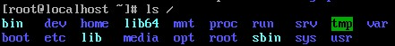
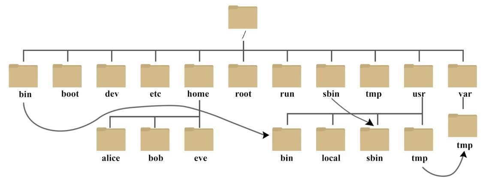
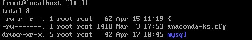
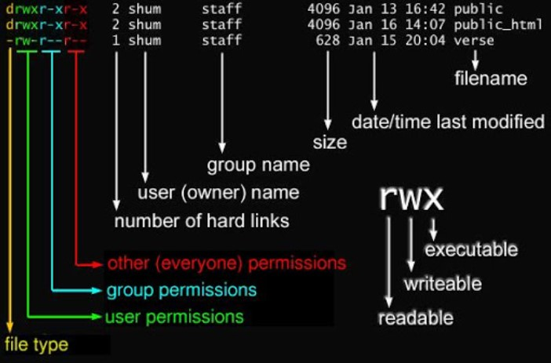
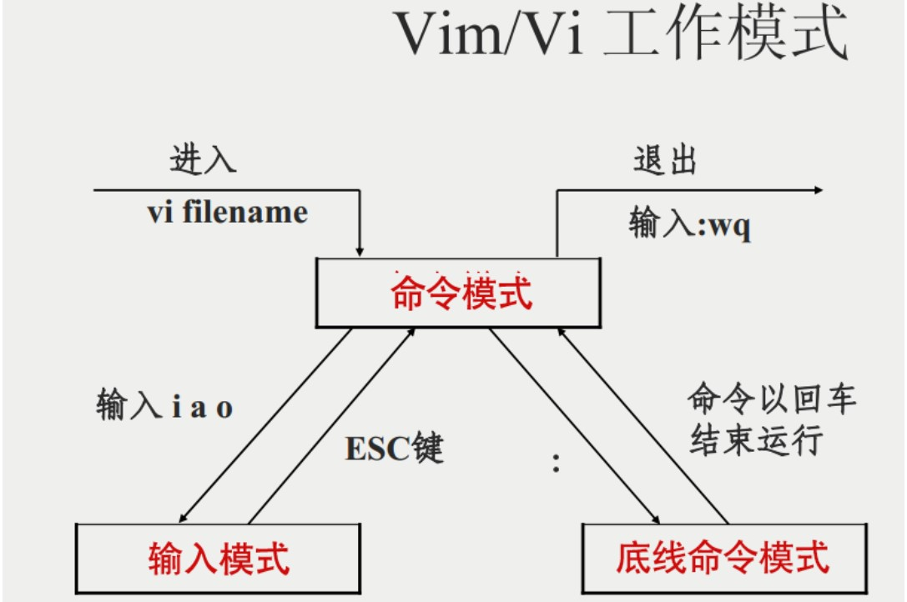

# Linux命令学习

## Linux系统目录结构

命令：`ls /`。



树状目录结构：



对目录的解释：

| 目录        | 解释                                                         |
| ----------- | ------------------------------------------------------------ |
| /bing       | bin 是 Binaries (二进制文件) 的缩写, 这个目录存放着最经常使用的命令。 |
| /boot       | 这里存放的是启动 Linux 时使用的一些核心文件，包括一些连接文件以及镜像文件。 |
| /dev        | dev 是 Device(设备) 的缩写, 该目录下存放的是 Linux 的外部设备，在 Linux 中访问设备的方式和访问文件的方式是相同的。 |
| /etc        | etc 是 Etcetera(等等) 的缩写,这个目录用来存放所有的系统管理所需要的配置文件和子目录。 |
| /home       | 用户的主目录，在 Linux 中，每个用户都有一个自己的目录，一般该目录名是以用户的账号命名的，如上图中的 alice、bob 和 eve。 |
| /lib        | lib 是 Library(库) 的缩写这个目录里存放着系统最基本的动态连接共享库，其作用类似于 Windows 里的 DLL 文件。几乎所有的应用程序都需要用到这些共享库。 |
| /lost+found | 这个目录一般情况下是空的，当系统非法关机后，这里就存放了一些文件。 |
| /media      | linux 系统会自动识别一些设备，例如U盘、光驱等等，当识别后，Linux 会把识别的设备挂载到这个目录下。 |
| /mnt        | 系统提供该目录是为了让用户临时挂载别的文件系统的，我们可以将光驱挂载在 /mnt/ 上，然后进入该目录就可以查看光驱里的内容了。 |
| /opt        | opt 是 optional(可选) 的缩写，这是给主机额外安装软件所摆放的目录。比如你安装一个ORACLE数据库则就可以放到这个目录下。默认是空的。 |
| /proc       | proc 是 Processes(进程) 的缩写，/proc 是一种伪文件系统（也即虚拟文件系统），存储的是当前内核运行状态的一系列特殊文件，这个目录是一个虚拟的目录，它是系统内存的映射，我们可以通过直接访问这个目录来获取系统信息。 |
| /root       | 该目录为系统管理员，也称作超级权限者的用户主目录。           |
| /sbin       | s 就是 Super User 的意思，是 Superuser Binaries (超级用户的二进制文件) 的缩写，这里存放的是系统管理员使用的系统管理程序。 |
| /selinux    | 这个目录是 Redhat/CentOS 所特有的目录，Selinux 是一个安全机制，类似于 windows 的防火墙，但是这套机制比较复杂，这个目录就是存放selinux相关的文件的。 |
| /srv        | 该目录存放一些服务启动之后需要提取的数据。                   |
| /sys        | 这是 Linux2.6 内核的一个很大的变化。该目录下安装了 2.6 内核中新出现的一个文件系统 sysfs 。 |
| /tmp        | tmp 是 temporary(临时) 的缩写这个目录是用来存放一些临时文件的。 |
| /usr        | usr 是 unix shared resources(共享资源) 的缩写，这是一个非常重要的目录，用户的很多应用程序和文件都放在这个目录下，类似于 windows 下的 program files 目录。 |
| /usr/bin    | 系统用户使用的应用程序。                                     |
| /usr/sbin   | 超级用户使用的比较高级的管理程序和系统守护程序。             |
| /usr/src    | 内核源代码默认的放置目录。                                   |
| /var        | var 是 variable(变量) 的缩写，这个目录中存放着在不断扩充着的东西，我们习惯将那些经常被修改的目录放在这个目录下。包括各种日志文件。 |
| /run        | 是一个临时文件系统，存储系统启动以来的信息。当系统重启时，这个目录下的文件应该被删掉或清除。如果你的系统上有 /var/run 目录，应该让它指向 run。 |

在 Linux 系统中，有几个目录是比较重要的，平时需要注意不要误删除或者随意更改内部文件。

**/etc**： 上边也提到了，这个是系统中的配置文件，如果你更改了该目录下的某个文件可能会导致系统不能启动。

**/bin, /sbin, /usr/bin, /usr/sbin**: 这是系统预设的执行文件的放置目录，比如 **ls** 就是在 **/bin/ls** 目录下的。值得提出的是 **/bin**、**/usr/bin** 是给系统用户使用的指令（除 root 外的通用用户），而**/sbin**, **/usr/sbin** 则是给 root 使用的指令。

**/var**： 这是一个非常重要的目录，系统上跑了很多程序，那么每个程序都会有相应的日志产生，而这些日志就被记录到这个目录下，具体在**/var/log **目录下，另外 mail 的预设放置也是在这里。

## Linux文件基本属性

Linux 系统是一种典型的多用户系统，**不同的用户处于不同的地位，拥有不同的权限**。为了保护系统的安全性，Linux 系统对不同的用户访问同一文件（包括目录文件）的权限做了不同的规定。

### 文件属性以及文件所属的用户和组

命令：`ll`或`ls -l`。



首先看`-rw-r--r--`：

1. 第一个属性`-`，表示这是一个文件。

   在 Linux 中第一个字符代表这个文件是目录、文件或链接文件等等。

   - 当为 **d** 则是目录
   - 当为 **-** 则是文件；
   - 若是 **l** 则表示为链接文档(link file)；
   - 若是 **b** 则表示为装置文件里面的可供储存的接口设备(可随机存取装置)；
   - 若是 **c** 则表示为装置文件里面的串行端口设备，例如键盘、鼠标(一次性读取装置)。

2. 接下来的字符，以三个为一组，且均为`rwx`的三个参数的组合。其中，**r** 代表可读(read)、 **w** 代表可写(write)、 **x** 代表可执行(execute)。 要注意的是，这三个权限的位置不会改变，如果没有权限，就会出现减号 **-** 而已。

   + 第一组为文件属主（该文件的所有者）的权限
   + 第二组为文件属组（所有者的同组用户）的权限
   + 第三组为其他用户的权限

   

对于文件来说，它都有一个特定的所有者，也就是对该文件具有所有权的用户。

同时，在Linux系统中，用户是按组分类的，一个用户属于一个或多个组。文件所有者以外的用户又可以分为文件所属组的同组用户和其他用户。

因此，Linux系统按文件所有者、文件所有者同组用户和其他用户来规定了不同的文件访问权限。

在以上实例中，mysql 文件是一个目录文件，属主和属组都为 root，属主有可读、可写、可执行的权限；与属主同组的其他用户有可读和可执行的权限；其他用户也有可读和可执行的权限。

**对于 root 用户来说，一般情况下，文件的权限对其不起作用。**

### 更改文件属性

#### chgrp：**更改文件属组**

语法：`chgrp [-R] 属组名 文件名`。

参数选项：

+ -R：递归更改文件属组，，就是在更改某个目录文件的属组时，如果加上 **-R** 的参数，那么该目录下的所有文件的属组都会更改。

#### chown：**更改文件所有者（ownner），也可以同时更改文件所属组**

语法：

```
chown [-R] 所有者 文件名
#或
chown [-R] 所有者:属组名 文件名
```

#### chmod：**更改文件9个属性**

Linux文件属性有两种设置方法，一种是数字，一种是符号。

Linux 文件的基本权限就有九个，分别是 **owner/group/others(拥有者/组/其他)** 三种身份各有自己的 **read/write/execute** 权限。

##### 数字方式

先复习一下刚刚上面提到的数据：文件的权限字符为： **-rwxrwxrwx** ， 这九个权限是三个三个一组的！其中，我们可以使用数字来代表各个权限，各权限的分数对照表如下：

| 权限 | 分数 |
| ---- | ---- |
| r    | 4    |
| w    | 2    |
| x    | 1    |

每种身份(owner/group/others)各自的三个权限(r/w/x)分数是需要累加的，例如当权限为： **-rwxrwx---** 分数则是：owner=4+2+1=7；group=4+2+1=7；others=0+0+0=0。所以当我们设定权限的变更时，该文件的权限（`-rwxrwx---`）数字就是 **770**。

变更权限的指令 `chmod` 的语法是这样的：

```
chmod [-R] xyz 文件或目录
```

选项与参数：

+ `xyz`： 就是刚刚提到的数字类型的权限属性，为 **rwx** 属性数值的相加。

  如果要将权限变成 `-rwxr-xr--`呢？那么权限的分数就成为\[4+2+1\]\[4+0+1\]\[4+0+0\]=754。

+ `-R`：进行递归(recursive)的持续变更，以及连同次目录下的所有文件都会变更。

##### 符号类型改变文件权限

九个权限分别是：user——用户；group——组；others——其他。

就可以使用 **u, g, o** 来代表三种身份的权限。此外， **a** 则代表 **all**，即全部的身份。

读写的权限可以写成 **r, w, x**，也就是可以使用下表的方式来看：

````
chmod [u|g|o|a] [+|-|=] [r|w|x] 文件或目录
````

其中，`+`：加入；`-`：除去；`=`：设定。

如果我们需要将文件权限设置为 **-rwxr-xr--** ，可以使用 `chmod u=rwx,g=rx,o=r 文件名` 来设定。

如果是要将权限去掉而不改变其他已存在的权限呢？例如要拿掉全部人的可执行权限，则：`chmod a-x 文件名`

## Linux文件与目录管理

我们知道 Linux 的目录结构为树状结构，最顶级的目录为根目录 **/**。其他目录通过挂载可以将它们添加到树中，通过解除挂载可以移除它们。

### 路径

#### 绝对路径

路径的写法，由根目录 `/`写起，例如：`/usr/share/doc`这个目录。

#### 相对路径

路径的写法，不是由`/`写起，例如：从`/usr/share/doc`到`/usr/share/man`底下时，可以写成：`cd ../man`这就是相对路径的写法。

### 处理目录的常用命令

+ ls（英文全拼：list files）：列出目录及文件名
+ cd（英文全拼：change directory）：切换目录
+ pwd（英文全拼：print work directory）：显示目前的目录
+ mkdir（英文全拼：make directory）：创建一个新的目录
+ rmdir（英文全拼：remove directory）：删除一个空的目录
+ cp（英文全拼：copy file）：复制文件或目录
+ rm（英文全拼：remove file）：删除文件或目录
+ mv（英文全拼：move file）：移动文件与目录，或修改文件与目录的名称

***可以使用`man [命令]`来查看各个命令的使用文档***，如：`man cp`。

#### ls（列出目录）

语法：

```
ls [-aAdfFhilnrRSt] 目录名称
#或
ls [--color={never,auto,always}] 目录名称
#或
ls [--full-time] 目录名称
```

选项与参数：

+ -a：全部的文件，连同隐藏文件（开头为`.`的文件）一起列出来（常用）
+ -d：仅列出目录本身，而不是列出目录内的文件数据（常用）
+ -l：长数据串列出，包含文件的属性与权限等等数据；（常用）

将目录下的所有文件列出来（含属性与隐藏档）：`ls -al`。

#### cd（切换目录）

语法：

```
cd [相对路径或绝对路径]
```

一些特定的格式：

+ 回到当前用户的home目录（比如`/root`）：`cd ~`
+ 回到目前目录的上一级目录：`cd ..`

#### pwd（显示目前目录所在的目录）

语法：

```
pwd [-p]
```

可选参数：

+ -p：显示出确实的路径，而非使用连接（link）路径

#### mkdir（创建新目录）

语法：

```
mkdir [-mp] 目录名称
```

可选参数：

+ -m：配置文件的权限！直接配置，不需要看默认权限。
+ -p：帮助将所需要的目录（包括上一级目录）递归创建起来。

例如：

+ 创建权限为`rwx--x--x`的目录：`mkdir -m 711 test`

  如果没有加上`-m`来强制配置属性，系统会使用默认属性。

+ 同时创建多个新的目录：`mkdir -p test1/test2/test3`

#### rmdir（删除空的目录）

语法：

```
rmdir [-p] 目录名称
```

可选参数：

+ -p：从该目录起，一次删除多级**空目录**

  例如：`rmdir -p test1/tesst2/test3`

**不过要注意的是，这个 `rmdir` 仅能删除空的目录，你可以使用 `rm` 命令来删除非空目录。**

#### cp（复制文件或目录）

语法：

```
cp [-adfilprsu] 来源档（source） 目标档（destination）
#或
cp [options] source1 source2 source3 ... directory
```

可选参数：

+ -a：相当于`-pdr`，请参考如下`-p`、`-d`、`-r`的说明
+ -d：若来源档为链接档的属性（link file），则复制链接档属性而非文件本身
+ -f：为强制（force）的意思，若目标文件已经存在且无法开启，则移除后再尝试一次
+ -i：若目标档（destination）已经存在，在覆盖时会先询问动作的进行
+ -l：进行硬式链接（hard link）的链接档创建，而非复制文件本身
+ -p：连同文件的属性一起复制过去，而非使用默认属性（备份常用）
+ -r：递归持续复制，用于目录的复制行为
+ -s：复制成为符号链接档（symbolic link），亦即“捷径”文件
+ -u：若 destination 比 source 旧才升级 destination 

#### rm（移除文件或目录）

语法：

```
rm [-fir] 文件或目录
```

可选参数：

+ -f：就是force的意思，忽略不存在的文件，不会出现警告信息
+ -i：互动模式，在删除前会询问使用者是否动作
+ -r：递归删除！最常用在目录的删除了！这是非常危险的选项！！！

#### mv（移动文件与目录，或修改名称）

语法：

```
mv [-fiu] source destination
#或
mv [options] source1 source2 source3 ... directory
```

可选参数：

- -f ：force 强制的意思，如果目标文件已经存在，不会询问而直接覆盖；
- -i ：若目标文件 (destination) 已经存在时，就会询问是否覆盖！
- -u ：若目标文件已经存在，且 source 比较新，才会升级 (update)

## Linux文件内容查看

Linux系统中使用以下命令查看文件的内容：

- cat 由第一行开始显示文件内容
- tac 从最后一行开始显示，可以看出 tac 是 cat 的倒着写！
- nl  显示的时候，顺便输出行号！
- more 一页一页的显示文件内容
- less 与 more 类似，但是比 more 更好的是，他可以往前翻页！
- head 只看开头几行
- tail 只看末尾几行

可以使用 `man [命令]`来查看各个命令的使用文档。

### cat

语法：

```
cat [-AbEnTv]
```

可选参数：

+ -A：相当于`-vET`的整合选项，可列出一些特殊字符而不是空白字符而已
+ -b：列出行号，仅针对非空白行做行号显示，空白行不标行号
+ -E：将结尾的断行字节`$`显示出来
+ -n：列打印行号，连同空白行也会有行号，与-b的选项不同
+ -T：将`tab`（制表符）按键以`^|`显示出来
+ -v：列出一些看不出来的特殊字符

### tac

tac与cat命令刚好相反，文件内容从最后一行开始显示，可以看出tac是cat的倒写。

### nl

显示行号

语法：

```
nl [-bnw] 文件
```

可选参数：

+ -b：指定行号指定的方式，主要有两种：
  + -b  a：表示不论是否为空行，也同样列出行号（类似`cat -n`）
  + -b t：如果有空行，空的那一行不要列出行号（默认值）
+ -n：列出行号表示的方法，主要有三种：
  + -n ln：行号在屏幕的最左方显示
  + -n rn：行号在自己栏位的最右方显示，且不加0
  + -n rz：行号在自己栏位的最右方显示，且加0
+ -w：行号栏位的占用的位数

### more

一页一页翻动

在more这个程序的运行过程中，可以有几个按键可以按：

+ 空白键（space）：代表向下翻一页
+ enter：代表向下翻一行
+ /字串：代表在这个显示的内容当中，向下搜寻`字串`这个关键字
+ :f ：立刻显示出档名以及目前显示的行数
+ q：代表立刻离开more，不再显示该文件内容
+ b或ctrl-b：代表往回翻，不过这动作只对文件有用，对管线无用

### less

一页一页翻动

less运行时可以输入的命令或按键：

+ 空白键：向下翻动一页
+ [pagedown]：向下翻动一页
+ [pageup]：向下翻动一页
+ /字串：向下搜寻`字串`的功能
+ n：重复前一个搜寻（与/或?有关）
+ N：反向的重复前一个搜寻（与/或?有关）
+ q：离开less这个程序

### head

取出文件的前面几行

语法：

```
head [-n number] 文件
```

可选参数：

+ -n：后面接数字，代表显示几行的意思

  默认的情况下，显示前面10行。

### tail

取出文件后面几行

语法：

```
tail [-n number] 文件
```

可选参数：

+ -n：后面接数字，代表显示几行的意思
+ -f：表示持续侦测后面所接的档名，要等到按下ctrl-c才会结束tail的侦测

## Linux磁盘管理

Linux 磁盘管理好坏直接关系到整个系统的性能问题。

Linux 磁盘管理常用三个命令为 **df**、**du** 和 **fdisk**。

- **df**（英文全称：disk free）：列出文件系统的整体磁盘使用量
- **du**（英文全称：disk used）：检查磁盘空间使用量
- **fdisk**：用于磁盘分区

### df

df命令参数功能：检查文件系统的磁盘空间占用情况。可以利用该命令来获取硬盘被占用了多少空间，目前还剩下多少空间等信息。

语法：

```
df [-ahiKHTm] [目录或文件名]
```

可选参数：

+ `-h`：以人类可读的方式显示输出结果（例如，使用 KB、MB、GB 等单位）。
+ `-T`：显示文件系统的类型。
+ `-t <文件系统类型>`：只显示指定类型的文件系统。
+ `-i`：显示 inode 使用情况。
+ `-H`：该参数是 `-h` 的变体，但是使用 1000 字节作为基本单位而不是 1024 字节。这意味着它会以 SI（国际单位制）单位（例如 MB、GB）而不是二进制单位（例如 MiB、GiB）来显示磁盘使用情况。
+ `-k`：这个选项会以 KB 作为单位显示磁盘空间使用情况。
+ `-a`：该参数将显示所有的文件系统，包括虚拟文件系统，例如 `proc`、`sysfs` 等。如果没有使用该选项，默认情况下，`df` 命令不会显示虚拟文件系统。

### du

Linux du 命令也是查看使用空间的，但是与 df 命令不同的是 Linux du 命令是对文件和目录磁盘使用的空间的查看，还是和df命令有一些区别的。

语法：

```
du [-ahskm] 文件或目录名称
```

可选参数：

- -a ：列出所有的文件与目录容量，因为默认仅统计目录底下的文件量而已。
- -h ：以人们较易读的容量格式 (G/M) 显示；
- -s ：仅显示指定目录或文件的总大小，而不显示其子目录的大小。
- -S ：包括子目录下的总计，与 -s 有点差别。
- -k ：以 KBytes 列出容量显示；
- -m ：以 MBytes 列出容量显示；

### fdisk

fdisk 是 Linux 的磁盘分区表操作工具。

语法：

```
fdisk [-l] 装置名称
```

可选参数：

- -l ：输出后面接的装置所有的分区内容。若仅有 fdisk -l 时， 则系统将会把整个系统内能够搜寻到的装置的分区均列出来。

### 磁盘格式化

磁盘分割完毕后自然就是要进行文件系统的格式化，格式化的命令非常的简单，使用 `mkfs`（make filesystem） 命令。

语法：

```
mkfs [-t 文件系统格式] 装置文件名
```

可选参数：

- -t ：可以接文件系统格式，例如 ext3, ext2, vfat 等(系统有支持才会生效)

### 磁盘检验

fsck（file system check）用来检查和维护不一致的文件系统。

若系统掉电或磁盘发生问题，可利用fsck命令对文件系统进行检查。

语法：

```
fsck [-t 文件系统] [-ACay] 装置名称
```

可选参数：

- -t : 给定档案系统的型式，若在 /etc/fstab 中已有定义或 kernel 本身已支援的则不需加上此参数
- -s : 依序一个一个地执行 fsck 的指令来检查
- -A : 对/etc/fstab 中所有列出来的 分区（partition）做检查
- -C : 显示完整的检查进度
- -d : 打印出 e2fsck 的 debug 结果
- -p : 同时有 -A 条件时，同时有多个 fsck 的检查一起执行
- -R : 同时有 -A 条件时，省略 / 不检查
- -V : 详细显示模式
- -a : 如果检查有错则自动修复
- -r : 如果检查有错则由使用者回答是否修复
- -y : 选项指定检测每个文件是自动输入yes，在不确定那些是不正常的时候，可以执行 # fsck -y 全部检查修复。

### 磁盘挂载与卸除

Linux 的磁盘挂载使用 `mount` 命令，卸载使用 `umount` 命令。

磁盘挂载语法：

```
mount [-t 文件系统] [-L Label名] [-o 额外选项] [-n] 装置文件名 挂载点
```

磁盘卸载语法：

```
umount [-fn] 装置文件名或挂载点
```

可选参数：

- -f ：强制卸除！可用在类似网络文件系统 (NFS) 无法读取到的情况下；
- -n ：不升级 /etc/mtab 情况下卸除。

## Linux vi/vim

所有的 Unix Like 系统都会内建 vi 文书编辑器，其他的文书编辑器则不一定会存在。但是目前我们使用比较多的是 vim 编辑器。vim 具有程序编辑的能力，可以主动的以字体颜色辨别语法的正确性，方便程序设计。

Vim 是从 vi 发展出来的一个文本编辑器。代码补全、编译及错误跳转等方便编程的功能特别丰富，在程序员中被广泛使用。简单的来说， vi 是老式的字处理器，不过功能已经很齐全了，但是还是有可以进步的地方。 vim 则可以说是程序开发者的一项很好用的工具。

### vi/vim的使用

基本上vi/vim共分为三种模式：**命令模式（Command Mode）、输入模式（Insert Mode）和命令行模式（Command-Line Mode）**。

#### 命令模式

**用户刚刚启动 vi/vim，便进入了命令模式。**此状态下敲击键盘动作会被 Vim 识别为命令，而非输入字符，比如我们此时按下 `i`，并不会输入一个字符，`i` 被当作了一个命令。

以下是普通模式常用的几个命令：

- `i` -- 切换到输入模式，在光标当前位置开始输入文本。
- `x` -- 删除当前光标所在处的字符。
- `:` -- 切换到底线命令模式，以在最底一行输入命令。
- `a` -- 进入插入模式，在光标下一个位置开始输入文本。
- `o`：在当前行的下方插入一个新行，并进入插入模式。
- `O` -- 在当前行的上方插入一个新行，并进入插入模式。
- `dd` -- 剪切当前行。
- `yy` -- 复制当前行。
- `p`（小写） -- 粘贴剪贴板内容到光标下方。
- `P`（大写）-- 粘贴剪贴板内容到光标上方。
- `u` -- 撤销上一次操作。
- `Ctrl + r` -- 重做上一次撤销的操作。
- `:w` -- 保存文件。
- `:q` -- 退出 Vim 编辑器。
- `:q!` -- 强制退出Vim 编辑器，不保存修改。

若想要编辑文本，只需要启动 Vim，进入了命令模式，按下 **i** 切换到输入模式即可。

命令模式只有一些最基本的命令，因此仍要依靠**底线命令行模式**输入更多命令。

#### 输入模式

在命令模式下按下 **i** 就进入了输入模式，使用 **Esc** 键可以返回到普通模式。

在输入模式中，可以使用以下按键：

- **字符按键以及Shift组合**，输入字符
- **ENTER**，回车键，换行
- **BACK SPACE**，退格键，删除光标前一个字符
- **DEL**，删除键，删除光标后一个字符
- **方向键**，在文本中移动光标
- **HOME**/**END**，移动光标到行首/行尾
- **Page Up**/**Page Down**，上/下翻页
- **Insert**，切换光标为输入/替换模式，光标将变成竖线/下划线
- **ESC**，退出输入模式，切换到命令模式

#### 底线命令模式

在命令模式下按下 **:**（英文冒号）就进入了底线命令模式。

底线命令模式可以输入单个或多个字符的命令，可用的命令非常多。

在底线命令模式中，基本的命令有（已经省略了冒号）：

- `:w`：保存文件。
- `:q`：退出 Vim 编辑器。
- `:wq`：保存文件并退出 Vim 编辑器。
- `:q!`：强制退出Vim编辑器，不保存修改。

按 **ESC** 键可随时退出底线命令模式。



使用`vim`建立一个名为`01.txt`的文件，可以输入：

```
vim 01.txt
```

直接输入 `vi 文件名` 就能够进入 vi 的一般模式了。请注意，记得 vi 后面一定要加文件名，不管该文件存在与否！

接着按下 i 进入输入模式(也称为编辑模式)，开始编辑文字。

按下 ESC 按钮回到一般模式。

在一般模式中输入 `:wq` 储存后离开 vi
