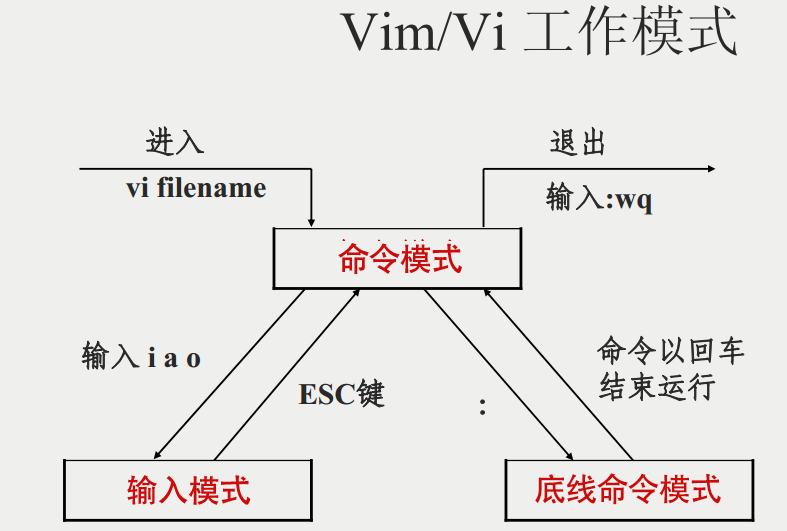
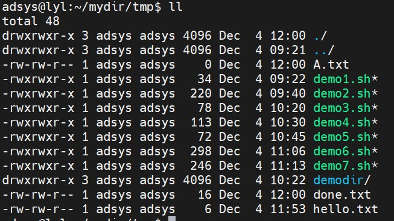
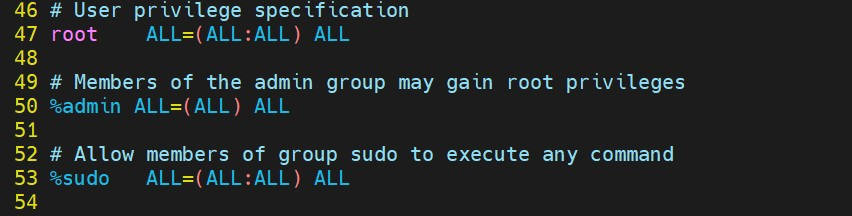
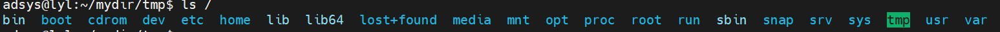
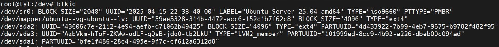
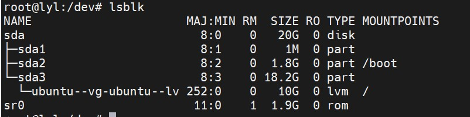

# Linux操作系统

## 介绍

***以下内容来自维基百科：<https://zh.wikipedia.org/wiki/Linux>***

**Linux**是一种自由和开放源码的类Unix操作系统。该操作系统的内核由林纳斯·托瓦兹在1991年10月5日首次发布，再加上用户空间的应用程序之后，就成为了Linux操作系统。只要遵循GNU通用公共许可证（GPL），任何个人和机构都可以自由地使用Linux的所有底层源代码，也可以自由地修改和再发布。

Linux严格来说是单指操作系统的内核，因操作系统中包含了许多用户图形界面和其他实用工具。如今Linux常用来指基于Linux的完整操作系统，内核则改以Linux内核称之。

Linux最初是作为支持英特尔x86架构的个人电脑的一个自由操作系统。目前Linux已经被移植到更多的计算机硬件平台，远远超出其他任何操作系统。Linux可以运行在服务器和其他大型平台之上，如大型计算机和超级计算机。Linux也广泛应用在嵌入式系统上，如手机（Mobile Phone）、平板电脑（Tablet）、路由器（Router）、电视（TV）和电子游戏机等。在移动设备上广泛使用的Android操作系统就是建立在Linux内核之上。

通常情况下，Linux被打包成供个人计算机和服务器使用的Linux发行版，一些流行的主流Linux发行版，包括Debian（及其派生版本Ubuntu、Linux Mint）、Fedora（及其相关版本Red Hat Enterprise Linux）和openSUSE等。Linux发行版包含Linux内核和支撑内核的实用程序和库，通常还带有大量可以满足各类需求的应用程序。

Linux系统使用宏内核，由Linux内核负责处理进程控制、网络，以及外围设备和文件系统的访问。在系统运行的时候，设备驱动程序要么与内核直接集成，要么以加载模块形式添加。

Linux具有设备独立性，它内核具有高度适应能力，从而给系统提供了更高级的功能。GNU用户界面组件是大多数Linux操作系统的重要组成部分，提供常用的C函数库，Shell，还有许多常见的Unix实用工具，可以完成许多基本的操作系统任务。

一个典型的发行版包括：Linux内核，GNU函数库和各种系统工具，命令行Shell，图形界面底层的X窗口系统和上层的桌面环境等。

---

常见的Linux发行版：Debian、Ubuntu（基于Debian）、CentOS （已停止原来版本的稳定维护）、Fedora（Red Hat 社区版）、Linux Mint、Kali Linux等。


## 安装

### 物理机安装

***全功能、全速***


### 双启动安装

***方便切换、启动便拥有物理机安装特性***


### 虚拟机安装

***不影响原系统、随时重装、快照恢复；部分网络功能不便实现，性能略差***


## 软件管理

### 源代码

困难

专业要求高

需要编译环境


### rpm（redhat package manager）

红帽公司发行的linux系统包管理工具

需要解决依赖问题

与源代码安装相比，简单易用

```
# 安装
rpm -i 
# 升级
rpm -U
# 查询
rpm -q
# 校验
rpm -V
# 卸载
rpm -e
```


### yum（yellow dog updater，Modified）

提供yum软件库

解决了软件的依赖关系问题

进一步降低软件安装难度和复杂度而设计

```
yum install

yum update

yum info

yum remove

```


### dnf（dandified yum）

yum仍然还是存在分析不准确、内存占用大、不能多人同时安装软件等硬伤

dnf可以看做是yum的升级版v4，常用操作与yum无异

```
dnf install

dnf update

dnf info

dnf remove

```


### apt-get和apt

apt-get 是 Debian 和 Ubuntu 等基于 Debian 的 Linux 发行版中用于管理软件包的核心命令行工具。

`apt-get` 是 Advanced Packaging Tool (APT) 的前端工具，用于处理 `.deb` 格式的软件包。它能够自动解决软件包之间的依赖关系，简化了 Linux 系统的软件管理。

```
# 更新软件包列表，但不会安装或升级任何软件
apt-get update

# 升级已安装的软件包
apt-get upgrade

# 安装软件
apt-get install

# 移除软件包，但保留配置文件
apt-get remove

# 完全移除软件包和配置文件
apt-get purge 
```


apt（Advanced Packaging Tool）是一个在 Debian 和 Ubuntu 中的 Shell 前端软件包管理器。

apt 命令提供了查找、安装、升级、删除某一个、一组甚至全部软件包的命令，而且命令简洁而又好记。

apt 命令执行需要超级管理员权限(root)。

```
apt update

apt upgrade

apt install

apt remove

apt purge

# 列出所有已经安装的软件包
apt list --installed

# 列出所有已经安装的软件包的版本信息
apt list --all-versions

# 查找软件包
apt search <keyword>

# 显示软件包具体信息
apt show 
# 或
apt info

# 清除不再使用的包和库文件
apt autoremove
```


## 基础命令

### 命令格式

```
命令名称 [命令参数] [命令对象]
```

- 大小写敏感
- “空格”必不可少
- 参数类型
  + 长格式（完整单词），如`--help`
  + 短格式（单个字母缩写），如`-h`
- 命令对象
  + 一般指“文件“（在Linux中一切皆是文件，包括硬件资源）


在输入命令时，命令提示符`$`表示当前用户是普通用户；`#`表示管理员用户，或`root`用户

### 输出命令

#### echo

1. 输出字符串

   ```
   echo "hello world"
   ```

   

2. 输出环境变量

   ```
   echo $PATH
   ```

   + `$`表示取变量的值


### 日期命令

#### date

1. 显示当前时间

   ```
   date
   ```

   + 格式化输出，如`date +"%Y-%m-%d %H:%M:%S"`，注意`+`不能少且和格式控制字符串没有空格。

2. 设置时间

   ```
   date -s "20251231 12:00:00"
   ```

   + 命令需要管理员权限


#### timedatectl

1. 显示系统时间和时区信息

   ```
   timedatectl
   
   # 或
   timedatectl status
   ```

2. 设置系统时区

   ```
   timedatectl set-timezone Asia/Shanghai
   ```

   + 命令可能需要验证密码


### 关机/重启计算机

#### reboot

1. 重启计算机

   ```
   reboot
   ```

   

#### poweroff

1. 关机（关闭电源）

   ```
   poweroff
   ```


### 系统服务管理

#### systemctl

`systemctl`是 Linux 系统中用于控制 systemd 系统和服务管理器的命令行工具。

1. 服务管理命令

   ```
   # 启动服务
   systemctl start [服务名]
   
   # 停止服务
   systemctl stop [服务名]
   
   # 重启服务
   systemctl restart [服务名]
   
   # 重新加载配置（不重启服务）
   systemctl reload [服务名]
   
   # 检查服务状态
   systemctl status [服务名]
   
   # 启用服务（开机自启）
   systemctl enable [服务名]
   
   # 禁用服务（取消开机自启）
   systemctl disable [服务名]
   
   # 查看服务是否启用
   systemctl is-enabled [服务名]
   ```

2. 系统电源管理

   ```
   # 关机
   systemctl poweroff
   
   # 重启
   systemctl reboot
   
   # 挂起
   systemctl suspend
   
   # 休眠
   systemctl hibernate
   ```

   


### 网络工具

#### wget

1. 从网络上下载

   ```
   wget -c <下载地址>
   ```

   + `-c`断点续传文件


### 进程管理

#### ps

1. 显示所有进程

   ```
   ps -A
   ```
   
   

2. 格式化输出进程的登记信息，包括用户信息、PID、CPU占用率

   ```
   ps -au
   ```


#### pstree

1. 以树结构显示进程

   ```
   pstree
   ```


#### top

1. 实时刷新进程CPU等资源使用情况

   ```
   top
   ```

   + 显示的`NI`列表示进程的优先级


#### nice

1. 设定进程的优先级

   ```
   nice -n -20 <命令>
   ```

   + 优先级从`-20`到`19`，数值越小优先级越高，`-20`最高优先级，`19`最低优先级。
   + `命令`是进程信息的`CMD`或` COMMAND`列的值。


#### pidof

1. 查询指定进程的PID值

   ```
   pidof <进程>
   ```

   + 如`pidof systemd`


#### kill

1. 结束指定PID的进程

   ```
   kill <pid>
   ```


### 系统状态检测

#### ifconfig

1. 显示网络信息

   ```
   ifconfig
   ```


#### uname

1. 打印输出系统信息

   ```sh
   uname -a
   ```


#### lsb_release

1. 查看系统发行版本信息

   ```sh
   lsb_release -a
   ```

   

#### hostnamectl

1. 查看包括操作系统在内的多种系统信息

   ```sh
   hostnamectl
   ```

   


#### uptime

1. 显示系统上线时间

   ```
   uptime
   ```


#### free

1. 查看系统内存使用情况

   ```
   free -h
   ```

   + `-h`是以对人友好的方式输出显示


#### who

1. 打印当前系统登录用户信息

   ```
   who
   ```


#### last

1. 查看最近登录系统的用户信息

   ```
   last
   ```


#### ping

1. 向目标主机发送报文，判断网络联通性

   ```
   ping -c 4 <目标主机IP地址>
   ```

   + `-c 4`收到4个回复后结束，数值可以自定义


#### tracepath

1. 显示到目标主机的路由信息

   ```
   tracepath <目标主机IP地址>
   ```

   

#### netstat

1. 显示网络接口信息

   ```
   netstat -i
   ```


2. 列出所有的网络状态信息

   ```
   netstat -a
   ```

   

#### history

1. 查看执行过的命令历史记录

   ```
   history
   ```


2. 清除历史记录

   ```
   history -c
   ```


#### sosreport

1. 打印系统诊断的信息形成一个包文件


### 查找定位文件命令

#### pwd

1. 打印当前的工作目录（路径）

   ```
   pwd
   ```


#### cd

1. 改变当前的工作目录

   ```
   cd <目录>
   ```

   + 如切换到`/etc`目录，`cd /etc`
   + 切换到用户的home主目录，`cd ~`
   + 回到上一次的目录，`cd -`（该命令只能在最近的两个`cd`命令间切换）


#### ls

1. 列出目录下的文件信息

   ```
   ls
   ```

   + 使用参数`-a`列出所有文件，包括隐藏文件
   + 使用参数`-l`列出文件的详细信息


#### tree

1. 以树形结构列出目录下的所有文件

   ```
   tree
   ```


#### find

1. 按照文件名匹配搜索目录下的文件

   ```
   find <目录> -name "<匹配规则>"
   ```

   + 如在`/etc`目录下搜索文件名为“zoo”开头的文件，`find /etc -name "zoo*"`

2. 按照文件的权限搜索目录下的文件

   ```
   find <目录> -perm -<权限>
   ```

   + 如搜索写权限的文件，`find /etc -perm -020`


#### whereis

1. 搜索二进制文件

   ```
   whereis <文件名>
   ```


#### which

1. 查询指定命令（程序）所在的目录路径

   ```
   which <命令>
   ```

   + 如查找`ls`命令所在的目录，`which ls`


### 文本文件编辑命令

#### cat

1.  显示文件内容

   ```
   cat <文件路径>
   ```

   + 内容显示带行号，加参数`-n`，如`cat -n <文件路径>`


#### more

1. 文件内容过多时，使用more命令分屏（页）显示

   ```
   more <文件路径>
   ```

   + 使用空格翻页，向下显示；按`q`键结束，或翻页结束


#### head

1. 显示文件内容的前几行

   ```
   head -n <count> <文件路径>
   ```

   + 显示前3行，`head -n 3 <文件路径>`
   + 不带`-n <count>`参数默认显示前10行


#### tail

1. 显示文件内容的末尾几行

   ```
   tail -n <count> <文件路径>
   ```

   + 不带参数默认显示末尾10行

2. 当文件增长时输出增加的内容

   ```
   tail -f <文件路径>
   ```

   


#### tr

将标准输入的内容按照指定格式进行替换、压缩、删除字符后标准输出

1. 将输入的字符串中的小写字母转大写

   ```
   echo "asifleifl" | tr [a-z] [A-Z]
   ```


#### wc

统计文件内容的字符、行数等信息

1. 统计文件内容的行数

   ```
   wc -l <文件路径>
   ```

2. 统计文件内容的单词数

   ```
   wc -w <文件路径>
   ```

3. 统计文件内容的字节数

   ```
   wc -c <文件路径>
   ```


#### stat

1. 显示文件或文件系统的状态

   ```
   stat <文件>
   ```


#### grep

按照模式匹配的方式输出文件内容

```
grep [参数] <模式> <文件>
```

+ 参数`-i`在内容匹配时忽略大小写
+ 模式可以是特定的字符串也可以正则表达式


#### cut

按照列显示文件的内容


#### diff

一行一行地比较文件内容

```
diff <文件A> <文件B> 
```


#### uniq

去除文件中的重复行

```
uniq <文件名>
```


#### sort

对文件内容进行排序输出，包括字母、字符串、数字等，默认按照字符串（将数字也视作字符串）。

```
sort <文件名>
```

+ 排序不影响文件内容，只是输出显示结果变化
+ 参数`-n` 进行数字（值）排序


### 文件目录管理命令

#### touch

修改文件（目录）的时间戳（访问、修改时间），也可以创建空的文件（当文件不存在时创建空文件；添加参数`-c`或`-h`可避免空文件的创建）。

1. 修改文件的时间戳

   ```
   touch <参数> <文件>
   ```

2. 创建空文件

   ```
   touch <不存在文件>
   ```


#### mkdir

创建文件目录，添加参数`-p`可以逐级递归创建。

```
mkdir -p <文件目录>
```

+ 没有`-p`参数，当文件目录中存在错误（不存在）的目录名称就会创建失败。


#### cp

复制（拷贝）文件（目录）

```
cp [参数] <源文件> <目的文件>
```

+ `-r`或`-R`：递归复制目录及其内容（用于复制目录）。
+ `-i`：交互模式，覆盖前提示用户确认。
+ `-v`：显示详细的复制过程（verbose）。
+ `-f`：强制复制，覆盖目标文件而不提示。
+ `-p`：保留文件的原始属性（如权限、时间戳等）。
+ `-l`：创建硬链接而不是复制文件。
+ `-s`：创建符号链接（软链接）而不是复制文件。


#### mv

移动文件或重命名文件。

```
mv [参数] <源文件> <目的文件>
```

+ 当目的文件和源文件是在同一目录下时，就是让源文件重命名为目的文件。


#### rm

删除文件（目录）

```
rm [参数] <文件>
```

+ 参数`-f`，强制删除且无提示
+ 参数`-i`，每次删除时提示
+ 参数`-r`，逐级递归删除目录或文件及其包含的子目录文件。若删除目录则必须配合选项`-r`。


#### dd

复制文件，根据操作数进行转换和格式化

可以用作光盘的刻录


#### file

检测文件的类型

```
file [参数] <文件>
```

+ 如`file ./music/demo.mp3`


#### tar

归档（打包）文件或目录/释放（解压）压缩包

1. 将文件A打包为压缩包`pk.tar.gz`

   ```
   tar -czvf pk.tar.gz <文件A>
   ```

   + 参数`-c`：对文件进行归档（打包）
   + 参数`-z`：通过gzip（zip）方式压缩文件
   + 参数`-v`：列出处理过程中的文件
   + 参数`-f`：指定归档文件或设备，例子中是`pk.tar.gz`

2. 将压缩包解压（释放）

   ```
   tar -xzvf <压缩包>
   ```

   + 参数`-x`：解压（释放）归档（压缩）文件
   + 如要解压到指定目录使用`-C`参数，`tar -xzvf <压缩包> <指定目录>`


## 输入输出重定向

linux系统总输入输出设备种类：

+ 标准输入设备（STDIN，文件描述符为0）：默认从键盘输入，也可以从其他文件或命令中输入
+ 标准输出设备（STDOUT，文件描述符为1）：默认输出到屏幕
+ 错误输出设备（STDERR，文件描述符为2）：默认输出到屏幕

输入输出重定向：改变标准输入输出设备的输入输出方向

### 输入重定向

+ `命令 < 文件`

  将文件作为命令的标准输入

  如统计特定文件中的字符信息`wc < 文件`

+ `命令 << 分界符`

  从标准输入中读入，直到遇见分界符才停止

  如统计从键盘中输入字符（以`end`结束输入）的信息`wc << end`

+ `命令 < 文件1 > 文件2`

  将文件1作为命令的标准输入并将标准输出到文件2

  如将统计的字符信息输出到另一个文件中`wc < 文件 > 另一个文件`


### 输出重定向

+ `命令 > 文件`

  将标准输出重定向到一个文件中（清空原有文件的数据）

+ `命令 2> 文件`

  将错误输出重定向到一个文件中（清空原有文件的数据）

+ `命令 >> 文件`

  将标准输出重定向到一个文件中（追加到原有内容的后面）

+ `命令 2>> 文件`

  将错误输出重定向到一个文件中（追加到原有内容的后面）

+ `命令 >> 文件 2>&1`或`命令 &>> 文件`

  将标准输出与错误输出共同写入到文件中（追加到原有内容的后面）。若使用单个`>`则是清空原有文件数据。


## 管道命令符

管道命令符：`|`，用于命令之间。

使用格式：`命令A | 命令B`，将`命令A`的输出作为`命令B`的输入

如`ll /mydir | grep demo`，输出显示`/mydir`目录下文件名与`demo`匹配的文件

允许在3个及以上命令之间使用：`命令A | 命令B | 命令C | ……`

**与输入输出重定向的区别**：管道符是用于命令和命令之间；输入输出重定向是用于命令和文件之间。


## 命令行通配符

+ `*` ，任意字符
+ `?`，单个任意字符
+ `[a-z]`，单个小写字母
+ `[A-Z]`，单个大写字母
+ `[a-Z]`，单个字母
+ `[0-9]`，单个数字
+ `[[:alpha:]]`，任意字母
+ `[[:upper:]]`，任意大写字母
+ `[[:lower:]]`，任意小写字母
+ `[[:digit:]]`，所有数字
+ `[[:alnum:]]`，任意字母加数字
+ `[[:punct;]]`，标点符号


## 常用转义字符

+ 反斜杠`\`，使反斜杠后面的一个变量变为单纯的字符
+ 单引号`''`，转义其中所有的变量为单纯的字符
+ 双引号`""`，保留其中的变量属性，不进行转义处理
+ 反引号，把其中的命令执行后返回结果


## 重要的环境变量

变量：计算机系统用于保存可变值的数据类型。变量名称一般是大写的。

环境变量：用来定义系统运行环境的一些参数

### linux中命令的执行步骤：

1. 第一步，判断用户是否以绝对路径或相对路径的方式输入命令（如`/bin/ls`），如果是则直接执行。

2. 第二步，Linux系统检查用户输入的命令是否为“别名命令”，即用一个自定义的命令名称来替换原本的命令名称，如`ll`一般是`ls -al`的“别名”。

   ***使用`type <命令>`可以查看命令的类型信息（别名，shell保留字/关键字，shell函数，shell内置，磁盘文件）、路径信息***

3. 第三步，bash解释器判断用户输入的是内部命令还是外部命令。内部命令则直接执行，外部命令则需要系统去查找命令。

   ***使用`which <命令>`可以查看命令的所在路径***

4. 第四步，系统在多个路径（PATH环境变量）中查找用户输入的命令文件。


### 重要的10个环境变量

+ HOME：用户的主目录
+ SHELL：用户在使用的shell解释器名称
+ HISTSIZE：输出的历史命令记录条数
+ HISTFILESIZE：保存的历史命令记录条数
+ MAIL：邮件保存路径
+ LANG：系统语言，系统名称
+ RANDOM：生成一个随机随机数
+ PS1：Bash解释器的提示符
+ PATH：定义解释器搜索用户执行命令的路径
+ EDITOR：用户默认的文本编辑器


### 自定义变量

使用`export <变量名>=<变量值>`去自定义变量及其值，通过`$<变量名>`获取变量值。

撤销变量使用`unset <变量名>`。


## vim文本编辑器

vim（Vi IMproved）编辑器是vi（Visual）编辑器的进化版。

**在linux系统中一切都是文件，而配置一个服务就是在修改其配置文件的参数。**

三种模式：

+ 命令模式：控制光标移动，可对文本进行复制、粘贴、删除和查找等工作。
+ 输入模式：正常的文本录入。
+ 末行模式：保存或退出文档，以及设置编辑环境。




### 常用操作

#### 设置行号显示

+ 在命令模式下输入`:set nu`，会在每一行前面显示改行行号
+ 在命令模式下输入`:set nonu`，取消行号显示


#### 光标移动

+ 通过箭头键上、下、左、右移动光标，光标上下移动一行或左右移动一个字符
+ 按`ctrl`键和`f`键（大写未锁定）屏幕向下移动一页；按`ctrl`键和`b`键（大写未锁定）屏幕向上移动一页
+ 在命令模式下先通过数字键输入数字`<num>`，再按`space`空格键，则光标向后移动`<num>`个字符
+ 在命令模式下按数字键`0`或`HOME`键光标移动到该行第一个字符处；按`$`键或`END`键光标移动到该行最后一个字符处
+ 在命令模式下按`G`（大写）键，光标移动到该文件的最后一行；在命令模式下按下`gg`（两次`g`键），光标移动到该文件的第一行，相当于`1G`
+ 在命令模式下先通过数字键输入行号`<num>`，再按`G`（大写），则光标移动到行号为`<num>`的行
+ 在命令模式下先通过数字键输入数字`<num>`，再按回车键`ENTER`，则光标从当前行向下移动`<num>`行
+ 在命令模式下先按`:`键，再输入行号`<num>`，再按回车键`ENTER`，光标将跳转到行号为`<num>`的行


#### 删除/剪切

+ 在命令模式下，按`dd`（两次`d`键）可以剪切光标所在的一整行内容，和删除整行效果一样

+ 在命令模式下，先通过数字键输入数字`<num>`，再按`dd`键可以剪切包括光标所在行向下的`<num>`行内容，和删除`<num>`行效果一样
+ 在命令模式下，按`dG`可以删除光标所在行到最后一行的所有内容；按`d1G`可以删除光标所在行到第一行的所有内容；按`d`键、输入行号`<num>`、再按`G`键，可以删除光标所在行到行号`<num>`所在行的所有内容


#### 复制

+ 在命令模式下，按`yy`（两次`y`键）可以复制光标所在行的一整行内容
+ 在命令模式下，先输入数字`<num>`，再按`yy`键，可以复制包括光标所在行向下的`<num>`行内容
+ 在命令模式下，按`yG`可以复制光标所在行到最后一行的所有内容；按`y1G`可以复制光标所在行到第一行的所有内容；按`y`键、输入行号`<num>`、再按`G`键，可以复制光标所在行到行号`<num>`所在行的所有内容


#### 粘贴

+ 在命令模式下，按`p`键（小写），在光标的下一行粘贴已经复制或剪切的内容
+ 在命令模式下，按`P`键（大写），在光标的上一行粘贴已经复制或剪切的内容


#### 查找

+ 命令模式下，先按`/`键，再输入关键字`<key>`，再按`ENTER`回车键，从光标所在行向下进行关键字查找。接着按`n`键可以向下（后）查找，按`N`键可以向上（前）查找。
+ 命令模式下，先按`?`键，再输入关键字`<key>`，再按`ENTER`回车键，从光标所在行向上进行关键字查找。接着按`n`键可以向上（前）查找，按`N`键可以向下（后）查找。

***`n`是重复前一个搜寻动作，`N`是反向进行前一个搜寻动作。***


#### 替换

+ 在命令模式下，输入`:s/word1/word2`，将把光标所在行中第一个和`word1`匹配的字符串替换为`word2`，其余匹配字符串不替换
+ 在命令模式下，输入`:s/word1/word2/g`，将把光标所在行中所有和`word1`匹配的字符串替换为`word2`，`g`表示全局
+ 在命令模式下，输入`:%s/word1/word2/g`，将文件内容中所有和`word1`匹配的字符串（从第一行到最后一行）替换为`word2`
+ 在命令模式下，输入`:num1,num2/word1/word2/g`，将文件内容从第`num1`行到第`num2`行中所有和`word1`匹配的字符串替换为`word2`。第一行到最后一行也可以使用`:1,$/word1/word2/g`
+ 在命令模式下，输入`:%s/word1/word2/gc`，将文件内容中所有和`word1`匹配的字符串（从第一行到最后一行）替换为`word2`，并且在每个字符被替换时提示用户确认（confirm）


#### 复原/撤销

+ 在命令模式下，按`u`键可以复原/撤销上一次的操作


#### 重做

+ 在命令模式下，按`ctrl`键和`r`键可以重做上一次的操作


#### 保存

+ 在命令模式下按`:w`，将保存文件内容
+ 在命令模式下按`:w!`，将强制保存文件内容。在文件属性为只读时，文件内容能否保存成功取决于用户对文件的权限


#### 退出

+ 在命令模式下按`:q`，将退出vi/vim编辑
+ 在命令模式下按`:q!`，将强制退出vi/vim编辑，且不保存修改后的文件内容
+ 在命令模式下按`:wq`，将保存文件内容后退出
+ 在命令模式下按`:wq!`，将强制保存文件内容后退出


## 编写Shell脚本

Linux系统中文件的类型和文件的后缀名没有直接关系，即不通过后缀名判断文件类型。

### 打印Hello World

```shell
#!/bin/bash

echo "Hello World!"
```

+ `#`后面是注释信息
+ `#!`是一种提示。`#!/bin/bash`提示使用的解释器


### 接收用户参数

```shell
#!/bin/bash

echo "当前脚本名称为$0"
echo "总共有$#个参数，分别是$*"
echo "第1个参数是$1，第2个参数是$2，第3个参数是$3，第4个参数是$4,……"
```

+ `$0`获取脚本的名称
+ `$#`获取参数的个数
+ `$*`将输入的所有参数作为一个字符串
+ `$1`、`$2`、`$3`、`$4`、……获取输入的第1个、第2个、第3个、第4个、……参数
+ 执行脚本时在执行命令后加上参数即可，如`bash demo.sh one two 3 hello good`。当输入参数个数不足，即获取不到对应的参数，但不影响脚本运行


### 判断用户的参数

测试语句格式：`[ 条件表达式 ]`。**注意：中括号两边都有一个空格！**

按照测试对象来划分，条件测试语句可以分为4种：

+ 文件测试语句
+ 逻辑测试语句
+ 整数值比较语句
+ 字符串比较语句


**测试语句的结果为`1`表示`假`，`0`表示`真`。这与程序设计语言的“非0为真，0为假”相反。**


#### 文件测试

文件测试所用的参数：

+ `-d`：测试文件是否为目录类型
+ `-e`：测试文件是否存在
+ `-f`：判断是否为一般文件
+ `-r`：判断当前用户是否有权限读取
+ `-w`：判断当前用户是否有权限写入
+ `-x`：判断当前用户是否有权限执行


如判断文件`./demo.txt`是否存在，输出打印测试结果：

```shell
# 以下命令直接在终端执行

[ -e ./demo.txt ]

echo $?
```

+ 直接执行`echo [ -e ./demo.txt ]`将打印出`[ -e ./demo.txt ]`的字符串
+ 执行`[ -e ./demo.txt ]`，并不会产生回显
+ `$?`表示获取上一次指令执行的结果


#### 逻辑测试

+ `&&`：逻辑“与”，只有当前面语句执行成功（为“真”）才会执行后面的命令
+ `||`：逻辑“或”，只有当前面语句执行失败（为“假”）才会执行后面的命令
+ `!`：逻辑“非”，代表对逻辑测试结果取反值。


如判断文件`./demo.txt`是否存在，且判断当前用户是否有写入权限：

```shell
[ -e ./demo.txt ] && [ -w ./demo.txt ]

echo $?
```


#### 整数值比较

+ `-eq`：是否等于
+ `-ne`：是否不等于
+ `-gt`：是否大于
+ `-lt`：是否小于
+ `-le` ：是否小于等于
+ `-ge`：是否大于等于


如判断2是否大于3：

```shell
[ 2 -gt 3 ]

echo $?
```


#### 字符串比较

+ `=`：比较字符串内容是否相等
+ `!=`：比较字符串内容是否不同
+ `-z`（小写`z`）：判断字符串内容是否为空

**在shell中，单个`=`即可做赋值，也可以相等判断（在测试语句中），这与程序设计语言有所区别。**


如判断字符串是否为空：

```shell
[ -z 'sleif' ]

echo $?
```


### 流程控制语句

#### if条件测试语句

##### 单分支的if条件语句

```
if 条件测试
	then 命令序列
fi
```


如判断一个目录`./demodir/Adir`是否存在，不存在则创建该目录：

```shell
#!/bin/bash

DIR='./demodir/Adir'

if [ ! -e $DIR ]
then
        mkdir -p $DIR

fi
```


##### 双分支的if条件语句

```
if 条件测试
	then 命令序列1
	else 命令序列2
fi
```


如判断文件`./demodir/demo.sh`是否存在，存在输出“文件存在”；不存在输出“文件不存在”：

```shell
#!/bin/bash

[ -e ./demodir/demo.sh ]

if [ $? -eq 0 ]
then
        echo "文件存在"
else
        echo "文件不存在"
fi
```


##### 多分支的if条件语句

即if条件语句的嵌套，else后面再跟if条件语句。


#### for条件循环语句

```
for 变量名 in 取值列表
do
	命令序列
done
```


一般格式：

```
for var in item1 item2 ... itemN
do
    command1
    command2
    ...
    commandN
done
```

+ 通过变量名获取变量值，如`$var`。


如在当前目录下创建`a.txt`、`b.txt`、`c.txt`文件：

```shell
#!/bin/bash

for fname in 'a.txt' 'b.txt' 'c.txt'
do
        touch $fname
done
```


#### while条件循环结构

```
while 条件测试
do
	命令序列
done
```


#### case条件测试语句

```
case 变量值 in
模式1）
	命令序列1
	;;
模式2）
	命令序列2
	;;
……
*)
	默认命令序列
	;;
esac
```

+ 当变量值没有被匹配时，则有`*)`进行捕获。


如输入一个1到4之间的数字，打印输入的数字：

```shell
echo '输入 1 到 4 之间的数字:'
echo '你输入的数字为:'
read aNum
case $aNum in
    1)  echo '你选择了 1'
    ;;
    2)  echo '你选择了 2'
    ;;
    3)  echo '你选择了 3'
    ;;
    4)  echo '你选择了 4'
    ;;
    *)  echo '你没有输入 1 到 4 之间的数字'
    ;;
esac
```

+ `read`用于读取输入的值。上面第2行和第3行可以写作`read -p '你输入的数字为:' aNum`，`-p`参数表示提示信息。


如输入一个字符，判断字符是字母还是数字：

```shell
#!/bin/bash

read -p '请输入一个字符：' CHAR

case $CHAR in
        [a-z]|[A-Z])
                echo '你输入的字符是字母。'
                ;;
        [0-9])
                echo '你输入的字符是数字。'
                ;;
        *)
                echo '你输入的字符不是字母和数字。'
                ;;
esac
```


## 计划任务服务程序

在linux系统中计划任务有两种类型：

+ 一次性计划任务
+ 周期性计划任务：按照设定的周期重复的做某一件事情


### at命令——一次性计划任务

at命令的参数：

+ `-f`：指定包含命令的任务文件
+ `-q`：指定新任务名称
+ `-l`：显示待执行任务列表
+ `-d`：删除指定待执行任务
+ `-m`：任务执行后给用户发邮件


应用举例：

+ 提交一个3分钟后系统执行的任务
  1. 输入`at now + 3 minute`
  2. 在`at`命令行中逐行输入命令，如删除`/home/a.txt`文件，`rm -f /home/a.txt`
  3. 按`ctrl`和`D`键结束输入，任务将提交给系统。
  4. 输入`atq`或`at -l`可以查看待执行的任务
  5. 输入`atrm 任务号`或`at -d 任务号`可以删除对应的任务
+ 提交一个`12:00`的任务给系统
  1. 输入`at 12:00`
  2. 在`at`命令行中逐行输入命令，如删除`/home/a.txt`文件，`rm -f /home/a.txt`
  3. 按`ctrl`和`D`键结束输入，任务将提交给系统。


at命令时间指定格式：

+ 绝对时间：
  1. HH:MM，几时几分
  2. YYYY-MM-DD，哪年哪月哪日
  3. HH:MM YYYY-MM-DD，哪年哪月哪日几时几分
+ 相对时间：
  1. `now + 数量 单位`，就是现在开始之后多少个单位时间。单位有`minutes`（分钟）、`hours`（小时）、`days`（天）、`weeks`（星期）。
+ 特殊时间
  1. `noon`（中午12点）
  2. `midnight`（午夜）
  3. `teatime`（下午4点）
  4. `tomorrow`（明天相同时间）


### crontab命令——周期性计划任务

crontab命令参数：

+ `-e`：编辑计划任务。进入编辑器编辑，默认的编辑器是vi/vim
+ `-u`：指定用户名称
+ `-l`：列出任务列表
+ `-r`：删除计划任务


语法格式：

```
crontab [-u 用户] <-e|-l|-r>
```

+ 不使用`-u 用户` 时，周期性计划任务为当前登录用户所属
+ 使用`-e`将进入用户所属的crontab文件，用户可以在文件中编辑周期性计划任务。
  - 编辑的格式`minute hour day month weekday <待执行命令>`。
    - `minute`指分钟，取值0~59或`*`，`*`表示分钟不受限制即每分钟都执行
    - `hour`指小时，取值0~23或`*`，`*`表示小时不受限制即每小时都执行
    - `day`指日期，取值1~31或`*`，`*`表示日期不受限制即每天都执行
    - `month`指月份，取值1~12或`*`，`*`表示月份不受限制每月都执行
    - `weekday`指一个星期中的第几天，取值0~6（星期天为0）或`*`，`*`表示星期不受限制每一天都执行
    - 有关时间日期的表示有多种方式，具体可以搜素查询


如每天的12:00向文件a.txt写入"hello"：`0 12 * * * echo 'hello' > a.txt`。


## 用户身份与文件权限

Linux系统中的用户身份：

+ 管理员UID为0，系统的管理员用户（默认用户名为root）
+ 系统用户UID为1~999：Linux系统为了避免因某个服务程序出现漏洞而被黑客提权至整台服务器，默认服务程序会有独立的系统用户负责运行，进而有效地控制被破坏的范围
+ 普通用户UID从1000开始：是由管理员创建的用于日常工作的用户


用户组：

+ 基本用户组：创建用户时同时建立，默认与用户同名
+ 扩展用户组：后期加入

一个用户只有一个基本用户组，但是可以有多个扩展用户组，从而满足日常的工作需要


### 用户相关命令

+ `id`命令——用来输出与用户相关的信息。

  ```shell
  # 输出当前用户信息
  id
  
  # 输出某个用户信息
  id 用户名
  ```

+ `useradd`命令——用来创建用户

  - 参数：
    - `-d`：指定用户的家（HOME）目录（默认为`/home/用户名`）
    - `-e`：账户的到期时间，格式为`YYYY-MM-DD`
    - `-u`：指定该用户的默认UID（大于1000且未被使用）
    - `-g`：指定一个初始的用户基本组（该用户基本组须已存在）
    - `-G`：指定一个或多个扩展用户组
    - `-N`：不创建与用户名同名的基本用户组
    - `-s`：指定该用户的默认shell解释器

+ `groupadd`命令——创建一个新组

  ```shell
  # 创建一个组
  groupadd 组名
  ```

+ `usermod`命令——修改用户账号信息

  - 参数：
    - `-c`：填写用户的备注信息
    - `-d -m`：参数`-d`和`-m`连用，可重新指定用户的家（HOME）目录并自动把旧的数据转移过去
    - `-e`：账户的到期时间，格式为`YYYY-MM-DD`
    - `-g`：变更用户所属基本用户组
    - `-G`：变更用户所属扩展用户组
    - `-L`：锁定用户禁止登录系统
    - `-U`（大写）：解锁用户，允许其登录系统
    - `-s`：变更用户的默认终端
    - `-u`（小写）：修改用户的UID

+ `passwd`命令——用来修改用户的认证密码（令牌）

  ```shell
  # 修改用户的密码
  passwd 用户名
  ```

  

+ `whoami`命令——显示当前登录的用户名

  ```shell
  # 显示当前用户名
  whoami
  ```


+ `userdel`命令——删除用户
  - 参数：
    - `-f`：强制删除用户
    - `-r`：同时删除用户及用户的家（HOME）目录


### 文件权限

Linux系统中文件的权限只有三种：读（read，r），写（write，w），执行（execute，x）。

文件权限的字符与数字表示：

+ 文件的权限一共是9个字符`rwxrwxrwx`，从左到右每3个字符组合分别表示**文件所属者权限**、**文件所属组权限**、**其他用户权限**。
+ 文件权限`x`对应的数字表示为`1`（二进制为`001`）；文件权限`w`对应的数字表示为`2`（二进制为`010`）；文件权限`r`对应的数字表示为`4`（二进制为`100`）。
+ 用数字表示`777`代替权限`rwxrwxrwx`；数字表示`752`代替权限`rwxr-x-w-`（4+2+1=7，4+0+1=5，0+2+0=2）。其他数字表示的权限以此类推。


一般来说，先给读权限r，再考虑给写权限w或执行权限x。所以对于某个用户来说常见的权限有`---`、`r--`、`rw-`、`r-x`、`rwx`，对应权限值为0、4、6、5、7。

一般来说，文件所有者的权限大于文件所属组的权限大于其他用户的权限。


可以通过`ls -l`或`ll`命令查看到文件的属性信息。



每行开头的10个字符组合中第一个字符表示文件的类型，其余9个字符表示文件权限。`-`表示普通文件，`d`表示目录文件，`l`（小写的L）表示链接文件，`p`表示管道文件，`b`表示块设备文件，`c`表示字符设备文件。

第二列表示链接数。

第三列和第四列分别表示文件的属主和属组。如`adsys`（属主）和`adsys`（属组）。

第五列表示文件的大小。如`220`。


默认的文件权限由系统启动时通过`umask`设置，也可以通过命令`umask 掩码`暂时修改。新建文件权限=默认666-掩码，新建目录权限=默认777-掩码。如`umask 022`，666-022=644，777-022=755。


#### chmod命令——修改文件权限

1. 命令格式：`chmod {a|u|g|o}{+|-|=}权限字符 文件名`。

   + `a`表示同时修改文件所属者、文件所属组、其他用户的权限
   + `u`表示修改文件所属者的权限
   + `g`表示修改文件所属组的权限
   + `o`表示修改文件其他用户的权限
   + `+`表示添加权限
   + `-`表示删除（取消）权限
   + `=`表示设置权限

   如`chmod g-w a.txt`将取消文件所属组的写权限；`chmod a+x a.sh`将给所有人添加可执行权限。

2. 命令格式：`chmod 权限数字 文件名`。

   + 该命令中的权限数字必须是完整的权限表示，同时含有文件所属者、文件所属组、其他用户，即3个数字，如`777`、`331`、`340`。

   如`chmod 777 a.sh`将所有人都赋予文件的读、写、执行权限。


## su和sudo服务

### su

Linux su（英文全拼：switch user）命令用于切换用户身份的命令，除 root 外，需要键入该使用者的密码。

在保证普通用户完成相应工作的前提下，尽可能少地赋予额外的权限。

如切换root用户`su root`，需要输入root用户密码。


### sudo

sudo 全称为 Super User DO，允许授权用户以其他用户（通常是 root 用户）的身份执行命令，也就是说，经由 sudo 所执行的指令就好像是 root 亲自执行。

可以限制用户执行指定的命令、记录用户执行过的每一条指令、集中的管理用户与权限。

使用权限：在 /etc/sudoers 中有出现的使用者。

/etc/sudoers文件设定：`谁可以使用 允许使用的主机=(以谁的身份) 可以执行命令的列表`。

+ 谁可以使用：为那位用户进行命令授权
+ 允许使用的主机：可以填写`ALL`来代表不受限制来源的主机，亦可填写如`192.168.26.0/24`的网段来限制主机ip地址来源
+ 以谁的身份：可以填写`ALL`代表系统最高权限，也可以是另一位用户的名字
+ 可执行命令的列表：可以填写`ALL`代表不受限制命令的列表，亦可填写特定的文件名称（如`/usr/bin/cat`）来限制命令列表，多个命令文件之间用`,`间隔。




## Linux文件系统

在Linux系统中一切皆文件，包括目录、字符设备、套接字、硬盘、光驱、打印机等都会被抽象成文件形式。

Linux的文件系统是一个层次结构，通过路径表示文件。

Linux系统的文件存储结构，从根目录`/`开始：



二级目录的内容：


登录linux后，首先进入一个特殊的目录，称为用户主目录或者登录目录，用`~`表示。

当前目录叫做工作目录，可以用`.`表示。

当前目录的父目录（上一层目录），用`..`表示


### 绝对路径和相对路径

绝对路径指的是从根目录`/`开始写起的文件或目录名称，如`/tmp/lib/log.txt`

相对路径指的是相对于当前路径的写法，如`./nodir/demo.txt`。相对路径也可以相对用户的主目录表示，如`~/tmp/sql.txt`。


### 硬件设备命名规则

+ SCSI/SATA/U盘——`/dev/sd[a-z]`
+ 打印机——`/dev/lp[0-15]`
+ 光驱——`/dev/cdrom`
+ 鼠标——`/dev/mouse`
+ 磁带机——`/dev/st0`或`/dev/ht0`


----


Linux系统常见的文件系统：

+ Ext2：是Linux系统第一个商业级文件系统，基本沿袭的是Unix文件系统的设计标准。但由于不包含读写日志功能，数据丢失可能性很大，建议不使用。
+ Ext3：是一款日志文件系统，它会把整个硬盘的每个写入动作的细节都预先记录下来，然后再实际操作，以便在发生异常宕机后能回溯追踪到被中断的部分。Ext3能够在系统异常宕机时避免文件系统资料丢失，并能自动修复数据的不一致与错误。然而，当硬盘容量较大时，所需修复的时间较长，也不能百分百保证数据不丢失。
+ Ext4：Ext3的改进版，作为红帽企业版的默认文件管理系统，它支持的存储容量高达1EB（1EB=1,073,741,824GB），且能够有无限多的子目录。另外Ext4文件系统能够批量分配block块，从而提高读写效率，现在很多主流服务器也会使用。
+ XFS：是一种高性能的日志文件系统，而且是红帽企业版第7、第8版中默认的文件管理系统，它的优势在发生意外宕机后尤其明显，既可以快速恢复可能被破坏的文件，而且强大的日志功能只用花费极低的计算和存储性能。并且它最大可支持的存储容量为18EB，这几乎满足了所有需求。


### 挂载硬件设备

+ `mount`命令用来挂载文件系统。

  参数：

  1. `-a`：挂载所有在`/etc/fstab`中定义的文件系统
  2. `-t`：指定文件系统的类型

+ `blkid`命令——显示块设备（如硬盘、分区、USB 设备等）的文件系统类型、UUID（通用唯一标识符）、标签（LABEL）以及其他相关信息。

  

+ `lsblk`命令——列出系统中所有可用的块设备（块设备是指以块为单位进行数据读写的存储设备，如硬盘、SSD、U盘等）信息，包括设备名、大小、类型、挂载点。

  

+ `df`命令——用于显示文件系统的磁盘空间使用情况，包括总容量、已用空间、可用空间和挂载点等信息。
  - 如`df -h`，以对人友好的方式（以1024为权）显示


### 磁盘分区格式化、挂载、卸载

+ `fdisk`命令——是一个创建和维护分区表的程序，它兼容 DOS 类型的分区表、BSD 或者 SUN 类型的磁盘列表。
  - 参数`-l`，列出所有分区表
  - 对磁盘进行分区`fdisk 磁盘设备`，如`fdisk /dev/sda`，根据提示进行分区设置。
+ `mkfs`命令——用于在特定的分区上建立 linux 文件系统，即格式化。
  - 输入`mkfs`后连按两次`TAB`键会打印显示文件系统的别称，如`mkfs        mkfs.btrfs  mkfs.ext2   mkfs.ext3   mkfs.ext4   mkfs.xfs`
  - 使用特定的文件系统给磁盘分区建立文件系统，如`mkfs.ext4 /dev/sda1`
+ `mount`命令——挂载设备
  - 如`mount /dev/sda1 /mnt/`，将把`sda1`挂载到`/mnt`目录下
+ `umount`命令——卸载目前挂在Linux目录中的文件系统（设备）。
  - 如`umount /dev/sda1`卸载`sda1`硬盘；`umount /mnt`卸载挂载点为`/mnt`的设备（文件系统）。


### 添加交换分区

swap交换分区是一种通过在硬盘中预先划分一定的空间，然后把内存中暂时不常用的数据临时存放到硬盘中，以便腾出物理内存空间让更活跃的程序服务来使用的技术，其设计的目的是为了解决物理内存空间不足的问题。

+ `fdisk`命令——创建一个交换分区
+ `mkswap`命令——格式化交换分区
  - 如`mkswap /dev/sda3`
+ `swapon`命令——启用（挂载）交换分区
  - 如`swapon /dev/sda3`
+ `swapoff`命令——关闭（卸载）交换分区
  - 如`swapoff /dev/sda3`
+ `free`命令——显示内存状态
  - 如`free -m`，以兆字节为单位输出；`free -h`，以对人友好的方式输出。


### 磁盘配额

使用磁盘配额服务来限制某个用户或某个用户组针对特定文件夹可以使用的最大硬盘空间或最大文件个数，一旦达到这个最大值就不再允许继续使用。

+ 软限制：当达到软限制时会提示用户（写到日志中），但仍允许用户在限定的额度内继续使用。
+ 硬限制：当达到硬限制时会提示用户，且强制终止用户的操作。


`edquota`命令——会使用vi来编辑使用者或群组的磁盘配额设置。如`edquota -u user1`，设置用户user1的磁盘配额。


### 软硬方式链接

软链接（symbolic link）：也叫符号链接，仅仅包含所链接文件的名称和路径，像个记录地址的标签。当原始文件被删除或移动后，新的链接文件也会随之失效，不能被访问。可以对文件、目录做软链接，也可以跨文件系统，类似Windows系统的“快捷方式”。

硬链接（hard link）：可以将它理解为一个“指向原始文件block的指针”，系统会创建出一个与原来一模一样的inode信息块。所以，硬链接文件与原始文件其实时一模一样的，只是名字不同。每添加一个硬链接，该文件的inode个数就会增加1；而且只有当该文件的inode个数为0时，才算彻底将它删除。换而言之，由于硬链接实际上是指向原文件block的指针，因此即便原始文件被删除，依然可以通过硬链接文件来访问。需要注意的是，由于技术的局限性，不能跨分区对目录文件进行硬链接。

#### ln命令

`ln`命令的功能是为某一个文件在另外一个位置建立一个同步的链接。

参数：

+ `-s`：创建符号链接（软链接）。若不使用该参数，则默认创建硬链接。
+ `-f`：强制创建文件或目录的硬链接
+ `-i`：覆盖前先询问
+ `-v`（小写）：显示创建链接的过程

使用：`ln -s 原文件 链接文件`。如`ln -s /tmp/a.txt /home/user1/a.txt`，将在`/home/user1/`目录下创建一个新文件`a.txt`作为`/tmp/a.txt`的软链接文件。

删除使用`rm 链接文件`，如`rm /home/user1/a.txt`。


## RAID（磁盘冗余阵列）

Redundant Array of Independent Disks，磁盘冗余阵列，简称RAID。利用冗余磁盘提高系统的响应速度和安全性。

RAID级别：

+ RAID0级：至少需要两块磁盘，存储块号为奇数的物理块在磁盘A上，存储块号为偶数的物理块在磁盘B上，这样可以做到对两块磁盘并行存储，提高磁盘访问速度。缺点是数据安全性变差，当任何一块磁盘出现故障时，剩余磁盘的数据将没有意义（不全）。

+ RAID1级：使用一块磁盘做另外一块磁盘的副本（拷贝、克隆），当某块磁盘出现故障时，可以从副本磁盘中读取数据，提高了数据的安全性。缺点实际使用（读取数据）的磁盘容量为真实物理磁盘容量的一半，访问速度也没有提高。

+ RAID5级：至少需要三块磁盘，其中每两个存储块号连续的物理块（如存储块n和存储块n+1）都要计算出一个存储校验位的物理块（如Parity），存储块n、存储块n+1和Parity块要分别存储在不同的3个磁盘上，且要保证所有的Parity块均匀地分布在3个磁盘上（即不能将Parity块集中存储在某个固定磁盘），这样当某一磁盘损坏，可能通过其余两个磁盘上的存储块和Parity块恢复数据，从而提高数据的安全性。与此同时，可以提高对磁盘的访问速度（两个连续的存储块在两个磁盘上，可以并行读取）。缺点要存储校验位的物理块，所以会损失部分可用的存储容量。

  若使用n个磁盘采用RAID，每（n-1）个连续的存储块号计算1个存储校验位的物理块，则可用磁盘容量为（n-1）个磁盘。

+ RAID10级（结合RAID0级和RAID1级）：至少需要四块磁盘，分为两组，每组两个磁盘，两组磁盘互为副本、克隆，每组磁盘按照RAID0级并行存储数据，可以同时提高安全性和访问速度。缺点磁盘实际可用的容量为一半。


## 防火墙

防火墙作为公网与内网之间的保护屏障。

防火墙策略可以基于流量的源目地址、端口号、协议、应用等信息来定制。

防火墙工具：

+ `iptables`：传统防火墙工具，是Linux系统最经典、使用最广的防火墙工具之一。功能强大、但命令行语法复杂。
+ `firewalld`：多见于 RHEL/CentOS 7+/Fedora。支持不重启服务的动态更新规则（相比iptables更方便）。使用区域（“zones”）概念，按可行度划分网络（例如public、home、internal）。提供命令行工具`firewall-cmd`与图形化界面
+ `nftables`（iptables的现代替代方案）：Linux内核3.13引入，用来替代iptables。是更统一、更高效的防火墙系统。一套规则同时支持IPv4&IPv6（不需要分别管理）。内核性能更好、更现代。
+ `ufw`（Uncomplicated Firewall）：简化防火墙，底层依然基于iptables或nftables，但操作更加简化。命令简单，易上手。适合对防火墙不熟悉的用户快速配置安全策略。


## 检索系统日志信息

目前Linux系统（如CentOS、RHEL、Ubuntu）最常见、默认的日志服务是`rsyslog`。`rsyslog`可以将日志写入文件或发送到远程服务器，性能更高、支持模块化扩展。

常见的日志文件保存路径：

+ `/var/log/boot.log`：系统开机自检事件及引导过程等信息
+ `/var/log/lastlog`：用户登录成功时间、终端名称及IP地址等信息
+ `/var/log/btmp`：记录登录失败的时间、终端名称及IP地址等信息
+ `/var/log/messages`：系统及各个服务的运行和报错信息
+ `/var/log/secure`：系统安全相关
+ `/var/log/wtmp`：系统启动与关机相关信息

`journalctl`是 Linux 系统中用于查询和显示 systemd 日志的强大工具。

`journactl`命令的参数：

+ `-b`：显示本次启动的日志
+ `-f`：跟踪日志（类似`tail -f`）
+ `-k`：只显示内核消息
+ `-u`：显示指定单元（服务）的日志
+ `-n`：显示最近的n条日志
+ `--since`：显示指定时间之后的日志
+ `--until`：显示指定时间之前的日志


## 常见服务的配置与使用

`Telne`t&`FTP`：明文传输，不安全。

### SSH

SSH（Secure Shell）是一种能够以安全的方式提供远程登录的协议，也是目前远程管理Linux系统的首选方式。

验证方式：

+ 基于口令的验证：用账户和密码来验证登录
+ 基于密钥的验证：需要在本地生成密钥对，然后把密钥对中的公钥上传至服务器，本地中的私钥与服务器中的公钥进行比对；该方式相较来说更安全。

Linux系统中的SSH服务命令常用的有`ssh`和`scp`，前者是登录远程服务器，后者是与远程服务器之间进行文件拷贝。

提供SSH服务的工具一般为`openssh`，采用C/S架构。

**一般Linux系统安装后，就可以使用SSH相关的服务，如`ssh`和`scp`，不用自行安装有关工具。**

`openssh`服务端`openssh-server`：

1. 安装`openssh-server`

   如Ubuntu系统：`apt install openssh-server`

2. 开启`sshd`服务（`d`代表`daemon`，守护进程的意思）

   ```shell
   # 下次开机自启动
   systemctl enable sshd
   # 或 马上启动
   systemctl restart sshd
   ```


`openssh`客户端`openssh-clients`：

1. 安装`openssh-clients`

   如Ubuntu系统：`apt install openshh-clients`


使用SSH服务：

1. 登录远程服务器：

   ```
   ssh 用户名@远程服务器IP地址 [-p ssh端口号]
   
   # 如下（默认端口为22）
   ssh root@142.53.68.11
   ```

2. 编辑ssh客户端服务配置文件（可修改远程服务器ssh时的端口号、监听IP地址等，修改后需要重启ssh服务）：

   ```
   vi /etc/ssh/ssh_config
   ```

3. 与远程服务器之间拷贝文件，使用`scp`命令：

   如将远程服务器的文件`/root/demo.txt`拷贝到本地（已登录到远程服务器）：

   ```
   scp /root/demo.txt root@本地服务器IP:/tmp
   ```


### Web服务

Web服务即提供HTTP服务的应用程序。

Web服务：

- IIS（Internet Information Services，互联网信息服务）：Windows系统
- Nginx：俄罗斯程序员开发的开源、轻量级Web服务，系统资源消耗低，并发能力强
- Apache：市场占有率高，跨平台，安全、快速、可靠、简单。RHEL5、6、7、8系统默认的Web服务程序

**具体的Web服务需要根据使用的软件去查阅有关手册，进行安装、配置、使用。**


### FTP服务

FTP（File Transfer Protocol，文件传输协议），默认使用20、21端口（20端口用于数据传输，21端口用于接收客户端发出的相关FTP命令与参数）。

两种工作模式：

+ 主动模式：FTP服务器主动向客户端发送连接请求
+ 被动模式：FTP服务器等待客户端发起连接请求（默认工作模式）

FTP、HTTP、Telnet等协议使用的是明文传输数据。

Linux系统常使用的FTP服务软件为`vsftpd`（very secure ftp daemon，非常安全的FTP守护进程），相关配置文件`/etc/vsftpd/vsftpd.conf`。

Ubuntu系统安装`vsftpd`：`apt install vsftpd`。


### NFS服务

NFS：网络文件系统服务，基于TCP/IP协议，远程挂载文件系统。在RHEL8中默认已经安装了NFS服务。
