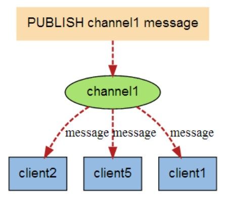

# Redis学习笔记

## Redis介绍

REmote DIctionary Server(Redis) 是一个由 Salvatore Sanfilippo 写的**key-value 存储系统**，是跨平台的**非关系型数据库**。

Redis 是一个开源的使用 ANSI C 语言编写、遵守 BSD 协议、支持网络、可**基于内存**、分布式、可选持久性的键值对(Key-Value)存储数据库，并提供多种语言的 API。它提供了一个高性能的键值（key-value）存储系统，*常用于缓存、消息队列、会话存储等应用场景*。

Redis 通常被称为数据结构服务器，因为**值（value）可以是字符串(String)、哈希(Hash)、列表(list)、集合(sets)和有序集合(sorted sets)等类型**。

+ 性能高：Redis以其极高的性能著称，能够支持每秒数十万次的读写操作。这种高性能主要得益于Redis将数据存储在内存中，从而显著提高了数据的访问速度。这使得Redis成为处理高并发请求的理想选择，尤其是在需要快速响应的场景中，如缓存、会话管理、排行榜等。
+ 丰富的数据类型：Redis不仅支持基本的键值存储，还提供了丰富的数据类型，包括字符串、列表、集合、哈希表、有序集合等。
+ 原子性操作：Redis的所有操作都是原子性的，这意味着要么完全执行，要么完全不执行。这种特性对于确保数据的一致性和完整性至关重要，尤其是在高并发环境下处理事务时。
+ 持久化：Redis支持数据的持久化，可以将内存中的数据保存到磁盘中，以便在系统重启后恢复数据。这位Reids提供了数据安全性，确保数据不会因为系统故障而丢失。
+ 支持发布/订阅模式：Redis内置了发布/订阅模式（Pub/Sub），允许客户端之间通过消息传递进行通信。这使得Redis可以作为消息队列和实时数据传输的平台。
+ 单线程模型：尽管Redis是单线程的，但它通过高效的事件驱动模型来处理并发请求，确保了性能和延迟。单线程也简化了并发控制的复杂性。
+ 主从复制：Redis支持主从复制，可以通过从节点来备份或分担读请求，提高数据的可用性和系统的伸缩性。
+ 应用场景广泛：Redis被广泛应用于各种场景，包括但不限于缓存系统、会话存储、排行榜、实时分析、地理空间数据索引等。
+ 支持Lua脚本：Redis支持使用Lua脚本来编写复杂的操作，这些脚本可以在服务器端执行，提供了更多的灵活性和强大的功能。

## Redis安装

### Windows环境下

[Redis官方](https://redis.io/)没有提供windows环境下的软件安装，官方推荐的方式是通过安装WSL2（Windows Subsystem for Linux，WSL2 lets you run Linux binaries natively on Windows），具体可以参考官方文档：[Install Redis on Windows | Docs](https://redis.io/docs/latest/operate/oss_and_stack/install/install-redis/install-redis-on-windows/)。

还有一些人基于Redis的开源性质自己编写了在可在windows上运行的Redis软件，这里推荐使用：[tporadowski/redis: Native port of Redis for Windows. Redis is an in-memory database that persists on disk. The data model is key-value, but many different kind of values are supported: Strings, Lists, Sets, Sorted Sets, Hashes, Streams, HyperLogLogs. This repository contains unofficial port of Redis to Windows. (github.com)](https://github.com/tporadowski/redis)。

使用github上的压缩包安装（其实不用安装，解压即可使用）后，在cmd命令行中切换到安装路径下（解压后的文件夹），输入`redis-server.exe redis.windows.conf`就可以启动redis服务端（为了避免每次都要切换路径可以直接将redis的路径加到系统环境变量中，输入`redis-server.exe`就可以启动redis服务端，使用的配置文件是默认的，若要使用`redis.window.conf`请输入配置文件完整的路径名）。接着再重新启动一个cmd命令行，输入`redis-cli.exe -h 127.0.0.1 -p 6379`就启动了redis客户端（为了保证访问，请不要关闭服务端的cmd命令行），通过redis客户端就可以对Redis进行数据存储了。

### Linux环境下

参考官方文档使用源码安装（推荐）：[Install Redis from Source | Docs](https://redis.io/docs/latest/operate/oss_and_stack/install/install-redis/install-redis-from-source/)。

参考官方文档使用Ubuntu apt 命令安装：[Install Redis on Linux | Docs](https://redis.io/docs/latest/operate/oss_and_stack/install/install-redis/install-redis-on-linux/)。

### MacOS环境下

使用Homebrew安装：[Install Redis on macOS | Docs](https://redis.io/docs/latest/operate/oss_and_stack/install/install-redis/install-redis-on-mac-os/)。

也可以使用源码安装，同Linux环境下的源码安装。

## Redis配置

Redis的配置文件位于Redis安装目录下，文件名为`redis.conf`（windows名为`redis.windows.conf`），可以通过`config`命令查看。

config命令格式：`CONFIG GET CONFIG_SETTING_NAME`，如`config get loglevel`获取日志等级的配置信息、`config get *`获取所有配置信息。

可以通过修改文件内容或使用`CONFIG SET CONFIG_SETTING_NAME NEW_CONFIG_VALUE`命令来修改配置。

## Redis数据类型

官方文档：[Understand Redis data types | Docs](https://redis.io/docs/latest/develop/data-types/)。

Redis主要支持一下几种数据类型：

+ **string（字符串）**：基本的数据存储单元，可以存储字符串、整数或者浮点数。
+ **hash（哈希）**：一个键值对集合，可以存储多个字段。
+ **list（列表）**：一个简单的列表，可以存储一系列的字符串元素。
+ **set（集合）**：一个无序集合，可以存储不重复的字符串元素。
+ **zset（sorted set，有序集合）**：类似于集合，但是每一个 元素都有一个分数（score）与之关联。
+ 位图（Bitmaps）：基于字符串类型，可以对个位进行操作。
+ 超日志（HyperLogLogs）：用于基数统计，可以估算集合中的唯一元素数量。
+ 地理空间（Geospatial）用于存储地理位置信息。
+ 发布/订阅（Pub/Sub）：一种消息通信模式，允许客户端订阅消息通道，并接收发布到该通道的消息。
+ 流（Streams）：用于消息队列和日志存储，支持消息的持久化和时间排序。
+ 模块（Modules）：Redis支持动态加载模块，可以扩展Redis的功能。

### String（字符串）

string是redis最基本的类型，一个key对应一个value。

string是二进制安全的。意思是redis的string可以包含任何数据，比如jpg图片或者序列化的对象。

string类型是redis的最基本的数据类型，**string类型的值最大能存储512MB**。

#### 常用命令

+ `SET key value`：设置建的值，如`set baidu www.baidu.com`。
+ `GET key` ：获取键的值。
+ `APPEND key value`：将值（字符串）追加到键的值之后。
+ `INCR key`：将键存储的数字值加一。
+ `DECR key`：将键存储的数字值减一。
+ `DEL key`：删除键及其值。

### Hash（哈希）

Redis hash 是一个键值(key=>value)对集合，类似于一个小型的 NoSQL 数据库。

Redis hash 是一个 string 类型的 field 和 value 的映射表，hash 特别适合用于存储对象。

每个哈希最多可以存储 2^32 - 1 个键值对。

#### 常用命令

+ `HSET key field value`：设置哈希表中字段的值，如`hset food fruit apple`。
+ `HGET key field`：获取哈希表中字段的值，如`hget foot fruit`。
+ `HGETALL key`：获取哈希表中所有字段和值。
+ `HDEL key field`：删除哈希表中的一个或多个字段。
+ `HMSET key field1 value1 field2 value2`：同时设置哈希表的多个字段的值，如`hmset food fruit apple flesh meat`。

### List（列表）

Redis 列表是简单的字符串列表，按照插入顺序排序。你可以添加一个元素到列表的头部（左边）或者尾部（右边）。

列表最多可以存储 2^32 - 1 个元素。

#### 常用命令

+ `LPUSH key value`：将值插入到列表头部。
+ `RPUSH key value`：将值插入到列表尾部。
+ `LPOP key`：移除并获取列表的第一个元素。
+ `RPOP key`：移除并获取列表的最后一个元素。
+ `LRANGE key start stop`：获取列表在指定范围内（`start`和`stop`是元素在列表中的下标，从0开始）的元素。

### Set（集合）

Redis 的 Set 是 string 类型的无序集合。

集合是通过哈希表实现的，所以添加，删除，查找的复杂度都是 O(1)。

集合中最大的成员数为 2^32 - 1(4294967295, 每个集合可存储40多亿个成员)。

#### 常用命令

+ `SADD key value`：向集合添加一个或过个成员，成功返回 1，如果元素已经在集合中返回 0。
+ `SREM key value`：移除集合中的一个或多个成员。
+ `SMEMBERS key`：返回集合中的所有成员。
+ `SISMEMBER key value`：判断值是否是集合的成员。

### zset（有序集合）

Redis zset 和 set 一样也是string类型元素的集合,且不允许重复的成员。

不同的是每个元素都会关联一个double类型的分数。redis正是通过分数来为集合中的成员进行从小到大的排序。

zset的成员是唯一的,但分数(score)却可以重复。

#### 常用命令

+ `ZADD key score value`：向有序集合添加一个或多个成员，或更新已存在成员的分数。
+ `ZRANGE key start stop [WITHSCORES]`：返回指定范围（索引下标）内的成员。
+ `ZREM key value`：移除有序集合中的一个或多个成员。
+ `ZSCORE key value`：返回有序集合中，成员的分数值。

## Redis命令

官方文档：[Commands | Docs (redis.io)](https://redis.io/docs/latest/commands/)。

在[[#Redis数据类型]]中的介绍的命令将不再过多列举。

### KEY（键）相关命令

基本命令格式：`COMMAND KEY_NAME`，如`set name 张三`。

#### 常用命令

+ `DUMP key`：序列化给定的key，并返回被序列化的值
+ `EXISTS key`：检查给定key是否存在
+ `EXPIRE key seconds`：为给定key设置过期时间，以秒为单位
+ `EXPIRE key milliseconds`：设置key的过期时间，以毫秒为单位
+ `EXPIRE key timestamp`：设置key的过期时间，使用时间戳实现
+ `EXPIRE key milliseconds-timestamp`：设置key的过期时间，使用时间戳（以毫秒计）
+ `KEYS pattern`：查找所有符合给定模式（正则表达式）的key，如`keys *`查找所有的key
+ `PERSIST key`：移除key的过期时间，key将持久保持
+ `MOVE key db`：将当前数据库的key移动到给定的数据库db中
+ `PTTL key`：以毫秒为单位，返回给定key的剩余生存时间(TTL,time to live)
+ `TTL key`：以秒为单位，返回给定key的剩余生存时间
+ `RENAME key newkey`：修改key的名称
+ `RENAMEX key newkey`：仅当newkey不存在时，将key改名为newkey
+ `TYPE key`：返回key所存储的值的类型

### String（字符串）相关命令

Redis 字符串数据类型的相关命令用于管理 redis 字符串值，基本命令格式：`COMMAND KEY_NAME`。

#### 常用命令

+ `GETRANGE key start end`：返回key中字符串值的子字符
+ `GETSET key value`：将给定key的值设为value，并返回key的旧值（old value）
+ `MSET key value [key value]`：同时设置一个或多个key-value对
+ `MGET key1 [key2]`：获取所有（一个或多个）给定key的值
+ `SETEX key seconds value`：将值value关联到key，并将key的过期时间设为seconds（以秒为单位）
+ `SETNX key value`：只有在key不存在时设置key的值
+ `STRLEN key`：返回key所存储的字符串的长度
+ `INCRBY key increment`：将key所存储的值加上给定的增量值
+ `INCREBYFLOAT key increment`：将key所存储的值加上给定的浮点增量值
+ `DECRBY key decrement`：key所存储的值减去给定的减量值

### Hash（哈希）相关命令

Redis hash 是一个 string 类型的 field（字段） 和 value（值） 的映射表，hash 特别适合用于存储对象。Redis 中每个 hash 可以存储 232 - 1 键值对（40多亿）。

#### 常用命令

+ `HEXISTS key field`：查看哈希表key中，指定的字段是否存在
+ `HINCRBY key field increment`：将哈希表key中的指定字段的整数值加上增量increment
+ `HINCRBYFLOAT key field increment`：将哈希表key中的指定字段的浮点数值加上增量increment
+ `HKEYS key`：获取哈希表中的所有字段
+ `HVALS key`：获取哈希表中所有的值
+ `HLEN key`：获取哈希表中字段的数量
+ `HMGET key field1 [field2]`：获取给定字段的值
+ `HSETNX key field value`：只有在字段field不存在时，设置哈希表字段的值

### List（列表）相关命令

Redis列表是简单的字符串列表，按照插入顺序排序。你可以添加一个元素到列表的头部（左边）或者尾部（右边）。一个列表最多可以包含 232 - 1 个元素 (4294967295, 每个列表超过40亿个元素)。

#### 常用命令

+ `BLPOP key1 [key2] timeoout`：移除并获取列表的第一个元素，如果列表没有元素会阻塞列表直到等待超时或发现可弹出元素为止
+ `BRPOP key1 [key2] timeout`：移除并获取列表的最后一个元素，如果列表没有元素会阻塞列表直到等待超时或发现可弹出元素为止
+ `BRPOPLPUSH source destination timeout`：从列表中弹出一个值，将弹出的元素插入到另外一个列表中并返回它；如果列表没有元素会阻塞列表直到等待超时或发现可弹出元素为止
+ `RPOPLPUSH source destination`：移除列表的最后一个元素，并将该元素添加到另一个列表并返回
+ `LINDEX key index`：通过索引获取列表中的元素
+ `LLEN key`：获取列表长度
+ `LPUSH key value1 [value2]`：将一个或多个值插入到列表头部
+ `LPUSHX key value1 [value2]`：将一个值插入到已存在的列表头部
+ `LREM key count value`：移除列表元素
+ `LSET key index value`：通过索引设置元素的值
+ `LTRIM key start stop`：对一个列表进行修剪（trim），就是说，让列表只保留指定区间内的元素，不在指定区间之内的元素都将被删除
+ `RPUSH key value1 [value2]`：在列表中添加一个或多个值到列表尾部
+ `RPUSHX key value`：为已存在的列表添加值

### Set（集合）相关命令

Redis 的 Set 是 String 类型的无序集合。集合成员是唯一的，这就意味着集合中不能出现重复的数据。集合对象的编码可以是 intset 或者 hashtable。

Redis 中集合是通过哈希表实现的，所以添加，删除，查找的复杂度都是 O(1)。

集合中最大的成员数为 232 - 1 (4294967295, 每个集合可存储40多亿个成员)。

#### 常用命令

+ `SCARD key`：获取集合的成员数
+ `SDIFF key1 [key2]`：返回第一个集合与其他集合之间的差异
+ `SDIFFSTORE destination key1 [key2]`：返回给定所有集合的差集并存储在destination中
+ `SINTER key1 [key2]`：返回给定所有集合的交集
+ `SINTERSTORE destination key1 [key2]`：返回给定所有集合的交集并存储在destination中
+ `SMOVE source destination member`：将member元素从source集合移动到destination集合
+ `SUNION key1 [key2]`：返回所有给定集合的并集
+ `SUNIONSTORE destination key1 [key2]`：所有给定集合的并集存储在destination集合中

### Sorted Set（有序集合）相关命令

Redis 有序集合和集合一样也是 string 类型元素的集合,且不允许重复的成员。不同的是每个元素都会关联一个 double 类型的分数。redis 正是通过分数来为集合中的成员进行从小到大的排序。有序集合的成员是唯一的,但分数(score)却可以重复。

集合是通过哈希表实现的，所以添加，删除，查找的复杂度都是 O(1)。 集合中最大的成员数为 232 - 1 (4294967295, 每个集合可存储40多亿个成员)。

#### 常用命令

+ `ZCARD key`：获取有序集合的成员数
+ `ZCOUNT key min max`：计算在有序集合中指定区间分数的成员数
+ `ZINCRBY key increment member`：有序集合对指定成员的分数加上增量increment
+ `ZINTERSTORE destination numkeys key [key]`：计算给定的一个或多个有序集的交集并将结构集存储在新的有序集合destination中
+ `ZLEXCOUNT key min max`：在有序集合中计算指定字典区间内成员数量
+ `ZRANGE key start stop [WITHSCOR]`：通过索引区间返回有序集合指定区间内的成员
+ `ZRANGEBYLEX key min max [LIMIT offset count]`：通过字典区间返回有序集合的成员
+ `ZRANGEBYSCORE key min max [WITHSCORES] [LIMIT]`：通过分数返回有序集合指定区间内的成员
+ `ZRANGE key member`：返回有序集合中指定成员的索引
+ `ZREMRANGEBYLEX key min max`：移除有序集合中给定的字典区间的所有成员
+ `ZREMRANGEBYRANK key start stop`：移除有序集合中给定的排名区间的所有成员
+ `ZREMRANGEBYSCORE key min max`：移除有序集合中给定的分数区间的所有成员
+ `ZREVRANGEBYSCORE key max min [WITHSCORES]`：返回有序集合中指定分数区间内的成员，分数从高到低排序
+ `ZREVRANK key member`：返回有序集合中指定成员的排名，有序集合成员按分数值递减（从大到小）排序
+ `ZUNIONSTORE destination members key [key]`：计算给定的一个或多个有序集的并集，并存储在新的key中

### HyperLogLog（超日志）相关命令

Redis 在 2.8.9 版本添加了 HyperLogLog 结构。

Redis HyperLogLog 是用来做基数统计的算法，HyperLogLog 的优点是，在输入元素的数量或者体积非常非常大时，计算基数所需的空间总是固定 的、并且是很小的。

在 Redis 里面，每个 HyperLogLog 键只需要花费 12 KB 内存，就可以计算接近 2^64 个不同元素的基 数。这和计算基数时，元素越多耗费内存就越多的集合形成鲜明对比。

但是，因为 HyperLogLog 只会根据输入元素来计算基数，而不会储存输入元素本身，所以 HyperLogLog 不能像集合那样，返回输入的各个元素。

**什么是基数**

比如数据集 {1, 3, 5, 7, 5, 7, 8}， 那么这个数据集的基数集为 {1, 3, 5 ,7, 8}, 基数(不重复元素)为5。 基数估计就是在误差可接受的范围内，快速计算基数。

#### 常用命令

+ `PFADD key element [element]`：添加指定元素到HyperLogLog中
+ `PFCOUNT key [key]`：返回给定HyperLogLog的基数给定值
+ `PFMERGE destkey sourcekey [sourcekey]`：将多个HyperLogLog合并为一个HyperLogLog

### Pub/Sub（发布订阅）相关命令

Redis 发布订阅 (pub/sub) 是一种消息通信模式：发送者 (pub) 发送消息，订阅者 (sub) 接收消息。Redis 客户端可以订阅任意数量的频道。

当有新消息通过 PUBLISH 命令发送给频道 channel1 时， 这个消息就会被发送给订阅它的三个客户端。

#### 常用命令

+ `PSUBSCRIBE pattern [patten]`：订阅一个或多个符合给定模式的频道
+ `PUBSUB subcommand [argument [argument]]`：查看订阅与发布状态
+ `PUNSUBSCRIBE [pattern [pattern]]`：退订所有给定模式的频道
+ `PUBLISH channel message`：将信息发送到指定的频道
+ `SUBSCRIBE channel [channel]`：订阅给定的一个或多个频道的信息
+ `UNSUBSCRIBE [channel [channel]]`：只退订给定的频道

### Redis事务相关命令

Redis 事务可以一次执行多个命令， 并且带有以下三个重要的保证：

+ 批量操作在发送EXEC命令前被放入队列缓存
+ 收到EXEC命令后进入事务执行，事务中任意命令执行失败，其余的命令依然被执行
+ 在事务执行过程，其他客户端提交的命令不会被插入到事务执行命令序列中

一个事物从开始到执行会经历以下三个阶段：

+ 开始事务
+ 命令入队
+ 执行事务

**单个 Redis 命令的执行是原子性的**，但 Redis 没有在事务上增加任何维持原子性的机制，所以**Redis 事务的执行并不是原子性的**。

Redis事务（这和一般事务的原子性有区别）可以理解为一个打包的批量执行脚本，但批量指令并非原子化的操作，**中间某条指令的失败不会导致前面已做指令的回滚，也不会造成后续的指令不做**。

#### 常用命令

+ `DISCARD`：取消事务，放弃执行事务块内的所有命令
+ `EXEC`：执行所有事务块内的命令
+ `MULTI`：标记一个事物块的开始
+ `UNWATCH`：取消WATCH命令对所有key的监视
+ `WATCH key [key]`：监视一个（或多个）key，如果在事务执行之前这个（或这些）key被其他命令所改动，那么事务将打断

### Redis脚本

Redis 脚本使用 Lua 解释器来执行脚本。 Redis 2.6 版本通过内嵌支持 Lua 环境。执行脚本的常用命令为 **EVAL**。

EVAL命令的基本格式：`EVAL script numkeys key [key] arg [arg]`。

如：`EVAL "return {keys[1],keys[2],argv[1],argv[2]}" 2 key1 key2 first second`。

#### 常用命令

+ `EVAL script numkeys key [key] arg [arg]`：执行Lua脚本
+ `EVALSHA sha1 numkeys key [key] arg [arg]`：执行Lua脚本
+ `SCRIPT EXISTS script [script]`：查看指定的脚本是否已经被保存在缓存当中
+ `SCRIPT FLUSH`：从脚本缓存中移除所有脚本
+ `SCRIPT KILL`：杀死当前正在运行的Lua脚本
+ `SCRIPT LOAD script`：将脚本添加到脚本缓存中，但并不立即执行这个脚本

### Redis连接

Redis 连接命令主要是用于连接 redis 服务。

#### 常用命令

+ `AUTH password`：验证密码是否正确
+ `ECHO message`：打印字符串
+ `PING`：查看服务是否运行
+ `QUIT`：关闭当前连接
+ `SELECT index`：切换到指定的数据库

### Redis服务器

Redis 服务器命令主要是用于管理 redis 服务。

#### 常用命令

+ `BGSAVE`：在后台异步保存当前数据库的数据到磁盘
+ `CLIENT KILL [ip:port] [ID client-id]`：关闭客户端连接
+ `CLIENT LIST`：获取连接到服务器的客户端连接列表
+ `CLIENT GETNAME`：获取连接的名称
+ `CLIENT PAUSE timeout`：在指定时间内终止运行来自客户端的命令
+ `CLIENT SETNAME connection-name`：设置当前连接的名称
+ `CLUSTER SLOTS`：获取集群节点的映射数组
+ `COMMAND` ：获取Redis命令详情数组
+ `COMMAND COUNT`：获取Redis命令总数
+ `COMMAND GETKEYS`：获取给定命令的所有键
+ `TIME`：返回当前服务器时间
+ `COMMAND INFO command-name [command-name]`：获取指定Redis命令描述的数组
+ `CONFIG GET parameter`：获取指定配置参数的值
+ `CONFIG SET parameter value`：修改redis配置参数，无需重启
+ `DBSIZE`：返回当前数据库的key的数量
+ `DEBUG OBJECT key`：获取key的调试信息
+ `DEBUG SEGFAULT`：让redis服务崩溃
+ `FLUSHALL`：删除所有数据库的所有key
+ `FLUSHDB`：删除当前数据库的所有key
+ `INFO [section]`：获取redis服务器的各种信息和统计数值
+ `LASTSAVE`：返回最近一次redis成功将数据保存到磁盘上的时间，以UNIX时间戳格式表示
+ `MONITOR`：实时打印出redis服务器接收到的命令，调试用
+ `ROLE`：返回主从实例所属的角色
+ `SAVE`：同步保存数据到磁盘
+ `SHUTDOWN [NOSAVE] [SAVE]`：异步保存数据到磁盘，并关闭服务器
+ `SLAVEOF host port`：将当前服务器转变为指定服务器的从属服务器（slave server）
+ `SLOWLOG subcommand [argument]`：管理redis的慢日志
+ `SYNC`：用于复制功能（replication）的内部命令