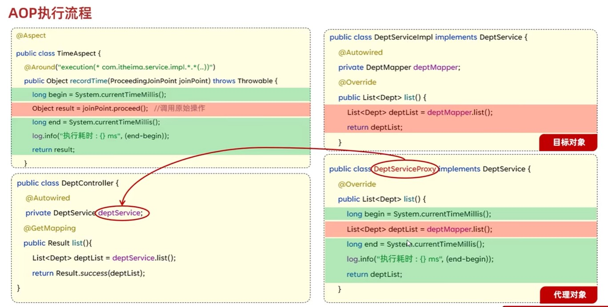

# Spring Boot AOP技术

## AOP概述

AOP：Aspect Oriented Programming（面向对象切面编程，面向方面编程），其实就是面向特定方法编程。

AOP的是实现基于动态代理：动态代理是面向切面编程最主流的实现。而Spring AOP是Spring框架的高级、核心技术，旨在管理Bean对象的过程中，主要通过底层的动态代理机制，对特定的方法进行编程。

AOP使用动态代理的方式来实现AOP，将IOC容器中实例化后的Bean对象重新读取，根据开发者配置的AOP信息，重新为某些类生成代理对象，该代理对象作为实际运行中使用的对象放入IOC容器（BeanMap）。

AOP使用场景：

+ 记录操作日志
+ 权限控制
+ 事务管理

AOP优势：

+ 代码无侵入
+ 减少重复代码
+ 提高开发效率
+ 维护方便

## AOP执行流程

应用运行时由Spring框架为目标方法（切点）所在的类生成代理对象，代理对象存在目标方法同名的方法，该方法体中目标方法执行前的通知方法（语句）先于目标方法（语句）执行，目标方法执行后的通知方法（语句）后于目标方法（语句）执行。

## AOP核心概念

+ 连接点：JoinPoint，可以被AOP控制的方法（暗含方法执行时的相关信息）
+ 通知（增强）：Advice，表示那些重复的逻辑，也就是共性功能（最终体现为一个方法）
+ 切入点：PointCut，匹配连接点的条件，通知仅会在切入点方法执行时被应用
+ 切面：Aspect，描述通知与切入点的对应关系（通知+切入点）
+ 目标对象：Target，通知所应用的对象

## AOP通知类型

1. @Around：环绕通知，此注解标注的通知方法在目标方法前、后都被执行
2. @Before：前置通知，此注解标注的通知方法在目标方法前被执行
3. @After：后置通知，此注解标注的通知方法在目标方法后被执行，无论是否有异常都会执行
4. @AfterReturning：返回后通知，此注解标注的通知方法在目标方法后被执行，有异常不会执行
5. @AfterThrowing：异常后通知，此注解标注的通知方法发生异常后执行

**注意**：@Around环绕通知需要自己调用`ProceedingJoinPoint.proceed()`来让原始方法执行，其他类型的通知不需要考虑目标方法执行。@Around环绕通知方法的返回值，必须指定为Object，来接收原始方法的返回值。

## AOP通知顺序

当有多个切面的切入点都匹配到了目标方法，目标方法运行时，多个通知方法都会被执行。

执行顺序：

1. 不同切面类中，**默认**按照切面类的类名字母排序，排名靠前的切面类中目标方法前的通知方法先执行，目标方法后的通知方法后执行。
2. 使用**@Order(数字)注解修饰**切面类来控制顺序，数字越小的切面类中目标方法前的通知方法先执行，目标方法后的通知方法后执行。如@Order(1)的优先级比@Order(2)高。

## 深入AOP 连接点

在Spring中使用JoinPoint抽象了连接点，用它可以获取方法执行时的相关信息，如目标类名、方法名、方法参数等。

+ 对于@Around通知，获取连接点信息只能使用`ProceedingJoinPoint`，ProceedingJoinPoint中提供方法`proceed`去执行目标方法，并返回目标方法的返回值。
+ 对于其他四种通知，获取连接点信息只能使用`JoinPoint`，它是`ProceedingJoinPoint`的父类型。

## AOP 切入点表达式

切入点表达式：描述切入点的一种表达式

作用：主要用来决定项目中的哪些方法需要加入通知

常见形式：

+ execution(.....)：根据方法的签名来匹配

  execution主要根据方法的返回值 、包名、类名、方法名、方法参数等信息来匹配，语法为`execution([访问修饰符] 返回值 [包名.类名.]方法名(方法参数) [throws 异常])`，其中访问修饰符可省略，`包名.类名`可以省略（不建议省略，不然匹配的范围会扩大到所有包下同名的方法），`throws 异常`可以省略，这里的异常是指目标方法声明抛出的异常。

  *注*：可以将execution后面括号中的表达式看做方法的声明，以此来指明目标方法。

  可以使用通配符描述切入点：

  `*`——单个独立的任意符号，可以通配任意返回值、包名、类名、方法名，任意类型的一个方法参数，甚至是包名、类名、方法名的部分（例如：名称后缀为Service——`*Service`）。如通知的目标方法为`com.example`包的下一级包的所有方法——`execution(com.example.*.*.*(*))`。

  `..`——多个连续的任意符号，可以通配任意层级的包，或任意类型、任意个数的方法参数。如通知的目标方法为`com.example`包下及其子包下所有方法——`execution(com.example..*.*(..))`。

  **根据业务需要，可以使用且（&&）、或（||）、非（!）来组合比较复杂的切入点表达式。**

+ @annotation(....)：根据注解匹配——用于匹配标识有特定注解的方法。

  如将通知作用于使用com.example.annotation.MyAnnotation修饰的方法，对应的切入点表达式为`@annotation(com.example.annotation.MyAnnotation)`。

  *注意*：使用这种方法一般需要自定义一个注解，并在目标方法上使用自定义注解。

## AOP使用

AOP的基本使用步骤：

1. 引入依赖`spring-boot-starter-aop`。
2. 编写AOP代码：根据业务需要对特定方法（使用AOP的方法）进行编程。
   + 新建一个类XxxxAdvice，并用@Component（注入IOC容器）、@Aspect（声明为AOP类）注解修饰该类。
   + 在XxxxAdvice中编写方法，使用AOP通知注解（如@Around）修饰，在属性中设置该方法作用在哪个类的哪个方法下，即切入点表达式。
   + 如果多个Advice通知都要作用在相同的切入点，为了减少设置通知注解的属性，可以在XxxxAdvice中定义切（入）点：定义一个方法`public void xxx(){}`，注意方法返回值为void，没有方法参数，方法体内为空语句，然后使用@Pointcut注解修饰，在@Pointcut中设置属性值——切入点表达式，最后再在通知注解中设置属性为`xxx()`，它会获取@Pointcut中的切入点表达式。

