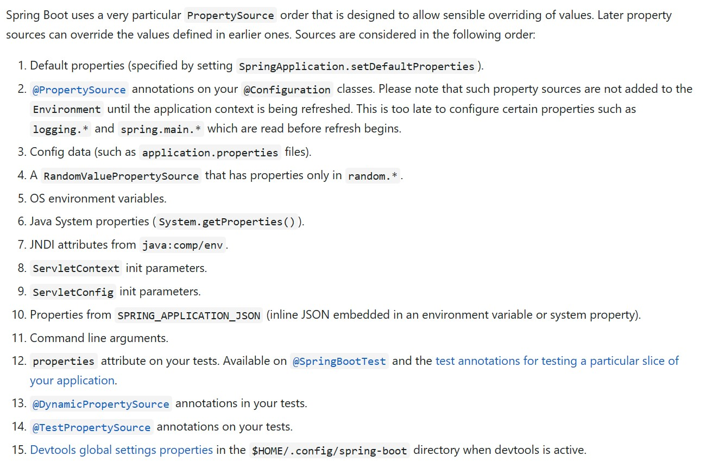
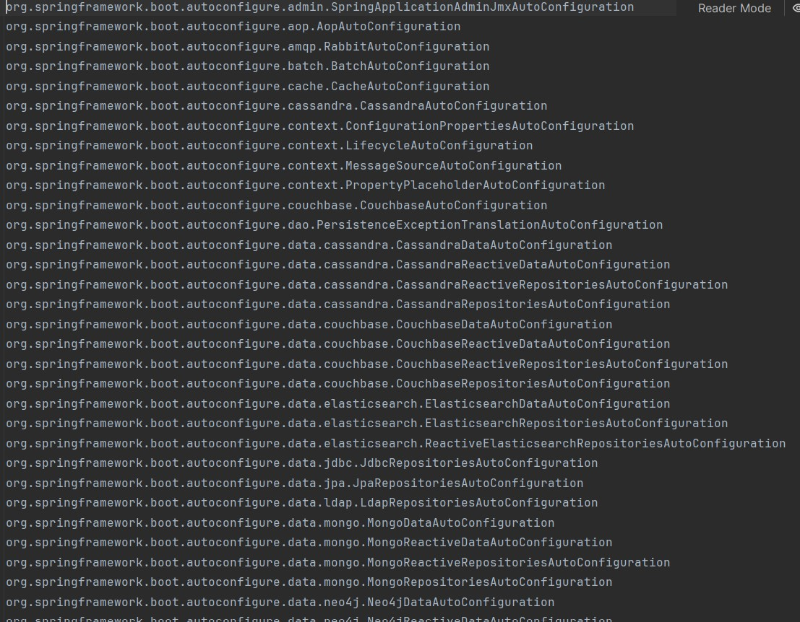
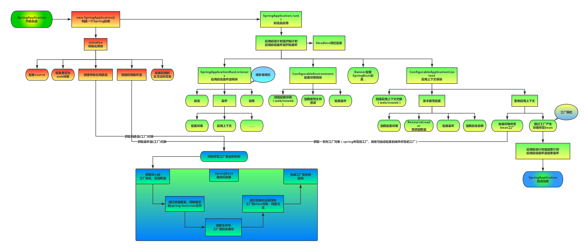

# SpringBoot基础配置学习

## SpringBoot概述

SpringBoot提供了一种快速使用Spring的方式，基于约定由于配置的思想，减少开发人员在配置与逻辑业务之间进行思维的切换。

Spring的缺点：

+ 配置繁琐
+ 依赖繁琐

SpringBoot的功能：

+ 自动配置
+ 起步依赖——将具备某种功能的坐标打包到一起，并提供一些默认的功能。
+ 辅助功能——提供了一些项目中常见的非功能性特性。

**SpringBoot提供了一种快速开发Spring项目的方式，而不是对Spring功能上的增强**

## SpringBoot快速入门

案例：需求

+ 搭建SpringBoot工程，定义一个Controller方法，返回“Hello World！”。

案例：实现步骤

1. 创建Maven项目
2. 导入SpringBoot起步依赖——在pom.xml中导入相关依赖，基本的是spring-boot-starter-parent（通过Maven继承，即\<parent>标签）和spring-boot-starter-web（web开发相关依赖，通过\<dependency>标签的方式引入）
3. 定义Controller——编写拦截http请求的控制器，返回“Hello World！”，使用基本的注解：``@RestController``和``@RequestMapping("/hello")``。前者在声明一个controller的同时，该controller用于返回JSON、XML等数据，但不能返回HTML页面，相当于@ResponseBody和@Controller合在一起使用；后者用来处理请求地址映射，用在类或方法上，如果用在类上，则表示类中的所有响应请求的方法都是以改地址作为父路径的
4. 编写引导类——即SpringBoot应用程序的main方法所在的类，使用``@SpringBootApplication``声明该类为启动入口类Application，同时在main方法中编写SpringApplication类的run方法，例如：``SpringApplication.run(XxxApplication.class,args);``
5. 启动测试

小结

+ SpringBoot在创建项目时，默认使用jar的打包方式
+ SpringBoot的引导类，是项目入口，运行main方法就可以启动项目
+ 使用SpringBoot和Spring构建的项目，业务代码编写方式完全一样

## 快速构建SpringBoot工程

使用IDEA编辑器的Spring工程构建工具快速构建SpringBoot工程，这样可以通过勾选可选项自动生成一个基本的SpringBoot工程（包含Maven的项目结构，pom.xml文件具有勾选的依赖导入信息，自动生成了Application启动类）。

官网url：<https://start.spring.io/>

阿里镜像url：<https://start.aliyun.com/>

## SpringBoot起步依赖原理分析

具体的关于依赖的知识详见Maven知识。

+ spring-boot-starter-parent——定义了各种技术的版本信息，组合了一套最优搭配的技术版本
+ spring-boot-starter-web——定义了完成有关web开发功能需要的坐标集合，其中大部分的版本信息来自父工程

小结：在各种starter中，定义了完成该功能需要的坐标集合；我们的工程一般继承自parent，引入starter后，通过依赖传递，就可以简单方便获得需要的jar包，并且不会存在版本冲突等问题。

## SpringBoot配置

### SpringBoot配置文件分类

SpringBoot是基于约定的，很多配置都有默认值（如tomacat的默认端口），但如果想使用自己的配置替换默认配置的话，就可以使用application.properties或者application.yaml（或application.yml，yaml和yml表示同一种类型的文件）进行配置。

+ properties——使用键值对（“键”=“值”）的方式

如服务器的端口号：`server.port=8080`

+ yml——一种树形结构的方式（注意缩进和空格）

如服务器的端口号：

	server:
		port: 8080

当一个项目中同时存在application.properties、application.yaml、application.yml三个文件时（同级目录下），**配置文件的加载顺序：properties > yml > yaml**，高优先级的属性会覆盖低优先级中相同的属性（或低优先级中相同的属性被忽略）。

### yaml基础语法

YAML全称是YAML Ain‘t Markup Language。YAML是一种直观的能够被计算机识别的数据序列化格式，并且容易被人类阅读，容易和脚本语言交互，可以被支持YAML库的不同编程语言程序导入。**YAML文件是以数据为核心，比传统的xml方式更简洁。**YAML文件的拓展名可以使用.yaml或者.yml。 

#### 基本语法

+ 大小写敏感
+ 使用缩进表示层级关系
+ 缩进不允许使用tab，只允许空格
+ 缩进的空格数不重要，只要相同层级的元素左对齐即可
+ '#'表示注释
+ 数据值前面必须有空格，作为分隔符

#### 数据格式

+ 对象（map）：键值对的集合。

  ````yaml
  person:
    name: zhangsan
  #行内写法
  person: {name: zhangsan}
  ````

+ 数组：一组按次序排列的值

  ```yaml
  address:
    - beijing
    - shanghai
  #行内写法
  address: [beijing,shanghai]
  ```

+ 纯量：单个的、不可再分的值

  ````yaml
  msg1: 'hello \n world' #单引号忽略转义字符
  msg2: "hello \n world" #双引号识别转义字符
  ````

#### 参数引用

+ ${key}

```yaml
name: lisi

person:
  name: ${name} #引用上面定义的name值
```

### 读取配置文件内容

三种读取配置文件的方式

+ @Value

在配置文件中有配置信息：`name=张三`，在编写代码中通过**在变量声明上使用注解@Value（所在包：`import org.springframework.beans.factory.annotation.Value;`）获取配置数据**，如：

```java
// 注入配置文件中的name属性
@Value("${name}")
private String name;
```

对于对象通过’对象名.属性名‘获取；对于数组通过’数组名[下标]‘获取。

+ Environment

使用Environment类（所在包：`import org.springframework.core.env.Environment;`）的对象去获取配置信息，并通过@Autowired注解（所在包：`import org.springframework.beans.factory.annotation.Autowired;`）注入Spring容器中。当需要使用有关属性时，通过Environment类的实例方法getProperties()获取配置信息。

```java
@Autowired
private Environment env;
......
System.out.println(env.getProperty("name"));  //获取的是name: zhangsan
System.out.println(env.getProperty("person.name"));  //获取的是person: {name: zhangsan,age: 18}
```

**使用此方式可以通过一个Environment类的实例对象即可读取配置文件中的信息，相对@Value注解一个个的注入更方便简洁。**

+ @ConfigurationProperties

**让配置内容和Java对象相互绑定。**如配置文件中有`person: {name: zhangsan,age: 18}`，我们希望编写的Person类（有成员属性name和age）的对象可以获取该配置信息。但要注意若@ConfigurationProperties注解没有指明prefix属性（前缀信息）则当在配置文件中存在单个属性`name: 张三`（位于对象类型的配置属性person之前）时，Person类的对象实际读取的是单个属性`name: 张三`而非`person: {name: zhangsan,age: 18}`，相应的Person类的实例对象的属性值——name：张三，age：为0。所以需要在@ConfigurationProperties的属性prefix中指明前缀，如下：

```java
@ConfigurationProperties(prefix = "person")
public class Person {
    private String name;
    private int age;
    .........
}
```

*注：实体类的属性和配置文件中的属性名相同。*

### profile

通常一套程序会被安装到不同的环境，比如：开发、测试、生产等。其中数据库地址、服务器端口等配置都是不尽相同的，如果每次打包时，都要修改配置文件，那么非常麻烦。profile功能就是进行动态配置切换的。

#### profile配置方式

+ 多profile文件方式

  + 开发环境的配置文件，新建一个配置文件，文件名为“application-dev”，拓展名可为“.properties”、“.yaml”、“.yml”。
  + 测试环境的配置文件，新建一个配置文件，文件名为“application-test”，拓展名可为“.properties”、“.yaml”、“.yml”。
  + 生产环境的配置文件，新建一个配置文件，文件名为“application-pro”，拓展名可为“.properties”、“.yaml”、“.yml”。

  想要使用（激活）某个环境下的配置文件，可到原始的“application.properties”或“application.yaml"或”application.yml“中编写配置属性，以”application.properties“为例，激活开发环境配置：

  ```
  #激活开发环境的profile配置
  spring.profiles.active=dev
  ```

+ yml多文档方式

  本方式仅在一个yml文件中编写多个环境的配置信息，各个环境使用"---"分隔，每一段相当于一个独立的配置文档。如：

  ```yaml
  ---
  server:
    port: 8081
  
  spring:
    config:
      activate:
        on-profile: dev
  
  ---
  server:
    port: 8082
  
  spring:
    config:
      activate:
        on-profile: test
  
  ---
  server:
    port: 8083
  
  spring:
    config:
      activate:
        on-profile: pro
  
  ---
  ```

  想要使用（激活）某个环境下的配置文件，如开发环境，可另外在单独的一段中编写如下配置：

  ```yaml
  ---
  spring:
    profiles:
      active: dev
  ```

#### profile激活方式

+ 配置文件

  参考上节“profile配置方式”。

+ 虚拟机参数

  在IDEA中配置SpringBoot运行时的虚拟机参数“VM options”——"-Dspring.profies.active=test "（激活test环境的配置）会覆盖配置文件中的配置。

+ 命令行参数

  同虚拟机参数一样在IDEA中配置，不过此时配置的是命令行参数“Program argumens”——"--spring.profiles.active=test"。

  **在命令行中运行jar包时，可以使用命令——"java -jar xxxx.jar --spring.profiles.actives=test"**

### 内部配置加载顺序

SpringBoot程序启动时，会从一下位置加载配置文件：

1. file:./config/ ：当前项目下的/config目录下
2. file:./ ：当前项目的根目录
3. classpath:/config/ ：classpath的/config目录
4. classpath:/ ：classpath的根目录

加载顺序为上述的排列顺序，高优先级的属性会生效。

### 外部配置加载顺序

参见官网：<https://docs.spring.io/spring-boot/docs/current/reference/html/features.html#features.external-config>



## SpringBoot整合其他框架

### SpringBoot整合Junit

案例：需求

SpringBoot整合Junit

案例：实现步骤

1. 搭建SpringBoot工程
2. 引入starter-test起步依赖
3. 编写测试类
4. 添加测试相关注解
 + @RunWith(SpringRunner.class)
 + @SpringBootTest(classes=启动类.class)
5. 编写测试方法 

### SpringBoot整合Redis

案例：需求

SpringBoot整合Redis

案例：实现步骤

1. 搭建SpringBoot工程
2. 引入redis起步依赖
3. 配置redis相关属性
4. 注入RedisTemplate模板
5. 编写测试方法，测试（本机的redis可以不用对redis进行配置，直接启动redis即可测试）

### SpringBoot整合MyBatis

案例：需求

SpringBoot整合MyBatis

案例：实现步骤

1. 搭建SpringBoot工程
2. 引入MyBatis、MySQL驱动的起步依赖，添加mysql驱动
3. 编写DataSource和MyBatis相关配置
4. 定义表和实体类
5. 编写dao和mapper文件/纯注解开发
6. 测试

## SpringBoot原理分析

### SpringBoot自动配置

#### Condition

condition是在Spring4.0增加的条件判断功能，通过这个可以功能可以**实现选择性的创建Bean操作**。

案例：需求

在Spring的IOC容器中有一个User的Bean，现要求：

1. 导入Jedis坐标后，加载该Bean，没导入，则不加载
2. 将类的判断定义为动态的。判断哪个字节码文件存在可以动态指定

小结：

+ 自定义条件：
  1. 定义条件类：自定义条件类实现Condition接口，重写matches方法，在matches方法进行逻辑判断，返回boolean值。matches方法两个参数：
     + context：上下文对象，可以获取属性值，获取类加载器，获取BeanFactory等
     + metadata：元数据对象，用于获取注解属性
  2. 判断条件：在初始化Bean时，使用@Conditional(条件类.class)注解
+ SpringBoot提供的常用条件注解：
  + ConditionalOnProperty：判断配置文件中是否有对应属性和值才初始化Bean
  + ConditionalOnClass：判断环境中是否有对应字节码文件才初始化Bean
  + ConditionalOnMissingBean：判断环境中没有对应Bean才初始化Bean

#### 切换内置web服务器

SpringBoot的web环境中默认使用了tomcat作为内置服务器，其实SpringBoot提供了4种内置服务器供我们选择，我们可以很方便的进行切换。

方法：排除tomcat依赖，引入想要使用的服务器依赖，如jetty。

```xml
        <dependency>
            <groupId>org.springframework.boot</groupId>
            <artifactId>spring-boot-starter-web</artifactId>
            <!--排除tomcat的依赖-->
            <exclusions>
                <exclusion>
                    <artifactId>spring-boot-starter-tomcat</artifactId>
                    <groupId>org.springframework.boot</groupId>
                </exclusion>
            </exclusions>
        </dependency>

        <!--引入jetty依赖-->
        <dependency>
            <groupId>org.springframework.boot</groupId>
            <artifactId>spring-boot-starter-jetty</artifactId>
        </dependency>
```

#### @Enable*注解

SpringBoot中提供了很多Enable开头的注解，这些注解都是用于动态启用某些功能的。而其底层原理是使用@Import注解导入一些配置类，实现Bean的动态加载。

#### @Import注解

@Enable*底层依赖于@Import注解导入一些类，使用@Import导入的类会被Spring加载到Ioc容器中。而@Import提供4种用法：

1. 导入Bean
2. 导入配置类
3. 导入ImportSelector实现类。一般用于加载配置文件中的类
4. 导入ImportBeanDefinitionRegistrar实现类。

#### @EnableAutoConfiguration注解

详见源码

+ @EnableAutoConfiguration注解内部使用`@Import({AutoConfigurationImportSelector.class})`来加载配置类。

+ 配置文件地址：`META-INF/spring/org.springframework.boot.autoconfigure.AutoConfiguration.imports`，该配置文件中定义了大量的配置类，当SpringBoot应用启动时，会自动加载这些配置类，初始化Bean。

  *注意：此地址会随着springboot的版本更新有变化，最好根据源码判断文件地址。*

  

+ 并不是这些Bean都会被初始化，在配置类中使用Condition来加载满足条件的Bean。

#### 自定义starter

案例：需求

​	自定义redis-starter。要求当导入redis坐标时，SpringBoot自动创建Jedis的Bean。

案例：实现步骤

1. 创建redis-spring-boot-autoconfigure模块
2. 创建reidis-spring-boot-starter模块，依赖redis-spring-boot-autoconfigure的模块
3. 在redis-spring-boot-autoconfigure模块中初始化Jedis的Bean。并定义META-INF/spring.factories文件（注意文件路径、命名随着SpringBoot版本有变化，请详见源码）
4. 在测试模块中引入自定义的redis-starter依赖，测试获取Jedis的Bean，操作Jedis

### SpringBoot监听机制

#### Java监听机制

SpringBoot的监听机制，其实是对Java提供的事件监听机制的封装。

Java中的事件监听机制定义了以下几个角色：

1. 事件：Event，继承java.util.EventObject类的对象
2. 事件源：Source，任意对象Object
3. 监听器：Listener，实现java.util.EventListener接口的对象

#### SpringBoot监听机制

SpringBoot在项目启动时，会对几个监听器进行回调，我们可以实现这些监听器接口，在项目启动时完成一些操作。

+ ApplicationContextInitializer
+ SpringApplicationRunListener
+ CommanLineRunner
+ ApplicationRunner

#### SpringBoot启动流程分析

SpringBoot启动流程图：



## SpringBoot监控

### Actuator概述

SpringBoot自带监控功能Actuator，可以帮助实现对程序内部运行情况监控，比如监控状况、Bean加载情况、配置属性、日志信息等。

### Actuator使用

使用步骤：

1. 导入依赖坐标

   ```xml
           <dependency>
               <groupId>org.springframework.boot</groupId>
               <artifactId>spring-boot-starter-actuator</artifactId>
           </dependency>
   ```

   

2. 访问<http://localhost:8080/actuator>

暴露所有的监控endpoint——在配置文件中配置（以application.properties为例）：

```
# 开启actuator的健康检查的完整信息
management.endpoint.health.show-details=always

# 将所有的监控endpoint暴露出来
management.endpoints.web.exposure.include=*
```

### Spring Boot Admin——一个开源的图形化界面监控工具

Spring Boot Admin是一个开源社区项目，用于管理和监控SpringBoot应用程序

Spring Boot Admin有两个角色，客户端（Client）和服务器（Server）

应用程序作为Spring Boot Admin Client向Spring Boot Admin Server注册

Spring Boot Admin Server的UI界面将显示Spring Boot Admin Client的Actuator  Endpoint上的一些监控信息。

+ 使用步骤
  + admin-server端
    1. 创建admin-server模块
    2. 导入依赖坐标admin-starter-server
    3. 在引导类上启用监控功能@EnableAdminServer
  + admin-client端
    1. 创建admin-client模块
    2. 导入依赖坐标admin-starter-client
    3. 配置相关信息：server地址等
    4. 启动server和client服务，访问server

## SpringBoot项目部署

SpringBoot项目开发完毕后，支持两种方式部署到服务器：

+ jar包（官方推荐，且是默认方式）——使用内置的服务器（如tomca）运行，即将服务器一同打入jar包

+ war包——放置到外部的服务器运行，需要修改pom文件（设置打包方式为war）和启动类（继承pringBootServletInitializer类，重写configure方法）

  ```xml
      <parent>
          <groupId>org.springframework.boot</groupId>
          <artifactId>spring-boot-starter-parent</artifactId>
          <version>x.x.x</version>
          <relativePath/> <!-- lookup parent from repository -->
      </parent>
      <groupId>xxx</groupId>
      <artifactId>xxxx</artifactId>
      <version>xxxx</version>
      <name>xxxx</name>
      <description>xxxxx</description>
      <!--设置打包方式-->
      <packaging>war</packaging>
      <properties>
          <java.version>x.x</java.version>
      </properties>
      <dependencies>
          .........省略
      </dependencies>
  
      <build>
          <!--设置打包文件名-->
          <finalName>xxxx</finalName>
          <plugins>
              <plugin>
                  <groupId>org.springframework.boot</groupId>
                  <artifactId>spring-boot-maven-plugin</artifactId>
              </plugin>
          </plugins>
      </build>
  ```

  

  ```java
  /**
   * 如果打包为war包，则继承SpringBootServletInitializer
   */
  @SpringBootApplication
  public class SpringbootDeployApplication extends SpringBootServletInitializer {
  
      public static void main(String[] args) {
          SpringApplication.run(SpringbootDeployApplication.class, args);
      }
  
      /**
       * 如果打包为war包，则需要重写configure方法
       * @param builder
       * @return
       */
      @Override
      protected SpringApplicationBuilder configure(SpringApplicationBuilder builder) {
          return builder.sources(SpringbootDeployApplication.class);
      }
  }
  ```
