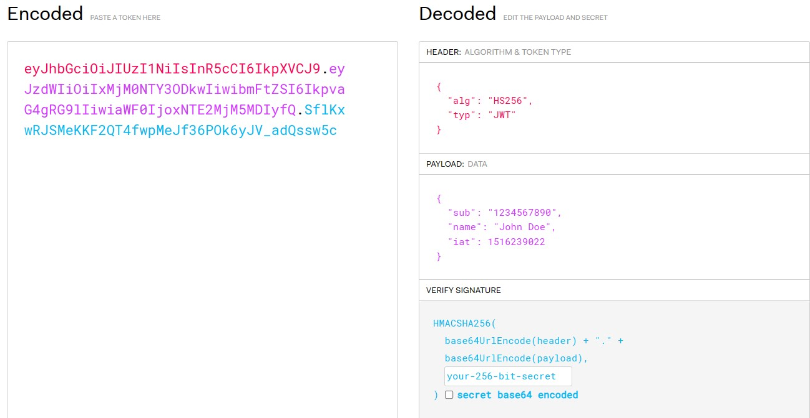
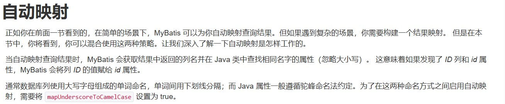
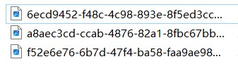

# Spring Boot实战笔记

## 环境搭建

+ 准备数据库表
+ 创建Spring Boot工程，引入相关依赖（如：web依赖、mysql驱动依赖、mybatis依赖、junit依赖等）
+ 编写配置文件application.yml（如：数据库连接配置）
+ 创建包结构，准备实体类

### 准备数据库表

一般是执行创建数据库、表的.sql文件或相应的sql语句。

### 创建Spring Boot工程

1. 通过IDEA的Spring快速构建工具，勾选需要使用的依赖和工具，由IDEA自动产生SpringBoot工程，并自动引入对应依赖和创建配置文件application.properties。

2. 手动创建maven工程，自己在pom.xml文件中引入相关依赖（注意：Spring Boot工程需要引入父工程“spring-boot-starter-parent”）。自行创建目录“resources”，并新建配置文件application.properties或application.yml。手动编写Spring Boot工程的启动类XxxxApplication和main方法。

   ```java
   @SpringBootApplication
   public class BigEventApplication {
       public static void main(String[] args) {
           SpringApplication.run(BigEventApplication.class, args);
       }
   }
   ```

### 编写配置文件

一般需要配置数据库连接信息、服务器（如Tomcat）端口号等。

```yml
spring:
  datasource: # 数据源配置
    url: jdbc:mysql://localhost:3306/数据库名?useUnicode=true&characterEncoding=utf-8&useSSL=false&serverTimezone=Asia/Shanghai
    username: root
    password: xxxx
```

### 项目包结构

1. controller包：存放控制器类

2. service包：存放与业务相关的服务接口和类

   service.impl包：存放实现服务接口的实现类

3. mapper包：存放mybatis的mapper映射接口

4. domain包或pojo包或entity包：存放实体类

5. utils包：存放工具类

*参见[代码编写基本过程](#代码编写基本过程)*

### 准备实体类

根据数据库表结构，编写对应的实体类。

在给实体类生成set、get方法以及构造方法等时，推荐使用lombok工具（需要在pom.xml文件中引入lombok依赖），在实体类上使用注解@Data、@NoArgsConstructor、@AllArgsConstructor等。lombok工具提供的@Data注解在编译阶段为实体类自动生成setter、getter、toString等方法。

## 开发流程

明确需求---》阅读接口文档---》思路分析---》开发---》测试

### 明确需求

确定项目要实现的需求是什么。

### 阅读接口文档

了解各个接口的输入数据是什么，返回数据是什么。

### 思路分析

根据需求和接口文档，思考业务逻辑，使其完成需求的功能，且满足接口文档的规范。

### 开发

编写程序代码，使其运行

### 测试

通过输入测试数据，检验需求功能是否完整实现。

## 代码编写基本过程

Spring Boot工程一般作为Web后端应用，其主要实现的功能就是： 接收前端请求，处理数据，实现业务，数据库操作/存储、响应请求，返回数据信息。对应到Spring Boot的包结构分别是：controller ---》service ---》mapper ---》service ---》controller。

### controller

controller层主要负责编写各个XxxController类，这些类完成对前端请求的响应，调用service层的类实现业务逻辑，最后响应请求返回业务处理结果。

1. 在controller包下编写一个XxxxController类，并用注解@RestController声明为Controller（控制器），可以使用@RequestMapping("/Aaaa")注解去映射前端请求路径。
2. 在XxxxController类中编写方法去处理前端请求，方法上使用@RequestMapping注解及其衍生注解（如：@GetMapping、@PostMapping、@DeleteMapping）去映射请求路径
3. 通常在方法体中要调用sevice层的类及其方法，所以在XxxxController类通过@Autowired注解（按照类型注入）去将需要的XxxService注入IOC容器中，然后在方法体中调用XxxService的某个方法。
4. 根据控制流程和逻辑，调用service实现业务后，向前端返回业务处理结果。

示例：

```java
@RestController
@RequestMapping("/user")
public class UserController {

    @Autowired
    UserService userService;

    //用户注册接口
    @PostMapping("/register")
    public Result register(String username,String password){
        //根据用户名查询用户
        User user=userService.findByUsername(username);
        if(user!=null){
            //用户名存在
            return Result.error("用户名已经被占用了");
        }else{
            //用户名不存在，进行用户注册
            userService.register(username,password);
            return Result.success();
        }
    }
}
```

### service

service层主要负责实现业务逻辑，一般有接口XxxxService和对应的实现类XxxxServiceImpl，接口XxxxService仅仅定义该service要实现的方法声明（如方法返回值是什么，方法参数是什么），对应实现类XxxxServiceImpl实现接口XxxxService的方法完成业务处理。

1. 在service包下编写接口XxxxService，在接口中生命业务处理方法。
2. 在service.impl包下编写实现类XxxxServiceImpl，实现接口XxxxService的方法完成业务处理。实现类XxxxServiceImpl使用@Service声明
3. 通常业务逻辑的处理中要涉及对数据库的操作，如果在Spring Boot中通过MyBatis去操作数据库，那么需要在实现类XxxxServiceImpl中使用@Autowired注解将XxxMapper注入到IOC容器中，然后在方法中调用XxxMapper的方法去操作数据库。

示例：

```java
@Service
public class UserServiceImpl implements UserService {

    @Autowired
    private UserMapper userMapper;

    @Override
    public User findByUsername(String username) {
        User user=userMapper.findByUsername(username);
        return user;
    }

    @Override
    public Integer register(String username, String password) {
        String md5password = Md5Util.getMD5String(password);
        Integer result=userMapper.register(username,md5password);
        return result;
    }
}
```

### mapper

mapper层一般是实现对数据库的操作，包括“增、删、改、查”四种数据库操作。如果使用MyBatis框架去操作数据库，mapper包通常存放对应的Xxxxmapper接口。

1. 在mapper包中编写接口XxxxMapper，并使用MyBtis的注解@Mapper在接口上进行声明。
2. 在接口XxxxMapper中定义方法声明（方法返回值，方法参数）。
3. 使用注解（如：@Select、@Insert）或xml文件的方式去执行sql语句，完成对数据库的“增、删、改、查”。

示例：

```java
@Mapper
public interface UserMapper {
    @Select("select * from user where username = #{username}")
    User findByUsername(String username);

    @Insert("insert into user(username,password,create_time,update_time) values (#{username},#{password},now(),now())")
    Integer register(String username,String password);
}
```

### domain/pojo/entity

domain/pojo/entity层一般是对实体类型数据的封装，即实体类，实体类中通常含有很多字段属性去描述某一特定的实体，如用户、学生、商品、订单、文章等。一般为了能够将写入、读取实体的字段属性，都要在实体类中编写各个字段属性的setter、getter方法以及实体类的构造方法（有参、无参），为了减少代码编写的重复性，使用lombok工具在编译阶段自动帮助我们生成有关方法。

示例1：

```java
@Data
public class User {
    private Integer id;//主键ID
    private String username;//用户名
    private String password;//密码
    private String nickname;//昵称
    private String email;//邮箱
    private String userPic;//用户头像地址
    private LocalDateTime createTime;//创建时间
    private LocalDateTime updateTime;//更新时间
}
```

示例2：

```java
@NoArgsConstructor
@AllArgsConstructor
@Data
public class Result<T> {
    private Integer code;//业务状态码  0-成功  1-失败
    private String message;//提示信息
    private T data;//响应数据

    //快速返回操作成功响应结果(带响应数据)
    public static <E> Result<E> success(E data) {
        return new Result<>(0, "操作成功", data);
    }

    //快速返回操作成功响应结果
    public static Result success() {
        return new Result(0, "操作成功", null);
    }

    public static Result error(String message) {
        return new Result(1, message, null);
    }
}
```

有时为了快捷地调用对多个属性的set方法，实现对实体属性的修改，可以使用lombok的`@Accessors(chain = true)`注解完成链式编程，如在示例1的User类上使用该注解，则可以这样修改User对象的属性：

```java
user.setUsername("lisi").setPassword("123456").setEmail("123@qq.com");
```

有时我们需要向前端返回实体类对象的属性（实体类对象由Java对象转为JSON字符串），一般情况下是所有属性都会被转换为json字符串，从而返回给前端，但实体类的部分属性（如密码）出于安全和保密的考虑，不允许传回给前端。此时我们可以在字段上使用@JsonIgnore注解（包：com.fasterxml.jackson.annotation.JsonIgnore），让Spring MVC在将实体类对象转换为json字符串时，忽略该字段，最终的json字符串也将没有这个属性。

### utils

utils包一般用来存放实现特定功能的工具类，如：将字符串转换为加密后的密文字符串。

### exception

exception包通常用来存放处理异常的异常处理类XxxxxExceptionHandler或者是一些自定义异常类。

### interceptor

interceptor包用来存放拦截器类XxxxInterceptor，拦截器类通常用于拦截前端请求做某些处理，处理完之后再让controller获取请求处理业务。

### config

config包通常用于存放配置类。

### annotation

annotation包一般存放自定义的注解。

### validation

validation包存放数据校验类。

## 接口参数校验

有时前端请求的参数是不符合规范的，如参数需要的是6~8个字符组成的字符串，而请求中的参数仅仅只是5个字符。为了提高系统的健壮性，我们需要对参数进行校验。Spring框架提供了Spring validation帮助我们对参数进行校验。

### Spring validation

Spring提供的一个参数校验框架，使用预定义的注解完成参数校验。

#### 对controller接口的方法参数进行校验

使用步骤：

1. 引入Spring validation的起步依赖
2. 在方法参数前面添加相关注解，如@Pattern
3. 在类上添加@Validated注解，让Spring框架可以扫描到方法参数上的validation注解
4. 由于参数检验失败时会抛出异常，所以需要对异常进行处理

示例：用户名由6~10位字符组成，秘密由6~18位字符组成

引入依赖

```xml
    <dependency>
      <groupId>org.springframework.boot</groupId>
      <artifactId>spring-boot-starter-validation</artifactId>
    </dependency>
```

在方法参数和类上添加注解

```java
@RestController
@RequestMapping("/user")
@Validated  //添加Spring Validation的注解@Validated
public class UserController {

    @Autowired
    UserService userService;

    //用户注册接口
    //在方法参数上添加@Pattern注解，属性regexp的值为校验参数的正则表达式
    @PostMapping("/register")
    public Result register(@Pattern(regexp = "^\\S{6,10}$") String username, @Pattern(regexp = "^\\S{6,18}$") String password){
        //根据用户名查询用户
        User user=userService.findByUsername(username);
        if(user!=null){
            //用户名存在
            return Result.error("用户名已经被占用了");
        }else{
            //用户名不存在，进行用户注册
            userService.register(username,password);
            return Result.success();
        }
    }
}
```

添加一个全局的异常处理器

```java
@RestControllerAdvice
public class GlobalExceptionHandler {

    @ExceptionHandler(Exception.class)
    public Result handleException(Exception e){
        //判断是否有错误信息，有就返回错误信息，没有就返回操作失败
        return Result.error(StringUtils.hasLength(e.getMessage())?e.getMessage():"操作失败");
    }

}
```

#### 对实体类的字段属性进行参数校验

应用场景：有时前端发送过来的请求中携带着与实体类属性对应的json数据，后端通常会使用实体类去接收json数据，此时我们也需要对接收的数据做校验。

使用步骤：

1. 引入Spring validation的起步依赖。
2. 在实体类对应的字段属性上加上有关的注解。
   + @NotNull：值不能为null
   + @NotEmpty：值不能为null，并且内容不为空
   + @Email：满足邮箱格式
   + @Pattern(regexp = "^\\S{4,10}$")：满足注解属性regexp的正则表达式
   + @URL：满足url格式
3. 在接收json数据的controller接口的方法参数前使用@Validated注解，使校验生效。

示例：

实体类：

```java
@Data
public class User {
    @NotNull
    private Integer id;//主键ID
    private String username;//用户名
    @JsonIgnore
    private String password;//密码
    @NotEmpty
    @Pattern(regexp = "^\\S{4,10}$")
    private String nickname;//昵称
    @Email
    private String email;//邮箱
    private String userPic;//用户头像地址
    private LocalDateTime createTime;//创建时间
    private LocalDateTime updateTime;//更新时间
}
```

controller接口方法：

```java
    @PutMapping("/update")
    public Result updateUserInfo(@RequestBody @Validated User user){
        userService.update(user);
        return Result.success();
    }
```

#### 分组校验

在有些接口中某些实体类的字段属性必须进行校验，而在另外的接口中可能并不需要对这些实体类的字段属性进行校验，比如，用户注册时不需要对id进行校验，而在用户登录、获取用户信息时通常要校验id是否为空。如果只是简单的在实体类的字段属性上使用校验注解，而不去设置注解的其他属性，那么当接口接收json数据时都会去检验，这会使得那些并不需要校验的接口无法完成自己的功能。

Spring Validation提供**分组校验**：把校验项进行归类分组，在完成不同的功能的时候，检验指定组中的检验项。

使用步骤：

1. 定义分组：在实体类内部定义接口，接口名Xxx即为分组名。
2. 定义检验项时指定归属的分组：当在实体类字段属性上使用检验注解时，设置注解的groups属性（属性类型为数组，即可以设置多个组）。
3. 检验时指定要校验的分组：在controller中的接口使用@Validated注解时，设置校验的分组`Xxx.class`。

示例：

实体类：
```java
public class Category {
    @NotNull(groups = Update.class)
    private Integer id;//主键ID
    @NotEmpty(groups = {Add.class,Update.class})
    private String categoryName;//分类名称
    @NotEmpty(groups = {Add.class,Update.class})
    private String categoryAlias;//分类别名
    private Integer createUser;//创建人ID
    @JsonFormat(pattern = "yyyy-MM-dd HH:mm:ss")
    private LocalDateTime createTime;//创建时间
    @JsonFormat(pattern = "yyyy-MM-dd HH:mm:ss")
    private LocalDateTime updateTime;//更新时间

    //添加校验分组Add
    public interface Add{

    }

    //更新校验分组Update
    public interface Update{
    }
}
```

控制器类：

```java
@RestController
@RequestMapping("/category")
public class CategoryController {

    @Autowired
    private CategoryService categoryService;

    //不指定映射路径，通过请求方式区分
    //新增文章分类
    @PostMapping
    public Result add(@RequestBody @Validated(Category.Add.class) Category category){
        categoryService.add(category);
        return Result.success();
    }

    //更新文章信息
    @PutMapping
    public Result update(@RequestBody @Validated(Category.Update.class) Category category){
        categoryService.update(category);
        return Result.success();
    }
}
```

***注意***：定义校验项时如果没有指定分组，则属于'Default'分组。分组可以继承（即接口间的继承），A分组继承了B分组（A中有B的所有校验项），那么当指定校验A分组时也会校验B分组的校验项。

上面的实体类可以进行如下的修改，则Add分组和Update分组进行校验时都会校验Default分组的校验项：'categoryName'、'categoryAlias'等。

```java
public class Category {
    @NotNull(groups = Update.class)
    private Integer id;//主键ID
    @NotEmpty
    private String categoryName;//分类名称
    @NotEmpty
    private String categoryAlias;//分类别名
    private Integer createUser;//创建人ID
    @JsonFormat(pattern = "yyyy-MM-dd HH:mm:ss")
    private LocalDateTime createTime;//创建时间
    @JsonFormat(pattern = "yyyy-MM-dd HH:mm:ss")
    private LocalDateTime updateTime;//更新时间

    //添加校验分组Add
    public interface Add extends Default {

    }

    //更新校验分组Update
    public interface Update extends Default{
    }
}
```

#### 自定义校验

Spring Validation提供的注解不足以实现对数据的校验，此时就需要我们自定义校验（即自定义检验注解）。

实现步骤：

1. 自定义注解Xxxx：在annotation包下新建注解Xxxx。关于注解的实现可以参考检验注解的源码。

   注解至少含有message、groups、payload三个属性

   同时注解使用元注解：`@Documented`、`@Target`、`@Retention`修饰，由于通常是对类的字段属性进行校验，所以@Target的属性值(value)为`ElementType.FIELD`，并且注解是在运行时起作用，所以@Retention的属性值（value）为`RetentionPolicy.RUNTIME`。

2. 自定义数据校验类XxxxValidation：在validation包下新建类XxxxValidation，该类实现ConstraintValidator接口，并指定接口的两个泛型为：`<[为哪个注解提供校验规则],[检验的数据类型]>`，重写isValid方法。

   isValid方法即校验数据的具体实现过程，返回值为boolean，true为校验成功，false为校验失败。

   编写完检验类后，再在注解Xxxx上使用@Constraint注解修饰，@Constraint注解的validatedBy属性设置为数据校验类的字节码，即指定为注解Xxxx提供校验规则的类。

3. 在需要校验的地方使用自定义注解，就如同使用Validation提供的注解一样。

示例：

自定义注解：
```java
@Documented
@Target(ElementType.FIELD)
@Retention(RetentionPolicy.RUNTIME)
@Constraint(validatedBy = {StateValidation.class})
public @interface State {
    //提供校验失败时的提示信息
    String message() default "state参数的值只能是'已发布'或'草稿'";

    //指定分组
    Class<?>[] groups() default {};

    //负载——获取State注解的附加信息
    Class<? extends Payload>[] payload() default {};
}
```

自定义数据校验类：

```java
public class StateValidation implements ConstraintValidator<State, String> {
    /**
     *
     * @param s 校验时的数据
     * @param constraintValidatorContext
     * @return
     */
    @Override
    public boolean isValid(String s, ConstraintValidatorContext constraintValidatorContext) {
        //数据校验规则
        if(s==null){
            return false;
        }
        if(s.equals("已发布") || s.equals("草稿")){
            return true;
        }
        return false;
    }
}
```

在实体类的字段上使用自定义注解：

```java
public class Article {
    ......
    @State
    private String state;//发布状态 已发布|草稿
    ......
}
```


## 通用业务逻辑

### 登录认证

为防止用户在未登录的情况下获取到服务器的某些资源，所以需要在系统中增加登录认证的功能，**使得用户必须在登录后获得“令牌”才能访问其他的资源**。

而“令牌”通常是一段字符串——1.承载业务数据，减少后续请求查询数据的次数。2.防篡改，保证信息的合法性和有效性。

服务端存在很多资源的访问接口，为了提高代码的复用性，可以使用拦截器去完成对“令牌”的验证工作。

前端在获取JWT令牌后，可以不再将JWT令牌中含有的基本信息通过请求参数传给后端了，后端通过JWT去获取其中的基本信息。

#### JWT认证

JWT全称：JSON Web Token，官网地址：[JSON Web Tokens - jwt.io](https://jwt.io/)

JWT定义了一种简洁的、自包含的格式，用于通信双方以json的数据格式安全的传输信息。

JWT由以下部分组成：

+ 第一部分：Header（头），记录令牌类型、签名算法等。例如：{"alg":"HS256","type":"JWT"}。
+ 第二部分：Payload（有效载荷），携带一些自定义信息、默认信息。例如{"id":"1","username":"Tom"}。此部分通过Base64（是一种基于64个可打印字符来表示二进制数据的编码方式）编码，Base64仅是一种编码方式且公开，不是加密编码，故此部分不宜存放隐秘的数据，避免产生安全问题。
+ 第三部分：Signature（签名），防止Token被篡改，确保安全性。将header、payload，一并加入指定秘钥，通过指定签名算法计算而来。

如下是JWT官网的一个示例。



用户登录成功后，系统会自动下发JWT令牌，然后在后续的每次请求中，浏览器都会在请求头header中携带到服务端，请求头的名称为Authorization，值为登录时下发的JWT令牌。

#### Token令牌失效机制

一般用户登录后，服务器会给浏览器（客户端）发送一个token，token含有当前登录用户的最基本信息，用于验证请求的合法性。当用户修改个人信息（如修改密码）后重新登录将获得新的token，旧的token应该失效。但有时服务器端仅仅只是校验token是否被篡改，并没有校验token是否有效。

使用Redis将用户登录后的token进行存储，如果用户修改信息后，则应该删除Redis中的token。**当拦截器拦截请求时，验证请求携带的token是否和Redis中的token一致。**

### 图片/文件上传

通常是将图片这样的较大文件上传到某个文件服务器上，在数据库中存放的是图片在文件服务器上的存储路径或访问地址。

## 过滤器 Filter

Filter过滤器，是JavaWeb三大组件（Servlet、Filter、Listener）之一。过滤器可以把对资源的请求拦截下来，从而实现一些特殊功能。过滤器一般完成一些通用的操作，如：登录校验、统一编码处理、敏感字符处理等。

### 过滤器使用

过滤器的简单使用步骤：

1. 定义Filter：定义一个类，实现`Filter`接口，并重写其所有方法。

   + init方法：初始化（创建）Filter，Web服务器启动时调用，只调用一次
   + doFilter方法：拦截到请求时调用该方法，可调用多次
   + destroy方法：Filter销毁方法，服务器关闭时调用，只调用一次

2. 配置Filter：Filter类上加`@WebFilter`注解，配置拦截请求的路径。

   如：`@WebFilter(urlPatterns = "/user/*")`。

3. 在启动类上添加注解`@ServletComponentScan`。

*注*：过滤器Filter（包：javax.servlet) 是Java Web提供的，并不是Spring框架提供的。

## 拦截器 Interceptor

### 拦截器的使用

拦截器的使用步骤：

1. 在interceptor包新建一个拦截器类XxxxInterceptor，拦截器类需要实现HandlerInterceptor接口，重写对应的方法，并用@Component注解注入IOC容器（此时只是注入Spring IOC容器中，但拦截器还未生效）。
2. 编写拦截器所要完成的功能，一般实现这个功能的方法就是重写HandlerInterceptor接口的方法。
   + preHandle方法——在请求处理前被拦截处理
   + postHandle方法
   + afterCompletion方法——在请求处理完成后被拦截处理
3. 在config包下新建一个配置类XxxxConfig（配置类用@Configuration注解声明），该配置类实现WebMvcConfigurer接口，通过重写addInterceptors方法，将拦截器XxxxInterceptor注册（拦截器需要在配置类中用@Autowired注解注入IOC容器）。

示例：

+ 拦截器类

  ```java
  @Component
  public class LoginInterceptor implements HandlerInterceptor {
  
      // 拦截请求，验证token令牌
      @Override
      public boolean preHandle(HttpServletRequest request, HttpServletResponse response, Object handler) throws Exception {
          //读取请求头中的token
          String token = request.getHeader("Authorization");
          try {
              // 验证token
              JwtUtil.verify(token);
              // 验证通过，放行
              return true;
          } catch (Exception e) {
              // 验证失败，不放行
              return false;
          }
      }
  }
  ```

+ 配置类

  ```java
  @Configuration
  public class WebConfig implements WebMvcConfigurer {
  
      @Autowired
      LoginInterceptor loginInterceptor;
  
      @Override
      public void addInterceptors(InterceptorRegistry registry) {
          //注册登录拦截器，并放行注册、登录接口
          registry.addInterceptor(loginInterceptor).excludePathPatterns("/user/register","/user/login");
      }
  }
  ```

*拦截器的注册不是只有上述方式，还可以让配置类继承WebMvcConfigurationSupport类，重写addInterceptors方法去注册拦截器。*

## MyBatis

### MyBatis的配置

#### 在Spring Boot的配置文件中开启MyBatis的下划线命名和驼峰命名转换

一般在开发中数据库表的字段使用的是下划线命名规则，如user_name、create_time等，而Java实体类的字段属性命名一般采用的是驼峰命名规则，如userName、createTime等。在默认情况下（未配置时）MyBatis直接根据数据库表的字段名与实体类字段属性相同进行映射，像user_name是不会和userName进行映射的。

通过开启MyBatis的这个配置，可以解决上述问题。

配置文件编写：

```yaml
mybatis:
  configuration:
    map-underscore-to-camel-case: true
```

官方文档中的说明：



#### 开启控制台日志输出

有时为了更好地对mapper的执行国产进行“跟踪”和调试，需要将mapper执行sql语句的过程输出打印到控制台。此时可以在Spring Boot工程的配置文件中对MyBatis进行配置，如下：

```yaml
mybatis:
  configuration:
    log-impl: org.apache.ibatis.logging.stdout.StdOutImpl # 开启日志
```


### MyBatis的映射配置文件

在java目录下编写的mapper接口仅仅只是接口（没有方法体），对数据库的操作，如执行sql语句主要通过注解和配置对应的xml映射文件实现。这里说明一下使用xml映射文件实现的过程。

1. 在resources目录下建立mapper接口在java目录下相同的层级（这是为了让mapper和xml文件可以顺利映射），比如XxxMapper在jave目录下的层级为com.example.mapper，那么该mapper对应的xml文件应建立在resources目录下的"./com/example/mapper/"下，文件命名为"XxxMapper.xml"。
2. 编写XxxMapper.xml文件，这里可以参考官方文档：[mybatis – MyBatis 3 | 入门](https://mybatis.org/mybatis-3/zh_CN/getting-started.html#探究已映射的-sql-语句)
3. 在XxxMapper.xml文件中编写对应的标签，使其可以映射XxxMapper接口中的方法，完成对数据库的操作（如sql语句）。

示例：

```xml
<?xml version="1.0" encoding="UTF-8" ?>
<!DOCTYPE mapper PUBLIC "-//mybatis.org//DTD Mapper 3.0//EN" "http://mybatis.org/dtd/mybatis-3-mapper.dtd" >
<mapper namespace="com.example.mapper.ArticleMapper">

    <select id="list" resultType="com.example.domain.Article">
        select * from article
        <where>
            <if test="categoryId!=null">
                category_id=#{categoryId}
            </if>
            <if test="state!=null">
                and state=#{state}
            </if>
            and create_user=#{userid}
        </where>
    </select>
</mapper>
```


### 分页插件——PageHelper

很多时候我们需要对数据库进行分页查询操作，如果直接通过sql语句去实现:

+ 查询指定pageSize的第n页（n=0,1,2,...)：`select 列名1,列名2,...,列名n from 数据表名 [where子句] limit n,pageSize;`
+ 查询总共的记录数total：`select count(列名1,列名2,...,列名n) from 数据表名 [where子句] limit n,pageSize;`

这是十分繁琐的，且需要执行至少2条sql语句。为了降低分页查询的复杂性，可以使用MyBatis的分页插件——PageHelper。

GitHub地址：[pagehelper/pagehelper-spring-boot: pagehelper-spring-boot (github.com)](https://github.com/pagehelper/pagehelper-spring-boot/tree/master)、[pagehelper/Mybatis-PageHelper: Mybatis通用分页插件 (github.com)](https://github.com/pagehelper/Mybatis-PageHelper)

Maven仓库：[Maven Repository: PageHelper (mvnrepository.com)](https://mvnrepository.com/search?q=PageHelper)

使用的步骤：

1. 在Spring Boot工程中引入PageHelper的起步依赖。

   ```xml
       <!--引入mybatis的分页插件pageHelper-->
       <dependency>
         <groupId>com.github.pagehelper</groupId>
         <artifactId>pagehelper-spring-boot-starter</artifactId>
         <version>2.0.0</version>
       </dependency>
   ```

2. 编写符合响应分页查询请求的实体类。

   示例：后端的响应请求的格式如下，其中最主要的是data对象的值中既有单个键值对total（查询到的总记录数），也有json对象数组items（本页的数据）：

   ```json
   {
       "code": 0,
       "message": "操作成功",
       "data": {
           "total": 1,
           "items": [
               {
                   "id": 5,
                   "username": "zhangsan"
               },
               {
                   "id": 6,
                   "username": "lisi"
               },
               {
                   "id": 7,
                   "username": "wangwu"
               }
           ]
       }
   }
   ```

   则编写的分页实体类可这样设计，本实体类就对应着json对象“data”：

   ```java
   public class PageBean <T>{
       private Long total;//总条数
       private List<T> items;//当前页数据集合
   }
   ```

3. 在service层中代码调用mapper查询时，开启分页功能——`PageHelper.startPage(pageNum,pageSize);`，则PageHelper将会代理接下来的一次sql查询，并新增一个count语句查询总记录数，最后将这次sql添加limit语句——用于分页。

4. 使用编写的分页实体类封装查询结果，由PageHelper自动计算总共分了几页。

   示例：

   ```java
   public PageBean<Article> list(Integer pageNum, Integer pageSize, Integer categoryId, String state) {
           System.out.println(state);
           // 1.创建PageBean对象
           PageBean<Article> pb = new PageBean<>();
           // 2.开启分页查询功能
           PageHelper.startPage(pageNum,pageSize);
           // 3.调用mapper获取分页查询接果
           Map<String,Object> map = ThreadLocalUtil.get();//从token中获取用户信息
           Integer userid = (Integer) map.get("id");
           List<Article> list=articleMapper.list(categoryId,state,userid);
           //强制转换，Page中提供了方法可以获取PageHelper分页查询后的总记录条数和当前页数据
           Page<Article> page = (Page<Article>) list;
           //将数据填充到PageBean对象中
           pb.setTotal(page.getTotal());
           pb.setItems(page.getResult());
           return pb;
       }
   ```

   **说明：代码中的`PageHelper`和`Page<T>`是由引入的PageHelper依赖提供的类，startPage方法是静态方法（static修饰）。**

   **注意：articleMapper.list()方法执行的sql语句类似`select 列名1,列名2,...,列名n from 数据表名 [where子句];`，它没有带`limit n,pageSize`，所以它将查询所有满足查询条件的记录（没有进行分页），最终的分页结果由PageHelper产生。**


## ThreadLocal

ThreadLocal可以为应用提供线程局部变量

+ 用来存取数据：set()/get()
+ 使用ThreadLocal存储的数据是线程安全的

***注意：为了防止内存泄漏，请在请求处理完成后清除TreadLocal中的数据(一般放在拦截器的afterCompletion方法中）。***

这是一个封装了ThreadLocal的工具类：

```java
public class ThreadLocalUtil {
    //提供ThreadLocal对象,
    private static final ThreadLocal THREAD_LOCAL = new ThreadLocal();

    //根据键获取值
    public static <T> T get(){
        return (T) THREAD_LOCAL.get();
    }
	
    //存储键值对
    public static void set(Object value){
        THREAD_LOCAL.set(value);
    }


    //清除ThreadLocal 防止内存泄漏
    public static void remove(){
        THREAD_LOCAL.remove();
    }
}
```


## 日期格式问题

一般涉及日期格式问题主要出现在前端和后端交互、后端和数据库交互上。

### 前端和后端交互

此情况默认数据库中日期类型的字段的数据类型是符合要求的（如：datetime），后端可以正常地和数据库存取日期类型的数据，但是后端传给前端的数据格式不符合前端的要求。

这种情况可以在对应实体类的日期型的字段属性上使用注解@JsonFormat使其格式化的转换为前端所需要的json字符串。

示例：
```java
	@JsonFormat(pattern = "yyyy-MM-dd HH:mm:ss")
    private LocalDateTime createTime;//创建时间
    @JsonFormat(pattern = "yyyy-MM-dd HH:mm:ss")
    private LocalDateTime updateTime;//更新时间
```

## 文件上传

有时后端需要处理前端请求中携带的文件数据（通常为post请求、编码格式为multipart/form-data、类型为file）。

Spring MVC提供MultipartFile类去文件类型的请求参数，并提供一下方法进行处理：

+ String getOriginalFilename()：获取原始文件名（包含文件拓展名）
+ void transferTo(File dest)：将接收文件转存到磁盘文件中
+ long getSize()：获取文件的大小，单位为字节
+ byte[] getBytes()：获取文件内容的字节数组
+ inputStream getinputStream()：获取接收到的文件内容的输入流

### 上传到本地服务器内的磁盘

实现思路：接收文件，获取文件名，将文件存储到磁盘中的某个位置。**注意：当要存储文件的文件名和磁盘路径下的文件重名时，之前存储的文件会被覆盖。**所以建议对存储文件的文件名最好进行重命名。

示例：

```java
@PostMapping("/upload")
    public Result upload(@RequestParam("file") MultipartFile multipartFile) throws IOException {
        /**
         * 将文件存储到本地磁盘上
         */
        //获取文件名
        String filename = multipartFile.getOriginalFilename();
        //防止同名文件被覆盖，重命名文件名
        filename = UUID.randomUUID().toString()+filename.substring(filename.lastIndexOf("."));
        //存储文件
        multipartFile.transferTo(new File("C:\\Users\\asus\\Desktop\\上传文件\\"+filename));
        return Result.success("URL访问地址。。。");
    }
```

存储结果：



### 上传到专门的文件服务器（如云服务提供商提供的云对象存储服务OSS）

文件上传到本地服务器的磁盘会有以下问题：1.外部请求无法直接访问文件，需要后端提供文件的访问接口，增加后端的工作量。2.本地服务器的磁盘容易满，降低服务器工作效率。

将文件上传到云服务器上可以极大地简化开发人员的工作量，使用云服务器提供的API去存取文件，并且云服务器的安全性和可靠性有保证。

一般使用第三方服务的思路：

1. 准备工作：注册服务方的账号，购买相应的服务。
2. 阅读官方文档，参照官方SDK，编写入门程序：根据官方文档的内容和示例代码，自己先简单模拟实现相关功能。
3. 集成使用：将第三方服务集成到工程项目中，编写代码完成功能。

以阿里云OSS为例：阿里云对象存储 OSS（Object Storage Service）是一款海量、安全、低成本、高可靠的云存储服务，提供最高可达 99.995 % 的服务可用性。多种存储类型供选择，全面优化存储成本。支持图片、文档、视频、CSV 等数据的常用处理和分析能力，提供更智能的对象存储。

使用阿里云OSS的一般步骤：

1. 注册登录阿里云
2. 开通阿里云OSS服务
3. 创建bucket——即存储空间，是用户用于存储对象（Object，就是文件）的容器，所有的对象都必须隶属于某个存储空间bucket
4. 获取AccessKey（密钥）——在存取对象时，会要求提供
5. 参照官方SDK编写入门程序——模拟实现功能
6. 工程集成OSS

在Spring Boot使用阿里云OSS：


## 日志输出

为了对应用的信息（如运行时的程序执行信息）进行监控，可以将信息（称“日志”）输出到指定的位置，如控制台（不推荐，会降低程序运行时的性能）、日志文件、数据库等。

常用的日志接口——SLF4j

常用的日志实现——Log4j、Logback、Log4j2

日志的级别由低到高：trace->debug->info->warn->error

SpringBoot默认使用info及以上级别的日志

日志的输出配置：

1. 输出到特定文件

   在配置文件中配置``logging.file=文件名``，文件名可以是绝对路径的文件名

2. 输出到特定路径

   在配置文件中配置``logging.path=路径``，则会在路径下生成一个spring.log文件记录日志、

3. 日志的输出格式

   在配置文件中配置``logging.pattern.console=格式``，则会修改在控制台中的日志格式

   在配置文件中配置``logging.pattern.file=格式``，则会修改在文件中的日志格式

   %d：表示日期

   %thread：表示线程名

   %-5level：级别从左显示5个字符宽度

   %logger(50)：表示logger名字最长50个字符，否则按照句点分隔

   %msg：日志消息

   %n：换行符

### 使用AOP完成记录操作日志

操作日志一般包含：操作人、操作时间、执行方法的全类名、方法运行时参数、返回值、方法执行时长等。

1. 引入AOP依赖

   ```xml
   <!--引入aop的起步依赖-->
   <dependency>
     <groupId>org.springframework.boot</groupId>
     <artifactId>spring-boot-starter-aop</artifactId>
   </dependency>
   ```

2. 自定义注解，由于需要日志输出的方法上

   ```java
   @Retention(RetentionPolicy.RUNTIME)
   @Target({ElementType.METHOD})
   @Documented
   public @interface Log {
   }
   ```

3. 定义切面类，完成记录操作日志的逻辑

   ```java
   @Slf4j
   @Component
   @Aspect
   public class LogAdvice {
   
       @Around("@annotation(com.example.annotation.Log)")
       public Object log(ProceedingJoinPoint joinPoint) throws Throwable {
   
           //获取当前请求的用户id
           Map<String,Object> claims = ThreadLocalUtil.get();
           Integer id = (Integer) claims.get("id");
   
           //操作时间
           LocalDateTime operateTime = LocalDateTime.now();
   
           //获取操作方法所在类名
           String className = joinPoint.getTarget().getClass().getName();
   
           //获取操作方法名
           String methodName = joinPoint.getSignature().getName();
   
           //获取操作方法参数
           Object[] args = joinPoint.getArgs();
           String methodArgs = Arrays.toString(args);
   
           Long begin = System.currentTimeMillis();
           //调用原始目标方法执行
           Object result = joinPoint.proceed();
           Long end=System.currentTimeMillis();
   
           //获取返回值
           String returnString = JSONObject.toJSONString(result);
   
           //操作耗时
           Long costTime=end-begin;
   
           log.info("用户id:{},操作时间:{},类名:{},方法名:{},方法参数:{},返回值:{},耗时:{}",id,operateTime,className,methodName,methodArgs,returnString,costTime);
   
           return result;
       }
   }
   ```


## Redis

### Spring Boot集成Redis

Spring Boot使用Redis的基本步骤：

1. 引入Redis的起步依赖

   ```xml
       <!--引入redis的起步依赖-->
       <dependency>
         <groupId>org.springframework.boot</groupId>
         <artifactId>spring-boot-starter-data-redis</artifactId>
       </dependency>
   ```

2. 在配置文件中配置Redis相关的配置项

   ```yaml
   spring:
     data:
       redis:  #redis配置
         host: localhost
         port: 6379
   ```

3. 基础使用：使用StringRedisTemplate获取对Redis的操作对象。

   示例：

   ```java
   @Autowired
   private StringRedisTemplate stringRedisTemplate;
   
   .......
   
   //向redis中存储一个键值对
   //获取操作对象
   ValueOperations<String, String> ops = stringRedisTemplate.opsForValue();
   //通过操作对象存值
   ops.set("name","zhangsan");
   ops.set("id","11",15, TimeUnit.SECONDS);//设置过期时间：15秒
   
   ........
   ```


## 测试

### 单元测试

#### @SpringBootTest

如果在测试类上添加@SpringBootTest注解，那么将来单元测试方法执行之前，会先初始化Spring容器。

#### @Test

@Test注解用在方法上，在方法内可以编写测试功能的实现过程，框架会自动生成main去调用测试方法。

## 多环境开发——Profiles

一个项目一般需要经过开发、测试、生成等周期（环境），在各个环境中项目的配置文件可能是不同的（如端口号不同，数据库连接不同等）。

Spring Boot提供Profiles用来隔离应用程序配置的各个部分，并在特定环境下指定部分配置生效。

### 多profile文件方式

+ 开发环境的配置文件，新建一个配置文件，文件名为“application-dev”，拓展名可为“.properties”、“.yaml”、“.yml”。
+ 测试环境的配置文件，新建一个配置文件，文件名为“application-test”，拓展名可为“.properties”、“.yaml”、“.yml”。
+ 生产环境的配置文件，新建一个配置文件，文件名为“application-pro”，拓展名可为“.properties”、“.yaml”、“.yml”。

想要使用（激活）某个环境下的配置文件，可到原始的“application.properties”或“application.yaml"或”application.yml“中编写配置属性，以”application.properties“为例，激活开发环境配置：

```properties
#激活开发环境的profile配置
spring.profiles.active=dev
```


### yml多文档方式

在一个yml文件中编写多个环境的配置信息，各个环境使用"---"分隔（三个“-”），每一段相当于一个独立的配置文档。

示例：

```yaml
---
server:
  port: 8081

spring:
  config:
    activate:
      on-profile: dev

---
server:
  port: 8082

spring:
  config:
    activate:
      on-profile: test

---
server:
  port: 8083

spring:
  config:
    activate:
      on-profile: pro

---
```

想要使用（激活）某个环境下的配置文件，如开发环境，可另外在单独的一段中编写如下配置（此段中的配置除了激活外的信息，其他的配置信息可以看做通用的配置信息，但优先级没有指定环境中的配置高）：

```yaml
---
spring:
  profiles:
    active: dev
```

### Profiles分组

前述的方式，无论是哪一个环境开发，我们都将服务器、数据库、自定义、……的配置信息全写在一起。当配置信息过多的时候，会显得很庞杂。

Profiles分组：按照配置的类别，把配置信息配置到不同的配置文件中。如：

+ 开发阶段的服务器相关配置可以写进名为“application-devServer.yml”文件中

+ 开发阶段的数据库相关的配置可以写进名为“application-devDB.yml”文件中

+ 测试阶段的自定义相关的配置可以写进名为“application-testSelf.yml”文件中。

 （.properties文件类似）

激活开发环境的配置，可以在application.yml文件中编写：

```yaml
spring:
  profiles:
    active: dev  #激活
    group:  #分组
      "dev": devServer,devDB,devSelf
      "test": testServer,testDB,testSelf
      "pro": proServer,proDB,proSelf
```

可见：spring.profiles.group属性用来定义分组信息，spring.profiles.active属性用来激活分组。

## 部署

Spring Boot项目通常是打包为一个jar包（默认）或war包，然后再部署到服务器上运行。

使用jar包需要部署的服务器具有jre环境。使用war包需要部署的服务器具有服务容器（如Tomcat）。

### 打包

将Spring Boot工程进行打包需要一个Maven插件，在pom.xml中引入。

```
  <build>
    <!--项目打包插件-->
    <plugins>
      <plugin>
        <groupId>org.springframework.boot</groupId>
        <artifactId>spring-boot-maven-plugin</artifactId>
        <version>3.2.4</version>
      </plugin>
    </plugins>
  </build>
```

### 属性配置方法

1. 项目配置文件方式：Spring Boot在开发阶段时，可以在配置文件application.properties，application.yaml，application.yml中进行配置。
2. 命令行参数方式：在通过java命令去运行程序时，在命令后加上参数，参数格式：'--键=值'。如运行jar包，想要修改tomcat的端口号——'java -jar xxxx.jar --server.port=9090'
3. 操作系统环境变量方式：以windows为例，直接在环境变量中配置对应的属性值。如在环境变量中新建环境变量：变量名——server.port，值——9090，在运行jar包时会自动读取到该配置。
4. 外部配置文件方式：在jar包所在的目录下创建一个配置文件application.properties或application.yaml或application.yml，在配置文件中编写配置信息。

**配置的优先级——由低到高：（低）项目配置文件，外部配置文件，操作系统环境变量，命令行参数（高）。**
