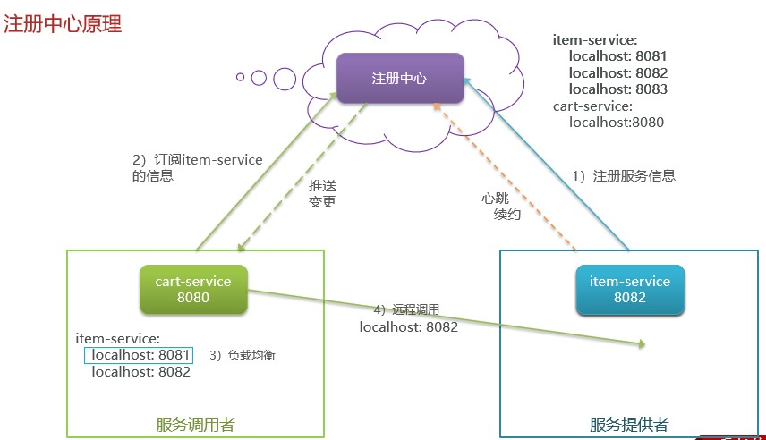
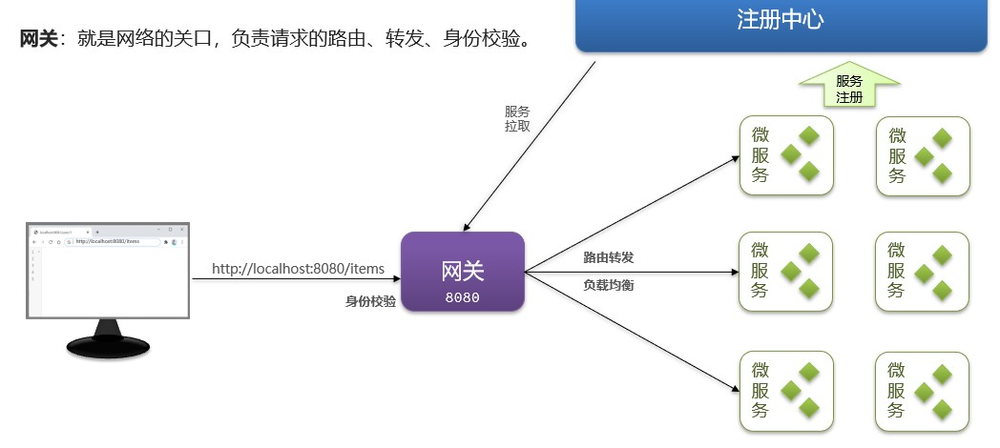
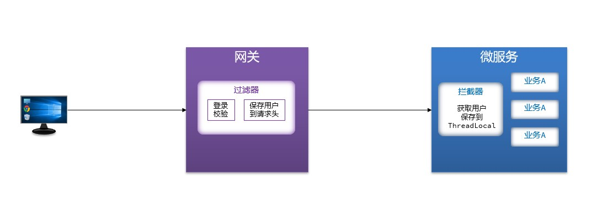
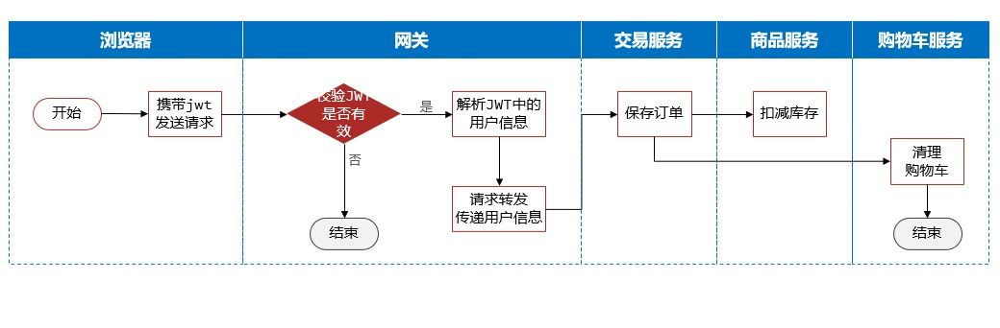
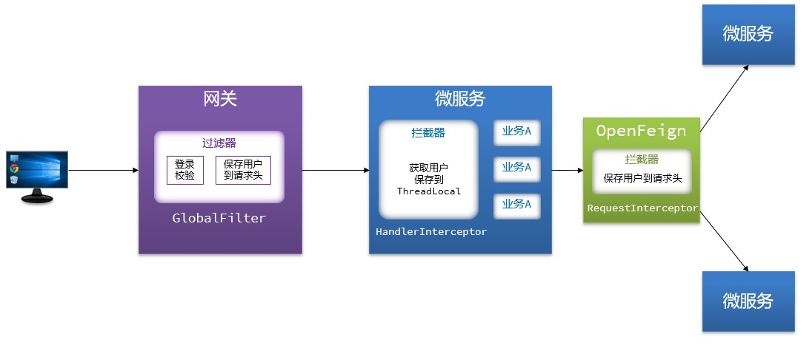
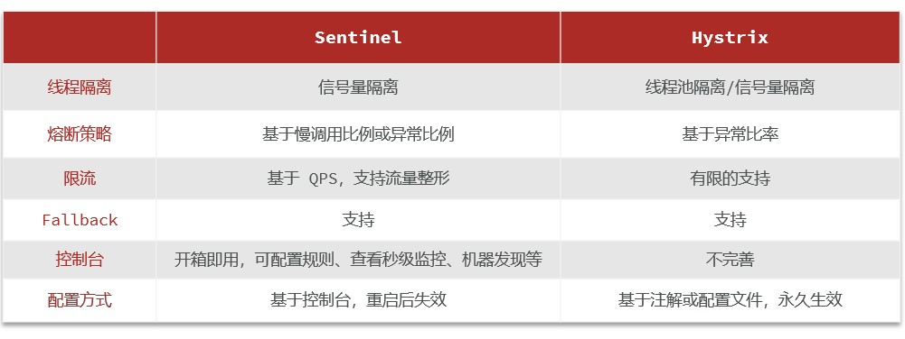

# Spring Cloud微服务学习笔记

微服务是一种软件架构风格，它是以专注于单一职责的很多小型项目为基础，组合出复杂的大型应用。

微服务需要实现：

+ 服务拆分
+ 远程调用
+ 服务治理
+ 请求路由
+ 身份认证
+ 配置管理
+ 服务保护
+ 分布式事务
+ 异步通信
+ 信息可靠性
+ 延迟消息
+ 分布式搜索
+ 倒排索引
+ 数据聚合
+ ……

## 认识微服务

### 单体架构

单体架构：将业务的**所有功能集中在一个项目中开发**，达成一个包部署。

优点：

+ 架构简单
+ 部署成本低

缺点：

+ 团队协作成本高
+ 系统发布效率低
+ 系统可用性差

总结：单体架构适合开发功能相对简单，规模较小的项目。

### 微服务

微服务架构，是服务化思想指导下的一套最佳实践架构方案。服务化，就是把单体架构中的功能模块拆分为多个独立的项目。

+ 粒度小
+ 团队自治
+ 服务自治

### Spring Cloud

Spring Cloud是目前使用最广泛的微服务框架，官网：[Spring Cloud](https://spring.io/projects/spring-cloud)

Spring Cloud集成了各种微服务功能组件，并基于Spring Boot实现了这些组件的自动装配，从而提供了良好的开箱即用体验：

+ 微服务注册发现：Eureka、Nacos、Consul
+ 服务远程调用：OpenFeign、Dubbo
+ 服务链路监控：Zipkin、Sleuth
+ 统一配置管理：SpringCloudConfig、Nacos
+ 统一网关路由：SpringCloudGateway、Zuul
+ 流控、降级、保护：Hystix、Sentinel

Spring Cloud对于Spring Boot的版本有要求，具体参考官网。

## 微服务拆分

### 服务拆分原则

根据项目类型，选择拆分时机：

+ 创业型项目：先采用单体架构，快速开发，快速试错。随着规模扩大，逐渐拆分
+ 确定的大型项目：资金充足，目标明确，可以直接选择微服务架构，避免后续拆分的麻烦

拆分要求：

+ 高内聚：每个微服务的职责要尽量单一，包含的业务相互关联度高、完整度高
+ 低耦合：每个微服务的功能要相对独立，尽量减少对其他微服务的依赖

拆分方式：

+ 纵向拆分：按照业务模块来拆分
+ 横向拆分：抽取公共服务，提高复用性

## 远程调用

让微服务之间能够互相发送调用信息，从而获取非自身的数据信息。

Spring给我们提供了一个RestTemplate工具，可以方便的实现Http请求的发送。使用步骤如下：

1. 注入RestTemplate到Spring容器

   ```java
   @Bean
   public RestTemplate restTemplate(){
   	return new RestTemplate();
   }
   ```

2. 发起远程调用

   ```java
   public <T> ResponseEntity<T> exchange(
   	String url, // 请求路径
   	HttpMethod method, // 请求方式
   	@Nullable HttpEntity<?> requestEntity, //请求实体，可以为空
   	Class<T> responseType, // 返回值类型
   	Map<String,?>uriVariables //请求参数
   )
   ```

### OpenFeign

OpenFeign是一个声明式的http客户端，是Spring Cloud在Eureka公司开源的Feign基础上改造而来。其作用就是基于Spring MVC的常见注解，帮我们优雅的实现http请求的发送。

GitHub地址：[OpenFeign/feign: Feign makes writing java http clients easier (github.com)](https://github.com/OpenFeign/feign)、[spring-cloud-openfeign/README.adoc at main · spring-cloud/spring-cloud-openfeign (github.com)](https://github.com/spring-cloud/spring-cloud-openfeign/blob/main/README.adoc#3-contributing)

Spring Cloud官方地址：[Spring Cloud OpenFeign](https://spring.io/projects/spring-cloud-openfeign)

#### 快速入门

OpenFeign已经被Spring Cloud自动装配，实现起来非常简单：

1. 引入依赖，包括OpenFeign和负载均衡组件SpringCloudLoadBalancer

   ```
   <!--OpenFeign-->
   <dependency>
   	<groupId>org.springframework.cloud</groupId>
   	<artifactId>spring-cloud-starter-openfeign</artifactId>
   </dependency>
   <!--负载均衡-->
   <dependency>
   	<groupId>org.springframework.cloud</groupId>
   	<artifactId>spring-cloud-starter-loadbalancer</artifactId>
   </dependency>
   ```

2. 在启动类上通过`@EnableFeignClients`注解，启用OpenFeign功能

3. 编写FeignClient

   ```
   @FeignClient(value="服务提供者名称")
   public interface XxxxClient{
   	//利用Spring MVC的注解简化http请求的编写
   	@GetMapping("/请求路径")
   	返回类型 调用方法名(@RequestParam("请求参数名")方法参数类型 请求参数);
   }
   ```

4. 调用FeignClient，实现远程调用

#### 连接池

OpenFeign对Http请求做了封装，不过其底层发起http请求，依赖与其他的框架。这些框架可以自己选择，包括以下三种：

+ HttpURLConnection：默认实现，不支持连接池
+ Apache HttpClient：支持连接池
+ OKHttp：支持连接池

*具体代码可以参考FeignBlockingLoadBalancerClient类中的delegate成员变量。*

OpenFeign整合OKHttp的步骤如下：

1. 引入依赖

   ```xml
   <dependency>
   	<groupId>io.github.openfeign</groupId>
   	<artifactId>feign-okhttp</artifactId>
   </dependency>
   ```

2. 开启连接池功能

   ```yaml
   feign:
     okhttp:
       enabled: true #开启OKHttp连接池支持
   ```

#### 日志

OpenFeign只会在FeignClient所在包的日志级别为**DEBUG**时，才会输出日志。而且其日志级别有4级：

+ NONE：不记录任何日志信息，这是默认值
+ BASIC：仅记录请求的方法，URL以及响应状态码和执行时间
+ HEADERS：在BASIC的基础上，额外记录了请求和响应的头信息
+ FULL：记录所有请求和响应的明细，包括头信息、请求体、元数据

由于Feign默认的日志级别就是NONE，所以默认我们看不到请求日志。

要自定义日志级别需要声明一个类型为Logger.Level的Bean，在其中定义日志级别：

```java
public class DefaultFeignConfig{
	@Bean
	public Logger.Level feignLogLevel(){
		return Logger.Level.FULL;
	}
}
```

但此时这个Bean并未生效，要想配置某个FeignClient的日志，可以在@FeignClient注解中声明：

```java
@FeignClient(value = "item-service",configuration = DefaultConfig.class)
```

如果想要全局配置，让所有FeignClient都按照这个日志配置，则需要在@EnableFeignClients注解中声明：

```java
@EnableFeignClients(defaultConfiguration = DefaultFeignConfig.class)
```

## 服务治理

### 注册中心原理



1. 服务提供者向注册中心注册服务信息（如ip地址、端口号）
2. 服务调用者向注册中心订阅服务提供者的信息
3. 由负载均衡的算法，服务调用者选择要调用的服务提供者
4. 服务调用者远程调用服务提供者

*注意：服务提供者和注册中心之间保持着“心跳”，当服务提供者异常时，注册中心会向服务调用者推送变更信息。*

### Nacos注册中心

Nacos是目前国内企业中占比最多的注册中心组件。它是阿里巴巴的产品，目前已经加入SpringCloudAlibaba中。

官方网站：[Nacos官网 | Nacos 官方社区 | Nacos 下载 | Nacos](https://nacos.io/)

GitHub仓库：<https://github.com/alibaba/nacos>

#### 服务注册

服务注册步骤：

1. 引入nacos discovery依赖

   ```xml
   <!--nacos服务注册发现-->
   <dependency>
   	<groupId>com.alibaba.cloud</groupId>
   	<artifactId>spring-cloud-starter-alibaba</artifactId>
   </dependency>
   ```

2. 配置Nacos地址

   ```yaml
   spring:
     application:
       name: xxxx  #服务名称
     cloud:
       nacos:
         server-addr: xx.xx.xx.xx:xxx #nacos地址--ip:port
   ```

#### 服务发现

服务调用者（消费者）需要连接Nacos以拉取和订阅服务，因此服务发现的前两步与服务注册是一样，后面再加上服务调用即可：

1. 引入nacos discovery依赖

2. 配置nacos地址

3. 服务发现

   以下外码仅为示例，具体以编写时的情况确定涉及的泛型、参数等。

   ```
   private DiscoveryClient discoveryClient; // 注入进Spring容器
   
   private void handleXxxx(方法参数){
   	//1.根据服务名称，拉取服务的实例列表
   	List<ServiceInstance> instances=discoveryClient.getInstances("服务名称");
   	//2.对实例列表是否拉取成功进行判断
   	if(Collutil.isEmpty(instances)){
   		return;
   	}
   	//3.编写负载均衡，从实例列表中挑选一个实例，以生成随机数为例
   	ServiceInstance instance =instances.get(RandomUtil.randomInt(instances.size()));
   	//4.从实例中获取服务提供者的地址，利用RestComplate向其发送调用请求
   	ResponseEntity<T> exchange(
   		instance.getUri()+"/路径", // 请求路径，getUri获得ip:port
   		HttpMethod.GET, // 请求方式，以GET为例
   		null, //请求实体，可以为空
   		new ParameterizedTypeReference<T>(){}, // 返回值类型
   		Map<String,?>uriVariables //请求参数
   	)
   }
   ```

## 网关及配置管理

网关：就是网络的关口，负责请求的路由、转发、身份校验。



### Spring Cloud Gateway

+ Spring官方出品
+ 基于WebFlux响应式编程
+ 无需调优即可获得优异性能

#### 快速入门

1. 创建心模块

2. 引入Spring Cloud Gateway网关依赖

3. 编写启动类

4. 配置路由规则

   ```yaml
   spring:
     cloud:
       gateway:
         - id: item #路由规则id，自定义，唯一
           uri: lb://item-service #路由目标微服务，lb代表负载均衡
           predicates: #路由断言，判断请求是否符合规则，符合则路由到目标
             - Path=/items/** #以请求路径做判断，以/items开头则符合
         - id：xx
           url： lb://xx-service
           predicates：
             - Path=/xx/**
   ```

#### 路由属性

网关路由对应的java类型是RouteDefinition，其中常见的属性有：

+ id：路由唯一标示
+ uri：路由目标地址
+ predicates：路由断言，判断请求是否符合当前路由
+ filters：路由过滤器，对请求或响应做特殊处理

##### 路由断言

Spring提供了12种基本的RoutePradicateFactory实现。具体可见Spring官方文档（Spring cloud2023.0.1版本、Gateway4.1.3版本为例）：[Route Predicate Factories :: Spring Cloud Gateway](https://docs.spring.io/spring-cloud-gateway/reference/spring-cloud-gateway/request-predicates-factories.html)

##### 路由过滤器

网关中提供了33种路由过滤器，每种过滤器都有独特的作用。具体可见Spring官方文档（Spring cloud2023.0.1版本、Gateway4.1.3版本为例）：[GatewayFilter Factories :: Spring Cloud Gateway](https://docs.spring.io/spring-cloud-gateway/reference/spring-cloud-gateway/gatewayfilter-factories.html)

#### 网关登录校验

在网关转发请求时做登录校验，校验成功之后再将用户信息和请求传递给微服务，并实现在微服务之间传递用户信息。

##### 自定义过滤器

网关过滤器有两种：分别是：

+ GatewayFilter：路由过滤器，作用于任意指定的路由；默认不生效，要配置到路由后生效。
+ GlobalFilter：全局过滤器，作用范围是所有路由；声明后自动生效。

###### 自定义过滤器GlobalFilter

自定义GlobalFilter比较简单，直接实现GlobalFilter接口即可：

```java
@Component
public class MyGlobalFilter implements GlobalFilter{
	@Override
    public Mono<Void> filter(ServerWebExchange exchange,GatewayFilterChain chain){
        //1.获取请求
        ServerHttpRequest request = exchange.getRequest();
        //2.过滤器业务处理，可对获取的请求读取用户登录凭证（如jwt）进行校验
        System.out.println("GlobalFilter pre阶段 执行了");
        //3.放行
        return chain.filter(exchange);
	}
    
    @Override
    public int getOrder(){
        //过滤器执行顺序，值越小，优先级越高
        return 0；
	}
}
```

###### 自定义过滤器GatewayFilter

自定义GatewayFilter不是直接实现GatewayFilter，而是实现（继承）AbstractGatewayFilterFactory。代码编写可见网络。

#### 网关传递用户信息

网关传递用户信息示意图如下。



#### OpenFeign传递用户信息

微服务项目中的很多业务要多个微服务共同合作完成，而这个过程中也需要传递登录用户信息，例如：



OpenFeign中提供了一个拦截器接口，所有由OpenFeign发起的请求都会先调用拦截器处理请求。



### 配置管理

配置管理解决以下问题：

+ 微服务重复配置过多，维护成本高
+ 业务配置经常变动，每次修改都要重启服务
+ 网关路由配置写死，如果变更要重启网关

#### 配置共享

步骤：

1. 添加配置到Nacos。添加一些共享配置到Nacos中，包括JDBC、MyBatis、日志、Swagger、OpenFeign等配置

2. 基于NacosConfig拉取共享配置代替微服务的本地配置。

   + 引入依赖

     ```xml
     <!--nacos配置管理-->
     <dependency>
     	<groupId>com.alibaba.cloud</groupId>
     	<artifactId>spring-cloud-starter-alibaba-nacos-config</artifactId>
     </dependency>
     <!--读取bootstrap文件-->
     <dependency>
     	<groupId>org.springframework.cloud</groupId>
     	<artifactId>spring-cloud-starter-bootstrap</artifactId>
     </dependency>
     ```

   + 新建bootstrap.yaml

     ```yaml
     spring:
       application:
         name: xxxx  #服务名
       profiles:
         active: dev
        cloud:
          nacos:
            server-addr: xx.xx.xx.xx:xxxx  #nacos地址
            config:
              file-extension: yaml   #文件后缀名
              shared-configs: #共享配置
                - dataId: shared-jdbc.yaml  #共享数据库配置
                - dataId: shared-log.yaml  #共享日志配置
                - dataId: shared-swagger.yaml #共享日志配置
     ```

     ***注意：实例中的“shared-jdbc.yaml”、“shared-log.yaml”、“shared-swagger.yaml”等文件需要在步骤1中添加到nacos中。***

#### 配置热更新

当修改配置文件中的配置时，微服务无需重启即可使配置生效。

前提条件：

1. nacos中要有一个与微服务名有关的配置文件

   命名规则：`[spring.application.name]-[spring.active.profile].[file-extension]`，分别是微服务名称、项目的profile（可选）、文件后缀名（如yaml）。

2. 微服务中要以特定方式读取需要热更新的配置属性

   如使用@ConfigurationProperties(prefix = "xxxx")注解

#### 动态路由

实现动态路由需要将路由配置保存到Nacos，然后在网关监听Nacos中的路由配置，并实现配置热更新。然而网关路由并不是自定义业务配置属性，本身不具备热更新功能！因此我们需要自己完成两件事：

1. 监听Nacos配置变更的信息。监听Nacos配置变更可以参考官方文档：[配置变更 | Nacos](https://nacos.io/docs/v2/plugin/config-change-plugin/)
2. 当配置变更时，将最新的路由信息更新到网关路由表

## 雪崩问题

微服务调用链路中的某个服务故障，引起整个链路中的所有微服务都不可用，这就是雪崩。

产生的原因：

+ 微服务相互调用，服务提供者出现故障或阻塞
+ 微服务调用者没有做好异常处理，导致自身故障
+ 调用链中的所有服务级联失败，导致整个集群故障

解决的思路：

+ 尽量避免服务出现故障或阻塞
  + 保证代码的健壮性
  + 保证网络畅通
  + 能应对较高的并发请求
+ 服务调用者做好远程调用异常的后备方案，避免故障扩散

### 服务保护方案——请求限流

请求限流：限制访问接口的请求的并发量，避免服务因流量激增出现故障。


### 服务保护方案——线程隔离

线程隔离：也叫做舱壁模式，模拟船舱隔板的防水原理。通过限定每个业务能使用的线程数量而将故障业务隔离，避免故障扩散。

### 服务保护方案——服务熔断

服务熔断：由断路器统计请求的异常比例或慢调用比例，如果超过阙值则会熔断业务，则拦截该接口的请求。熔断期间，所有请求快速失败，全部走fallback逻辑。

### 服务保护技术——Sentinel



Sentinel是阿里巴巴开源的一款微服务流量控制组件。

官网：[home | Sentinel (sentinelguard.io)](https://sentinelguard.io/zh-cn/)

GitHub地址：<https://github.com/alibaba/Sentinel>

## 分布式事务

在分布式系统中，如果一个业务需要多个服务合作完成，而且每一个服务都有事务，多个事务必须同时成功或失败，这样的事务就是分布式事务。其中的每个事务就是一个分支事务。整个业务称为全局事务。

### Seata

Seata 是一款开源的**分布式事务解决方案**，致力于在微服务架构下提供高性能和简单易用的分布式事务服务。在 Seata 开源之前，其内部版本在阿里系内部一直扮演着应用架构层数据一致性的中间件角色，帮助经济体平稳的度过历年的双11，对上层业务进行了有力的技术支撑。经过多年沉淀与积累，其商业化产品先后在阿里云、金融云上售卖。2019.1 为了打造更加完善的技术生态和普惠技术成果，Seata 正式宣布对外开源，未来 Seata 将以社区共建的形式帮助用户快速落地分布式事务解决方案。

官网：[Apache Seata](https://seata.apache.org/zh-cn/)

GitHub地址：<https://github.com/apache/incubator-seata>

#### Seata事务管理中的三个角色

+ TC (Transaction Coordinator) - 事务协调者：维护全局和分支事务的状态，驱动全局事务提交或回滚。
+ TM (Transaction Manager) - 事务管理器：定义全局事务的范围——开始全局事务、提交或回滚全局事务。
+ RM (Resource Manager) - 资源管理器：管理分支事务处理的资源，与TC交谈以注册分支事务和报告分支事务的状态，并驱动分支事务提交或回滚。

#### 事务模式

##### Seata AT模式

AT 模式是 Seata 创新的一种非侵入式的分布式事务解决方案，Seata 在内部做了对数据库操作的代理层，我们使用 Seata AT 模式时，实际上用的是 Seata 自带的数据源代理 DataSourceProxy，Seata 在这层代理中加入了很多逻辑，比如插入回滚 undo_log 日志，检查全局锁等。

###### 整体机制

两阶段提交协议的演变：

+ 一阶段：业务数据和回滚日志记录在同一个本地事务中提交，释放本地锁和连接资源
+ 二阶段：
  + 提交异步化，非常快速地完成
  + 回滚通过一阶段的回滚日志进行反向补偿

##### Seata TCC模式

TCC 模式是 Seata 支持的一种由业务方细粒度控制的侵入式分布式事务解决方案，是继 AT 模式后第二种支持的事务模式，最早由蚂蚁金服贡献。其分布式事务模型直接作用于服务层，不依赖底层数据库，可以灵活选择业务资源的锁定粒度，减少资源锁持有时间，可扩展性好，可以说是为独立部署的 SOA 服务而设计的。

###### 优势

TCC 完全不依赖底层数据库，能够实现跨数据库、跨应用资源管理，可以提供给业务方更细粒度的控制。

###### 缺点

TCC 是一种侵入式的分布式事务解决方案，需要业务系统自行实现 Try，Confirm，Cancel 三个操作，对业务系统有着非常大的入侵性，设计相对复杂。

###### 整体机制

在两阶段提交协议中，资源管理器（RM, Resource Manager）需要提供“准备”、“提交”和“回滚” 3 个操作；而事务管理器（TM, Transaction Manager）分 2 阶段协调所有资源管理器，在第一阶段询问所有资源管理器“准备”是否成功，如果所有资源均“准备”成功则在第二阶段执行所有资源的“提交”操作，否则在第二阶段执行所有资源的“回滚”操作，保证所有资源的最终状态是一致的，要么全部提交要么全部回滚。

资源管理器有很多实现方式，其中 TCC（Try-Confirm-Cancel）是资源管理器的一种服务化的实现；TCC 是一种比较成熟的分布式事务解决方案，可用于解决跨数据库、跨服务业务操作的数据一致性问题；TCC 其 Try、Confirm、Cancel 3 个方法均由业务编码实现，故 TCC 可以被称为是服务化的资源管理器。

TCC 的 Try 操作作为一阶段，负责资源的检查和预留；Confirm 操作作为二阶段提交操作，执行真正的业务；Cancel 是二阶段回滚操作，执行预留资源的取消，使资源回到初始状态。

###### 适用场景

TCC 模式是高性能分布式事务解决方案，适用于核心系统等对性能有很高要求的场景。

##### Seata Sage模式

Saga 模式是 SEATA 提供的长事务解决方案，在 Saga 模式中，业务流程中每个参与者都提交本地事务，当出现某一个参与者失败则补偿前面已经成功的参与者，一阶段正向服务和二阶段补偿服务都由业务开发实现。

###### 优势

+ 一阶段提交本地事务，无锁，高性能
+ 事件驱动架构，参与者可异步执行，高吞吐
+ 补偿服务易于实现

###### 缺点

+ 不保证隔离性（可以采取措施应对）

###### 使用场景

+ 业务流程长、业务流程多
+ 参与者包含其他公司或遗留系统服务，无法提供TCC模式要求的三个接口

###### Saga的实现

目前 SEATA 提供的 Saga 模式是基于状态机引擎来实现的，机制是：

1. 通过状态图来定义服务调用的流程并生成 json 状态语言定义文件
2. 状态图中一个节点可以是调用一个服务，节点可以配置它的补偿节点
3. 状态图 json 由状态机引擎驱动执行，当出现异常时状态引擎反向执行已成功节点对应的补偿节点将事务回滚（*注：异常发生时是否进行补偿也可由用户自定义决定*）
4. 可以实现服务编排需求，支持单项选择、并发、子流程、参数转换、参数映射、服务执行状态判断、异常捕获等功能

##### Seata XA模式

XA 模式是从 1.2 版本支持的事务模式。XA 规范 是 X/Open 组织定义的分布式事务处理（DTP，Distributed Transaction Processing）标准。Seata XA 模式是利用事务资源（数据库、消息服务等）对 XA 协议的支持，**以 XA 协议的机制来管理分支事务**的一种事务模式。

###### 优势

与 Seata 支持的其它事务模式不同，XA 协议要求事务资源本身提供对规范和协议的支持，所以事务资源（如数据库）可以保障从任意视角对数据的访问有效隔离，满足全局数据一致性。此外的一些优势还包括：

1. 业务无侵入：和 AT 一样，XA 模式将是业务无侵入的，不给应用设计和开发带来额外负担。
2. 数据库的支持广泛：XA 协议被主流关系型数据库广泛支持，不需要额外的适配即可使用。

###### 缺点

XA prepare 后，分支事务进入阻塞阶段，收到 XA commit 或 XA rollback 前必须阻塞等待。事务资源长时间得不到释放，锁定周期长，而且在应用层上面无法干预，性能差。

###### 整体机制

+ 执行阶段：
  + 可回滚：业务 SQL 操作放在 XA 分支中进行，由资源对 XA 协议的支持来保证 *可回滚*
  + 持久化：XA 分支完成后，执行 XA prepare，同样，由资源对 XA 协议的支持来保证 *持久化*（即，之后任何意外都不会造成无法回滚的情况）
+ 完成阶段：
  + 分支提交：执行 XA 分支的 commit
  + 分支回滚：执行 XA 分支的 rollback

###### 使用场景

适用于想要迁移到 Seata 平台基于 XA 协议的老应用，使用 XA 模式将更平滑，还有 AT 模式未适配的数据库应用。
