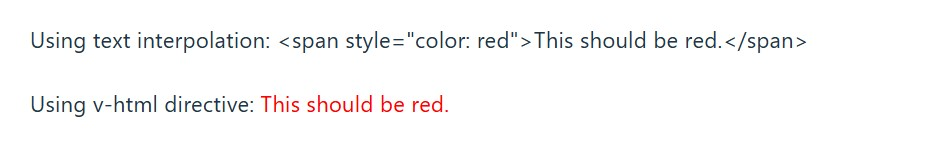
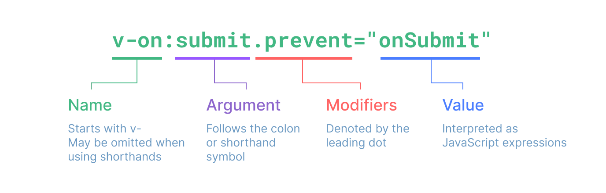

# Vue3学习笔记草稿

## Vue 概述

Vue是一款用于构建用户界面的 **JavaScript 框架**。它基于标准 HTML、CSS 和 JavaScript 构建，并提供了一套**声明式的、组件化**的编程模型，帮助你高效地开发用户界面。

Vue 的两个核心功能：

- **声明式渲染**：Vue 基于标准 HTML 拓展了一套模板语法，使得我们可以声明式地描述最终输出的 HTML 和 JavaScript 状态之间的关系。
- **响应性**：Vue 会自动跟踪 JavaScript 状态并在其发生变化时响应式地更新 DOM。

根据需求场景，可以用不同的方式使用 Vue：

- 无需构建步骤，渐进式增强静态的 HTML
- 在任何页面中作为 Web Components 嵌入
- 单页应用 (SPA)
- 全栈 / 服务端渲染 (SSR)
- Jamstack / 静态站点生成 (SSG)
- 开发桌面端、移动端、WebGL，甚至是命令行终端中的界面


## 单文件组件（`.vue`文件）

在大多数启用了构建工具的 Vue 项目中，我们可以使用一种类似 HTML 格式的文件来书写 Vue 组件，它被称为**单文件组件** (也被称为 `*.vue` 文件，英文 Single-File Components，缩写为 **SFC**)。顾名思义，Vue 的单文件组件会将一个组件的逻辑 (JavaScript)，模板 (HTML) 和样式 (CSS) 封装在同一个文件里。

单文件组件（`.vue`文件）的格式/结构示例：

```vue
<script setup>
// JS代码
import { ref } from 'vue'
const count = ref(0)
</script>

<template>
  <!-- HTML代码 -->
  <button @click="count++">Count is: {{ count }}</button>
</template>

<style scoped>
// CSS代码
button {
  font-weight: bold;
}
</style>
```


Vue 的组件可以按两种不同的风格书写（主要是**JS代码**）：**选项式 API** 和**组合式 API**。


### 选项式API（Options API）

使用选项式 API，可以用包含多个选项的对象来描述组件的逻辑，例如 `data`、`methods` 和 `mounted`。选项所定义的属性都会暴露在函数内部的 `this` 上，它会指向当前的组件实例。

示例：

```vue
<script>
export default {
  // data() 返回的属性将会成为响应式的状态
  // 并且暴露在 `this` 上
  data() {
    return {
      count: 0
    }
  },

  // methods 是一些用来更改状态与触发更新的函数
  // 它们可以在模板中作为事件处理器绑定
  methods: {
    increment() {
      this.count++
    }
  },

  // 生命周期钩子会在组件生命周期的各个不同阶段被调用
  // 例如这个函数就会在组件挂载完成后被调用
  mounted() {
    console.log(`The initial count is ${this.count}.`)
  }
}
</script>

<template>
  <button @click="increment">Count is: {{ count }}</button>
</template>
```


### 组合式 API (Composition API)

通过组合式 API，可以使用导入的 API 函数来描述组件逻辑。在单文件组件中，组合式 API 通常会与 `<script setup>` 搭配使用。这个 `setup` attribute 是一个标识，告诉 Vue 需要在编译时进行一些处理，让我们可以更简洁地使用组合式 API。比如，`<script setup>` 中的导入和顶层变量/函数都能够在模板中直接使用。

示例：

```vue
<script setup>
import { ref, onMounted } from 'vue'

// 响应式状态
const count = ref(0)

// 用来修改状态、触发更新的函数
function increment() {
  count.value++
}

// 生命周期钩子
onMounted(() => {
  console.log(`The initial count is ${count.value}.`)
})
</script>

<template>
  <button @click="increment">Count is: {{ count }}</button>
</template>
```


### 两种风格比较与选择

两种 API 风格都能够覆盖大部分的应用场景。它们只是**同一个底层系统所提供的两套不同的接口**。实际上，**选项式 API 是在组合式 API 的基础上实现的**！关于 Vue 的基础概念和知识在它们之间都是通用的。

**选项式 API 以“组件实例”的概念为中心** (即上述例子中的 `this`)，对于有面向对象语言背景的用户来说，这通常与基于类的心智模型更为一致。同时，**它将响应性相关的细节抽象出来，并强制按照选项来组织代码**，从而对初学者而言更为友好。

**组合式 API 的核心思想是直接在函数作用域内定义响应式状态变量**，并将从多个函数中得到的状态组合起来处理复杂问题。这种**形式更加自由，也需要你对 Vue 的响应式系统有更深的理解才能高效使用**。相应的，它的灵活性也使得组织和重用逻辑的模式变得更加强大。

+ 当你不需要使用构建工具，或者打算主要在低复杂度的场景中使用 Vue，例如渐进增强的应用场景，推荐采用选项式 API。
+ 当你打算用 Vue 构建完整的单页应用，推荐采用组合式 API + 单文件组件。


## Vue应用/项目构建

### 使用NPM创建一个完整的Vue项目（Vue3）

> 前提：已安装 `^20.19.0 || >=22.12.0` 版本的 [Node.js](https://nodejs.org/)

在终端中执行以下命令：

```sh
npm create vue@latest
```

这一指令将会安装并执行 [create-vue](https://github.com/vuejs/create-vue)，它是 Vue 官方的项目脚手架工具。你将会看到一些诸如 TypeScript 和测试支持之类的可选功能提示，如果不确定是否要开启某个功能，你可以直接按下回车键选择 `No`。在项目被创建后，通过以下步骤安装依赖并启动开发服务器：

```sh
cd <项目路径>
npm install
npm run dev
```

***请注意，生成的项目中的示例组件使用的是组合式 API和 `<script setup>`，而非选项式 API。***

当你准备将应用发布到生产环境时，请运行:

```sh
npm run build
```

此命令会在 `./dist` 文件夹中为你的应用创建一个生产环境的构建版本。


### Vue应用实例创建

以`.vue`文件（单文件组件）为例，一个Vue应用（组件）具有：HTML元素、CSS样式、JS数据交互。

使用Vue时，任何HTML页面元素的渲染、交互都要由一个具体的Vue应用实例处理完成。

每个 Vue 应用都是通过 `createApp`函数创建的一个应用实例：

```js
import { createApp } from 'vue'

const app = createApp({
  /* 根组件选项 */
})
```

说明：`createApp()`函数接受的参数——根组件选项，其实就是一个形如`.vue`文件定义的`组件`，可以直接传入一个`.vue`单文件组件，也可以编写一个具有组件选项的对象。

```js
import { createApp } from 'vue'
// 从一个单文件组件中导入根组件
import App from './App.vue'

const app1 = createApp(App)

const app2 = createApp({
  // 编写组件选项
  template: `<div>My name is: {{ name }} .</div>`,
  data() {
    return {
      name: 'Jack',
    }
  },
})
})

```

上面的示例中创建了两个Vue应用实例：`app1`和`app2`。

**在Vue项目中可以创建不只一个Vue应用实例**。`createApp` API 允许我们在同一个页面中创建多个共存的 Vue 应用，而且每个应用都拥有自己的用于配置和全局资源的作用域。

多个Vue应用实例在如下的场景很适用：使用 Vue 来增强服务端渲染 HTML，并且只想要 Vue 去控制一个大型页面中特殊的一小部分，应避免将一个单独的 Vue 应用实例挂载到整个页面上，而是应该创建多个小的应用实例，将它们分别挂载到所需的元素上去。


### Vue应用实例挂载

Vue应用实例必须在调用了 `.mount()` 方法后才会渲染出来。该方法接收一个“容器”参数，可以是一个实际的 DOM 元素或是一个 CSS 选择器字符串，应用根组件的内容将会被渲染在容器元素里面。容器元素自己将**不会**被视为应用的一部分。

用于挂载、渲染Vue应用实例的HTML页面：

```html
<!doctype html>
<html lang="">
  <head>
    <meta charset="UTF-8" />
    <link rel="icon" href="/favicon.ico" />
    <meta name="viewport" content="width=device-width, initial-scale=1.0" />
    <title>Vue App</title>
  </head>
  <body>
    <div id="app1"></div>
    <div id="app2"></div>
    <!-- 引入挂载Vue应用实例的JS代码 -->
    <script type="module" src="/src/main.ts"></script>
  </body>
</html>
```

挂载Vue应用实例的JS代码：

```js
// 创建
const app1 = createApp(App)
// 挂载
app1.mount('#app1')

// 创建
const app2 = createApp({
  // 编写组件选项
  template: `<div>My name is: {{ name }} .</div>`,
  data() {
    return {
      name: 'Jack',
    }
  },
})
// 挂载
app2.mount('#app2')
```

`.mount()` 方法应该始终在整个应用配置和资源注册完成后被调用。同时请注意，不同于其他资源注册方法，它的**返回值是根组件实例而非应用实例**。

创建Vue应用实例时，根组件的模板（`template`）通常是组件本身的一部分，但也可以直接通过在挂载容器（HTML元素）内编写模板来单独提供，此时在根组件没有设置 `template` 选项时，Vue 将自动使用容器的 `innerHTML` 作为模板。如下：

```html
<div id="app">
  <button @click="count++">{{ count }}</button>
</div>
```

```js
import { createApp } from 'vue'

const app = createApp({
  data() {
    return {
      count: 0
    }
  }
})

app.mount('#app')
```

DOM 内模板通常用于无构建步骤的 Vue 应用程序。它们也可以与服务器端框架一起使用，其中根模板可能是由服务器动态生成的。


### Vue应用实例配置

Vue应用实例会暴露一个 `.config` 对象允许我们配置一些应用级的选项，例如定义一个应用级的错误处理器，用来捕获所有子组件上的错误：

```js
app.config.errorHandler = (err) => {
  /* 处理错误 */
}
```


## 模板（`template`）语法

这里的模板其实指的是Vue中HTML元素的组织，在`.vue`单文件组件中HTML元素被组织在`<template></template>`标签之中。

Vue 使用一种基于 HTML 的模板语法，使我们能够声明式地将其组件实例的数据绑定到呈现的 DOM 上。**所有的 Vue 模板都是语法层面合法的 HTML**，可以被符合规范的浏览器和 HTML 解析器解析。

所以最简单的模板就是一般编写HTML文件的`<body>`部分的纯标签内容。

**在底层机制中，Vue 会将模板编译成高度优化的 JavaScript 代码。结合响应式系统，当应用状态变更时，Vue 能够智能地推导出需要重新渲染的组件的最少数量，并应用最少的 DOM 操作**。

在编写HTML标签时我们主要关注标签的这些内容：

+ 文本内容
+ 属性定义
+ 事件绑定

```html
<!-- 文本内容 -->
<h2>Vue 语法</h2>
<!-- 属性赋值 -->
<a href="https://cn.vuejs.org/">Vue 官网</a>
<p id="paragraph">段落内容</p>
<!-- 事件绑定 -->
<button onclick="doclick()">点击</button>
```

Vue对于它们的实现，通过`文本插值`和`属性绑定`完成。

### 文本内容

####  文本插值

Vue中使用的是“Mustache”语法 (即双大括号)，如：

```html
<span>Message: {{ msg }}</span>
```

双大括号标签会被替换为相应组件实例中 `msg` 属性的值。同时每次 `msg` 属性更改时它也会同步更新。

>Mustache 是一种常见的文本插值语法，用于在模板中动态插入变量值，通常用双大括号表示。


#### 插入HTML

Mustache语法的双大括号会将数据解释为纯文本，而不是 HTML。若想插入 HTML，你需要使用 Vue的`v-html`指令。如：

```html
<p>Using text interpolation: {{ rawHtml }}</p>
<p>Using v-html directive: <span v-html="rawHtml"></span></p>
```

其中`rawhtml`的内容为：`<span style="color: red">This should be red.</span>`，显示结果：



`span` 的内容将会被替换为 `rawHtml` 属性的值，插值为纯 HTML——数据绑定将会被忽略。注意，你不能使用 `v-html` 来拼接组合模板，因为 Vue 不是一个基于字符串的模板引擎。在使用 Vue 时，应当使用组件作为 UI 重用和组合的基本单元。

这里看到的 `v-html` 属性（attribute） 被称为一个**指令**。指令由 `v-` 作为前缀，表明它们是一些由 Vue 提供的特殊属性（attribute）。


### 指令 Directives

指令是带有 `v-` 前缀的特殊属性（ attribute）。Vue 提供了许多内置指令，包括上面 `v-html`。

指令 attribute 的期望值为一个 JavaScript 表达式 (除了少数几个例外，如： `v-for`、`v-on` 和 `v-slot`)。一个指令的任务是在其表达式的值变化时响应式地更新 DOM。

以`v-if`为例：

```html
<p v-if="seen">Now you see me</p>
```

这里，`v-if` 指令会基于表达式 `seen` 的值的真假来移除/插入该 `<p>` 元素。

完整的指令语法格式：




#### 参数Arguments

某些指令会需要一个“参数”，在指令名后通过一个冒号`:`隔开做标识。

例如用 `v-bind` 指令来响应式地更新一个 HTML元素属性：

```html
<a v-bind:href="url"> ... </a>

<!-- 简写 -->
<a :href="url"> ... </a>
```

这里 `href` 就是一个参数，它告诉 `v-bind` 指令将表达式 `url` 的值绑定到元素的 `href`属性上。**在简写中，参数前的一切 (例如 `v-bind:`) 都会被缩略为一个 `:` 字符**。

同名简写（仅支持 3.4 版本及以上）：如果属性（attribute）的名称与绑定的 JavaScript 变量的名称相同，那么可以进一步简化语法，省略属性（attribute）值：

```html
<!-- 与 :id="id" 相同 -->
<div :id></div>

<!-- 这也同样有效 -->
<div v-bind:id></div>
```

这与在 JavaScript 中声明对象时使用的属性简写语法类似。

另一个例子是 `v-on` 指令，它将监听 DOM 事件：

```html
<a v-on:click="doSomething"> ... </a>

<!-- 简写 -->
<a @click="doSomething"> ... </a>
```

这里的参数是要监听的事件名称：`click`。**`v-on` 有一个相应的缩写，即 `@` 字符**。


#### 修饰符 Modifiers

修饰符是以点开头的特殊后缀，表明指令需要以一些特殊的方式被绑定。例如 `.prevent` 修饰符会告知 `v-on` 指令对触发的事件调用 `event.preventDefault()`：

```html
<form @submit.prevent="onSubmit">...</form>
```


### 属性/事件绑定

Vue中对属性/事件的绑定通过**指令**实现，如上面提到的`v-bind`用于绑定属性值，`v-on`用于绑定事件。


#### 布尔型属性

布尔型属性（attribute）依据 `true / false` 值来决定 attribute 是否应该存在于该元素上。`disabled`就是最常见的例子之一。`v-bind` 在这种场景下的行为略有不同：

```html
<button :disabled="isButtonDisabled">Button</button>
```

当 `isButtonDisabled` 为`真值`或一个空字符串 (即 `<button disabled="">`) 时，元素会包含这个 `disabled` 属性。而当其为其他`假值`时该属性将被忽略。


#### 动态绑定多个值

如果你有像这样的一个包含多个属性的 JavaScript 对象：

```js
const objectOfAttrs = {
  id: 'container',
  class: 'wrapper',
  style: 'background-color:green'
}
```

通过不带参数的 `v-bind`，你可以将它们绑定到单个元素上：

```html
<div v-bind="objectOfAttrs"></div>
```


### 使用JavaScript表达式

#### 属性值

在上面的例子中，我们仅在模板中绑定了一些简单的属性名。但是 Vue 实际上在所有的数据绑定中都支持完整的 JavaScript 表达式：

```javascript
{{ number + 1 }}

{{ ok ? 'YES' : 'NO' }}

{{ message.split('').reverse().join('') }}

<div :id="`list-${id}`"></div>
```

这些表达式都会被作为 JavaScript代码 ，以当前组件实例为作用域解析执行。

在 Vue 模板内，JavaScript 表达式可以被使用在如下场景上：

- 在文本插值中 (双大括号)
- 在任何 Vue 指令 (以 `v-` 开头的特殊 attribute) 的值中

每个绑定仅支持**单一表达式**，也就是一段能够被求值的 JavaScript 代码（一个简单的判断方法：是否可以合法地写在 `return` 后面）。

可以在绑定的表达式中使用组件实例暴露`export`的方法（函数）：

```html
<time :title="toTitleDate(date)" :datetime="date">
  {{ formatDate(date) }}
</time>
```

***需要注意：绑定在表达式中的方法在组件每次更新时都会被重新调用，因此不应该产生任何副作用，比如改变数据或触发异步操作。***

**说明**：**模板中的表达式将被沙盒化，仅能够访问到有限的全局对象列表**。该列表中会暴露常用的内置全局对象，比如 `Math` 和 `Date`。没有显式包含在列表中的全局对象将不能在模板内表达式中访问，例如用户附加在 `window` 上的属性。然而，也可以自行在 `app.config.globalProperties`上显式地添加它们，供所有的 Vue 表达式使用。

#### 指令参数

同样在**指令参数上也可以使用一个 JavaScript 表达式，需要包含在一对方括号内**：

```html
<a v-bind:[attributeName]="url"> ... </a>

<!-- 简写 -->
<a :[attributeName]="url"> ... </a>
```

这里的 `attributeName` 会作为一个 JavaScript 表达式被动态执行，计算得到的值会被用作最终的参数。举例来说，如果你的组件实例有一个数据属性 `attributeName`，其值为 `"href"`，那么这个绑定就等价于 `v-bind:href`。

相似地，你还可以将一个函数绑定到动态的事件名称上：

```html
<a v-on:[eventName]="doSomething"> ... </a>

<!-- 简写 -->
<a @[eventName]="doSomething"> ... </a>
```

在此示例中，当 `eventName` 的值是 `"focus"` 时，`v-on:[eventName]` 就等价于 `v-on:focus`。

**强调**：**动态参数中表达式的值应当是一个字符串，或者是 `null`**。特殊值 `null` 意为显式移除该绑定。其他非字符串的值会触发警告。

**动态参数表达式因为某些字符的缘故有一些语法限制，比如空格和引号，在 HTML 元素名称中都是不合法的**。例如下面的示例：

```html
<!-- 这会触发一个编译器警告 -->
<a :['foo' + bar]="value"> ... </a>
```

如果需要传入一个复杂的动态参数，推荐使用**计算属性**替换复杂的表达式，也是 Vue 最基础的概念之一。

当使用 DOM 内嵌模板 (直接写在 `.html`文件里的模板) 时，我们需要避免在名称中使用大写字母，因为浏览器会强制将其转换为小写：

```html
<a :[someAttr]="value"> ... </a>
```

上面的例子将会在 DOM 内嵌模板中被转换为 `:[someattr]`。如果你的组件拥有 `someAttr`属性而非 `someattr`，这段代码将不会工作。**单文件组件（`.vue`文件）内的模板不受此限制**。


## 响应式基础

### `ref()`与`reactive()`

在Vue中，`ref()`与`reactive()`都可以用来声明数据的响应式状态。

`ref()`：

>Takes an inner value and returns a reactive and mutable ref object, which has a single property `.value` that points to the inner value.
>
>*@param* `value` — The object to wrap in the ref.
>
>接收一个内部值并返回一个响应式且可变的 ref 对象，该对象有一个属性`.value`，指向内部值。

```js
import { ref } from 'vue'

const count = ref(0)

// RefImpl {dep: Dep, __v_isRef: true, __v_isShallow: false, _rawValue: 0, _value: 0}
console.log(count) 
// 0
console.log(count.value)
```


`reactive()`：

>Returns a reactive proxy of the object.
>
>The reactive conversion is "deep": it affects all nested properties. A reactive object also deeply unwraps any properties that are refs while maintaining reactivity.
>
>*@param* `target` — The source object.
>
>返回对象的响应式代理。
>
>响应式转换是"深度"的：它影响所有嵌套属性。响应式对象还会深度解包任何 ref 属性，同时保持响应性。

```js
import { reactive } from 'vue'

const count = reactive({ count: 0 })

// Proxy(Object) {count: 0}
console.log(count)
// 0
console.log(count.count)
```


### Vue的响应式系统工作

以`ref`为例：

当你在模板中使用了一个 ref，然后改变了这个 ref 的值时，Vue 会自动检测到这个变化，并且相应地更新 DOM。这是通过一个基于依赖追踪的响应式系统实现的。当一个组件首次渲染时，Vue 会**追踪**在渲染过程中使用的每一个 ref。然后，当一个 ref 被修改时，它会**触发**追踪它的组件的一次重新渲染。

在标准的 JavaScript 中，检测普通变量的访问或修改是行不通的。然而，我们可以通过 getter 和 setter 方法来拦截对象属性的 get 和 set 操作。

该 `.value` 属性给予了 Vue 一个机会来检测 ref 何时被访问或修改。在其内部，Vue 在它的 getter 中执行追踪，在它的 setter 中执行触发。

当你修改了响应式状态时，DOM 会被自动更新。但是需要注意的是，DOM 更新不是同步的。Vue 会在`next tick`更新周期中缓冲所有状态的修改，以确保不管你进行了多少次状态修改，每个组件都只会被更新一次。

要等待 DOM 更新完成后再执行额外的代码，可以使用 `nextTick()`全局 API：

```js
import { nextTick } from 'vue'

async function increment() {
  count.value++
  await nextTick()
  // 现在 DOM 已经更新了
}
```


### `ref()`

`ref()` 接收参数（内部值），并将其包裹在一个带有 `.value` 属性的 ref 对象中返回

```vue
<script>
import { ref } from 'vue'

export default {
  setup() {
    const count = ref(0)
    
    function incremnet() {
    count.value++
   }
      
    // 暴露状态和方法
    return {
      count,
      increment
    }
  }
}
</script>
```

```vue
<template>
  <div>{{ count }}</div>
  <button @click="increment">+1</button>
</template>
```


在模板（`<template>`）中使用 ref 时，不需要附加 `.value`。为了方便起见，当在模板中使用时，ref 会自动解包。

在 `setup()` 函数中手动暴露大量的状态和方法非常繁琐。可以通过使用`.vue`单文件组件来避免这种情况，使用 `<script setup>` 来大幅度地简化代码：

```vue

<script setup>
import { ref } from 'vue'

const count = ref(0)

function incremnet() {
  count.value++
}
</script>
```

**`<script setup>` 中的顶层的导入、声明的变量和函数可在同一组件的模板中直接使用**，可以理解为模板是在同一作用域内声明的一个 JavaScript 函数——它自然可以访问与它一起声明的所有内容。

`ref`可以持有任何类型的值，包括深层嵌套的对象、数组或者 JavaScript 内置的数据结构，比如 `Map`。

`ref`会使它的值具有深层响应性。这意味着即使改变嵌套对象或数组时，变化也会被检测到：

```js
import { ref } from 'vue'

const obj = ref({
  nested: { count: 0 },
  arr: ['foo', 'bar']
})

function mutateDeeply() {
  // 以下都会按照期望工作
  obj.value.nested.count++
  obj.value.arr.push('baz')
}
```

也可以通过 `shallowref`来放弃深层响应性。对于浅层 ref，只有 `.value` 的访问会被追踪。浅层 ref 可以用于避免对大型数据的响应性开销来优化性能、或者有外部库管理其内部状态的情况。


### `reactive()`

与将内部值包装在特殊对象中的 ref 不同，`reactive()` 将使对象本身具有响应性：

```vue
<script setup>
import { reactive } from 'vue'

const count = reactive({ count: 0 })

function increment() {
  count.count++
}
</script>
```

```vue
<template>
  <div>{{ count.count }}</div>
  <button @click="increment">+1</button>
</template>
```


`reactive()` 将深层地转换对象：当访问嵌套对象时，它们也会被 `reactive()` 包装。**当 ref 的值是一个对象时，`ref()` 也会在内部调用它`reactive()`**。与浅层 ref 类似，这里也有一个`shallowReactive()`API 可以选择退出深层响应性。

值得注意的是，`reactive()` 返回的是一个原始对象的代理`Proxy`，它和原始对象是不相等的：

```js
const raw = {}
const proxy = reactive(raw)

// 代理对象和原始对象不是全等的
console.log(proxy === raw) // false
```

只有代理对象是响应式的，更改原始对象不会触发更新。因此，使用 Vue 的响应式系统的最佳实践是**仅使用你声明对象的代理版本**。

为保证访问代理的一致性，对同一个原始对象调用 `reactive()` 会总是返回同样的代理对象，而对一个已存在的代理对象调用 `reactive()` 会返回其本身：

```js
// 在同一个对象上调用 reactive() 会返回相同的代理
console.log(reactive(raw) === proxy) // true

// 在一个代理上调用 reactive() 会返回它自己
console.log(reactive(proxy) === proxy) // true
```

这个规则对嵌套对象也适用。依靠深层响应性，响应式对象内的嵌套对象依然是代理：

```js
const proxy = reactive({})

const raw = {}
proxy.nested = raw

console.log(proxy.nested === raw) // false
```


### 建议使用`ref()`

`reactive()` API 有一些局限性：

+ **有限的值类型**：它**只能用于对象类型** (对象、数组和如 `Map`、`Set` 这样的集合类型)。它不能持有如 `string`、`number` 或 `boolean` 这样的原始类型。

+ **不能替换整个对象**：由于 Vue 的响应式跟踪是通过属性访问实现的，因此我们必须始终保持对响应式对象的相同引用。这意味着我们不能轻易地“替换”响应式对象，因为这样的话与第一个引用的响应性连接将丢失：

  ```js
  let state = reactive({ count: 0 })
  
  // 上面的 ({ count: 0 }) 引用将不再被追踪
  // (响应性连接已丢失！)
  state = reactive({ count: 1 })
  ```

  

+ **对解构操作不友好**：当我们将响应式对象的原始类型属性解构为本地变量时，或者将该属性传递给函数时，我们将丢失响应性连接。

  ```js
  const state = reactive({ count: 0 })
  
  // 当解构时，count 已经与 state.count 断开连接
  let { count } = state
  // 不会影响原始的 state
  count++
  
  // 该函数接收到的是一个普通的数字
  // 并且无法追踪 state.count 的变化
  // 我们必须传入整个对象以保持响应性
  callSomeFunction(state.count)
  ```


### `ref()`解包

>解包：把被“包装/包裹”的值，自动或手动地取出其内部真实值来使用

+ 一个 `ref`对象会在作为响应式对象的属性被访问或修改时自动解包：

  ```js
  const count = ref(0)
  const state = reactive({
    count
  })
  
  console.log(state.count) // 0
  
  state.count = 1
  console.log(count.value) // 1
  ```

+ 如果将一个新的 `ref` 赋值给一个关联了已有 `ref` 的属性，那么它会替换掉旧的 ref：

  ```js
  const otherCount = ref(2)
  
  state.count = otherCount
  console.log(state.count) // 2
  // 原始 ref 现在已经和 state.count 失去联系
  console.log(count.value) // 1
  ```

  只有当嵌套在一个深层响应式对象内时，才会发生 `ref` 解包。当其作为浅层响应式对象的属性被访问时不会解包。

+ 与 `reactive` 对象不同的是，当 `ref` 作为响应式数组或原生集合类型 (如 `Map`) 中的元素被访问时，它不会被解包：

  ```js
  const books = reactive([ref('Vue 3 Guide')])
  // 这里需要 .value
  console.log(books[0].value)
  
  const map = reactive(new Map([['count', ref(0)]]))
  // 这里需要 .value
  console.log(map.get('count').value)
  ```

+ 在模板渲染上下文中，只有顶级的 `ref` 属性才会被解包。

  在下面的例子中，`count` 和 `object` 是顶级属性，但 `object.id` 不是：

  ```js
  const count = ref(0)
  const object = { id: ref(1) }
  ```

  因此，这个表达式按预期工作：

  ```vue
  {{ count + 1 }}
  ```

  但这个不会：

  ```vue
  {{ object.id + 1 }}
  ```

  为了解决这个问题，我们可以将 `id` 解构为一个顶级属性：

  > 解构：把对象或数组里的值，按结构取出来，赋值给变量。

  ```js
  const { id } = object // 等价： const id = object.id
  ```

  ```vue
  {{ id + 1 }}
  ```

  现在渲染的结果将是 `2`。

+ 如果 ref 是文本插值的最终计算值 (即 `{{ }}` 标签)，那么它将被解包，因此以下内容将渲染为 `1`：

  ```vue
  {{ object.id }}
  ```

  该特性仅仅是文本插值的一个便利特性，等价于 `{{ object.id.value }}`。


## 计算属性

模板中的表达式虽然方便，但也只能用来做简单的操作。如果在模板中写太多逻辑，会让模板变得臃肿，难以维护。当我们要对响应状态数据进行计算——当数据变化时，计算值也自动完成计算，相应的模板内容也响应式更新。

使用**计算属性**来描述依赖响应式状态的复杂逻辑。

### 一般使用

如：页面上有一个计数器，点击按扭自动+1，当值为3的倍数时，有提示内容。

```vue
<template>
  <div>
    <h3>{{ count }}</h3>
    <button @click="increment">+1</button>
    <P>Is it a multiple of 3? {{ result }}</P>
  </div>
</template>

<script lang="ts" setup>
import { computed, ref } from 'vue'

const count = ref(1)

const result = computed(() => {
  return count.value % 3 === 0 ? 'YES' : 'NO'
})

function increment() {
  count.value++
}
</script>
```

在这里定义了一个计算属性 `result`。`computed()` 方法期望接收一个 `getter 函数`，返回值为一个**计算属性 ref**。和其他一般的 `ref` 类似，可以通过 `result.value` 访问计算结果。计算属性 `ref` 也会在模板中自动解包，因此在模板表达式中引用时无需添加 `.value`。

Vue 的计算属性会自动追踪响应式依赖。它会检测到 `result` 依赖于 `count`，所以当 `count` 改变时，任何依赖于 `result` 的绑定都会同时更新。

**计算属性值会基于其响应式依赖被缓存**。一个计算属性仅会在其响应式依赖更新时才重新计算。这意味着只要 `count` 不改变，无论多少次访问 `result` 都会立即返回先前的计算结果，而不用重复执行 getter 函数。

相比之下，一般方法调用**总是**会在重新渲染发生时再次执行函数。

`computed()`：

>Takes a getter function and returns a readonly reactive ref object for the returned value from the getter. It can also take an object with get and set functions to create a writable ref object.
>
>接受一个 getter 函数，并返回一个只读的响应式 ref 对象，该对象用于存储 getter 返回的值。它还可以接受一个包含 get 和 set 函数的对象，以创建一个可写的 ref 对象。


### 可写的计算属性

**计算属性默认是只读的**。当你尝试修改一个计算属性时，你会收到一个运行时警告。只在某些特殊场景中你可能才需要**用到“可写”的属性，你可以通过同时提供 getter 和 setter 来创建**。

如将上例做如下修改：

```vue
<script lang="ts" setup>
import { computed, ref } from 'vue'

const count = ref(1)

const result = computed({
  get() {
    return count.value % 3 === 0 ? 'YES' : 'NO'
  },
  set(newValue) {
    // 如果result的值被设为YES，则count赋值为0
    if (newValue === 'YES') {
      count.value = 0
    }
  },
})

function increment() {
  count.value++
  // 当计数到9时，手动设置result的值为YES
  if (count.value === 9) {
    result.value = 'YES'
  }
}
</script>
```

这就是**可写的计算属性**，只有当我们显式设置计算属性`result`的`.value`值时，才会触发`computed()`中`set()`的代码——设置`count.value`值为0，也即上面的代码将重复0～9计数。


### 获取上一个计算值（仅 3.4+ 支持）

如果需要，可以通过访问计算属性的 getter 的第一个参数来获取计算属性返回的上一个值，如：

```js
const result = computed({
  get(previous) {
    if (previous === 'NO') {
      console.log('上一个值是NO')
    }
    return count.value % 3 === 0 ? 'YES' : 'NO'
  },
  set(newValue) {
    // 如果result的值被设为YES，则count赋值为0
    if (newValue === 'YES') {
      count.value = 0
    }
  },
})
```


### 建议

+ Getter 不应有副作用

  计算属性的 getter 应只做计算而没有任何其他的副作用，这一点非常重要，请务必牢记。举例来说，**不要改变其他状态、在 getter 中做异步请求或者更改 DOM**！一个计算属性的声明中描述的是如何根据其他值派生一个值。因此 getter 的职责应该仅为计算和返回该值。

+ 避免直接修改计算属性值

  从计算属性返回的值是派生状态。可以把它看作是一个“临时快照”，每当源状态发生变化时，就会创建一个新的快照。更改快照是没有意义的，因此计算属性的返回值应该被视为只读的，并且永远不应该被更改——应该更新它所依赖的源状态以触发新的计算。


## HTML元素`class`与`style`属性绑定

因为 `class` 和 `style` 都是 HTML元素的属性（attribute），所以可以和其他 attribute 一样使用 `v-bind` 将它们和动态的字符串绑定，Vue 专门为 `class` 和 `style` 的 `v-bind` 用法提供了特殊的功能增强——**除了字符串外，表达式的值也可以是对象或数组**。


### `class`属性绑定

#### 绑定对象

可以给 `:class` (`v-bind:class` 的缩写) 传递一个对象来动态切换元素的 `class`，如：

```vue
<template>
  <!-- 绑定对象 -->
  <div :class="{ active: isActive, header: isHeader, myClass: isMine }"></div>
  <div class="static" :class="{ active: isActive, 'text-danger': hasError }"></div>
</template>

<script lang="ts" setup>
import { ref } from 'vue'

const isActive = ref(true)
const isHeader = ref(false)
const isMine = ref(true)
const hasError = ref(false)
</script>
```

上面的示例中，`class`的值`active、header、myClass、text-danger`是否存在取决于数据属性 `isActive、isHeader、isMine、hasErrot` 的真假值。可以在对象中写多个字段来操作多个 `class`。

此外，`:class` 指令也可以和一般的 `class` 属性（attribute）共存。

对于使用驼峰命名法的字面量可以不用加引号，但是使用中划线`-`命名的字面量需要加引号。

也可以直接绑定一个对象或者一个计算属性（因为`compute()`返回的是一个`ref`对象），如：

```vue
<template>
  <!-- 绑定对象 -->
  <div :class="classObject1"></div>
  <div :class="classObject2"></div>
</template>

<script lang="ts" setup>
import { computed, reactive, ref } from 'vue'

const isActive = ref(true)
const hasError = ref(false)

const classObject1 = reactive({
  active: true,
  header: false,
  myClass: true,
  'text-danger': true,
})
const classObject2 = computed(() => ({
  active: isActive.value,
  'text-danger': hasError.value,
}))
</script>
```


#### 绑定数组

可以给 `:class` 绑定一个数组来渲染多个 CSS class，如：

````vue
<template>
  <!-- 绑定数组 -->
  <div :class="[activeClass, errorClass]"></div>
</template>

<script lang="ts" setup>
import { ref } from 'vue'

const activeClass = ref('active')
const errorClass = ref('text-danger')
</script>
````


### `style`属性绑定

#### 绑定对象

`:style` 支持绑定 JavaScript 对象值，对应的是 HTML 元素的 `style` 属性，如：

```vue
<template>
  <div :style="{ color: color, fontSize: fontsize + 'px' }"></div>
  <div :style="styleObject"></div>
</template>

<script lang="ts" setup>
import { reactive, ref } from 'vue'

const color = ref('red')
const fontsize = ref(50)

const styleObject = reactive({
  color: 'blue',
  fontsize: '50px',
})
</script>

```

尽管推荐使用驼峰命名（camelCase），但 `:style` 也支持中划线/连词命名（kebab-cased）形式的 CSS 属性 key (对应其 CSS 中的实际名称)，例如：

```vue
<div :style="{ 'font-size': fontsize + 'px' }"></div>
```

同样的，如果样式对象需要更复杂的逻辑，也可以使用返回样式对象的计算属性。

`:style` 指令也可以和常规的 `style` 属性（attribute） 共存，就像 `:class`。


#### 绑定数组

可以给 `:style` 绑定一个包含多个样式对象的数组。这些对象**会被合并后渲染到同一元素上**，如：

```vue
<template>
  <!-- 绑定数组 -->
  <div :style="[baseStyle, overridingStyle]"></div>
</template>

<script lang="ts" setup>
import { reactive } from 'vue'

const baseStyle = reactive({
  color: 'red',
  fontsize: '66px',
})
const overridingStyle = reactive({
  color: 'black',
  fontsize: '30px',
})
</script>

```


## 条件渲染

### `v-if`指令

`v-if` 指令用于条件性地渲染一块内容。这块内容**只会在指令的表达式返回真值时才被渲染**。如：

```vue
<template>
  <!-- if-else -->
  <div v-if="condition1">IF</div>
  <div v-else>ELSE</div>

  <!-- if-else if-else -->
  <div v-if="condition2">IF</div>
  <div v-else-if="condition3">ELSE-IF</div>
  <div v-else>ELSE</div>
</template>

<script lang="ts" setup>
import { ref } from 'vue'

const condition1 = ref(true)
const condition2 = ref(false)
const condition3 = ref(true)
</script>
```

和程序设计语言一样，除了`if`，还有`else`、`else if`。

可以使用 `v-else` 为 `v-if` 添加一个“else 区块”。一个 `v-else` 元素必须跟在一个 `v-if` 或者 `v-else-if` 元素后面，否则它将不会被识别。

顾名思义，`v-else-if` 提供的是相应于 `v-if` 的“else if 区块”。它可以连续多次重复使用。一个使用 `v-else-if` 的元素必须紧跟在一个 `v-if` 或一个 `v-else-if` 元素后面。

因为 `v-if` 是一个指令，他必须依附于某个元素。但如果我们想要切换不止一个元素呢？在这种情况下我们可以在一个 `<template>` 元素上使用 `v-if`，这只是一个不可见的包装器元素，最后渲染的结果并不会包含这个 `<template>` 元素。

```vue
<template v-if="ok">
  <h1>Title</h1>
  <p>Paragraph 1</p>
  <p>Paragraph 2</p>
</template>
```


### `v-show`

`v-show` 会在 DOM 渲染中保留该元素；`v-show` 仅切换了该元素上名为 `display` 的 CSS 属性。如：

```vue
<template>
  <div v-show="condition4">Show</div>
</template>

<script lang="ts" setup>
import { ref } from 'vue'

const condition4 = ref(true)
</script>
```

`v-show` 不支持在 `<template>` 元素上使用，也不能和 `v-else` 搭配使用。


### `v-if`&&`v-show`比较

`v-if` 是“真实的”按条件渲染，因为它确保了在切换时，条件区块内的事件监听器和子组件都会被销毁与重建。

`v-if` 也是**惰性**的：如果在初次渲染时条件值为 false，则不会做任何事。条件区块只有当条件首次变为 true 时才被渲染。

相比之下，**`v-show` 简单许多，元素无论初始条件如何，始终会被渲染，只有 CSS `display` 属性会被切换**。

总的来说，**`v-if` 有更高的切换开销，而 `v-show` 有更高的初始渲染开销**。因此，如果需要频繁切换，则使用 `v-show` 较好；如果在运行时绑定条件很少改变，则 `v-if` 会更合适。


## 重复（多次）渲染（`v-for`指令）

### 基于数组的`v-for`

使用 `v-for` 指令基于一个数组来重复渲染一个元素。`v-for` 指令的值需要使用 `item in items` 形式的特殊语法，其中 `items` 是源数据的数组，而 `item` 是迭代项的**别名**，可以通过`item`获取数组内的元素，也可以直接完整地访问父作用域内（与`items`数组同作用域）的属性和变量。如：

```vue
<template>
  <div>
    <p v-for="num in numbers" :key="num">段落{{ num }}：{{ words[num - 1] }}</p>
  </div>
</template>

<script lang="ts" setup>
import { ref } from 'vue'

const numbers = ref([1, 2, 3, 4, 5])
const words = ref(['一', '二', '三', '四', '五'])
</script>

```

为了给 Vue 一个提示，以便它可以跟踪每个节点的标识，从而重用和重新排序现有的元素，需要为每个元素对应的块提供一个唯一的 `key` 属性（如示例中的`:key="num"`）。`key` 绑定的值期望是一个基础类型的值，例如字符串或 number 类型。不要用对象作为 `v-for` 的 key。

也可以使用 `of` 作为分隔符来替代 `in`，这更接近 JavaScript 的迭代器语法。

`v-for` 也支持使用可选的第二个参数表示当前项的位置索引。如：

```vue
<template>
  <div>
    <a v-for="(wide, index) of wides" :key="index" :href="wide"
      >网址{{ index }}: {{ wide }}
      <p
    /></a>
  </div>
</template>

<script lang="ts" setup>
import { ref } from 'vue'

const wides = ref(['www.baidu.com', 'www.alibaba.com', 'www.qq.com'])
</script>

```


### 基于对象的`v-for`

也可以使用 `v-for` 来遍历一个对象的所有属性。遍历的顺序会基于对该对象调用 `Object.values()` 的返回值来决定。如：

```vue
<template>
  <div>
    <ol>
      <li v-for="value in book">{{ value }}</li>
    </ol>
  </div>
</template>

<script lang="ts" setup>
import { reactive } from 'vue'

const book = reactive({
  name: 'Vue指南',
  price: 68.99,
  author: 'xxx',
})
</script>

```

可以通过提供第二个参数表示属性名，第三个参数表示位置索引。如：

```vue
<template>
  <div>
    <ol>
      <li v-for="(value, name, index) in book" :key="index">{{ name }} ：{{ value }}</li>
    </ol>
  </div>
</template>

<script lang="ts" setup>
import { reactive } from 'vue'

const book = reactive({
  name: 'Vue指南',
  price: 68.99,
  author: 'xxx',
})
</script>
```


### 直接使用范围值

`v-for` 可以直接接受一个整数值。在这种用例中，会将该模板基于 `1...n` 的取值范围重复多次。

```vue
<p v-for="n in 5" :key="n">这是{{ n }}</p>
```

注意此处 `n` 的初值是从 `1` 开始而非 `0`，n的最后值为`5`。


### `v-for`与`v-if`

当它们同时存在于一个节点上时，`v-if` 比 `v-for` 的优先级更高。这意味着 `v-if` 的条件将无法访问到 `v-for` 作用域内定义的变量别名。

同时使用 `v-if` 和 `v-for` 是**不推荐的**，因为这样二者的优先级不明显。

两种常见的情况可能导致这种用法：

- 过滤列表中的项目 (例如，`v-for="user in users" v-if="user.isActive"`)。在这种情况下，可以用一个新的计算属性来替换 `users`，该属性返回过滤后的列表 (例如 `activeUsers`)。
- 避免渲染应该隐藏的列表 (例如 `v-for="user in users" v-if="shouldShowUsers"`)。在这种情况下，将 `v-if` 移至容器元素 (如 `ul`、`ol`)。


### 通过`key`管理元素状态

推荐在任何可行的时候为 `v-for` 提供一个 `key` 属性，除非所迭代的 DOM 内容非常简单 (例如：不包含组件或有状态的 DOM 元素)，或者你想有意采用默认行为来提高性能。


## 事件处理

我们可以使用 `v-on` 指令 (简写为 `@`) 来监听 DOM 事件，并在事件触发时执行对应的 JavaScript。用法：`v-on:click="handler"` 或 `@click="handler"`。

事件处理器 (handler) 的值可以是：

1. **内联事件处理器**：事件被触发时执行的内联 JavaScript 语句 (与 `onclick` 类似)。
2. **方法事件处理器**：一个指向组件上定义的方法的属性名或是路径。

方法与内联事件判断：模板编译器会通过检查 `v-on` 的值是否是合法的 JavaScript 标识符或属性访问路径来断定是何种形式的事件处理器。举例来说，`foo`、`foo.bar` 和 `foo['bar']` 会被视为方法事件处理器，而 `foo()` 和 `count++` 会被视为内联事件处理器。


## 表单输入绑定

在前端处理表单时，我们常常需要将表单输入框的内容同步给 JavaScript 中相应的变量。手动连接值绑定和更改事件监听器可能会很麻烦：

```vue
<input
  :value="text"
  @input="event => text = event.target.value">
```

`v-model` 指令帮我们简化了这一步骤：

```vue
<input v-model="text">
```

另外，`v-model` 还可以用于各种不同类型的输入，`<textarea>`、`<select>` 元素。它会根据所使用的元素自动使用对应的 DOM 属性和事件组合：

- 文本类型的 `<input>` 和 `<textarea>` 元素会绑定 `value` property 并侦听 `input` 事件；
- `<input type="checkbox">` 和 `<input type="radio">` 会绑定 `checked` property 并侦听 `change` 事件；
- `<select>` 会绑定 `value` property 并侦听 `change` 事件。
