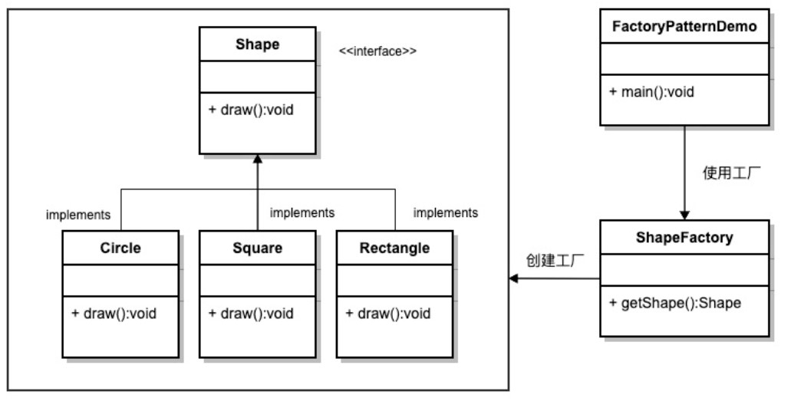
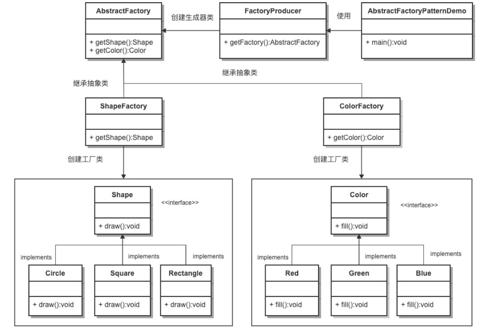
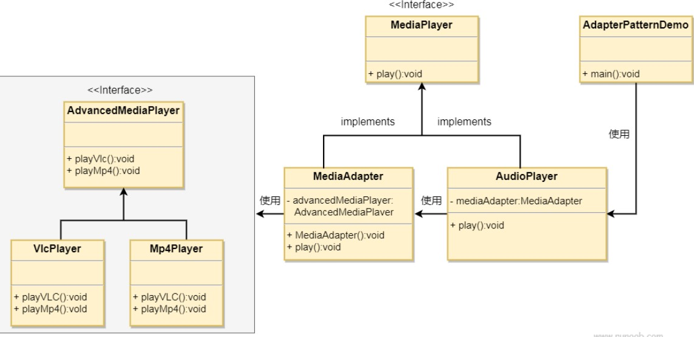
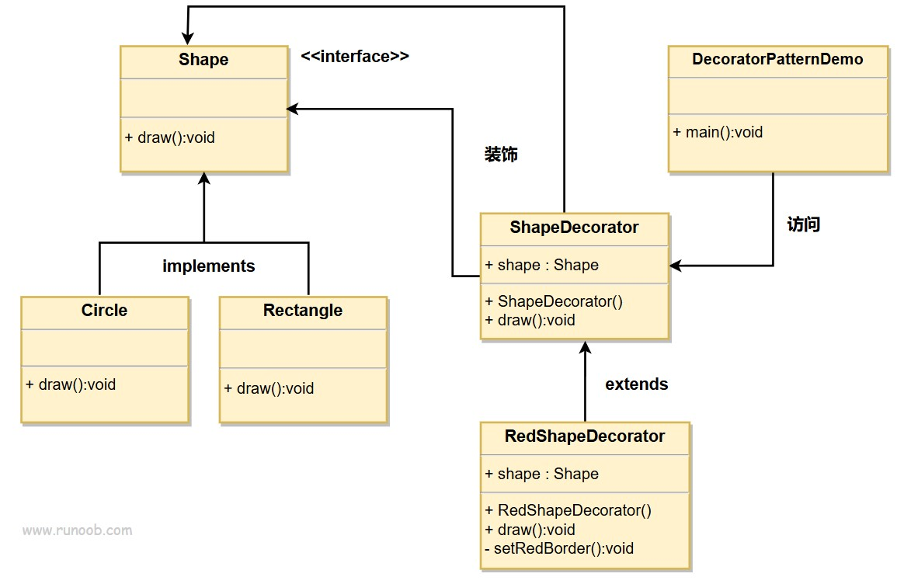

# 设计模式

*参考书籍：Design Patterns - Elements of Reusable Object-Oriented Software（中文译名：设计模式 - 可复用的面向对象软件元素）*

设计模式（Design pattern）代表了最佳的实践，通常被有经验的面向对象的软件开发人员所采用。设计模式是软件开发人员在软件开发过程中面临的一般问题的解决方案。这些解决方案是众多软件开发人员经过相当长的一段时间的试验和错误总结出来的。

设计模式是一套被反复使用的、多数人知晓的、经过分类编目的、代码设计经验的总结。使用设计模式是为了重用代码、让代码更容易被他人理解、保证代码可靠性。 毫无疑问，设计模式于己于他人于系统都是多赢的，设计模式使代码编制真正工程化，设计模式是软件工程的基石，如同大厦的一块块砖石一样。项目中合理地运用设计模式可以完美地解决很多问题，每种模式在现实中都有相应的原理来与之对应，每种模式都描述了一个在我们周围不断重复发生的问题，以及该问题的核心解决方案，这也是设计模式能被广泛应用的原因。

+ 设计模式分类
  1. 创建型模式
     + 工厂模式（Factory Pattern）
  2. 结构型模式
  3. 行为型模式

## 创建型模式

提供了一种在创建对象的同时隐藏创建逻辑的方式，而不是使用 new 运算符直接实例化对象。这使得程序在判断针对某个给定实例需要创建哪些对象时更加灵活。

### 工厂模式（Factory Pattern）

工厂模式提供了一种创建对象的方式，而无需指定要创建的具体类。它在创建对象时提供了一种封装机制，将实际创建对象的代码与使用代码分离。

#### 简介

工厂模式定义一个创建对象的接口，让其子类自己决定实例化哪一个工厂类，工厂模式使其创建过程延迟到子类进行。它主要解决接口选择的问题。让其子类实现工厂接口，返回的也是一个抽象的产品，创建的过程在其子类执行。

+ 优点：1、一个调用者想创建一个对象，只要知道其名称就可以了。 2、扩展性高，如果想增加一个产品，只要扩展一个工厂类就可以。 3、屏蔽产品的具体实现，调用者只关心产品的接口。
+ 缺点：每次增加一个产品时，都需要增加一个具体类和对象实现工厂，使得系统中类的个数成倍增加，在一定程度上增加了系统的复杂度，同时也增加了系统具体类的依赖。这并不是什么好事。

有关工厂模式，需要知道的几个核心概念（角色）：

+ 抽象产品（Abstract Product）：定义了产品的共同接口或抽象类。它可以是具体产品类的父类或接口，规定了产品对象的共同方法。
+ 具体产品（Concrete Product）：实现了抽象产品接口，定义了具体产品的特定行为和属性。
+ 抽象工厂（Abstract Factory）：声明了创建产品的抽象方法，可以是接口或抽象类。它可以有多个方法用于创建不同类型的产品。
+ 具体工厂（Concrete Factory）：实现了抽象工厂接口，负责实际创建具体产品的对象。

#### 模式实现

我们将创建一个 *Shape* 接口和实现 *Shape* 接口的实体类。下一步是定义工厂类 *ShapeFactory*。

*FactoryPatternDemo*类使用 *ShapeFactory* 来获取 *Shape* 对象。它将向 *ShapeFactory* 传递信息（*CIRCLE / RECTANGLE / SQUARE*），以便获取它所需对象的类型。

如图是一个简单的类图示意。



*注：在这个类图中没有定义抽象工厂，ShapeFactory为具体工厂。*

ShapeFactory类：

```java
/**
 * 工厂类
 */
public class ShapeFactory {

    /**
     * 根据传入的参数，返回对应的产品
     * @param shapeType
     * @return
     */
    public Shape getShape(String shapeType){
        if(shapeType == null){
            return null;
        }
        if(shapeType.equalsIgnoreCase("CIRCLE")){
            return new Circle();
        }
        if(shapeType.equalsIgnoreCase("RECTANGLE")){
            return new Rectangle();
        }
        if(shapeType.equalsIgnoreCase("SQUARE")){
            return new Square();
        }
        return null;
    }
}
```


### 抽象工厂模式（Abstract Factory Pattern）

抽象工厂模式（Abstract Factory Pattern）是围绕一个超级工厂创建其他工厂。该超级工厂又称为其他工厂的工厂。

在抽象工厂模式中，接口是负责创建一个相关对象的工厂，不需要显式指定它们的类。每个生成的工厂都能按照工厂模式提供对象。

抽象工厂模式提供了一种创建一系列相关或相互依赖对象的接口，而无需指定具体实现类。通过使用抽象工厂模式，可以将客户端与具体产品的创建过程解耦，使得客户端可以通过工厂接口来创建一族产品。

#### 简介

抽象工厂提供一个创建一系列相关或相互依赖对象的接口，而无需指定它们集体的类。主要解决接口选择的问题。当系统中的产品有多于一个的产品族，而系统只消费其中某一族的产品时，可以考虑使用抽象工厂模式。

在一个产品族里面，定义多个产品；在一个工厂里聚合多个同类产品。

+ 优点：当一个产品族中的多个对象被设计成一起工作时，它能保证客户端始终只使用同一个产品族中的对象。
+ 缺点：产品族扩展非常困难，要增加一个系列的某一产品，既要在抽象的 Creator 里加代码，又要在具体的里面加代码。

有关抽象工厂模式需要知道的几个核心概念：

+ 抽象工厂：声明了一组用于创建产品对象的方法，每个方法对应一种产品类型。抽象工厂可以是接口或抽象类。
+ 具体工厂：实现了抽象工厂接口，负责创建具体产品对象的实例。
+ 抽象产品：定义了一组产品对象的共同接口或抽象类，描述了产品对象的公共方法。
+ 具体产品：实现了抽象产品接口，定义了具体产品的特定行为和属性。

抽象工厂模式通常涉及一族相关的产品，每个具体工厂类负责创建该族中的具体产品。客户端通过使用抽象工厂接口来创建产品对象，而不需要直接使用具体产品的实现类。

#### 模式实现

我们将创建 *Shape* 和 *Color* 接口和实现这些接口的实体类。下一步是创建抽象工厂类 *AbstractFactory*。接着定义工厂类 *ShapeFactory* 和 *ColorFactory*，这两个工厂类都是扩展了 *AbstractFactory*。然后创建一个工厂创造器/生成器类 *FactoryProducer*。

*AbstractFactoryPatternDemo* 类使用 *FactoryProducer* 来获取 *AbstractFactory* 对象。它将向 *AbstractFactory* 传递形状信息 *Shape*（*CIRCLE / RECTANGLE / SQUARE*），以便获取它所需对象的类型。同时它还向 *AbstractFactory* 传递颜色信息 *Color*（*RED / GREEN / BLUE*），以便获取它所需对象的类型。

抽象工厂模式实现的类图示意。



### 单例模式（Singleton Pattern）

单例模式（Singleton Pattern）是 Java 中最简单的设计模式之一。这种类型的设计模式属于创建型模式，它提供了一种创建对象的最佳方式。

这种模式涉及到一个单一的类，该类负责创建自己的对象，同时确保只有单个对象被创建。这个类提供了一种访问其唯一的对象的方式，可以直接访问，不需要实例化该类的对象。

单例模式是一种创建型设计模式，它确保一个类只有一个实例，并提供了一个全局访问点来访问该实例。

注意：

1. 单例类只能有一个实例
2. 单例类必须自己创建自己的唯一实例
3. 单例类必须给所有其他对象提供这一实例

#### 简介

单例模式保证一个类仅有一个实例，并提供一个访问它的全局访问点。主要解决一个全局使用的类频繁地创建与销毁。当想要控制实例数目，节省系统资源的时候，可以考虑使用单例模式。

单例模式的实现主要是判断系统是否已经有这个单例，如果有返回这个实例，如果没有则创建这个实例。实现的关键在于单例类的构造函数是私有的（private），通过单例类提供给外界的方法（如`getInstance`())去调用构造函数。（*注意：getInstance() 方法中需要使用同步锁 synchronized (Singleton.class) 防止多线程同时进入造成 instance 被多次实例化。*）

#### 模式实现

基本思路：创建一个 *SingleObject* 类。*SingleObject* 类有它的私有构造函数和本身的一个静态实例。*SingleObject* 类提供了一个静态方法，供外界获取它的静态实例。*SingletonPatternDemo* 类使用 *SingleObject* 类来获取 *SingleObject* 对象。

##### 懒汉式，线程不安全的实现

单例类代码：

```java
public class Singleton {
    private static Singleton instance;
    private Singleton(){};

    public static Singleton getInstance(){
        if(instance == null){
            instance = new Singleton();
        }
        return instance;
    }
}

```

这种方式是懒加载的方式，但存在在多线程情况下，线程不安全的问题。

##### 懒汉式，线程安全的实现

即在”懒汉式，线程不安全“的实现中为`getInstance()`方法加上`synchronized`同步关键字，保证线程安全。

单例类代码：

```java
public class Singleton {
    private static Singleton instance;
    private Singleton(){};

    public static synchronized Singleton getInstance(){
        if(instance == null){
            instance = new Singleton();
        }
        return instance;
    }
}
```

这种方式具备很好的 lazy loading，能够在多线程中很好的工作，但是，效率很低，99% 情况下不需要同步。

优点：第一次调用才初始化，避免内存浪费。

缺点：必须加锁 synchronized 才能保证单例，但加锁会影响效率。

##### 饿汉式实现

单例类代码：

```java
public class Singleton {
    private static Singleton instance = new Singleton();

    private Singleton(){}

    public static Singleton getInstance(){
        return instance;
    }
}
```

这种方式比较常用，但容易产生垃圾对象。

优点：没有加锁，执行效率会提高。

缺点：类加载时就初始化，浪费内存。

它基于 classloader 机制避免了多线程的同步问题，不过，instance 在类装载时就实例化，虽然导致类装载的原因有很多种，在单例模式中大多数都是调用 getInstance 方法， 但是也不能确定有其他的方式（或者其他的静态方法）导致类装载，这时候初始化 instance 显然没有达到 lazy loading 的效果。

##### 双检锁/双重校验锁（DCL，即double-checked locking）

单例类代码：

```java
public class Singleton {
    private volatile static Singleton instance;
    private Singleton(){};
    
    public static Singleton getInstance(){
        if(instance == null){
            synchronized(Singleton.class){
                if(instance == null){
                    instance = new Singleton();
                }
            }
        }
        return instance;
    }
}
```

这种实现方式其实也是懒加载的一种实现方式，它采用了双锁机制，安全且在多线程的情况下能保持高性能。

##### 登记式/静态内部类

这种方式能达到双检锁方式一样的功效，但实现更简单。对静态域使用延迟初始化，应使用这种方式而不是双检锁方式。这种方式只适用于静态域的情况，双检锁方式可在实例域需要延迟初始化时使用。
这种方式同样利用了 classloader 机制来保证初始化 instance 时只有一个线程，它跟第 3 种方式（饿汉式）不同的是：第 3 种方式（饿汉式）只要 Singleton 类被装载了，那么 instance 就会被实例化（没有达到 lazy loading 效果），而这种方式是 Singleton 类被装载了，instance 不一定被初始化。因为 SingletonHolder 类没有被主动使用，只有通过显式调用 getInstance 方法时，才会显式装载 SingletonHolder 类，从而实例化 instance。想象一下，如果实例化 instance 很消耗资源，所以想让它延迟加载，另外一方面，又不希望在 Singleton 类加载时就实例化，因为不能确保 Singleton 类还可能在其他的地方被主动使用从而被加载，那么这个时候实例化 instance 显然是不合适的。这个时候，这种方式相比第 3 种方式就显得很合理。

单例类代码：

```java
public class Singleton {
    private static class SingletonHolder{
        private static final Singleton INSTANCE = new Singleton();
    }
    
    private Singleton(){}
    
    public static final Singleton getInstance(){
        return SingletonHolder.INSTANCE;
    }
}
```


##### 枚举

这种实现方式还没有被广泛采用，但这是实现单例模式的最佳方法。它更简洁，自动支持序列化机制，绝对防止多次实例化。
这种方式是 Effective Java 作者 Josh Bloch 提倡的方式，它不仅能避免多线程同步问题，而且还自动支持序列化机制，防止反序列化重新创建新的对象，绝对防止多次实例化。不过，由于 JDK1.5 之后才加入 enum 特性，用这种方式写不免让人感觉生疏，在实际工作中，也很少用。
不能通过 reflection attack 来调用私有构造方法。

单例类代码：

```java
public enum Singleton {
    INSTANCE;
    public void whateverMethod(){}
}
```


## 机构型模式

### 适配器模式（Adapter Pattern）

适配器模式（Adapter Pattern）是作为两个不兼容的接口之间的桥梁。这种类型的设计模式属于结构型模式，它结合了两个独立接口的功能。

这种模式涉及到一个单一的类，该类负责加入独立的或不兼容的接口功能。举个真实的例子，读卡器是作为内存卡和笔记本之间的适配器。您将内存卡插入读卡器，再将读卡器插入笔记本，这样就可以通过笔记本来读取内存卡。

#### 简介

适配器模式期望将一个类的接口转换成使用者希望的另一个接口。适配器模式使得原本由于接口不兼容而不能一起工作的那些类可以一起工作。主要解决在软件系统中，常常要将一些“现存的对象”放到新的环境中，而新环境要求的接口是现对象不能满足的。

适配器通过继承或依赖已有的对象，实现想要的目标接口。

优点：

1. 可以让任何两个没有关联的类一起运行。
2. 提高了类的复用。
3. 增加了类的透明度。
4. 灵活性好。

缺点：

1. 过多的使用适配器，会让系统非常零乱，不易整体进行把握。比如，明明看到调用的是 A 接口，其实内部被适配成了 B 接口的实现，一个系统如果太多出现这种情况，无异于一场灾难。因此如果不是很有必要，可以不使用适配器，而是直接对系统进行重构。
2. 由于JAVA至多继承一个类，所以至多只能适配一个适配者类，而且目标类必须是抽象类。

#### 模式实现

我们有一个 *MediaPlayer* 接口和一个实现了 *MediaPlayer* 接口的实体类 *AudioPlayer*。默认情况下，*AudioPlayer* 可以播放 mp3 格式的音频文件。

我们还有另一个接口 *AdvancedMediaPlayer* 和实现了 *AdvancedMediaPlayer* 接口的实体类。该类可以播放 vlc 和 mp4 格式的文件。

我们想要让 *AudioPlayer* 播放其他格式的音频文件。为了实现这个功能，我们需要创建一个实现了 *MediaPlayer* 接口的适配器类 *MediaAdapter*，并使用 *AdvancedMediaPlayer* 对象来播放所需的格式。

*AudioPlayer* 使用适配器类 *MediaAdapter* 传递所需的音频类型，不需要知道能播放所需格式音频的实际类。*AdapterPatternDemo* 类使用 *AudioPlayer* 类来播放各种格式。

类图如下：



### 装饰器模式（Decorator Pattern）

装饰器模式（Decorator Pattern）允许向一个现有的对象添加新的功能，同时又不改变其结构。这种类型的设计模式属于结构型模式，它是作为现有的类的一个包装。

装饰器模式通过将对象包装在装饰器类中，以便动态地修改其行为。

这种模式创建了一个装饰类，用来包装原有的类，并在保持类方法签名完整性的前提下，提供了额外的功能。

#### 简介

装饰器模式动态地给一个对象添加一些额外的职责。就增加功能来说，装饰器模式相比于生成子类更为灵活。一般的，我们为了扩展一个类经常使用继承的方式实现，由于继承为类引入静态特征，并且随着扩展功能的增多，子类会很膨胀，所以此时可以采用装饰器模式去实现，即当我们不想增加很多子类又想扩展类的情况。

优点：装饰类和被装饰类可以独立发展，不会互相耦合，装饰器模式是继承的一个替代模式，装饰器模式可以动态扩展一个实现类的功能。

缺点：所层装饰比较复杂。

在装饰器模式下，有一下核心角色：

+ 抽象组件（Component）：定义了原始对象和装饰器对象的公共接口或抽象类，可以是具体组件类的父类或接口。
+ 具体组件（Concrete Component）：是被装饰的原始对象，它定义了需要添加新功能的对象。
+ 抽象装饰器（Decorator）：继承自抽象组件，它包含了一个抽象组件对象，并定义了与抽象组件相同的接口，同时可以通过组合方式持有其他装饰器对象。
+ 具体装饰器（Concrete Decorator）：实现了抽象装饰器的接口，负责向抽象组件添加新的功能。具体装饰器通常会在调用原始对象的方法之前或之后执行自己的操作。

装饰器模式通过嵌套包装多个装饰器对象，可以实现多层次的功能增强。每个具体装饰器类都可以选择性地增加新的功能，同时保持对象接口的一致性。

#### 模式实现

我们将创建一个 *Shape* 接口和实现了 *Shape* 接口的实体类。然后我们创建一个实现了 *Shape* 接口的抽象装饰类 *ShapeDecorator*，并把 *Shape* 对象作为它的实例变量。

*RedShapeDecorator* 是实现了 *ShapeDecorator* 的实体类。

*DecoratorPatternDemo* 类使用 *RedShapeDecorator* 来装饰 *Shape* 对象。

类图如下：



## 行为型模式

### 观察者模式（Observer Pattern）

观察者模式是一种行为型设计模式，它定义了一种一对多的依赖关系，当一个对象的状态发生改变时，其所有依赖者都会收到通知并自动更新。

当对象间存在一对多关系时，则使用观察者模式（Observer Pattern）。比如，当一个对象被修改时，则会自动通知依赖它的对象。观察者模式属于行为型模式。

#### 简介


#### 模式实现

